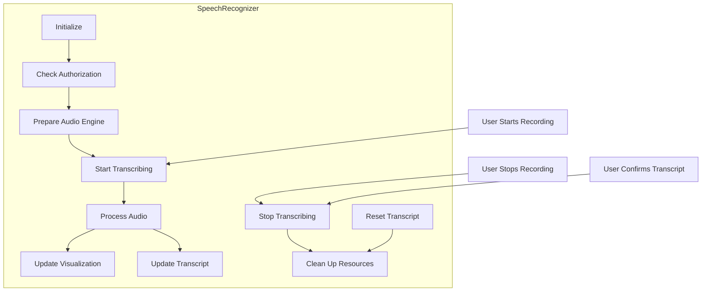
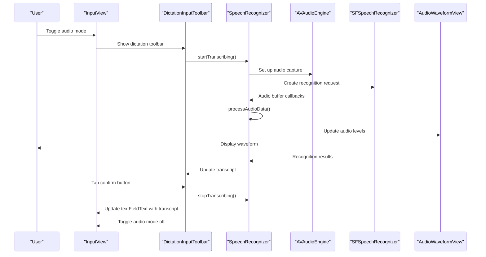
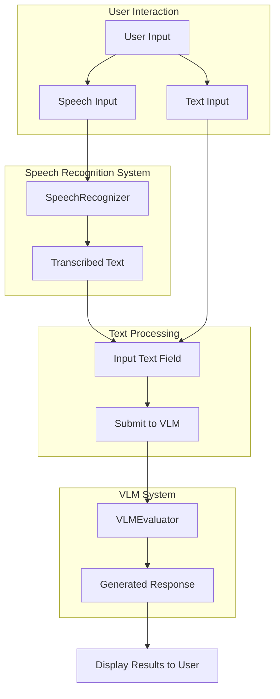

<!-- source: DeepWiki mcp.deepwiki.com · repo huggingface/HuggingSnap · page 2.4 Speech Recognition System · fetched 2026-10-26 -->

# Speech Recognition System

<details>
<summary>Relevant source files</summary>

The following files were used as context for generating this wiki page:

- [HuggingSnap/SpeechTranscriptionModel.swift](HuggingSnap/SpeechTranscriptionModel.swift)
- [HuggingSnap/Views/InputView.swift](HuggingSnap/Views/InputView.swift)

</details>


## Purpose and Scope

This document details the speech recognition capabilities within HuggingSnap that enable voice input and transcription. The system provides a seamless way for users to interact with the application using voice commands rather than typing. This functionality complements the camera and media input systems (see [Camera and Media Management](#2.3)) by providing an alternative input method for the machine learning system (see [Machine Learning System](#2.1)).

Sources: [HuggingSnap/SpeechTranscriptionModel.swift:22-39](), [HuggingSnap/Views/InputView.swift:10-17]()

## System Architecture

The Speech Recognition System is built on Apple's native speech recognition frameworks and consists of three primary components:

1. **SpeechRecognizer**: Core actor class handling speech-to-text conversion
2. **DictationInputToolbar**: UI component for speech input
3. **AudioWaveformView**: Visualization component for audio input levels

### Component Architecture

```mermaid
classDiagram
    class "SpeechRecognizer" {
        -SFSpeechRecognizer recognizer
        -AVAudioEngine audioEngine
        -String transcript
        -[Float] audioLevels
        +startTranscribing()
        +stopTranscribing()
        +resetTranscript()
        -transcribe()
        -processAudioData()
    }
    
    class "DictationInputToolbar" {
        -SpeechRecognizer audioRecorder
        -Boolean toggleDictationMode
        -String inputText
        -stopDictation()
        -confirmTranscription()
    }
    
    class "AudioWaveformView" {
        -Boolean isDictationMode
        -[Float] samples
        -audioCapsuleHeight()
        -audioCapsuleColor()
    }
    
    class "InputView" {
        -VLMEvaluator llm
        -SpeechRecognizer audioRecorder
        -Boolean isTextMode
        -Boolean isAudioMode
        -String textFieldText
        -onSubmitAction()
    }
    
    class "SFSpeechRecognizer" {
        +hasAuthorizationToRecognize()
    }
    
    class "AVAudioEngine" {
        -inputNode
    }
    
    class "AVAudioSession" {
        +hasPermissionToRecord()
    }
    
    "InputView" --> "SpeechRecognizer" : creates
    "InputView" --> "DictationInputToolbar" : contains
    "DictationInputToolbar" --> "AudioWaveformView" : contains
    "DictationInputToolbar" --> "SpeechRecognizer" : uses
    "SpeechRecognizer" --> "SFSpeechRecognizer" : uses
    "SpeechRecognizer" --> "AVAudioEngine" : uses
    "SpeechRecognizer" --> "AVAudioSession" : checks permissions
```

Sources: [HuggingSnap/SpeechTranscriptionModel.swift:23-214](), [HuggingSnap/Views/InputView.swift:10-127](), [HuggingSnap/Views/InputView.swift:129-193]()

## Core Components

### SpeechRecognizer

The `SpeechRecognizer` actor is the foundation of the speech recognition system. As an actor, it provides thread-safe access to shared mutable state like the transcript and audio levels.

Key responsibilities:
- Managing the speech recognition lifecycle
- Processing audio input
- Extracting and visualizing audio levels
- Handling permissions and errors
- Providing the transcribed text



The `SpeechRecognizer` handles several potential error cases:
- Unavailable recognizer
- Missing authorization to recognize speech
- No permission to record audio

Sources: [HuggingSnap/SpeechTranscriptionModel.swift:23-39](), [HuggingSnap/SpeechTranscriptionModel.swift:55-78](), [HuggingSnap/SpeechTranscriptionModel.swift:119-143]()

### Audio Processing and Visualization

The speech recognition system not only converts speech to text but also provides visual feedback through an audio waveform visualization:

1. Audio samples are captured from the microphone
2. The audio levels are processed using Accelerate framework
3. The levels are normalized and scaled for visualization
4. The `AudioWaveformView` displays these levels as animated capsules



Sources: [HuggingSnap/SpeechTranscriptionModel.swift:45-46](), [HuggingSnap/SpeechTranscriptionModel.swift:154-181](), [HuggingSnap/SpeechTranscriptionModel.swift:247-281](), [HuggingSnap/Views/InputView.swift:195-245]()

## User Interface Components

### InputView

The `InputView` serves as the container for both text input and speech input. It switches between these modes based on user interaction:

- Text input mode: Shows a TextField with a microphone button
- Audio mode: Shows the DictationInputToolbar with waveform visualization

Upon completion of speech recognition, the transcribed text is added to the text field and can be used as input for the VLM system.

### DictationInputToolbar

This toolbar appears when the user activates speech recognition mode. It provides:
- A cancel button to stop recording and discard the transcript
- A visual audio waveform showing microphone input levels
- A timer showing the duration of the current recording
- A confirm button to accept the transcription and return to text mode

Sources: [HuggingSnap/Views/InputView.swift:10-127](), [HuggingSnap/Views/InputView.swift:129-193]()

## Permission Handling

The speech recognition system requires two specific permissions:
1. Speech recognition authorization (`SFSpeechRecognizer` authorization)
2. Microphone access permission (`AVAudioSession` recording permission)

The system handles these permissions through extension methods:
- `SFSpeechRecognizer.hasAuthorizationToRecognize()`
- `AVAudioSession.hasPermissionToRecord()`

These are checked asynchronously when the `SpeechRecognizer` is initialized and appropriate error messages are displayed if permissions are not granted.

Sources: [HuggingSnap/SpeechTranscriptionModel.swift:217-244](), [HuggingSnap/SpeechTranscriptionModel.swift:66-77]()

## Integration Flow



The speech recognition system is tightly integrated with the text input system. When a user confirms a transcription, it gets added to the text field. This text can then be submitted to the VLM system for processing along with any image or video that has been captured.

Sources: [HuggingSnap/Views/InputView.swift:172-177](), [HuggingSnap/Views/InputView.swift:46-52]()

## Technical Implementation Details

### Audio Engine Configuration

The speech recognition system configures an `AVAudioEngine` instance to capture audio from the device's microphone. It installs a tap on the input node to receive audio buffers, which are then:

1. Sent to the `SFSpeechAudioBufferRecognitionRequest` for transcription
2. Analyzed to extract audio levels for visualization

The audio session is configured specifically for speech recognition:
- Category: `.playAndRecord`
- Mode: `.measurement`
- Options: `.duckOthers` (lowers volume of other audio during recording)

Sources: [HuggingSnap/SpeechTranscriptionModel.swift:154-181]()

### Audio Level Processing

The system processes audio levels using the Accelerate framework for efficient signal processing:

1. Extracts raw audio samples from the audio buffer
2. Calculates the Root Mean Square (RMS) of the audio samples using `vDSP_measqv`
3. Converts RMS to decibels
4. Normalizes and scales the values for visualization
5. Applies non-linear scaling for better visual effect

Sources: [HuggingSnap/SpeechTranscriptionModel.swift:247-281]()

## State Management

The `SpeechRecognizer` actor uses Swift's concurrency features to manage state safely across threads:

- `@MainActor` properties for UI updates
- Actor isolation for thread safety
- Dedicated dispatch queue for audio processing
- Task-based asynchronous operations

This ensures that UI updates occur on the main thread while computationally intensive audio processing happens in the background.

Sources: [HuggingSnap/SpeechTranscriptionModel.swift:40-46](), [HuggingSnap/SpeechTranscriptionModel.swift:183-213]()

## Timing and User Feedback

The system provides timing feedback during recording:

1. When recording starts, a timer is initialized
2. The timer updates once per second to show the elapsed recording time
3. A formatted time string (MM:SS) is displayed in the DictationInputToolbar

Additionally, visual feedback is provided through:
- The audio waveform visualization that responds to speech volume
- Smooth animations for waveform changes
- Automatic scrolling to show the most recent audio levels

Sources: [HuggingSnap/Views/InputView.swift:137-142](), [HuggingSnap/Views/InputView.swift:162-170](), [HuggingSnap/Views/InputView.swift:195-245]()

## Error Handling

The speech recognition system defines a custom `RecognizerError` enum with descriptive error messages for common failure scenarios:

| Error Type | Description | User-Facing Message |
|------------|-------------|---------------------|
| nilRecognizer | Speech recognizer couldn't be initialized | "Can't initialize speech recognizer" |
| notAuthorizedToRecognize | User hasn't granted speech recognition permission | "Not authorized to recognize speech" |
| notPermittedToRecord | User hasn't granted microphone permission | "Not permitted to record audio" |
| recognizerIsUnavailable | Speech recognition service is unavailable | "Recognizer is unavailable" |

When errors occur, they are translated into user-friendly messages displayed in the transcript field.

Sources: [HuggingSnap/SpeechTranscriptionModel.swift:24-38](), [HuggingSnap/SpeechTranscriptionModel.swift:203-213]()

## Conclusion

The Speech Recognition System in HuggingSnap provides an intuitive voice input method that complements the camera-based input capabilities. It leverages Apple's speech recognition frameworks while adding custom audio visualization and a streamlined user interface. The system is carefully integrated with the text input system, allowing users to seamlessly switch between typing and speaking when interacting with the application.

---

