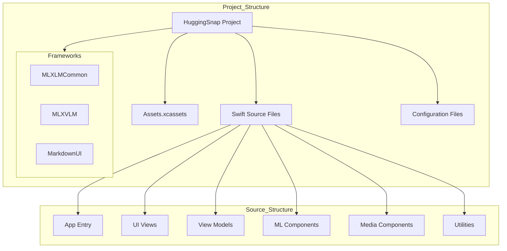
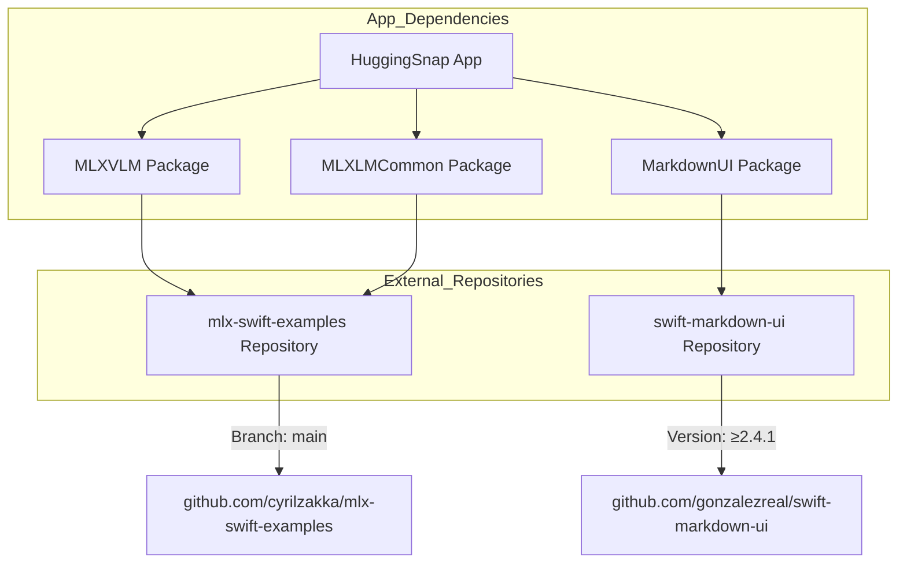
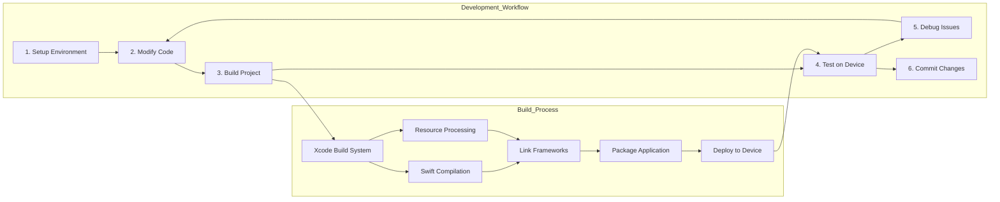
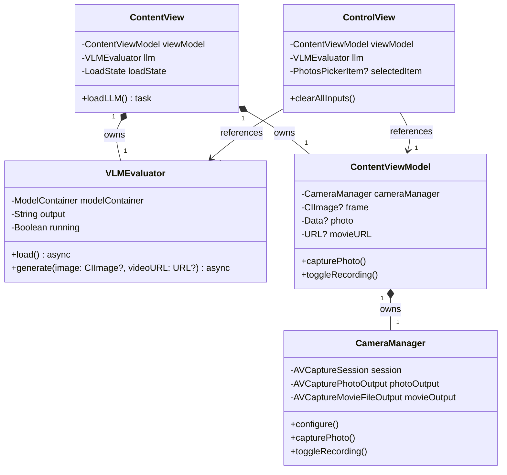

<!-- source: DeepWiki mcp.deepwiki.com · repo huggingface/HuggingSnap · page 3 Developer Guide · fetched 2026-10-26 -->

# Developer Guide

<details>
<summary>Relevant source files</summary>

The following files were used as context for generating this wiki page:

- [.gitignore](.gitignore)
- [HuggingSnap.xcodeproj/project.pbxproj](HuggingSnap.xcodeproj/project.pbxproj)
- [HuggingSnap/Info.plist](HuggingSnap/Info.plist)
- [README.md](README.md)

</details>


This guide provides comprehensive information for developers who want to contribute to or modify the HuggingSnap iOS application. It covers the development environment setup, project structure, build processes, and core implementation details. For general application overview, refer to [HuggingSnap Overview](#1), and for detailed architecture information, see [System Architecture](#2).

## Development Environment Setup

### Prerequisites

To develop for HuggingSnap, you'll need:

| Requirement | Details |
|-------------|---------|
| macOS | macOS Sonoma 14.0 or later |
| Xcode | Xcode 16.0 or later |
| iOS Device | iPhone running iOS 18.0 or later (for testing) |
| Git | For source code management |

### Getting Started

1. Clone the repository:
   ```bash
   git clone https://github.com/huggingface/HuggingSnap.git
   cd HuggingSnap
   ```

2. Open the project in Xcode:
   ```bash
   open HuggingSnap.xcodeproj
   ```

3. Before running on your device, update the bundle identifier and developer team in the project settings.

Sources: [README.md:15-23](), [HuggingSnap.xcodeproj/project.pbxproj:215-216]()

## Project Structure Overview

HuggingSnap follows a modular architecture separating concerns between UI, machine learning, and media capture functionality.



Sources: [HuggingSnap.xcodeproj/project.pbxproj:28-37](), [HuggingSnap.xcodeproj/project.pbxproj:53-69]()

### Key Components

The codebase is organized into several logical layers:

1. **UI Layer**: SwiftUI views for user interaction
2. **ML Layer**: Vision Language Model integration 
3. **Media Layer**: Camera and media handling
4. **Utility Layer**: Helper functions and extensions

## Build Configuration

### Project Settings

HuggingSnap is configured as an iOS application with specific build settings:

| Setting | Value |
|---------|-------|
| iOS Deployment Target | 18.0 |
| Device Support | iPhone only |
| Swift Version | 5.0 |
| Bundle Identifier | co.huggingface.HuggingSnap (needs to be changed for personal use) |

Sources: [HuggingSnap.xcodeproj/project.pbxproj:209-216](), [HuggingSnap.xcodeproj/project.pbxproj:297-311]()

### Required Permissions

The application requires several iOS permissions, which are defined in the Info.plist and project settings:

| Permission | Usage Description |
|------------|-------------------|
| Camera | For live video descriptions |
| Microphone | For live video descriptions |
| Photo Library | For accessing and saving media |
| Speech Recognition | For transcribing audio |

Sources: [HuggingSnap.xcodeproj/project.pbxproj:289-293]()

## Dependencies and Integration



### Package Dependencies

HuggingSnap relies on the following Swift packages:

1. **MLX Swift Examples**: A modified version providing VLM support
   - Products used: MLXLMCommon, MLXVLM
   - Repository URL: https://github.com/cyrilzakka/mlx-swift-examples
   - Branch: main

2. **Swift Markdown UI**: For rendering markdown content
   - Product used: MarkdownUI
   - Repository URL: https://github.com/gonzalezreal/swift-markdown-ui
   - Version: 2.4.1 or higher

Sources: [HuggingSnap.xcodeproj/project.pbxproj:377-393](), [HuggingSnap.xcodeproj/project.pbxproj:396-411](), [README.md:12]()

## Development Workflow



### Common Development Tasks

1. **Modifying UI Components**:
   - UI components are implemented as SwiftUI views
   - Main entry point is ContentView 
   - Camera controls are in ControlView
   - Settings are in SettingsView

2. **Working with ML Components**:
   - The VLMEvaluator class handles model loading and inference
   - ModelContainer manages the SmolVLM2 model
   - Configuration is loaded from Hugging Face Hub

3. **Media Handling**:
   - CameraManager provides camera functionality
   - Photo library access for selecting existing media
   - SpeechRecognizer for audio transcription

## Running on Your Device

To run HuggingSnap on your personal device:

1. In Xcode, select the HuggingSnap project in the Project Navigator
2. Go to the "Signing & Capabilities" tab
3. Change the Bundle Identifier to a unique identifier (e.g., com.yourdomain.HuggingSnap)
4. Select your personal developer team
5. Connect your iOS 18+ device and select it as the run destination
6. Build and run the application

Sources: [README.md:18-23](), [HuggingSnap.xcodeproj/project.pbxproj:303-305]()

## Code Component Relationships

The following diagram illustrates the key code components and their relationships:



Sources: [README.md:12]()

## Testing and Debugging

### Performance Considerations

When working with on-device ML models, consider:

1. **Memory Usage**: Monitor memory consumption when loading models
2. **Battery Impact**: Test the application's impact on battery life
3. **Thermal Performance**: Extended ML processing can cause device heating
4. **Model Load Times**: Optimize the initial model loading experience

### Debugging Tips

1. Use Xcode's Instruments to profile performance
2. Monitor memory usage during model loading and inference
3. Test on multiple iPhone models to ensure compatibility
4. Check permission handling when accessing camera and photos

## Contribution Guidelines

When contributing to HuggingSnap:

1. Follow the Swift style guide and coding conventions
2. Ensure permissions are properly requested and handled
3. Test thoroughly on physical devices
4. Document any new functionality or changes
5. Consider the performance impact of changes, especially those affecting ML processes

## Additional Resources

For more detailed information, refer to these related wiki pages:

- [Project Configuration](#3.1) for detailed explanation of the Xcode project structure
- [External Dependencies](#3.2) for more information about third-party libraries
- [Machine Learning System](#2.1) for details about the VLM system
- [Troubleshooting & FAQs](#6) for common issues and solutions

Sources: [HuggingSnap.xcodeproj/project.pbxproj:377-393](), [README.md:6-12]()

---

