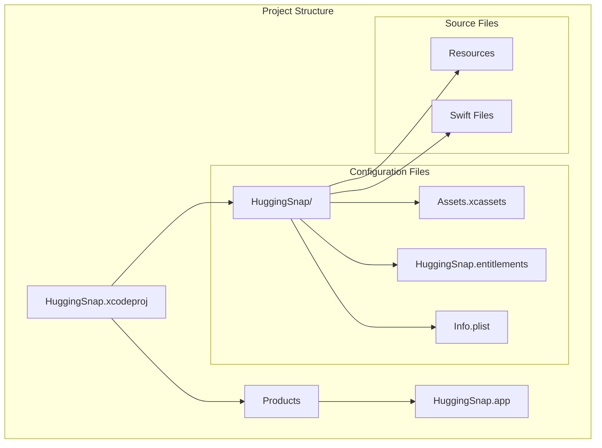
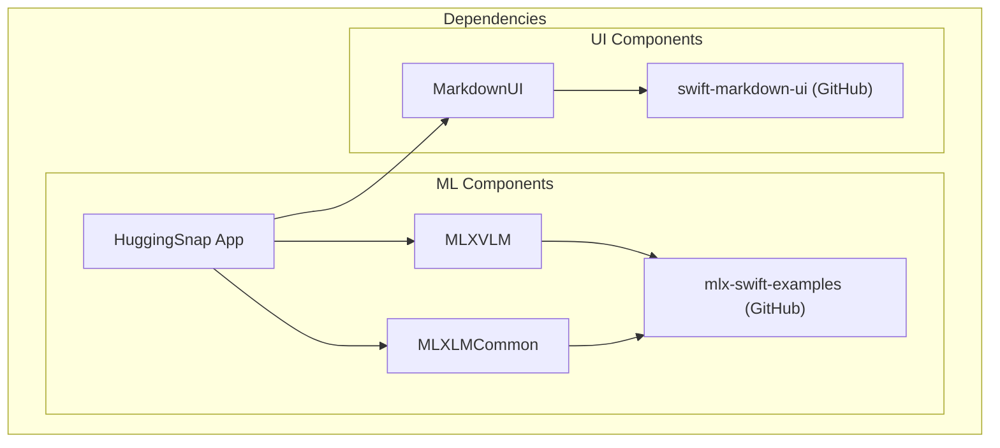
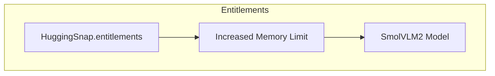
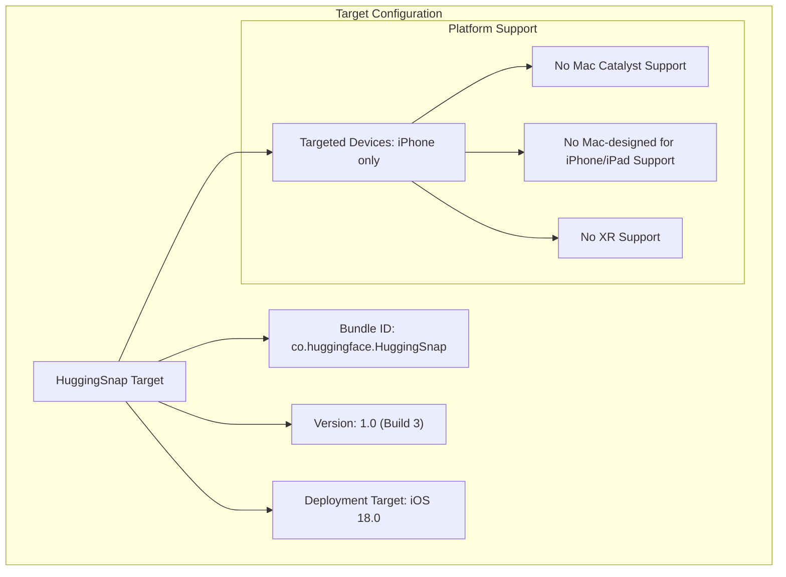
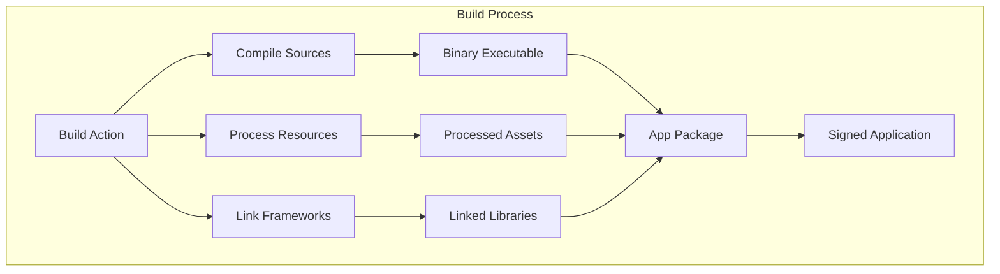
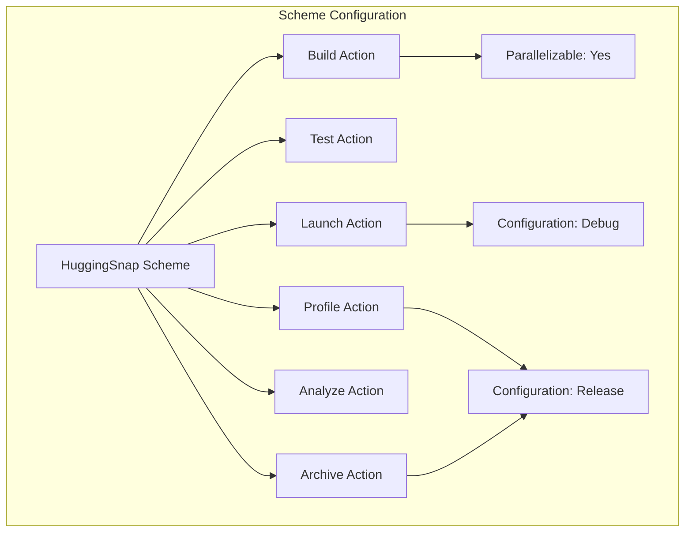
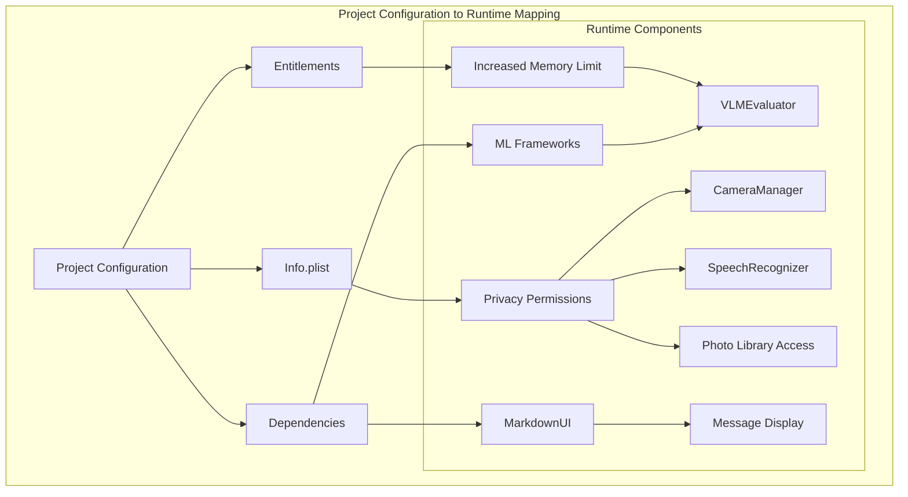

<!-- source: DeepWiki mcp.deepwiki.com · repo huggingface/HuggingSnap · page 3.1 Project Configuration · fetched 2026-10-26 -->

# Project Configuration

Relevant source files

The following files were used as context for generating this wiki page:

- [HuggingSnap.xcodeproj/project.pbxproj](HuggingSnap.xcodeproj/project.pbxproj)
- [HuggingSnap.xcodeproj/xcshareddata/xcschemes/HuggingSnap.xcscheme](HuggingSnap.xcodeproj/xcshareddata/xcschemes/HuggingSnap.xcscheme)
- [HuggingSnap/HuggingSnap.entitlements](HuggingSnap/HuggingSnap.entitlements)
- [HuggingSnap/Info.plist](HuggingSnap/Info.plist)

## Introduction

This page provides a detailed overview of the HuggingSnap Xcode project configuration, including build settings, entitlements, dependencies, and other technical aspects that affect development and deployment. It focuses on the underlying project structure rather than the application code itself. For information about external dependencies used in the project, see [External Dependencies](#3.2).

## Project Structure

HuggingSnap is organized as a standard iOS application project using Xcode's build system. The project configuration is defined primarily through the Xcode project file (`.pbxproj`), along with supporting configuration files such as entitlements and property lists.

Sources:
[HuggingSnap.xcodeproj/project.pbxproj:15-69]()

## Dependencies Management

HuggingSnap uses Swift Package Manager (SPM) for managing external dependencies. The project references two main packages that provide essential functionality for the application.

### Key Dependencies

| Package | Source | Version | Purpose |
|---------|--------|---------|---------|
| MLXVLM | github.com/cyrilzakka/mlx-swift-examples | main branch | Vision-language model implementation |
| MLXLMCommon | github.com/cyrilzakka/mlx-swift-examples | main branch | Common utilities for language models |
| MarkdownUI | github.com/gonzalezreal/swift-markdown-ui | 2.4.1+ | Markdown rendering in SwiftUI |

Sources:
[HuggingSnap.xcodeproj/project.pbxproj:377-393]()
[HuggingSnap.xcodeproj/project.pbxproj:396-412]()

## Build Configurations

The project includes standard Debug and Release configurations with settings appropriate for development and distribution.

### Debug Configuration

The Debug configuration is optimized for development with the following characteristics:
- Full debug information
- No code optimization (`GCC_OPTIMIZATION_LEVEL = 0`)
- Includes debugging symbols (`DEBUG_INFORMATION_FORMAT = dwarf`)
- Enables testability
- Includes DEBUG preprocessor definition

### Release Configuration

The Release configuration is optimized for distribution:
- Whole module optimization for Swift code
- No debug assertions
- Optimized debug information format (`dwarf-with-dsym`)
- Full code optimization
- Product validation for App Store submission

Sources:
[HuggingSnap.xcodeproj/project.pbxproj:156-275]()

## App Entitlements

HuggingSnap requires specific system entitlements to function properly:

The key entitlement is `com.apple.developer.kernel.increased-memory-limit`, which allows the application to request more memory from the system. This is critical for running the on-device machine learning model (SmolVLM2) that requires substantial memory resources.

Sources:
[HuggingSnap/HuggingSnap.entitlements:1-9]()

## Privacy and Permissions

HuggingSnap requires several permissions to access device capabilities:

| Permission | Usage Description | Purpose |
|------------|-------------------|---------|
| Camera | "Access to the camera is needed for live video descriptions" | For capturing photos and videos |
| Microphone | "Access to the microphone is needed for live video descriptions" | For video recording with audio |
| Photo Library (Read) | "Access to your photo library is needed to access videos and photos taken." | For accessing existing media |
| Photo Library (Write) | "Access to your photo library is needed to save videos and photos taken." | For saving captured media |
| Speech Recognition | "Speech recognition is needed to transcribe your audio." | For voice input transcription |

These permissions are defined in the project settings and included in the Info.plist file. The app also declares that it doesn't use non-exempt encryption through the `ITSAppUsesNonExemptEncryption` key.

Sources:
[HuggingSnap.xcodeproj/project.pbxproj:289-293]()
[HuggingSnap/Info.plist:1-9]()

## Target Configuration

The HuggingSnap target is configured with these key settings:

Key target settings include:
- Product Name: HuggingSnap
- Bundle Identifier: co.huggingface.HuggingSnap
- Version: 1.0
- Build: 3
- Deployment Target: iOS 18.0
- Device Family: iPhone only (no iPad)
- Interface Orientation: Portrait only

The target explicitly disables support for Mac Catalyst, Mac-designed-for-iPhone/iPad, and XR designed for iPhone/iPad platforms.

Sources:
[HuggingSnap.xcodeproj/project.pbxproj:276-353]()

## Build Process

The build process for HuggingSnap follows the standard iOS application build workflow:

The build process involves these standard phases:
1. Compiling Swift source files
2. Processing resources (images, storyboards, etc.)
3. Linking frameworks and libraries
4. Packaging everything into the application bundle
5. Code signing (using automatic signing with development team 2EADP68M95)

Sources:
[HuggingSnap.xcodeproj/project.pbxproj:72-97]()
[HuggingSnap.xcodeproj/project.pbxproj:282-283]()

## Scheme Configuration

The project includes a shared scheme that defines how to build, run, test, and profile the application:

The scheme uses standard settings:
- Build: Builds the HuggingSnap target with parallel build enabled
- Test: Uses the Debug configuration (no tests currently defined)
- Launch: Runs the app in Debug configuration
- Profile: Profiles the app in Release configuration
- Archive: Creates an archive using the Release configuration

Sources:
[HuggingSnap.xcodeproj/xcshareddata/xcschemes/HuggingSnap.xcscheme:1-79]()

## Connection to Runtime Components

This diagram shows how project configuration elements connect to runtime components of the application:

Sources:
[HuggingSnap.xcodeproj/project.pbxproj:10-12]()
[HuggingSnap.xcodeproj/project.pbxproj:289-293]()
[HuggingSnap/HuggingSnap.entitlements:5-6]()

---

