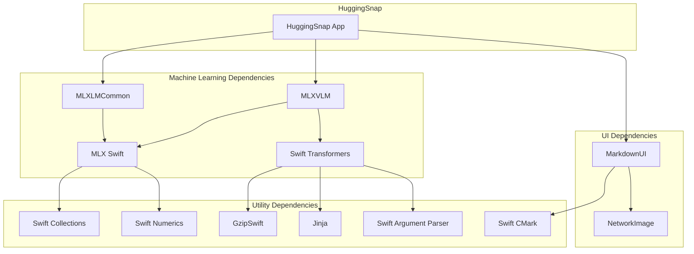
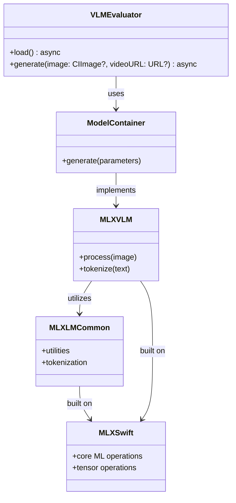

<!-- source: DeepWiki mcp.deepwiki.com · repo huggingface/HuggingSnap · page 3.2 External Dependencies · fetched 2026-10-26 -->

# External Dependencies

<details>
<summary>Relevant source files</summary>

The following files were used as context for generating this wiki page:

- [HuggingSnap.xcodeproj/project.pbxproj](HuggingSnap.xcodeproj/project.pbxproj)
- [HuggingSnap.xcodeproj/project.xcworkspace/xcshareddata/swiftpm/Package.resolved](HuggingSnap.xcodeproj/project.xcworkspace/xcshareddata/swiftpm/Package.resolved)
- [HuggingSnap/Info.plist](HuggingSnap/Info.plist)

</details>


This document provides a comprehensive overview of the third-party libraries and frameworks used by HuggingSnap. It focuses primarily on the machine learning packages that enable the app's visual intelligence capabilities, but also covers UI-related and utility libraries. For information about project configuration and build settings, see [Project Configuration](#3.1).

## Overview of Dependencies

HuggingSnap relies on several key external dependencies to provide its core functionality. These dependencies can be categorized into machine learning frameworks, UI components, and utility libraries.



Sources: [HuggingSnap.xcodeproj/project.pbxproj:9-12](), [HuggingSnap.xcodeproj/project.pbxproj:377-393](), [HuggingSnap.xcodeproj/project.xcworkspace/xcshareddata/swiftpm/Package.resolved:3-102]()

## Machine Learning Dependencies

The core ML capabilities of HuggingSnap are powered by several specialized frameworks:

### MLX Swift and Related Packages

MLX Swift is Apple's machine learning framework designed for efficient on-device ML computation. HuggingSnap specifically uses:

1. **MLXLMCommon** - Common utilities for language models using MLX
2. **MLXVLM** - Vision-Language Model implementations for MLX

These packages are imported from the `mlx-swift-examples` repository, which provides Swift implementations of various ML models using MLX.



Sources: [HuggingSnap.xcodeproj/project.pbxproj:10-11](), [HuggingSnap.xcodeproj/project.pbxproj:397-406](), [HuggingSnap.xcodeproj/project.xcworkspace/xcshareddata/swiftpm/Package.resolved:22-38]()

### Hugging Face Swift Transformers

HuggingSnap leverages `swift-transformers`, a Swift library by Hugging Face for implementing transformer-based models. This library provides:

- Common utilities for working with transformer models
- Tokenization capabilities
- Model architecture implementations

The Swift Transformers library enables the app to run SmolVLM2, the compact multimodal model used for visual understanding.

Sources: [HuggingSnap.xcodeproj/project.xcworkspace/xcshareddata/swiftpm/Package.resolved:94-101]()

## UI and Rendering Dependencies

### MarkdownUI

MarkdownUI is used for rendering formatted text in the application. It enables HuggingSnap to display model outputs with proper formatting, making results more readable for users.

```swift
// MarkdownUI integration in frameworks
import MarkdownUI
```

MarkdownUI is particularly important for the application as it allows the model's responses to be displayed with proper formatting, especially when the responses contain lists, tables, or other structured content.

Sources: [HuggingSnap.xcodeproj/project.pbxproj:12](), [HuggingSnap.xcodeproj/project.pbxproj:386-393](), [HuggingSnap.xcodeproj/project.pbxproj:407-411](), [HuggingSnap.xcodeproj/project.xcworkspace/xcshareddata/swiftpm/Package.resolved:76-83]()

### NetworkImage

NetworkImage is a Swift package for efficient asynchronous image loading from network sources. While not directly imported in the main project file, it's a dependency of MarkdownUI and potentially used for loading images referenced in markdown content.

Sources: [HuggingSnap.xcodeproj/project.xcworkspace/xcshareddata/swiftpm/Package.resolved:40-47]()

## Utility Dependencies

Several utility libraries support the core functionality of HuggingSnap:

| Dependency | Purpose | Version |
|------------|---------|---------|
| Swift Collections | Provides advanced collection data structures | 1.1.4 |
| Swift Numerics | Numerical computing capabilities | 1.0.2 |
| GzipSwift | Compression/decompression support | 6.0.1 |
| Jinja | Templating library | 1.1.1 |
| Swift Argument Parser | Command-line argument parsing | 1.4.0 |
| Swift CMark | CommonMark parsing for Markdown | 0.4.0 |

These utility libraries primarily support the ML frameworks and UI components rather than being directly used by the application code.

Sources: [HuggingSnap.xcodeproj/project.xcworkspace/xcshareddata/swiftpm/Package.resolved:4-93]()

## Dependency Integration and Management

HuggingSnap uses Swift Package Manager (SPM) for dependency management. The dependencies are declared in the Xcode project file and resolved through SPM.

```mermaid
flowchart LR
    subgraph "Project"
        XcodeProject["Xcode Project"]
        PackageResolved["Package.resolved"]
    end
    
    subgraph "Swift Package Manager"
        SPM["Swift Package Manager"]
        PackageDefinitions["Package Definitions"]
        VersionResolver["Version Resolver"]
    end
    
    subgraph "Remote Repositories"
        MLXSwiftExamples["github.com/cyrilzakka/mlx-swift-examples"]
        SwiftMarkdownUI["github.com/gonzalezreal/swift-markdown-ui"]
        OtherRepos["Other Repositories"]
    end
    
    XcodeProject --> SPM : "declares dependencies"
    SPM --> PackageDefinitions : "processes"
    PackageDefinitions --> VersionResolver : "resolves versions"
    VersionResolver --> PackageResolved : "produces"
    
    PackageDefinitions --> MLXSwiftExamples : "fetches from"
    PackageDefinitions --> SwiftMarkdownUI : "fetches from"
    PackageDefinitions --> OtherRepos : "fetches from"
```

### Version Requirements

HuggingSnap has specific version requirements for its dependencies:

- MLX Swift Examples: Pinned to main branch for the latest features
- MarkdownUI: At least version 2.4.1, compatible with future 2.x versions
- MLX Swift: Version 0.21.3
- Swift Transformers: Version 0.1.17

Other dependencies have similar version constraints to ensure compatibility.

Sources: [HuggingSnap.xcodeproj/project.pbxproj:377-393](), [HuggingSnap.xcodeproj/project.xcworkspace/xcshareddata/swiftpm/Package.resolved:22-102]()

## iOS System Framework Dependencies

Besides third-party libraries, HuggingSnap also relies on several iOS system frameworks:

- **AVFoundation**: For camera access and media capture
- **CoreML**: For machine learning operations
- **Speech**: For speech recognition
- **Photos**: For photo library access

These system frameworks are integrated through standard iOS import statements and require appropriate permissions declared in the app's Info.plist file.

Sources: [HuggingSnap.xcodeproj/project.pbxproj:288-293]()

---

