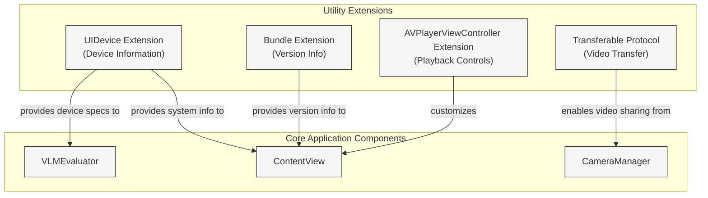
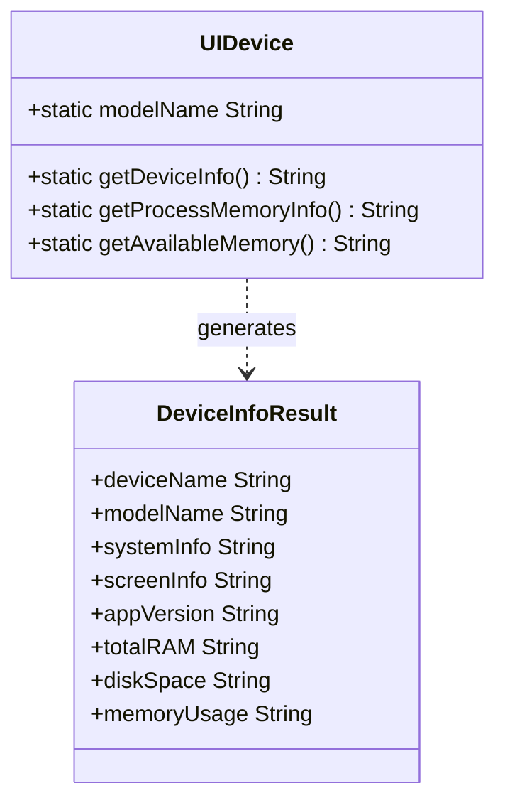
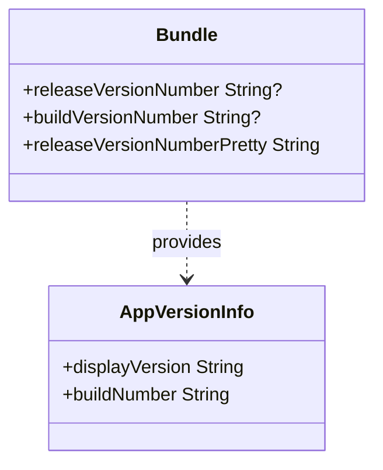
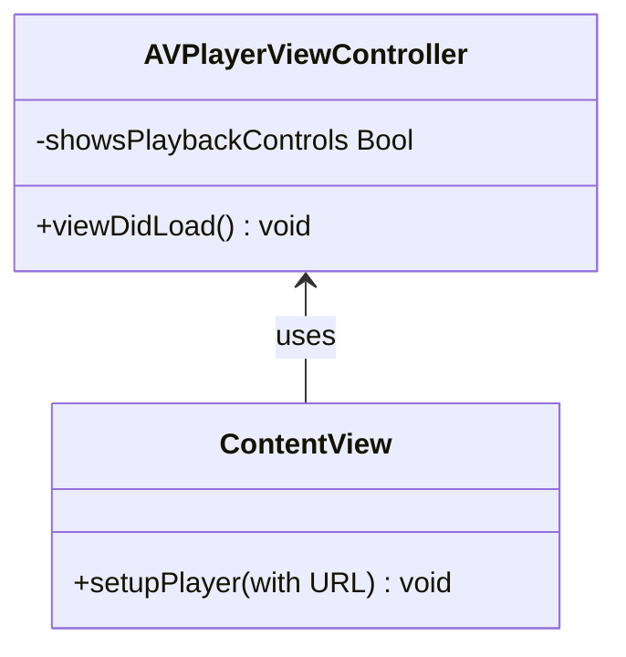
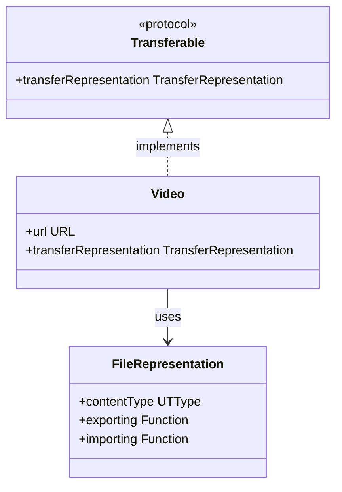
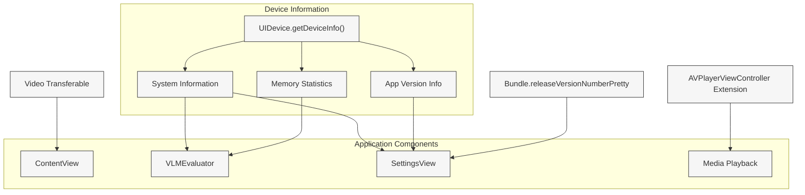

<!-- source: DeepWiki mcp.deepwiki.com · repo huggingface/HuggingSnap · page 4 Utility Extensions · fetched 2026-10-26 -->

# Utility Extensions

<details>
<summary>Relevant source files</summary>

The following files were used as context for generating this wiki page:

- [HuggingSnap/Extensions/AVPlayerExtension.swift](HuggingSnap/Extensions/AVPlayerExtension.swift)
- [HuggingSnap/Extensions/BundleExtensions.swift](HuggingSnap/Extensions/BundleExtensions.swift)
- [HuggingSnap/Extensions/DeviceInfo.swift](HuggingSnap/Extensions/DeviceInfo.swift)
- [HuggingSnap/Extensions/Transferable.swift](HuggingSnap/Extensions/Transferable.swift)

</details>


This page documents the utility extensions that provide supporting functionality across the HuggingSnap iOS application. These extensions enhance built-in iOS classes with additional capabilities specific to the application's needs, avoiding code duplication and keeping the codebase modular.

## Overview

HuggingSnap employs several Swift extensions to augment standard iOS framework classes with application-specific functionality. These extensions provide:

1. Device information gathering
2. Application version management
3. Media player customization
4. File transfer capabilities

The utility extensions serve as foundational building blocks that support the main application components documented in [System Architecture](#2) and [Machine Learning System](#2.1).



Sources: [HuggingSnap/Extensions/DeviceInfo.swift:1-211](), [HuggingSnap/Extensions/BundleExtensions.swift:1-20](), [HuggingSnap/Extensions/AVPlayerExtension.swift:1-16](), [HuggingSnap/Extensions/Transferable.swift:1-28]()

## Device Information Extensions

The `UIDevice` extension provides comprehensive methods for gathering device-specific information, which is crucial for diagnostics, logging, and ensuring compatibility with different device models.

### Key Functionality

1. **Device Model Identification**: Maps device identifiers to human-readable model names
2. **System Resource Monitoring**: Retrieves information about memory usage and disk space
3. **Device Specifications**: Collects details about screen size, iOS version, and device name



Sources: [HuggingSnap/Extensions/DeviceInfo.swift:11-86](), [HuggingSnap/Extensions/DeviceInfo.swift:89-211]()

### Device Information Gathering

The `getDeviceInfo()` method collects comprehensive system information in a formatted string, including:

- Device name and model
- Operating system details
- Screen specifications
- App version and build number
- Memory and disk space information

```
UIDevice.getDeviceInfo()
```

This method is particularly useful for diagnostics, crash reports, and user support scenarios.

### Device Model Identification

The static `modelName` property provides a human-readable device model name based on the system identifier code. It supports a comprehensive list of iOS devices including:

- iPhones (through iPhone 16 Pro Max)
- iPads (all models through M4 iPads)
- iPod touch devices
- Apple TV and HomePod devices
- Simulator environments

This extension maintains a complete mapping between device identifiers and their commercial names, which is valuable for device-specific optimizations and compatibility checks.

Sources: [HuggingSnap/Extensions/DeviceInfo.swift:89-211]()

### Memory and Resource Monitoring

Three specialized methods provide detailed memory information:

| Method | Purpose | Return Value |
|--------|---------|--------------|
| `getProcessMemoryInfo()` | Retrieves current app's memory usage | Formatted memory usage string |
| `getAvailableMemory()` | Shows available system memory | Formatted memory availability string |
| `getDeviceInfo()` | Comprehensive system details including memory | Formatted multi-line report |

These methods utilize low-level system APIs like `mach_task_basic_info` and `task_info` to retrieve accurate memory information.

Sources: [HuggingSnap/Extensions/DeviceInfo.swift:59-86]()

## Bundle Extensions

The `Bundle` extension provides convenient access to application version information. This is essential for version checking, update notifications, and application analytics.



Sources: [HuggingSnap/Extensions/BundleExtensions.swift:1-20]()

### Version Information Properties

| Property | Type | Description | Source |
|----------|------|-------------|--------|
| `releaseVersionNumber` | `String?` | The application's semantic version (e.g., "1.2.3") | CFBundleShortVersionString |
| `buildVersionNumber` | `String?` | The build number (e.g., "124") | CFBundleVersion |
| `releaseVersionNumberPretty` | `String` | Formatted version with "v" prefix (e.g., "v1.2.3") | Derived from releaseVersionNumber |

These properties simplify version information access across the application, particularly in UI components that display version information to users.

Sources: [HuggingSnap/Extensions/BundleExtensions.swift:10-19]()

## Media-Related Extensions

### AVPlayerViewController Extension

The `AVPlayerViewController` extension customizes the default behavior of video playback in the application.



Sources: [HuggingSnap/Extensions/AVPlayerExtension.swift:1-16]()

This extension overrides the `viewDidLoad()` method to disable standard playback controls, providing a cleaner, more integrated video playback experience within the application's custom UI.

```
override open func viewDidLoad() {
    super.viewDidLoad()
    self.showsPlaybackControls = false
}
```

### Transferable Implementation for Videos

The `Video` struct implements Apple's `Transferable` protocol to enable seamless sharing of video content between applications.



Sources: [HuggingSnap/Extensions/Transferable.swift:1-28]()

Key functionality:

1. **Export capability**: Allows videos to be shared from HuggingSnap to other applications
2. **Import capability**: Handles incoming videos and copies them to the app's documents directory
3. **Standardized format**: Uses the `.movie` content type for broad compatibility

This implementation takes care of:
- Creating a proper file representation with the appropriate content type
- Managing file operations for importing videos
- Handling duplicate files by removing existing files before copying new ones
- Specifying the destination path within the app's sandbox

Sources: [HuggingSnap/Extensions/Transferable.swift:11-27]()

## Integration with Application Components

The utility extensions integrate with core application components to provide supporting functionality across the HuggingSnap app.



Sources: [HuggingSnap/Extensions/DeviceInfo.swift:1-211](), [HuggingSnap/Extensions/BundleExtensions.swift:1-20](), [HuggingSnap/Extensions/AVPlayerExtension.swift:1-16](), [HuggingSnap/Extensions/Transferable.swift:1-28]()

### Usage Patterns

| Extension | Primary Use Cases | Integration Points |
|-----------|-------------------|-------------------|
| UIDevice Extensions | System diagnostics, memory monitoring, device compatibility | VLMEvaluator, Settings screens, diagnostics reporting |
| Bundle Extensions | Version display, update checking | About screens, Settings views, log information |
| AVPlayerViewController Extension | Custom video playback UI | Content viewing screens, media playback components |
| Video Transferable | Import/export video content | Media capture workflows, sharing functionality |

## Technical Considerations

### Performance Impact

The device information gathering methods should be used judiciously as they involve system calls that may impact performance if called frequently. Best practices include:

- Cache device information when appropriate rather than repeatedly calling the methods
- Avoid calling resource-intensive methods like `getDeviceInfo()` in UI rendering loops
- Use the more targeted methods (e.g., `getProcessMemoryInfo()`) when only specific information is needed

### Maintenance Notes

When updating the codebase, consider:

1. The device model mapping in `UIDevice.modelName` needs regular updates as new Apple devices are released
2. Memory monitoring methods use low-level system APIs that may change across iOS versions
3. The `Transferable` protocol implementation may need updates to maintain compatibility with future iOS versions

---

