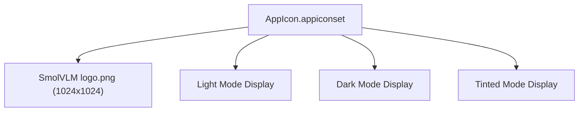
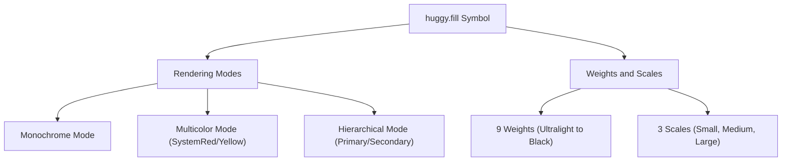
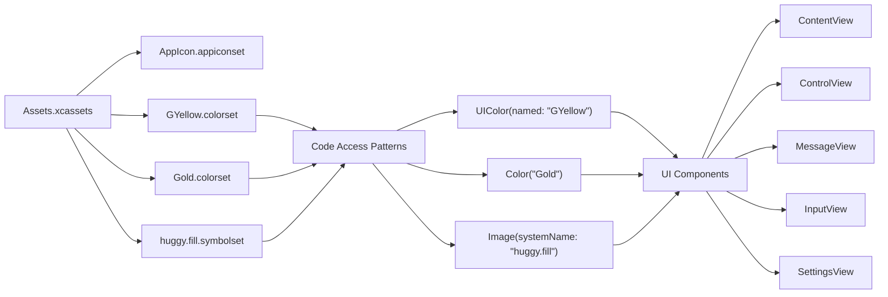
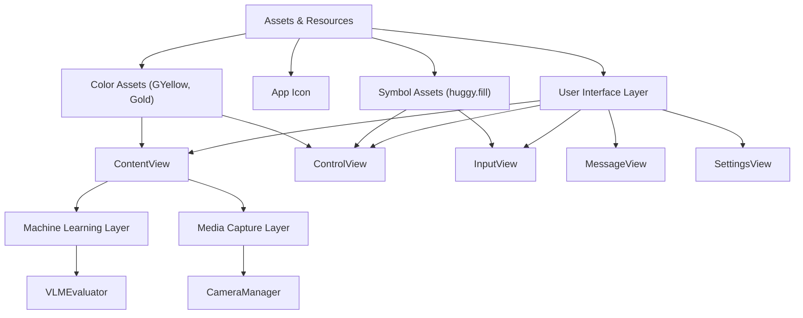

<!-- source: DeepWiki mcp.deepwiki.com · repo huggingface/HuggingSnap · page 5 Assets and Resources · fetched 2026-10-26 -->

# Assets and Resources

Relevant source files

The following files were used as context for generating this wiki page:

- [HuggingSnap/Assets.xcassets/AppIcon.appiconset/Contents.json](HuggingSnap/Assets.xcassets/AppIcon.appiconset/Contents.json)
- [HuggingSnap/Assets.xcassets/GYellow.colorset/Contents.json](HuggingSnap/Assets.xcassets/GYellow.colorset/Contents.json)
- [HuggingSnap/Assets.xcassets/Gold.colorset/Contents.json](HuggingSnap/Assets.xcassets/Gold.colorset/Contents.json)
- [HuggingSnap/Assets.xcassets/huggy.fill.symbolset/huggy.fill.svg](HuggingSnap/Assets.xcassets/huggy.fill.symbolset/huggy.fill.svg)

This document details the visual assets and design resources used in the HuggingSnap application. It covers the app icon, color palette, and custom symbols that maintain visual consistency and branding throughout the application. For information about project configuration and build settings, see [Project Configuration](#3.1).

## App Icon

HuggingSnap uses a custom app icon named "SmolVLM logo.png" configured for iOS platform display with support for different appearance modes.

Sources: [HuggingSnap/Assets.xcassets/AppIcon.appiconset/Contents.json:1-36]()

## Color System

The application employs a custom color palette defined in the asset catalog for consistent UI styling. All colors support both light and dark appearance modes.

### GYellow

A light yellow color primarily used for highlighting and accents:

| Property | Light Mode Value |
|----------|------------------|
| Color Space | Display P3 |
| Alpha | 1.000 |
| Red | 1.000 |
| Green | 0.902 |
| Blue | 0.761 |

Sources: [HuggingSnap/Assets.xcassets/GYellow.colorset/Contents.json:1-29]()

### Gold

A muted gold color used for UI accents and details:

| Property | Light Mode Value |
|----------|------------------|
| Color Space | Display P3 |
| Alpha | 1.000 |
| Red | 0.643 |
| Green | 0.486 |
| Blue | 0.318 |

Sources: [HuggingSnap/Assets.xcassets/Gold.colorset/Contents.json:1-29]()

## Custom SF Symbols

### huggy.fill

A custom SF Symbol that represents a chat bubble with a face, used throughout the UI. It supports multiple weights, scales, and appearance modes for versatile display options.

Sources: [HuggingSnap/Assets.xcassets/huggy.fill.symbolset/huggy.fill.svg:1-199]()

## Asset Access in Code

The following diagram illustrates how these assets are accessed within the codebase:

Sources:
- [HuggingSnap/Assets.xcassets/GYellow.colorset/Contents.json:1-29]()
- [HuggingSnap/Assets.xcassets/Gold.colorset/Contents.json:1-29]()
- [HuggingSnap/Assets.xcassets/huggy.fill.symbolset/huggy.fill.svg:1-199]()

## Asset Integration with App Architecture

This diagram shows how assets integrate with the broader system architecture of HuggingSnap:

This diagram illustrates how the assets primarily support the User Interface Layer, which in turn interacts with the Machine Learning and Media Capture components. Assets provide visual styling while the functional components handle the core application logic.

For more information about the UI components themselves, refer to [User Interface Components](#2.2). For details on the Machine Learning system, see [Machine Learning System](#2.1).

Sources:
- [HuggingSnap/Assets.xcassets/AppIcon.appiconset/Contents.json:1-36]()
- [HuggingSnap/Assets.xcassets/GYellow.colorset/Contents.json:1-29]()
- [HuggingSnap/Assets.xcassets/Gold.colorset/Contents.json:1-29]()
- [HuggingSnap/Assets.xcassets/huggy.fill.symbolset/huggy.fill.svg:1-199]()

---

