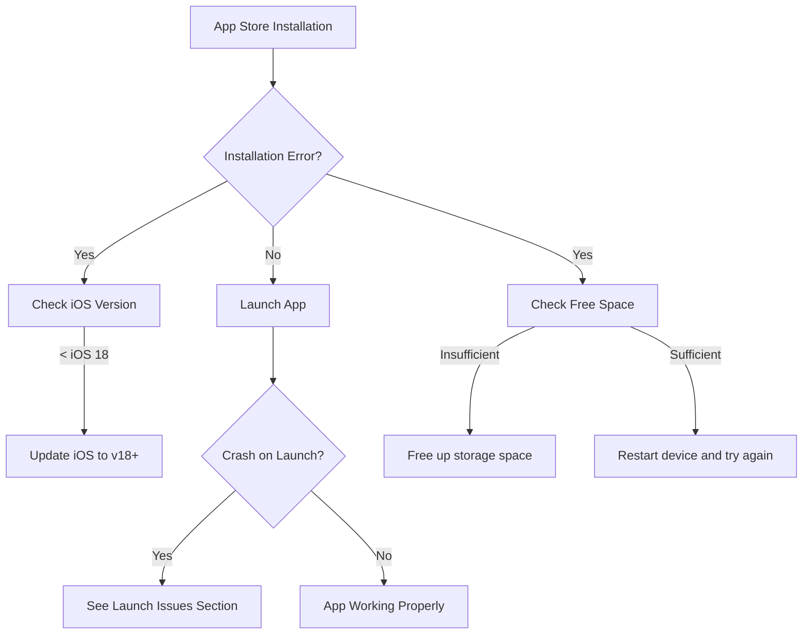
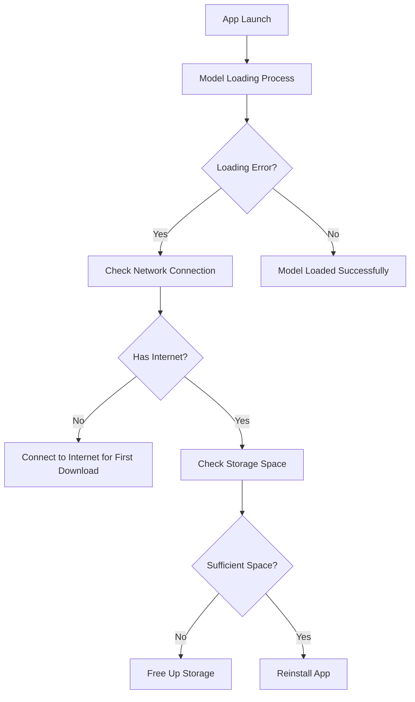
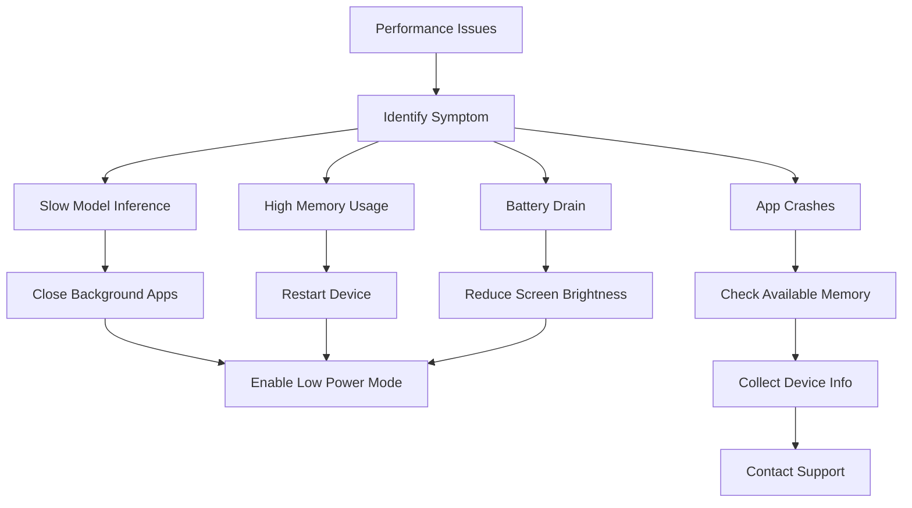
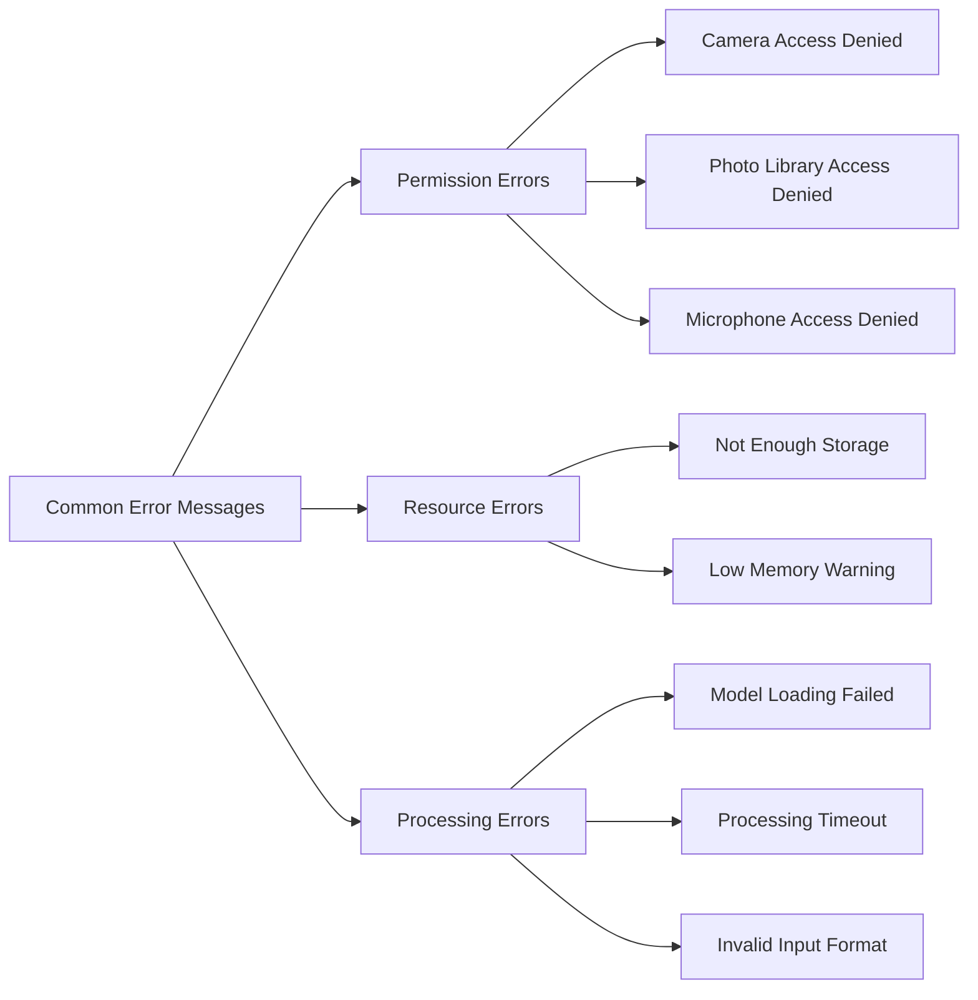

<!-- source: DeepWiki mcp.deepwiki.com · repo huggingface/HuggingSnap · page 6 Troubleshooting & FAQs · fetched 2026-10-26 -->

# Troubleshooting & FAQs

Relevant source files

The following files were used as context for generating this wiki page:

- [HuggingSnap.xcodeproj/project.pbxproj](HuggingSnap.xcodeproj/project.pbxproj)
- [HuggingSnap/Extensions/DeviceInfo.swift](HuggingSnap/Extensions/DeviceInfo.swift)
- [HuggingSnap/Info.plist](HuggingSnap/Info.plist)
- [README.md](README.md)

This document provides solutions to common problems encountered when developing, building, or using the HuggingSnap application. It covers installation issues, runtime errors, model loading problems, camera functionality, and performance optimizations. For information on system architecture, see [System Architecture](#2).

## System Requirements

HuggingSnap has specific hardware and software requirements due to its on-device machine learning capabilities.

| Requirement | Details |
|-------------|---------|
| Device | iPhone only (iPad not supported) |
| iOS Version | iOS 18.0 or later required |
| Architecture | Requires Apple Silicon (A-series or newer chips) |
| Storage | Approximately 1GB free space for model storage |
| Memory | Minimum 4GB RAM recommended for optimal performance |

Sources: [README.md:15-16](), [HuggingSnap.xcodeproj/project.pbxproj:266-267](), [HuggingSnap.xcodeproj/project.pbxproj:305-311]()

## Installation Issues

### App Store Installation

**Common App Store Installation Issues**

| Issue | Solution |
|-------|----------|
| "This app requires iOS 18" error | Update your device to iOS 18 or newer |
| Installation fails with "not enough storage" | Free up at least 1GB of storage and try again |
| App not appearing after installation | Restart your device and check the App Library |

Sources: [README.md:16](), [HuggingSnap.xcodeproj/project.pbxproj:209]()

### Building from Source

**Common Build Issues**

| Issue | Solution |
|-------|----------|
| "Update bundle identifier" error | Change the bundle identifier in project settings and select your development team |
| "Development team required" error | Set a development team in the Signing & Capabilities tab in Xcode |
| Build failure related to packages | Ensure you have an active internet connection for downloading dependencies |
| Simulator build fails | HuggingSnap requires a physical device due to camera functionality and MLX dependencies |

Sources: [README.md:19-23](), [HuggingSnap.xcodeproj/project.pbxproj:303-304](), [HuggingSnap.xcodeproj/project.pbxproj:285]()

## Model Loading Issues

**Troubleshooting Model Loading**

| Issue | Symptoms | Solution |
|-------|----------|----------|
| First-time model download failure | "Failed to load model" message | Ensure internet connection is active for first launch |
| Insufficient storage space | Loading hangs or fails | Free up at least 1GB of storage space |
| Corrupted model files | App crashes during model loading | Delete and reinstall the app |
| Slow model loading | Long wait times during startup | Check if other apps are using system resources |

Sources: [README.md:8-10]()

## Camera and Media Issues

**Camera Access Problems**

| Issue | Solution |
|-------|----------|
| "Camera access denied" message | Go to Settings > HuggingSnap > Permissions and enable Camera access |
| Black screen instead of camera feed | Restart the app or check if another app is using the camera |
| Camera freezes | Force close the app and relaunch |
| Cannot access photo library | Go to Settings > HuggingSnap > Permissions and enable Photo Library access |

Sources: [HuggingSnap.xcodeproj/project.pbxproj:289-293]()

## Performance Optimization

**Optimizing Performance**

| Issue | Optimization |
|-------|--------------|
| Slow inference | Close background apps, restart device |
| High memory usage | Restart app, avoid processing large videos |
| Battery drain | Reduce screen brightness, enable Low Power Mode |
| App crashes during processing | Avoid processing multiple images in quick succession |

Sources: [HuggingSnap/Extensions/DeviceInfo.swift:11-87]()

## Diagnostic Information

HuggingSnap includes a built-in diagnostic system to help troubleshoot issues. Here's how to collect and interpret this information:

**Collecting Device Information**

Device information can be useful when reporting issues to developers. It provides details about your device model, OS version, available memory, and storage that can help diagnose problems.

The app uses the `UIDevice.getDeviceInfo()` method to collect:
- Device model and name
- iOS version
- Screen resolution
- App version
- Available memory and storage
- Current memory usage

Sources: [HuggingSnap/Extensions/DeviceInfo.swift:12-56]()

## Frequently Asked Questions

### General Questions

**Q: What is HuggingSnap?**  
A: HuggingSnap is an iOS app that uses on-device machine learning to help users learn about objects and places around them through their camera. It can translate text, summarize content, identify plants and animals, and perform other visual intelligence tasks.

**Q: Is an internet connection required?**  
A: An internet connection is only required for the first launch to download the model. After that, all processing happens on-device without requiring internet.

**Q: What languages does HuggingSnap support?**  
A: HuggingSnap uses SmolVLM2 which primarily supports English for input and output.

**Q: Does HuggingSnap store or send my photos/videos to a server?**  
A: No, all processing happens on-device. Your photos and videos are never sent to external servers.

### Technical Questions

**Q: Why does HuggingSnap require iOS 18?**  
A: HuggingSnap utilizes advanced machine learning frameworks and APIs that are only available in iOS 18 and newer.

**Q: How much space does the model take on my device?**  
A: The SmolVLM2 model requires approximately 800MB of storage space.

**Q: Can I use HuggingSnap on iPad?**  
A: Currently, HuggingSnap is optimized for iPhone only and does not support iPad.

**Q: Does HuggingSnap work with all iPhone models?**  
A: HuggingSnap requires iOS 18, which means it works on iPhone XS/XR and newer models. However, for optimal performance, iPhone 12 or newer is recommended.

**Q: Why does the app need camera and photo library permissions?**  
A: Camera permission is needed to capture real-time images and videos for analysis. Photo library permission is required to access and analyze existing photos and videos.

**Q: How can I improve battery life when using HuggingSnap?**  
A: To improve battery performance:
- Limit continuous video processing
- Lower screen brightness
- Close the app when not in use
- Enable Low Power Mode

Sources: [README.md:6-10](), [HuggingSnap.xcodeproj/project.pbxproj:289-293]()

## Error Messages and Their Meaning

| Error Message | Meaning | Solution |
|---------------|---------|----------|
| "Camera access denied" | The app doesn't have permission to use the camera | Go to Settings > HuggingSnap > Permissions and enable Camera access |
| "Photo library access denied" | The app doesn't have permission to access photos | Go to Settings > HuggingSnap > Permissions and enable Photos access |
| "Failed to load model" | The app couldn't load the SmolVLM2 model | Ensure you have internet on first launch and sufficient storage space |
| "Not enough memory" | The device doesn't have enough RAM to process the request | Close background apps and restart the device |
| "Processing timeout" | The model took too long to process the input | Try with a less complex image or shorter video clip |
| "This app requires iOS 18" | Your device is running an older iOS version | Update your device to iOS 18 or newer |

Sources: [HuggingSnap.xcodeproj/project.pbxproj:289-294]()

## Contact and Support

If you encounter issues not covered in this document, consider the following resources:

1. Check the GitHub repository at [https://github.com/huggingface/HuggingSnap](https://github.com/huggingface/HuggingSnap)
2. Report issues through the repository's issue tracker
3. For detailed information about the machine learning system, refer to [Machine Learning System](#2.1)

When reporting issues, please include:
- Detailed description of the problem
- Steps to reproduce the issue
- Device model and iOS version
- Device diagnostic information if possible

Sources: [README.md:12-13](), [HuggingSnap/Extensions/DeviceInfo.swift:11-87]()