# Page: HuggingSnap Overview

# HuggingSnap Overview

<details>
<summary>Relevant source files</summary>

The following files were used as context for generating this wiki page:

- [HuggingSnap.xcodeproj/project.pbxproj](HuggingSnap.xcodeproj/project.pbxproj)
- [HuggingSnap/Info.plist](HuggingSnap/Info.plist)
- [README.md](README.md)

</details>


This document provides a comprehensive introduction to HuggingSnap, a mobile application that delivers on-device visual intelligence capabilities. It covers the app's purpose, core features, and high-level architecture. For installation instructions and system requirements, see [Installation & Requirements](#1.1). For detailed technical information about specific components, refer to the [System Architecture](#2) section.

## What is HuggingSnap?

HuggingSnap is an iOS application that enables users to quickly learn about objects, scenes, and text in their surroundings using advanced visual understanding capabilities. The app functions as a visual assistant that processes images and videos captured by the device camera or selected from the photo library, then generates informative text descriptions or answers to user queries.

At its core, HuggingSnap leverages SmolVLM2, a compact multimodal model designed to efficiently run on mobile devices. This model can analyze visual content and respond to user prompts through natural language processing.

Sources: [README.md:6-10]()

## Key Features and Capabilities

HuggingSnap offers a range of visual intelligence features, including:

| Feature | Description |
|---------|-------------|
| **Object Recognition** | Identifies and describes objects within images or video frames |
| **Scene Understanding** | Recognizes and explains environments, settings, and contexts |
| **Text Translation** | Translates text visible in images |
| **Content Summarization** | Creates concise summaries of visual content |
| **Plant/Animal Identification** | Recognizes and provides information about flora and fauna |
| **Visual Question Answering** | Responds to specific questions about visual content |
| **Pure Language Processing** | Functions as a language model without visual inputs when needed |

The application runs entirely on-device, ensuring privacy and enabling offline operation without sending data to external servers.

Sources: [README.md:6-10]()

## System Architecture Overview

HuggingSnap employs a modular architecture organized into three primary layers that work together to deliver its visual intelligence capabilities.

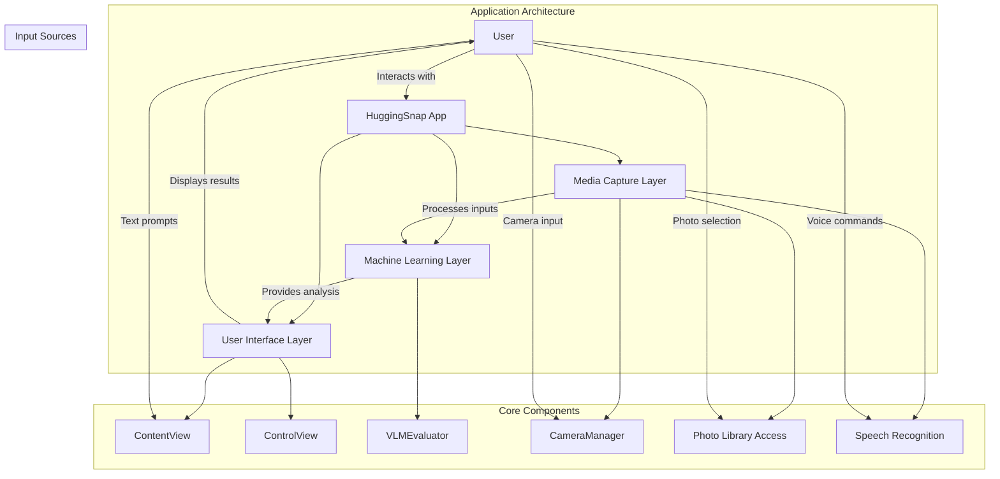

### Core Components

HuggingSnap consists of several key components that handle different aspects of the application's functionality:

1. **ContentView**: The main view controller that orchestrates the app's operation and displays the camera feed, captured media, and generated output.

2. **VLMEvaluator**: The component responsible for processing visual and textual inputs, managing the SmolVLM2 model, and generating responses.

3. **CameraManager**: Handles camera setup, configuration, and media capture operations.

4. **ContentViewModel**: The view model that connects the UI with the underlying data and camera functionality.

5. **ControlView**: Provides user interface elements for controlling the camera and interacting with the app.

Sources: Architecture diagrams provided in the prompt

### Architectural Layers

#### User Interface Layer
The UI layer is built using SwiftUI and handles all user interactions and visual presentation. It consists of various views that display the camera feed, captured media, user controls, and generated outputs.

#### Machine Learning Layer
The ML layer is centered around the VLMEvaluator component, which integrates with MLX Swift to provide on-device visual language model capabilities. This layer handles model loading, configuration, and inference operations.

#### Media Capture Layer
This layer manages media input through the CameraManager, which interfaces with the device camera to capture photos and videos. It also includes components for accessing the photo library and processing speech input.

Sources: Architecture diagrams provided in the prompt

## Technology Stack

HuggingSnap leverages several key technologies and frameworks:

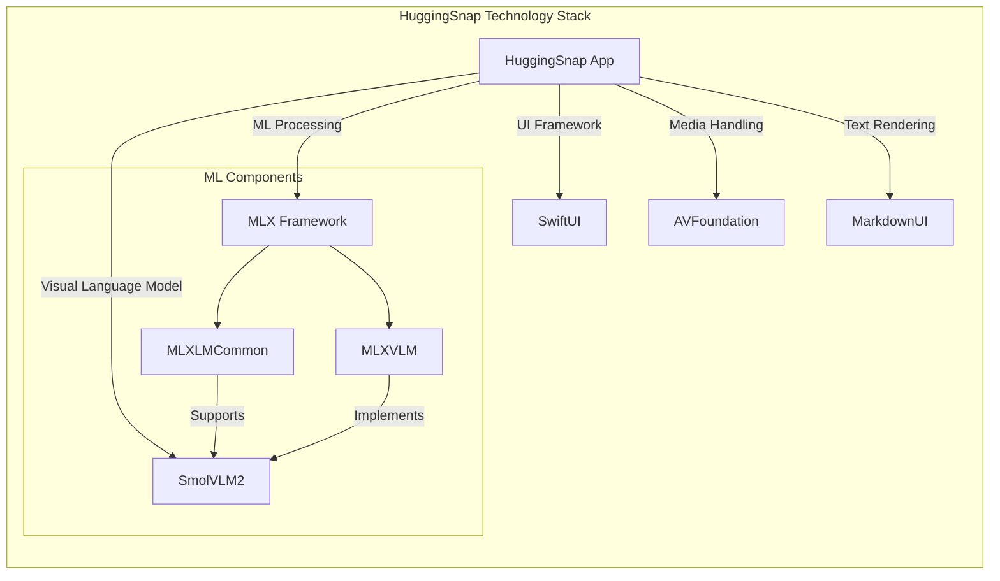

The application relies on several key dependencies:

| Framework/Library | Purpose |
|-------------------|---------|
| **MLXLMCommon** | Provides common functionality for language models |
| **MLXVLM** | Implements the visual language model capabilities |
| **MarkdownUI** | Renders formatted text in the user interface |
| **AVFoundation** | Handles camera and media capture operations |

Sources: [HuggingSnap.xcodeproj/project.pbxproj:10-12](), [HuggingSnap.xcodeproj/project.pbxproj:397-411]()

## Data Flow

HuggingSnap processes data through a well-defined flow from user input to generated output:

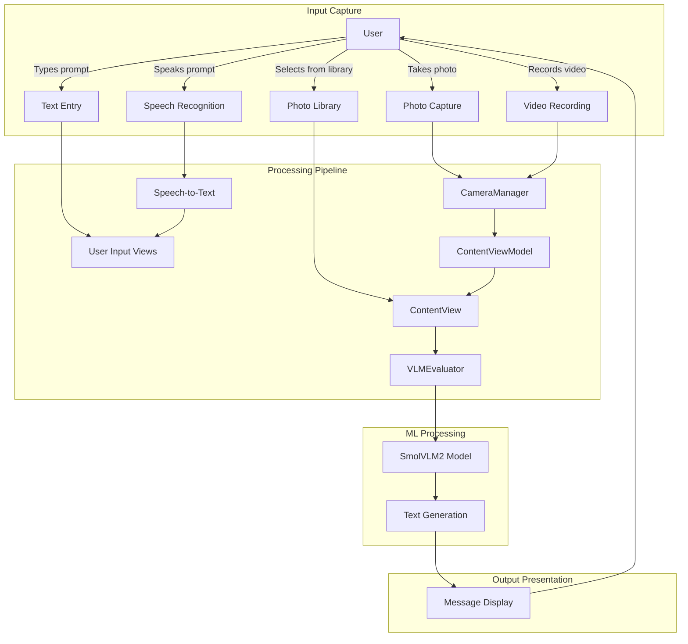

The application receives input from various sources, processes it through the appropriate components, runs the inputs through the SmolVLM2 model, and presents the generated output to the user.

Sources: Architecture diagrams provided in the prompt

## User Experience

HuggingSnap is designed to provide a seamless and intuitive user experience. Users can interact with the app through several methods:

1. **Camera Capture**: Point the camera at an object, scene, or text and capture a photo or video for analysis.
2. **Photo Library**: Select existing photos or videos from the device's photo library.
3. **Text Prompts**: Type specific questions or instructions to guide the analysis.
4. **Voice Commands**: Use speech recognition to provide verbal prompts.

The app processes the input and generates informative text that describes the content, answers questions, or provides requested information about the visual subject.

HuggingSnap requires several permissions to function properly:
- Camera access for capturing photos and videos
- Microphone access for recording audio with videos
- Photo library access for saving and accessing media
- Speech recognition for processing voice commands

Sources: [HuggingSnap.xcodeproj/project.pbxproj:289-293]()

## Privacy and Performance

HuggingSnap emphasizes privacy and performance through its on-device processing approach:

- All visual and language processing occurs locally on the device
- No data is sent to external servers for analysis
- SmolVLM2's compact design allows for efficient operation on mobile hardware
- The app functions offline without requiring an internet connection

This architecture ensures user data privacy while delivering responsive visual intelligence capabilities within the constraints of mobile device resources.

Sources: [README.md:8-10]()

---

# Page: Installation & Requirements

# Installation & Requirements

<details>
<summary>Relevant source files</summary>

The following files were used as context for generating this wiki page:

- [HuggingSnap.xcodeproj/project.pbxproj](HuggingSnap.xcodeproj/project.pbxproj)
- [HuggingSnap.xcodeproj/project.xcworkspace/xcshareddata/swiftpm/Package.resolved](HuggingSnap.xcodeproj/project.xcworkspace/xcshareddata/swiftpm/Package.resolved)
- [HuggingSnap/Info.plist](HuggingSnap/Info.plist)
- [README.md](README.md)

</details>


This page provides comprehensive instructions for installing HuggingSnap and details its system requirements. It covers both the App Store installation method and the process for building the application from source. For information about the underlying system architecture, see [System Architecture](#2).

## System Requirements

HuggingSnap has specific hardware and software requirements that must be met for successful operation.

### Hardware Requirements

HuggingSnap is designed to run on Apple devices with the following specifications:

| Requirement | Description |
|-------------|-------------|
| Device Type | iPhone only (not iPad or Mac) |
| Processor | Apple Silicon (required for MLX) |
| Storage | At least 150MB free space for app and model |
| Camera | Working rear camera for optimal experience |

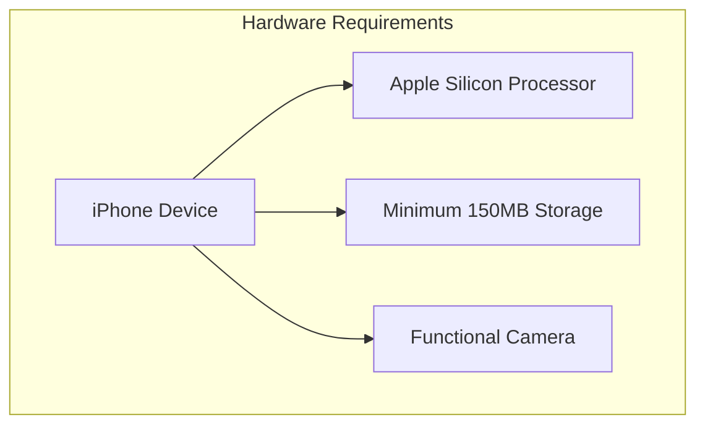

Sources: [HuggingSnap.xcodeproj/project.pbxproj:305-311]()

### Software Requirements

The application requires the following software environment:

| Requirement | Description |
|-------------|-------------|
| iOS Version | iOS 18.0 or later |
| Permissions | Camera, Photo Library, Microphone, Speech Recognition |
| Connectivity | Internet connection (for initial model download) |

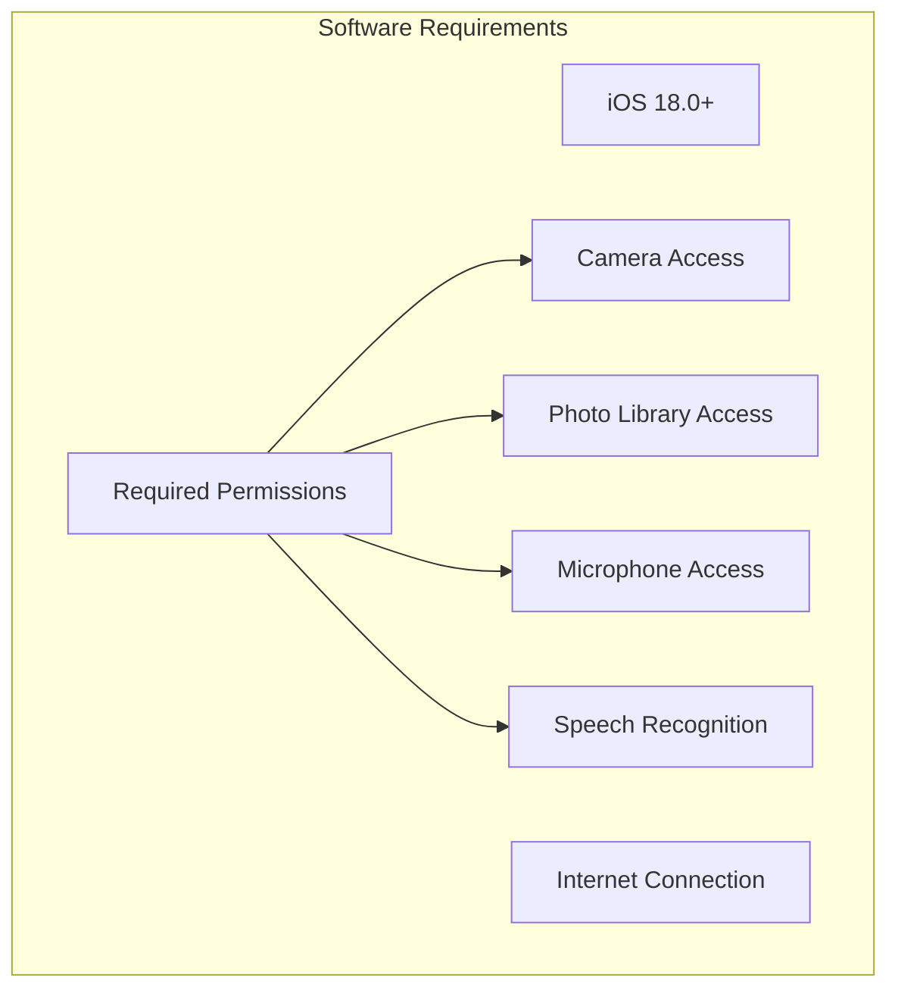

Sources: [HuggingSnap.xcodeproj/project.pbxproj:209-266](), [HuggingSnap.xcodeproj/project.pbxproj:289-293]()

## Installation Methods

HuggingSnap can be installed through either the App Store or by building from source.

### App Store Installation

The simplest method to install HuggingSnap is directly from the Apple App Store:

1. Open the App Store on your iOS device
2. Search for "HuggingSnap" or use the direct link: [App Store](https://apps.apple.com/us/app/huggingsnap/id6742157364)
3. Tap "Get" to download and install the application
4. Once installed, open the app and grant the required permissions when prompted

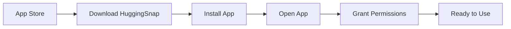

Sources: [README.md:14-16]()

### Building from Source

For developers who want to modify or contribute to HuggingSnap, building from source is the preferred method:

1. Prerequisites:
   - Mac computer with Xcode 16.2 or later installed
   - Apple Developer account (free or paid)
   - Git installed

2. Installation steps:
   ```
   1. Clone the repository:
      git clone https://github.com/huggingface/HuggingSnap.git
   
   2. Open the project in Xcode:
      open HuggingSnap.xcodeproj
   
   3. Modify the bundle identifier and development team:
      Navigate to project settings > Signing & Capabilities
   
   4. Build and run on a physical device (simulator not recommended)
   ```

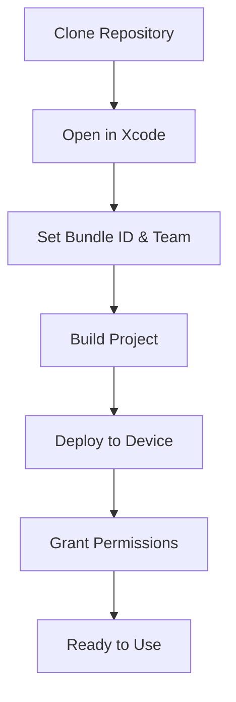

Sources: [README.md:18-23](), [HuggingSnap.xcodeproj/project.pbxproj:282-285]()

## Dependencies

HuggingSnap relies on several key dependencies to provide its functionality.

### Framework Dependencies

The application integrates with the following frameworks:

| Dependency | Purpose | Source |
|------------|---------|--------|
| MLXLMCommon | Core machine learning functionality | mlx-swift-examples |
| MLXVLM | Vision-language model support | mlx-swift-examples |
| MarkdownUI | Rendering formatted text | swift-markdown-ui |
| MLX Swift | Apple's ML framework for Apple Silicon | ml-explore/mlx-swift |
| Swift Transformers | HuggingFace transformer models | huggingface/swift-transformers |

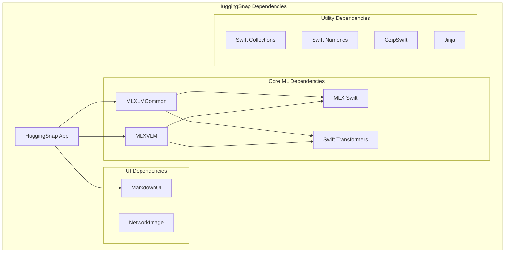

Sources: [HuggingSnap.xcodeproj/project.pbxproj:10-12](), [HuggingSnap.xcodeproj/project.pbxproj:377-394](), [HuggingSnap.xcodeproj/project.xcworkspace/xcshareddata/swiftpm/Package.resolved:1-105]()

### Dependency Relationship to Core Functionality

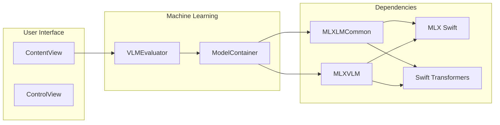

Sources: [HuggingSnap.xcodeproj/project.pbxproj:396-406]()

## Required Permissions

HuggingSnap requires several iOS permissions to function properly:

| Permission | Purpose | Info.plist Key |
|------------|---------|---------------|
| Camera | Capturing photos and videos | NSCameraUsageDescription |
| Microphone | Audio recording for videos | NSMicrophoneUsageDescription |
| Photo Library | Saving and accessing media | NSPhotoLibraryUsageDescription |
| Photo Library Additions | Saving captured media | NSPhotoLibraryAddUsageDescription |
| Speech Recognition | Transcribing voice input | NSSpeechRecognitionUsageDescription |

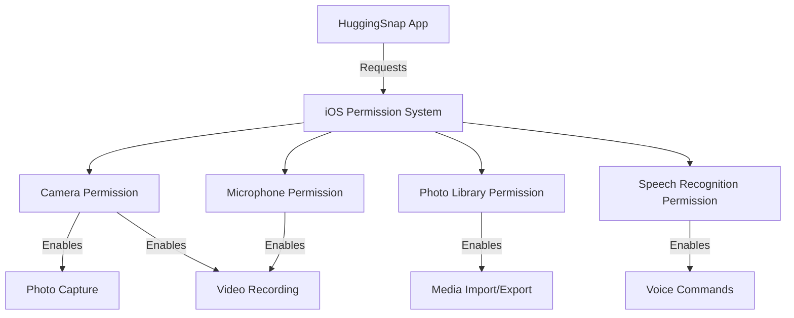

Sources: [HuggingSnap.xcodeproj/project.pbxproj:289-293]()

## Troubleshooting Installation Issues

If you encounter issues during installation or setup, consider the following solutions:

1. **App Store installation fails:**
   - Ensure your device runs iOS 18.0 or later
   - Check available storage space (minimum 150MB recommended)
   - Ensure you have a working internet connection

2. **Building from source issues:**
   - Verify Xcode version (16.2+ required)
   - Run `git submodule update --init --recursive` if dependencies fail to load
   - Ensure you've changed the bundle identifier and development team
   - Connect a physical device (simulator is not recommended)

3. **Permission errors:**
   - If permission dialogs don't appear, go to Settings > HuggingSnap and enable required permissions manually
   - If camera access fails, ensure no other app is currently using the camera

4. **Model loading issues:**
   - Ensure you have an internet connection for the initial model download
   - Verify sufficient storage space for the model files

Sources: [README.md:14-23](), [HuggingSnap.xcodeproj/project.pbxproj:289-293]()

---

# Page: System Architecture

# System Architecture

<details>
<summary>Relevant source files</summary>

The following files were used as context for generating this wiki page:

- [HuggingSnap/Views/ContentView.swift](HuggingSnap/Views/ContentView.swift)
- [HuggingSnap/Views/VLMEvaluator.swift](HuggingSnap/Views/VLMEvaluator.swift)
- [README.md](README.md)

</details>


This document provides a high-level explanation of the HuggingSnap application architecture, describing the major components, their relationships, and data flow through the system. For detailed information about specific subsystems, please refer to:

- [Machine Learning System](#2.1) for details about the VLM system and inference process
- [User Interface Components](#2.2) for the app's UI architecture
- [Camera and Media Management](#2.3) for camera capabilities and media processing
- [Speech Recognition System](#2.4) for voice input and transcription

## Overview

HuggingSnap is built with a layered architecture that separates concerns between user interface, media processing, and machine learning components. The application runs entirely on-device, leveraging the SmolVLM2 model for visual understanding without sending data to external servers.

### High-Level Architecture Diagram

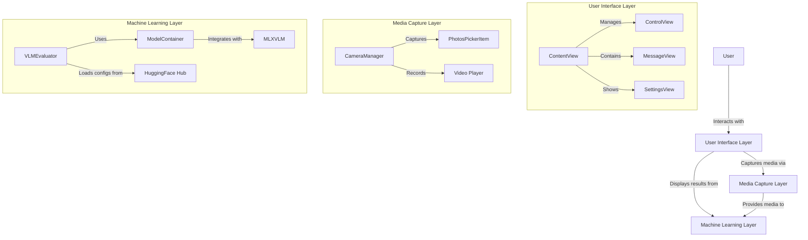

Sources: [HuggingSnap/Views/ContentView.swift:23-342](), [HuggingSnap/Views/VLMEvaluator.swift:53-224](), [README.md:1-24]()

## Core Components

HuggingSnap consists of three main architectural layers that interact to provide the application's functionality:

### Machine Learning Layer

The Machine Learning Layer is the core of HuggingSnap, responsible for processing visual inputs and generating descriptive outputs.

#### VLMEvaluator Component Diagram

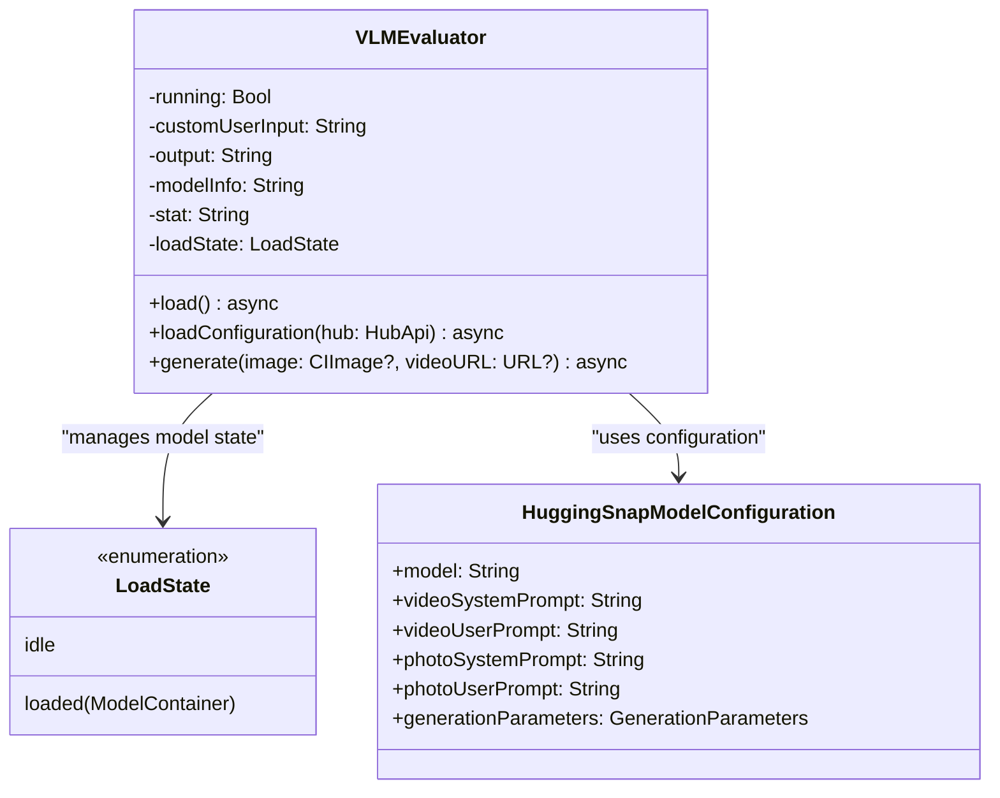

Sources: [HuggingSnap/Views/VLMEvaluator.swift:17-40](), [HuggingSnap/Views/VLMEvaluator.swift:53-87](), [HuggingSnap/Views/VLMEvaluator.swift:69-75]()

The `VLMEvaluator` is the central component responsible for:

1. **Model Loading**: Downloads and initializes the SmolVLM2 model
2. **Configuration Management**: Fetches runtime configuration from Hugging Face Hub
3. **Media Processing**: Handles image and video inputs
4. **Text Generation**: Produces descriptive text based on visual content

The configuration is dynamically downloaded from Hugging Face Hub, allowing for runtime updates to prompts and generation parameters without requiring app updates.

### User Interface Layer

The User Interface Layer manages all user interactions and visual presentation. `ContentView` serves as the main coordinator for the application UI.

#### User Interface Component Diagram

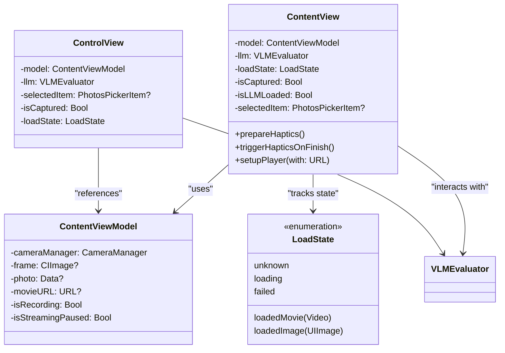

Sources: [HuggingSnap/Views/ContentView.swift:15-21](), [HuggingSnap/Views/ContentView.swift:23-50](), [HuggingSnap/Views/ContentView.swift:130-134]()

Key UI components include:

1. **ContentView**: Main view controller that orchestrates the UI and user interactions
2. **ControlView**: Manages camera controls, photo/video capture, and library access
3. **MessageView**: Displays generated text output from the VLM model
4. **SettingsView**: Provides access to application settings

The UI layer uses SwiftUI and follows a reactive approach, with state changes driving UI updates.

### Media Capture Layer

The Media Capture Layer handles camera interactions, photo/video capture, and media processing.

#### Media Component Interactions

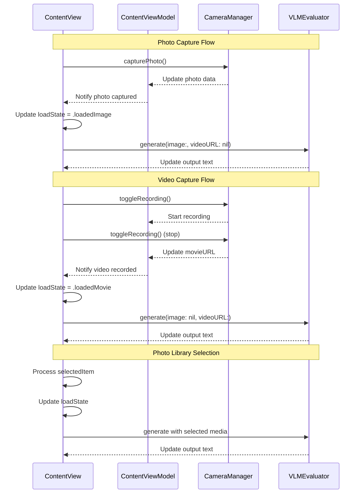

Sources: [HuggingSnap/Views/ContentView.swift:209-219](), [HuggingSnap/Views/ContentView.swift:225-236](), [HuggingSnap/Views/ContentView.swift:238-266]()

The Media Capture system provides multiple ways to input visual content:

1. **Camera Capture**: Direct photo/video capture using device cameras
2. **Photo Library**: Selection from the device's photo library
3. **Video Playback**: Management of video content and playback

## System Runtime Flow

The following diagram illustrates how data flows through the system during a typical user session:

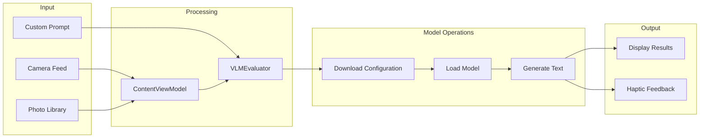

Sources: [HuggingSnap/Views/ContentView.swift:90-137](), [HuggingSnap/Views/VLMEvaluator.swift:132-224]()

## Model Loading and Execution Flow

A critical aspect of the system architecture is how the ML model is loaded and executed:

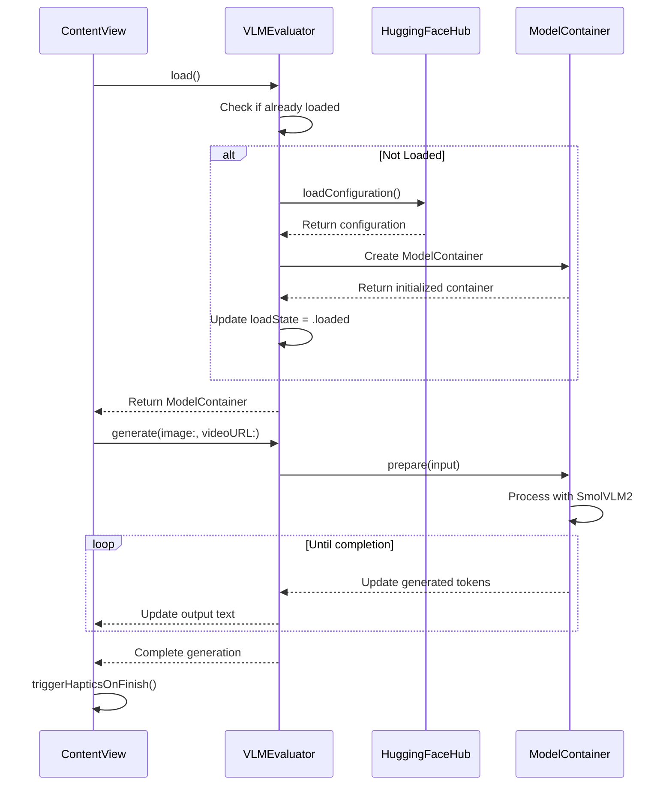

Sources: [HuggingSnap/Views/VLMEvaluator.swift:90-130](), [HuggingSnap/Views/VLMEvaluator.swift:132-224](), [HuggingSnap/Views/ContentView.swift:220-224](), [HuggingSnap/Views/ContentView.swift:295-325]()

## Configuration Management

HuggingSnap dynamically loads its model configuration at runtime from Hugging Face Hub:

| Configuration Parameter | Purpose |
|-------------------------|---------|
| `model` | Model identifier for loading from Hugging Face Hub |
| `videoSystemPrompt` | System prompt for video analysis context |
| `videoUserPrompt` | Default user prompt for video analysis |
| `photoSystemPrompt` | System prompt for photo analysis context |
| `photoUserPrompt` | Default user prompt for photo analysis |
| `generationParameters` | Temperature and topP settings for text generation |

Sources: [HuggingSnap/Views/VLMEvaluator.swift:17-40](), [HuggingSnap/Views/VLMEvaluator.swift:76-86]()

## Key Design Decisions

Several important architectural decisions shape the HuggingSnap application:

1. **On-Device Processing**: All ML processing occurs on-device, enhancing privacy and enabling offline operation
2. **Dynamic Configuration**: Runtime configuration download allows updating prompts and parameters without app updates
3. **Reactive UI**: SwiftUI with state-driven updates creates a responsive user experience
4. **Asynchronous Processing**: Heavy ML tasks run asynchronously to maintain UI responsiveness
5. **MLX Integration**: Uses Apple's MLX framework for efficient on-device ML processing
6. **Haptic Feedback**: Provides tactile feedback when processing completes

Sources: [HuggingSnap/Views/ContentView.swift:268-276](), [HuggingSnap/Views/VLMEvaluator.swift:93-95](), [README.md:6-10]()

## Memory Management

The architecture includes memory management strategies for optimal ML performance:

1. **GPU Buffer Cache Limit**: Set to 20MB to manage memory use
2. **Metal Memory Limit**: Dynamically set based on available device memory
3. **Token Generation Limiting**: Maximum token generation capped at 400 tokens
4. **Display Optimization**: Updates UI every 4 tokens to balance performance and responsiveness

Sources: [HuggingSnap/Views/VLMEvaluator.swift:62-67](), [HuggingSnap/Views/VLMEvaluator.swift:93-99](), [HuggingSnap/Views/VLMEvaluator.swift:197-209]()

## Error Handling

The system implements error handling at key points:

1. **Model Loading Errors**: Captured and displayed to users
2. **Media Processing Failures**: Tracked via LoadState changes
3. **Generation Errors**: Displayed in output text
4. **Configuration Download Fallbacks**: Uses default values when download fails

Sources: [HuggingSnap/Views/VLMEvaluator.swift:219-221](), [HuggingSnap/Views/ContentView.swift:262-264]()

---

# Page: Machine Learning System

# Machine Learning System

<details>
<summary>Relevant source files</summary>

The following files were used as context for generating this wiki page:

- [HuggingSnap.xcodeproj/project.xcworkspace/xcshareddata/swiftpm/Package.resolved](HuggingSnap.xcodeproj/project.xcworkspace/xcshareddata/swiftpm/Package.resolved)
- [HuggingSnap/Views/VLMEvaluator.swift](HuggingSnap/Views/VLMEvaluator.swift)

</details>


This document covers the machine learning system in HuggingSnap, focusing on how the Vision Language Model (VLM) is configured, loaded, and used to process visual inputs. For information about camera inputs and media management, see [Camera and Media Management](#2.3). For details about the user interface that interacts with this system, see [User Interface Components](#2.2).

## System Overview

The machine learning core of HuggingSnap is built around the `VLMEvaluator` class, which manages model loading, configuration, and inference. This system leverages a multimodal model (SmolVLM2) capable of processing both images and videos to generate natural language descriptions.

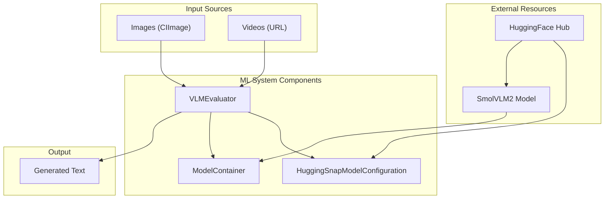

Sources: [HuggingSnap/Views/VLMEvaluator.swift:52-225]()

## Model Configuration Management

The ML system uses a runtime configuration mechanism that allows behavior adjustment without app updates.

### Configuration Structure

The system uses `HuggingSnapModelConfiguration` to store model settings, including the model identifier, prompts for different media types, and generation parameters:

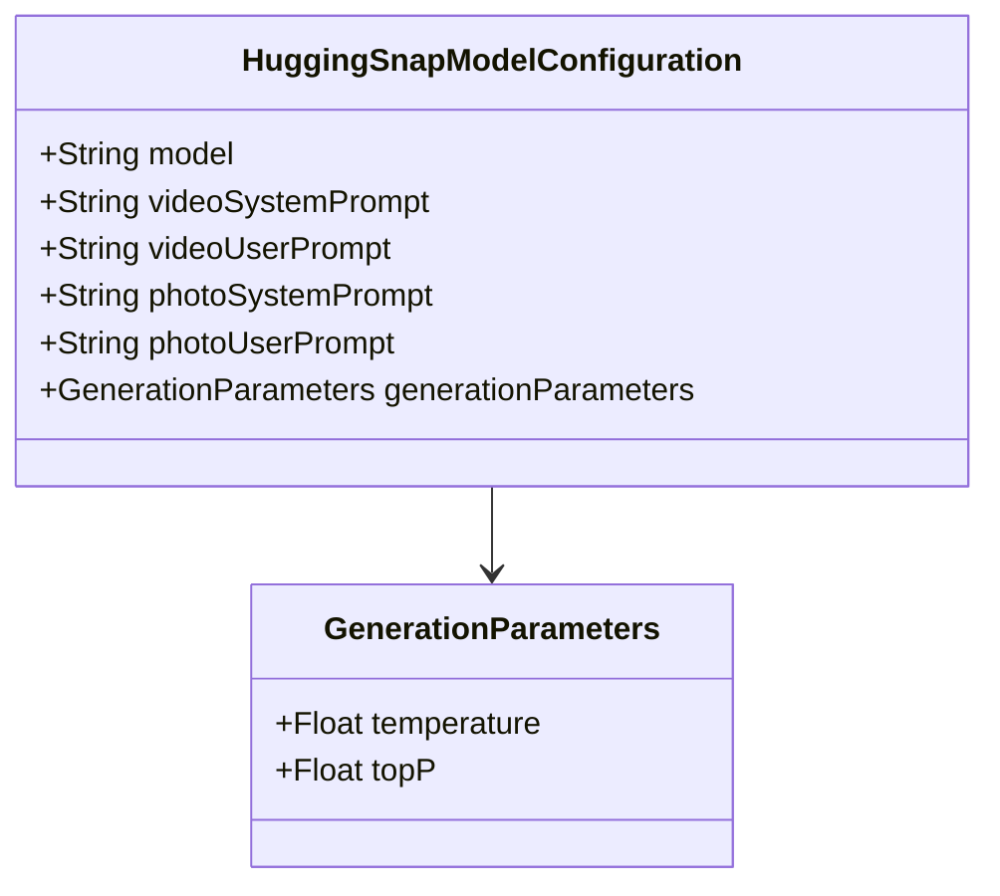

The configuration is stored in a remote repository (`HuggingFaceTB/smolvlm-app-config`) and loaded at runtime, allowing the app behavior to be updated without requiring new app versions.

Sources: [HuggingSnap/Views/VLMEvaluator.swift:16-50](), [HuggingSnap/Views/VLMEvaluator.swift:76-86]()

### Default Configuration

The system provides fallback configuration values in case the remote configuration cannot be loaded:

| Parameter | Default Value |
|-----------|---------------|
| Model ID | HuggingFaceTB/SmolVLM2-500M-Video-Instruct-mlx |
| Photo System Prompt | "You are an image understanding model capable of describing the salient features of any image." |
| Photo User Prompt | "Describe this image." |
| Video System Prompt | "Focus only on describing the key dramatic action or notable event occurring in this video segment..." |
| Video User Prompt | "What is the main action or notable event happening in this segment?..." |
| Temperature | 0.7 |
| Top-P | 0.9 |

Sources: [HuggingSnap/Views/VLMEvaluator.swift:43-50]()

## Model Loading Process

The model loading process is managed by the `load()` method in the `VLMEvaluator` class, which handles the one-time initialization of the ML model.

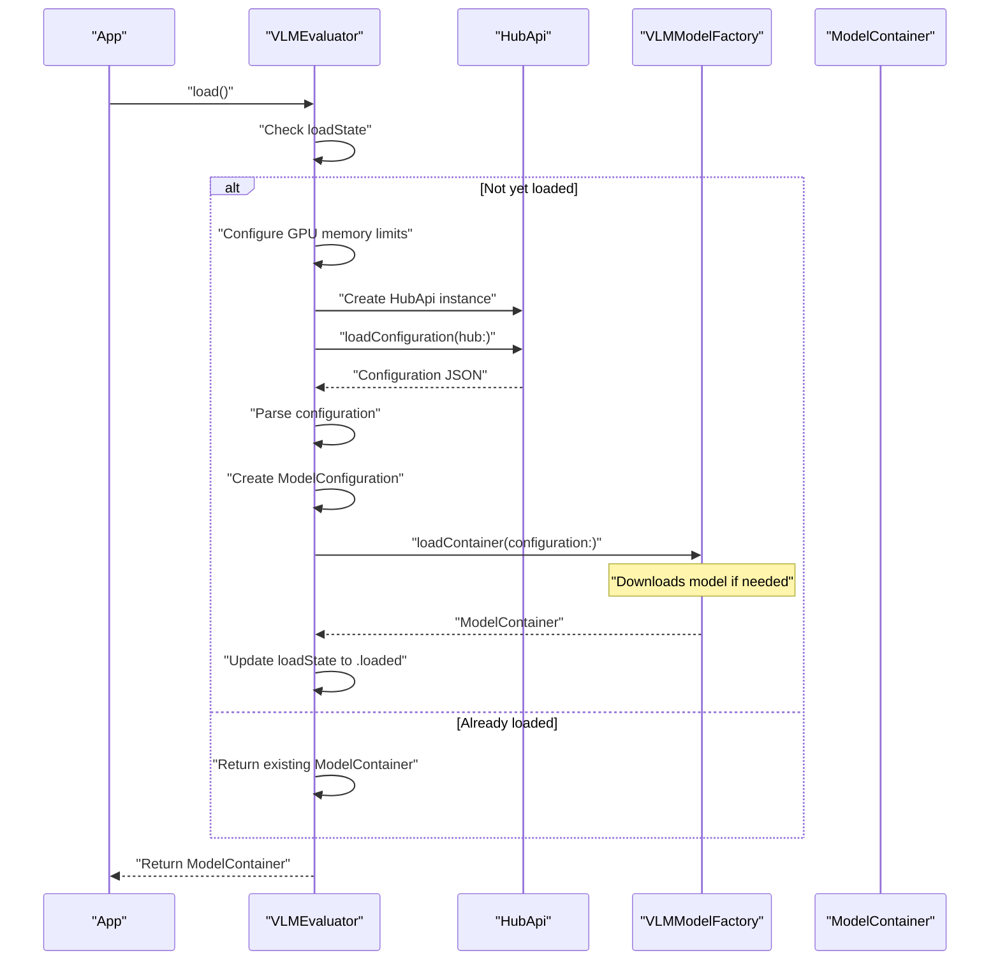

### Memory Management

The loading process includes important memory management steps:

1. Sets GPU cache limit to 20MB: `MLX.GPU.set(cacheLimit: 20 * 1024 * 1024)`
2. Calculates maximum Metal memory as 82% of available memory: `maxMetalMemory = Int(round(0.82 * Double(os_proc_available_memory())))`
3. Sets memory limit for efficient model execution: `MLX.GPU.set(memoryLimit: maxMetalMemory, relaxed: false)`

Sources: [HuggingSnap/Views/VLMEvaluator.swift:90-130]()

## Inference Process

The text generation from visual inputs is handled by the `generate(image:videoURL:)` method.

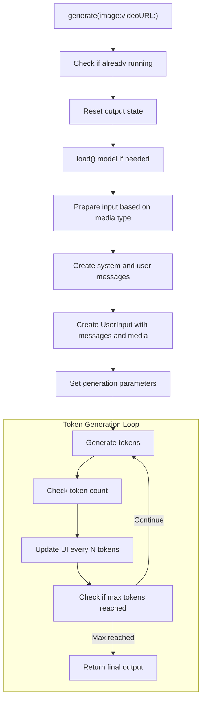

### Input Processing and Context Creation

The system handles both images and videos:

1. Images are oriented correctly before processing
2. Different system and user prompts are selected based on input type (photo vs. video)
3. Inputs are formatted into a standardized message structure for the model

### Generation Control

Text generation includes several control mechanisms:

- Maximum token limit (400 tokens)
- UI update frequency (every 4 tokens)
- Temperature and top-P parameters from configuration
- Error handling with user-facing error messages

Sources: [HuggingSnap/Views/VLMEvaluator.swift:132-224]()

## VLMEvaluator Class Structure

The `VLMEvaluator` class is the central component of the ML system:

```mermaid
classDiagram
    class VLMEvaluator {
        -Bool running
        -String customUserInput
        -String output
        -String modelInfo
        -String stat
        -Int maxTokens
        -Int displayEveryNTokens
        -LoadState loadState
        +load() ModelContainer
        +loadConfiguration(hub: HubApi) HuggingSnapModelConfiguration
        +generate(image: CIImage?, videoURL: URL?) void
    }
    
    class LoadState {
        <<enumeration>>
        idle
        loaded(ModelContainer)
    }
    
    VLMEvaluator *-- LoadState
```

Key properties:
- `running`: Prevents concurrent inference operations
- `customUserInput`: Holds user-provided prompts
- `output`: Stores generated text for UI display
- `modelInfo`: Provides status updates during loading
- `loadState`: Tracks model loading status

Sources: [HuggingSnap/Views/VLMEvaluator.swift:52-75](), [HuggingSnap/Views/VLMEvaluator.swift:69-74]()

## Integration with MLX Framework

The system leverages several MLX libraries for model execution:

```mermaid
graph TD
    VLMEvaluator["VLMEvaluator"] --> MLX["MLX"]
    VLMEvaluator --> MLXLMCommon["MLXLMCommon"]
    VLMEvaluator --> MLXVLM["MLXVLM"]
    
    MLX["MLX"] --> GPU["GPU Operations"]
    MLXLMCommon["MLXLMCommon"] --> TokenGeneration["Token Generation"]
    MLXVLM["MLXVLM"] --> Multimodal["Multimodal Processing"]
    
    TokenGeneration --> GenerateParams["GenerateParameters"]
    Multimodal --> Processor["InputProcessor"]
```

The ML system relies on these key MLX components:
- `MLX`: Core tensor operations and GPU memory management
- `MLXLMCommon`: Common utilities for language model inference
- `MLXVLM`: Support for vision-language model operations

Sources: [HuggingSnap/Views/VLMEvaluator.swift:8-13](), [HuggingSnap.xcodeproj/project.xcworkspace/xcshareddata/swiftpm/Package.resolved:23-29]()

## Data Flow During Inference

The full data flow during the generation process shows how inputs are processed and tokens are generated:

```mermaid
sequenceDiagram
    participant App as "ContentView"
    participant Evaluator as "VLMEvaluator"
    participant Container as "ModelContainer"
    participant Processor as "InputProcessor"
    participant Generator as "Token Generator"
    
    App->>Evaluator: "generate(image, videoURL)"
    Evaluator->>Evaluator: "Check if already running"
    Evaluator->>Evaluator: "Reset output state"
    Evaluator->>Evaluator: "load()"
    
    Evaluator->>Container: "perform { context in ... }"
    
    Container->>Container: "Create UserInput with messages"
    Container->>Processor: "prepare(input: userInput)"
    Processor-->>Container: "Prepared model input"
    
    Container->>Generator: "generate(input, parameters)"
    
    loop Token Generation
        Generator-->>Container: "Generate new tokens"
        Container->>Container: "Check if divisible by displayEveryNTokens"
        alt Update UI
            Container->>Evaluator: "Update output with current text"
            Evaluator->>App: "Update UI with text"
        end
        Container->>Container: "Check if reached maxTokens"
    end
    
    Generator-->>Container: "Final token sequence"
    Container->>Container: "Decode tokens to text"
    Container-->>Evaluator: "Return generation result"
    Evaluator->>Evaluator: "Update statistics"
    Evaluator->>App: "Update UI with final text"
```

Sources: [HuggingSnap/Views/VLMEvaluator.swift:132-224]()

## UI Integration

The ML system integrates with the UI through several mechanisms:

1. The `@Observable` macro enables automatic UI updates when properties change
2. The `@MainActor` annotation ensures UI updates happen on the main thread
3. Progress updates during model loading populate the `modelInfo` property
4. Token generation progressively updates the `output` property
5. The `running` flag prevents parallel operations and manages UI state

Sources: [HuggingSnap/Views/VLMEvaluator.swift:52-53](), [HuggingSnap/Views/VLMEvaluator.swift:196-202]()

## Error Handling

The system includes error handling for the inference process:

```swift
do {
    // Model loading and inference code
} catch {
    output = "Failed: \(error)"
}
```

This provides user-facing error messages when problems occur during model loading or inference.

Sources: [HuggingSnap/Views/VLMEvaluator.swift:219-221]()

## Dependencies

The ML system relies on several external libraries for its functionality:

| Library | Version | Purpose |
|---------|---------|---------|
| MLX Swift | 0.21.3 | Core ML framework |
| MLXLMCommon | via MLX Swift | Language model utilities |
| MLXVLM | via MLX Swift Examples | Vision-language model support |
| Swift Transformers | 0.1.17 | Transformer model implementations |
| Hub | embedded | Hugging Face Hub integration |

Sources: [HuggingSnap.xcodeproj/project.xcworkspace/xcshareddata/swiftpm/Package.resolved:23-29](), [HuggingSnap.xcodeproj/project.xcworkspace/xcshareddata/swiftpm/Package.resolved:95-101](), [HuggingSnap/Views/VLMEvaluator.swift:8-13]()

---

# Page: User Interface Components

# User Interface Components

<details>
<summary>Relevant source files</summary>

The following files were used as context for generating this wiki page:

- [HuggingSnap/Views/ContentView.swift](HuggingSnap/Views/ContentView.swift)
- [HuggingSnap/Views/ControlView.swift](HuggingSnap/Views/ControlView.swift)
- [HuggingSnap/Views/InputView.swift](HuggingSnap/Views/InputView.swift)
- [HuggingSnap/Views/SettingsView.swift](HuggingSnap/Views/SettingsView.swift)

</details>


This document provides a detailed overview of the user interface architecture in HuggingSnap, an iOS application that provides on-device visual intelligence. The UI components manage user interactions, media display, input methods, and result presentation. For information about the underlying machine learning system, see [Machine Learning System](#2.1), and for camera functionality details, see [Camera and Media Management](#2.3).

## UI Component Architecture

HuggingSnap follows a hierarchical view structure using SwiftUI. The UI layer is organized into specialized components that handle specific aspects of the user experience while maintaining a cohesive visual design.

```mermaid
graph TD
    subgraph "Main Structure"
        ContentView["ContentView"] --> FrameView["FrameView"]
        ContentView --> VideoPlayer["VideoPlayer"]
        ContentView --> ImageDisplay["Image Display"]
        ContentView --> MessageView["MessageView"]
        ContentView --> ControlView["ControlView"]
        ContentView --> SettingsView["SettingsView"]
    end

    subgraph "Input Components"
        ControlView --> InputView["InputView"]
        InputView --> TextField["TextField"]
        InputView --> DictationInputToolbar["DictationInputToolbar"]
        DictationInputToolbar --> AudioWaveformView["AudioWaveformView"]
    end

    subgraph "State Management"
        ContentViewModel["ContentViewModel"] --> CameraManager["CameraManager"]
        ContentView --> LoadState["LoadState Enum"]
    end

    ContentView --> ContentViewModel
    ControlView --> ContentViewModel
```

Sources: [HuggingSnap/Views/ContentView.swift:23-282](). [HuggingSnap/Views/ControlView.swift:12-311](). [HuggingSnap/Views/InputView.swift:10-246]().

## Main View Structure (ContentView)

ContentView serves as the primary container for the application UI. It orchestrates different views based on application state and user interactions.

### Key Responsibilities

- Media display (camera feed, photos, and videos)
- State management via the LoadState enum
- Integration with VLMEvaluator for AI processing
- Haptic feedback generation
- Overlay controls and messaging

### View States

The ContentView dynamically changes its display based on the `LoadState` enum:

| State | Purpose | Implementation |
|-------|---------|----------------|
| `.unknown` | Default/initial state | Shows camera feed |
| `.loading` | Loading media | Shows camera feed with loading indicator |
| `.loadedImage(UIImage)` | Displaying a still image | Shows full-screen image |
| `.loadedMovie(Video)` | Displaying a video | Shows video player |
| `.failed` | Error state | Shows camera feed with error indicator |

Sources: [HuggingSnap/Views/ContentView.swift:15-21](). [HuggingSnap/Views/ContentView.swift:53-93]().

### User Interface Flow

```mermaid
sequenceDiagram
    participant User
    participant ContentView
    participant ControlView
    participant InputView
    participant VLMEvaluator

    User->>ContentView: Opens App
    ContentView->>VLMEvaluator: load()
    ContentView->>User: Shows camera feed

    alt Capture Photo
        User->>ControlView: Taps capture button
        ControlView->>ContentView: capturePhoto()
        ContentView->>ContentView: Updates loadState to .loadedImage
        ContentView->>User: Displays captured image
    else Record Video
        User->>ControlView: Long-press capture button
        ControlView->>ContentView: toggleRecording()
        ContentView->>ContentView: Updates loadState to .loadedMovie
        ContentView->>User: Displays recorded video
    else Import Media
        User->>ControlView: Taps photo library button
        ControlView->>ContentView: Shows PhotosPicker
        User->>ContentView: Selects media
        ContentView->>ContentView: Updates loadState accordingly
    end

    User->>ControlView: Taps action button (Describe/Summarize)
    ControlView->>VLMEvaluator: generate()
    VLMEvaluator-->>ContentView: Updates output text
    ContentView->>User: Displays results in MessageView
    ContentView->>User: Provides haptic feedback
```

Sources: [HuggingSnap/Views/ContentView.swift:49-207](). [HuggingSnap/Views/ContentView.swift:209-235](). [HuggingSnap/Views/ControlView.swift:52-298]().

## Control Interface (ControlView)

ControlView manages user interaction elements, providing context-sensitive controls based on the application state. It adapts its interface depending on whether media has been captured or not.

### Main Control Components

1. **Media Capture Controls**:
   - Central circular button for photo capture/video recording
   - Photo library access button
   - Camera switching button

2. **Action Controls** (when media is captured):
   - "Describe" button for images
   - "Summarize" button for videos
   - Text input button
   - Audio input button

3. **Clear button** - Resets the captured media state

The control view transforms contextually after media is captured, replacing camera controls with AI processing options.

Sources: [HuggingSnap/Views/ControlView.swift:52-298](). [HuggingSnap/Views/ControlView.swift:302-310]().

## Input Methods (InputView)

HuggingSnap offers multiple input methods to interact with the visual intelligence system:

```mermaid
flowchart TD
    subgraph "InputView"
        InputField["Text Input Field"]
        AudioButton["Microphone Button"]
        SubmitButton["Submit Button"]
        CancelButton["Cancel Button"]
    end

    subgraph "DictationInputToolbar"
        WaveForm["AudioWaveformView"]
        TimerDisplay["Transcription Timer"]
        CompleteButton["Complete Button"]
        CancelDictation["Cancel Button"]
    end

    InputView -- "Toggle audio mode" --> DictationInputToolbar
    DictationInputToolbar -- "Complete transcription" --> InputView
    InputView -- "Submit text" --> VLMEvaluator["VLMEvaluator.generate()"]
```

### Text Input

The text input interface provides:
- Multi-line text field
- Submit button
- Toggle to speech recognition
- Cancel button

### Speech Recognition

The dictation interface provides:
- Real-time audio waveform visualization
- Transcription timer
- Accept/cancel buttons for the transcribed text
- Automatic transcription via `SpeechRecognizer`

Sources: [HuggingSnap/Views/InputView.swift:10-127](). [HuggingSnap/Views/InputView.swift:129-193](). [HuggingSnap/Views/InputView.swift:195-245]().

## Settings Interface (SettingsView)

The SettingsView provides access to app information and support functions:

### Key Features

- Privacy policy link
- Terms of service link
- App version information
- Contact support via email

The settings interface uses a standard SwiftUI List with sections for organizing related settings.

Sources: [HuggingSnap/Views/SettingsView.swift:11-124]().

## UI State Management

HuggingSnap's UI is heavily state-driven, with several key state variables controlling the interface presentation:

```mermaid
stateDiagram-v2
    [*] --> CameraView: App Launch
    CameraView --> LoadingLLM: Loading Model
    LoadingLLM --> ReadyState: Model Loaded
    
    ReadyState --> ImageCaptured: Take Photo
    ReadyState --> VideoRecorded: Record Video
    ReadyState --> MediaSelected: Select from Library
    
    state ImageCaptured {
        [*] --> ShowingImage
        ShowingImage --> Processing: Tap "Describe"
        ShowingImage --> TextInput: Tap Text Button
        ShowingImage --> AudioInput: Tap Mic Button
        Processing --> ShowingResult: Generation Complete
    }
    
    state VideoRecorded {
        [*] --> PlayingVideo
        PlayingVideo --> Processing: Tap "Summarize" 
        PlayingVideo --> TextInput: Tap Text Button
        PlayingVideo --> AudioInput: Tap Mic Button
    }
    
    TextInput --> Processing: Submit Text
    AudioInput --> TextInput: Complete Dictation
    TextInput --> ImageCaptured: Cancel
    AudioInput --> ImageCaptured: Cancel
    
    ImageCaptured --> ReadyState: Tap X
    VideoRecorded --> ReadyState: Tap X
    MediaSelected --> ReadyState: Tap X
```

### Key State Variables

| State Variable | Location | Purpose |
|----------------|----------|---------|
| `isCaptured` | ContentView | Tracks if media has been captured |
| `loadState` | ContentView | Manages media display state |
| `isLLMLoaded` | ContentView | Controls model loading overlay |
| `showInputView` | ControlView | Toggles input interface visibility |
| `isAudioMode` | InputView | Controls text vs. audio input mode |

Sources: [HuggingSnap/Views/ContentView.swift:28-34](). [HuggingSnap/Views/ControlView.swift:17-34](). [HuggingSnap/Views/InputView.swift:14-17]().

## Haptic Feedback

HuggingSnap incorporates haptic feedback to enhance the user experience:

- Initialization with `prepareHaptics()` method
- Multi-stage haptic pattern triggered on AI processing completion
- Custom intensity patterns for notification feedback

Sources: [HuggingSnap/Views/ContentView.swift:284-325]().

## Accessibility Support

The interface includes accessibility features throughout:
- Labeled buttons with descriptive text
- Proper focus management
- Voice-over compatible controls

Sources: [HuggingSnap/Views/ContentView.swift:111](). [HuggingSnap/Views/ControlView.swift:92-288](). [HuggingSnap/Views/SettingsView.swift:41-82]().

---

# Page: Camera and Media Management

# Camera and Media Management

<details>
<summary>Relevant source files</summary>

The following files were used as context for generating this wiki page:

- [HuggingSnap/Camera/CameraManager.swift](HuggingSnap/Camera/CameraManager.swift)
- [HuggingSnap/Extensions/AVPlayerExtension.swift](HuggingSnap/Extensions/AVPlayerExtension.swift)
- [HuggingSnap/Extensions/Transferable.swift](HuggingSnap/Extensions/Transferable.swift)
- [HuggingSnap/Views/ContentView.swift](HuggingSnap/Views/ContentView.swift)

</details>


This document describes the camera and media management system in HuggingSnap. It covers the architecture and functionality for capturing photos and videos, handling media files, and integrating them with the visual intelligence processing pipeline. For information about the machine learning system that processes these media files, see [Machine Learning System](#2.1), and for information about the speech recognition capabilities, see [Speech Recognition System](#2.4).

## 1. System Overview

The camera and media management system in HuggingSnap provides the following core capabilities:

- Real-time camera preview
- Photo capture
- Video recording
- Camera switching (front/back)
- Media import from device photo library
- Video playback
- Media routing to the visual language model for analysis

Sources: [HuggingSnap/Camera/CameraManager.swift:11-312](), [HuggingSnap/Views/ContentView.swift:23-342]()

## 2. Architecture

### Camera and Media Management Architecture

```mermaid
classDiagram
    class CameraManager {
        -AVCaptureSession session
        -AVCapturePhotoOutput photoOutput
        -AVCaptureMovieFileOutput movieOutput
        -Data? photo
        -Bool isRecording
        -URL? movieURL
        -AVCaptureDevice.Position cameraPosition
        +configure()
        +switchCamera()
        +capturePhoto()
        +toggleRecording()
        +toggleStreaming()
    }
    
    class ContentViewModel {
        -CameraManager cameraManager
        -CIImage? frame
        -Data? photo
        -URL? movieURL
        +capturePhoto()
        +toggleRecording()
    }
    
    class ContentView {
        -ContentViewModel model
        -LoadState loadState
        -PhotosPickerItem? selectedItem
        -AVPlayer player
        +setupPlayer(with: URL)
    }
    
    class Video {
        +URL url
        +static TransferRepresentation transferRepresentation
    }
    
    ContentView --> ContentViewModel : uses
    ContentViewModel --> CameraManager : wraps
    CameraManager ..> "AVCapturePhotoCaptureDelegate" : implements
    CameraManager ..> "AVCaptureFileOutputRecordingDelegate" : implements
    ContentView ..> Video : displays
```

Sources: [HuggingSnap/Camera/CameraManager.swift:11-312](), [HuggingSnap/Views/ContentView.swift:29-40](), [HuggingSnap/Extensions/Transferable.swift:11-28]()

### Media Capture and Processing Flow

```mermaid
flowchart TD
    subgraph "User Interface"
        UI["ContentView"]
        Controls["ControlView"]
    end
    
    subgraph "Media Capture Components"
        CM["CameraManager"]
        PO["photoOutput: AVCapturePhotoOutput"]
        MO["movieOutput: AVCaptureMovieFileOutput"]
        PP["PhotosPicker"]
    end
    
    subgraph "Media Types"
        Photo["Photo (Data)"]
        Video["Video (URL)"]
        SelectedItem["PhotosPickerItem"]
    end
    
    subgraph "Media State"
        LS["loadState: LoadState"]
        subgraph "LoadState Enum"
            Unknown["unknown"]
            Loading["loading"]
            LoadedImage["loadedImage(UIImage)"]
            LoadedMovie["loadedMovie(Video)"]
            Failed["failed"]
        end
    end
    
    subgraph "Presentation"
        ImageView["Image View"]
        VideoPlayer["AVPlayer"]
    end
    
    subgraph "ML Integration"
        VLM["VLMEvaluator"]
    end
    
    Controls -->|"capturePhoto()"| CM
    Controls -->|"toggleRecording()"| CM
    Controls -->|"selectItem"| PP
    
    CM -->|"photoOutput.capturePhoto()"| PO
    CM -->|"movieOutput.startRecording()"| MO
    
    PO -->|"didFinishProcessingPhoto"| Photo
    MO -->|"didFinishRecordingTo"| Video
    PP -->|"loadTransferable"| SelectedItem
    
    Photo -->|"model.photo update"| LS
    Video -->|"model.movieURL update"| LS
    SelectedItem -->|"selectedItem update"| LS
    
    LS -->|"loadedImage"| ImageView
    LS -->|"loadedMovie"| VideoPlayer
    
    ImageView -->|"generate(image:, videoURL: nil)"| VLM
    VideoPlayer -->|"generate(image: nil, videoURL:)"| VLM
```

Sources: [HuggingSnap/Views/ContentView.swift:49-266](), [HuggingSnap/Camera/CameraManager.swift:233-287]()

## 3. Core Components

### 3.1 CameraManager

The `CameraManager` class is the central component that handles all camera operations. It is implemented as a singleton (`shared`) to ensure a single consistent camera instance throughout the app.

Key properties:
- `session`: The `AVCaptureSession` that coordinates the flow of data from input devices to outputs
- `photoOutput`: Handles photo capture operations
- `movieOutput`: Handles video recording operations
- `photo`: Stores the most recently captured photo data
- `movieURL`: Stores the URL of the most recently recorded video
- `isRecording`: Indicates if video recording is in progress
- `cameraPosition`: Tracks which camera is currently active (front or back)
- `isStreamingPaused`: Indicates if the camera preview is currently paused

Key methods:
- `configure()`: Sets up the capture session with appropriate inputs and outputs
- `capturePhoto()`: Captures a still image
- `toggleRecording()`: Starts or stops video recording
- `switchCamera()`: Toggles between front and back cameras
- `toggleStreaming()`: Pauses or resumes the camera preview

Sources: [HuggingSnap/Camera/CameraManager.swift:11-312]()

### 3.2 ContentViewModel

This class serves as an intermediary between the UI (`ContentView`) and the camera system (`CameraManager`). It provides a simplified interface for camera operations and publishes camera state for the UI to observe.

Sources: [HuggingSnap/Views/ContentView.swift:29]()

### 3.3 Video

The `Video` struct implements the `Transferable` protocol, allowing videos to be transferred between the app and system services like Photos library. It encapsulates a video file URL and provides the necessary transfer representations.

Sources: [HuggingSnap/Extensions/Transferable.swift:11-28]()

### 3.4 LoadState

The `LoadState` enum tracks the current state of media loading and display:
- `unknown`: Initial state
- `loading`: Media is being loaded
- `loadedImage(UIImage)`: An image has been loaded and is ready for display
- `loadedMovie(Video)`: A video has been loaded and is ready for playback
- `failed`: Media loading failed

Sources: [HuggingSnap/Views/ContentView.swift:15-21]()

## 4. Camera Operations

### 4.1 Camera Configuration and Permissions

The camera system initializes by checking for camera permissions and configuring the `AVCaptureSession` with appropriate inputs and outputs. The configuration process follows these steps:

1. Check camera access permissions using `AVCaptureDevice.authorizationStatus`
2. Request permissions if not already determined
3. Create and configure the capture session with:
   - Camera input (default to back camera)
   - Photo output for still images
   - Movie output for video recording
   - Video output for preview frames

If any step fails, appropriate error states are set and published.

Sources: [HuggingSnap/Camera/CameraManager.swift:53-157]()

### 4.2 Photo Capture

The photo capture flow is as follows:

```mermaid
sequenceDiagram
    participant UI as ContentView/ControlView
    participant VM as ContentViewModel
    participant CM as CameraManager
    participant PO as AVCapturePhotoOutput
    participant UI2 as ContentView (Update)
    participant ML as VLMEvaluator
    
    UI->>VM: capturePhoto()
    VM->>CM: capturePhoto()
    CM->>CM: Get videoOrientation()
    CM->>PO: capturePhoto(with: settings, delegate: self)
    Note over CM,PO: Photo capture happens asynchronously
    PO-->>CM: photoOutput(_:didFinishProcessingPhoto:error:)
    CM-->>VM: Update photo property
    VM-->>UI2: onChange(of: model.photo)
    UI2->>UI2: Update loadState = .loadedImage
    UI2->>UI2: Set isCaptured = true
    UI2->>ML: generate(image:, videoURL: nil)
```

Sources: [HuggingSnap/Camera/CameraManager.swift:233-244](), [HuggingSnap/Camera/CameraManager.swift:314-330](), [HuggingSnap/Views/ContentView.swift:209-219]()

### 4.3 Video Recording

The video recording flow is as follows:

```mermaid
sequenceDiagram
    participant UI as ContentView/ControlView
    participant VM as ContentViewModel
    participant CM as CameraManager
    participant MO as AVCaptureMovieFileOutput
    participant UI2 as ContentView (Update)
    participant ML as VLMEvaluator
    
    UI->>VM: toggleRecording()
    VM->>CM: toggleRecording()
    
    alt Start Recording
        CM->>CM: startRecording()
        CM->>CM: Create temporary file URL
        CM->>MO: startRecording(to: path, recordingDelegate: self)
        CM-->>VM: Update isRecording = true
    else Stop Recording
        CM->>MO: stopRecording()
        CM-->>VM: Update isRecording = false
        CM-->>VM: Update movieURL
    end
    
    Note over CM,MO: Recording stops and file is saved
    MO-->>CM: fileOutput(_:didFinishRecordingTo:from:error:)
    VM-->>UI2: onChange(of: model.movieURL)
    UI2->>UI2: Update loadState = .loadedMovie
    UI2->>UI2: Set isCaptured = true
    UI2->>ML: generate(image: nil, videoURL:)
```

Sources: [HuggingSnap/Camera/CameraManager.swift:246-287](), [HuggingSnap/Camera/CameraManager.swift:332-345](), [HuggingSnap/Views/ContentView.swift:225-236]()

### 4.4 Camera Switching

The camera switching operation reconfigures the capture session to use either the front or back camera:

1. Begin session configuration
2. Remove existing camera input
3. Toggle `cameraPosition` between front and back
4. Add new camera input based on the updated position
5. Update video connection properties (rotation angle, mirroring)
6. Commit session configuration

Sources: [HuggingSnap/Camera/CameraManager.swift:159-214]()

## 5. Media Management

### 5.1 Photo Processing

Photos captured by the `CameraManager` are:
1. Converted to `Data` objects via `fileDataRepresentation()`
2. Published through the `photo` property
3. Detected by `ContentView` and converted to `UIImage` for display
4. Set in the `loadState` as `.loadedImage(UIImage)`
5. Displayed in the UI via an `Image` view with appropriate styling
6. Passed to the `VLMEvaluator` for analysis

Sources: [HuggingSnap/Camera/CameraManager.swift:314-330](), [HuggingSnap/Views/ContentView.swift:76-93](), [HuggingSnap/Views/ContentView.swift:209-219]()

### 5.2 Video Management

Videos recorded by the `CameraManager` are:
1. Saved to a temporary file in the documents directory
2. The URL is published through the `movieURL` property
3. Detected by `ContentView` and wrapped in a `Video` object
4. Set in the `loadState` as `.loadedMovie(Video)`
5. Played back using an `AVPlayer` configured with loop functionality
6. Passed to the `VLMEvaluator` for analysis

Sources: [HuggingSnap/Camera/CameraManager.swift:254-287](), [HuggingSnap/Camera/CameraManager.swift:332-345](), [HuggingSnap/Views/ContentView.swift:59-74](), [HuggingSnap/Views/ContentView.swift:225-236](), [HuggingSnap/Views/ContentView.swift:327-341]()

### 5.3 Photo Library Integration

HuggingSnap integrates with the device's photo library using `PhotosPicker` to allow selecting existing photos and videos:

1. Selection through `PhotosPicker` produces a `PhotosPickerItem`
2. The item is loaded asynchronously using `loadTransferable`
3. Depending on the content type, it's processed as:
   - For videos: Loaded as `Video` and set in `loadState` as `.loadedMovie`
   - For images: Loaded as `Data`, converted to `UIImage`, and set in `loadState` as `.loadedImage`
4. The imported media is then displayed and processed like directly captured media

Sources: [HuggingSnap/Views/ContentView.swift:33](), [HuggingSnap/Views/ContentView.swift:238-266](), [HuggingSnap/Extensions/Transferable.swift:11-28]()

## 6. Integration with UI and ML System

### 6.1 UI Integration

The camera preview and media display are integrated into the `ContentView`, with controls provided by `ControlView`. The state of the camera system and loaded media drives the UI display through SwiftUI state bindings.

Key UI integration points:
- Camera preview shown through `FrameView`
- Photos displayed through SwiftUI `Image` view
- Videos played through `VideoPlayer`
- Camera controls provided by `ControlView`
- Media state tracked through `loadState` enum

Sources: [HuggingSnap/Views/ContentView.swift:49-94](), [HuggingSnap/Views/ContentView.swift:130]()

### 6.2 ML System Integration

Captured or imported media is passed to the `VLMEvaluator` for analysis:

1. When a photo is captured or loaded, it's passed to `VLMEvaluator.generate(image:, videoURL:)`
2. When a video is recorded or loaded, it's passed to `VLMEvaluator.generate(image: nil, videoURL:)`
3. The `VLMEvaluator` processes the media and generates descriptive text
4. The generated text is displayed to the user through `MessageView`

The tight integration between the camera system and ML components allows for a seamless flow from media capture to visual intelligence analysis.

Sources: [HuggingSnap/Views/ContentView.swift:40](), [HuggingSnap/Views/ContentView.swift:115]()

## 7. Key Implementation Details

### 7.1 Video Playback Customization

Videos are played back using `AVPlayer` with customized behavior:
- Looped playback (using notification observation of `AVPlayerItemDidPlayToEndTime`)
- Hidden playback controls (via `AVPlayerViewController` extension)
- Automatic playback on load

Sources: [HuggingSnap/Views/ContentView.swift:327-341](), [HuggingSnap/Extensions/AVPlayerExtension.swift:11-16]()

### 7.2 Camera Orientation Handling

The camera system handles device orientation by:
- Determining the current device orientation
- Mapping it to the appropriate `AVCaptureVideoOrientation`
- Applying the orientation to photo captures and video recordings
- Handling rotation and mirroring for front vs. back camera

Sources: [HuggingSnap/Camera/CameraManager.swift:216-232](), [HuggingSnap/Camera/CameraManager.swift:238-241]()

### 7.3 Camera Stream Control

The camera preview stream can be paused and resumed, which is used when:
- A photo is captured and being displayed
- A video is recorded and being played back
- Media is imported from the photo library

This helps conserve battery and processing power when the camera is not actively needed.

Sources: [HuggingSnap/Camera/CameraManager.swift:299-311](), [HuggingSnap/Views/ContentView.swift:211-214](), [HuggingSnap/Views/ContentView.swift:228-231](), [HuggingSnap/Views/ContentView.swift:239-241]()

## 8. Error Handling

The camera system implements comprehensive error handling through:

1. A dedicated `CameraError` enum (not shown in provided code)
2. Error state publishing through `@Published var error: CameraError?`
3. Status tracking via `Status` enum (unconfigured, configured, unauthorized, failed)
4. UI feedback based on error states

Common error conditions handled include:
- Camera permission denied or restricted
- Camera hardware unavailable
- Inability to configure inputs or outputs
- Failures during photo capture or video recording

Sources: [HuggingSnap/Camera/CameraManager.swift:12-17](), [HuggingSnap/Camera/CameraManager.swift:32](), [HuggingSnap/Camera/CameraManager.swift:47-51]()

---

# Page: Speech Recognition System

# Speech Recognition System

<details>
<summary>Relevant source files</summary>

The following files were used as context for generating this wiki page:

- [HuggingSnap/SpeechTranscriptionModel.swift](HuggingSnap/SpeechTranscriptionModel.swift)
- [HuggingSnap/Views/InputView.swift](HuggingSnap/Views/InputView.swift)

</details>


## Purpose and Scope

This document details the speech recognition capabilities within HuggingSnap that enable voice input and transcription. The system provides a seamless way for users to interact with the application using voice commands rather than typing. This functionality complements the camera and media input systems (see [Camera and Media Management](#2.3)) by providing an alternative input method for the machine learning system (see [Machine Learning System](#2.1)).

Sources: [HuggingSnap/SpeechTranscriptionModel.swift:22-39](), [HuggingSnap/Views/InputView.swift:10-17]()

## System Architecture

The Speech Recognition System is built on Apple's native speech recognition frameworks and consists of three primary components:

1. **SpeechRecognizer**: Core actor class handling speech-to-text conversion
2. **DictationInputToolbar**: UI component for speech input
3. **AudioWaveformView**: Visualization component for audio input levels

### Component Architecture

```mermaid
classDiagram
    class "SpeechRecognizer" {
        -SFSpeechRecognizer recognizer
        -AVAudioEngine audioEngine
        -String transcript
        -[Float] audioLevels
        +startTranscribing()
        +stopTranscribing()
        +resetTranscript()
        -transcribe()
        -processAudioData()
    }
    
    class "DictationInputToolbar" {
        -SpeechRecognizer audioRecorder
        -Boolean toggleDictationMode
        -String inputText
        -stopDictation()
        -confirmTranscription()
    }
    
    class "AudioWaveformView" {
        -Boolean isDictationMode
        -[Float] samples
        -audioCapsuleHeight()
        -audioCapsuleColor()
    }
    
    class "InputView" {
        -VLMEvaluator llm
        -SpeechRecognizer audioRecorder
        -Boolean isTextMode
        -Boolean isAudioMode
        -String textFieldText
        -onSubmitAction()
    }
    
    class "SFSpeechRecognizer" {
        +hasAuthorizationToRecognize()
    }
    
    class "AVAudioEngine" {
        -inputNode
    }
    
    class "AVAudioSession" {
        +hasPermissionToRecord()
    }
    
    "InputView" --> "SpeechRecognizer" : creates
    "InputView" --> "DictationInputToolbar" : contains
    "DictationInputToolbar" --> "AudioWaveformView" : contains
    "DictationInputToolbar" --> "SpeechRecognizer" : uses
    "SpeechRecognizer" --> "SFSpeechRecognizer" : uses
    "SpeechRecognizer" --> "AVAudioEngine" : uses
    "SpeechRecognizer" --> "AVAudioSession" : checks permissions
```

Sources: [HuggingSnap/SpeechTranscriptionModel.swift:23-214](), [HuggingSnap/Views/InputView.swift:10-127](), [HuggingSnap/Views/InputView.swift:129-193]()

## Core Components

### SpeechRecognizer

The `SpeechRecognizer` actor is the foundation of the speech recognition system. As an actor, it provides thread-safe access to shared mutable state like the transcript and audio levels.

Key responsibilities:
- Managing the speech recognition lifecycle
- Processing audio input
- Extracting and visualizing audio levels
- Handling permissions and errors
- Providing the transcribed text

```mermaid
flowchart TD
    subgraph "SpeechRecognizer"
        init["Initialize"] --> checkAuth["Check Authorization"]
        checkAuth --> prepare["Prepare Audio Engine"]
        prepare --> startTrans["Start Transcribing"]
        startTrans --> processAudio["Process Audio"]
        processAudio --> updateVis["Update Visualization"]
        processAudio --> updateTrans["Update Transcript"]
        
        stopTrans["Stop Transcribing"] --> cleanUp["Clean Up Resources"]
        resetTrans["Reset Transcript"] --> cleanUp
    end
    
    userStart["User Starts Recording"] --> startTrans
    userStop["User Stops Recording"] --> stopTrans
    userConfirm["User Confirms Transcript"] --> stopTrans
```

The `SpeechRecognizer` handles several potential error cases:
- Unavailable recognizer
- Missing authorization to recognize speech
- No permission to record audio

Sources: [HuggingSnap/SpeechTranscriptionModel.swift:23-39](), [HuggingSnap/SpeechTranscriptionModel.swift:55-78](), [HuggingSnap/SpeechTranscriptionModel.swift:119-143]()

### Audio Processing and Visualization

The speech recognition system not only converts speech to text but also provides visual feedback through an audio waveform visualization:

1. Audio samples are captured from the microphone
2. The audio levels are processed using Accelerate framework
3. The levels are normalized and scaled for visualization
4. The `AudioWaveformView` displays these levels as animated capsules

```mermaid
sequenceDiagram
    participant User as "User"
    participant Input as "InputView"
    participant Dict as "DictationInputToolbar"
    participant SR as "SpeechRecognizer"
    participant AVE as "AVAudioEngine"
    participant SFR as "SFSpeechRecognizer"
    participant Wave as "AudioWaveformView"
    
    User->>Input: Toggle audio mode
    Input->>Dict: Show dictation toolbar
    Dict->>SR: startTranscribing()
    SR->>AVE: Set up audio capture
    SR->>SFR: Create recognition request
    AVE-->>SR: Audio buffer callbacks
    SR->>SR: processAudioData()
    SR-->>Wave: Update audio levels
    Wave-->>User: Display waveform
    
    SFR-->>SR: Recognition results
    SR-->>Dict: Update transcript
    
    User->>Dict: Tap confirm button
    Dict->>SR: stopTranscribing()
    Dict->>Input: Update textFieldText with transcript
    Dict->>Input: Toggle audio mode off
```

Sources: [HuggingSnap/SpeechTranscriptionModel.swift:45-46](), [HuggingSnap/SpeechTranscriptionModel.swift:154-181](), [HuggingSnap/SpeechTranscriptionModel.swift:247-281](), [HuggingSnap/Views/InputView.swift:195-245]()

## User Interface Components

### InputView

The `InputView` serves as the container for both text input and speech input. It switches between these modes based on user interaction:

- Text input mode: Shows a TextField with a microphone button
- Audio mode: Shows the DictationInputToolbar with waveform visualization

Upon completion of speech recognition, the transcribed text is added to the text field and can be used as input for the VLM system.

### DictationInputToolbar

This toolbar appears when the user activates speech recognition mode. It provides:
- A cancel button to stop recording and discard the transcript
- A visual audio waveform showing microphone input levels
- A timer showing the duration of the current recording
- A confirm button to accept the transcription and return to text mode

Sources: [HuggingSnap/Views/InputView.swift:10-127](), [HuggingSnap/Views/InputView.swift:129-193]()

## Permission Handling

The speech recognition system requires two specific permissions:
1. Speech recognition authorization (`SFSpeechRecognizer` authorization)
2. Microphone access permission (`AVAudioSession` recording permission)

The system handles these permissions through extension methods:
- `SFSpeechRecognizer.hasAuthorizationToRecognize()`
- `AVAudioSession.hasPermissionToRecord()`

These are checked asynchronously when the `SpeechRecognizer` is initialized and appropriate error messages are displayed if permissions are not granted.

Sources: [HuggingSnap/SpeechTranscriptionModel.swift:217-244](), [HuggingSnap/SpeechTranscriptionModel.swift:66-77]()

## Integration Flow

```mermaid
flowchart TB
    subgraph "User Interaction"
        userInput["User Input"]
        userInput --> textInput["Text Input"]
        userInput --> speechInput["Speech Input"]
    end
    
    subgraph "Speech Recognition System"
        speechInput --> sr["SpeechRecognizer"]
        sr --> transcript["Transcribed Text"]
    end
    
    subgraph "Text Processing"
        transcript --> inputText["Input Text Field"]
        textInput --> inputText
        inputText --> submit["Submit to VLM"]
    end
    
    subgraph "VLM System"
        submit --> vlm["VLMEvaluator"]
        vlm --> response["Generated Response"]
    end
    
    response --> display["Display Results to User"]
```

The speech recognition system is tightly integrated with the text input system. When a user confirms a transcription, it gets added to the text field. This text can then be submitted to the VLM system for processing along with any image or video that has been captured.

Sources: [HuggingSnap/Views/InputView.swift:172-177](), [HuggingSnap/Views/InputView.swift:46-52]()

## Technical Implementation Details

### Audio Engine Configuration

The speech recognition system configures an `AVAudioEngine` instance to capture audio from the device's microphone. It installs a tap on the input node to receive audio buffers, which are then:

1. Sent to the `SFSpeechAudioBufferRecognitionRequest` for transcription
2. Analyzed to extract audio levels for visualization

The audio session is configured specifically for speech recognition:
- Category: `.playAndRecord`
- Mode: `.measurement`
- Options: `.duckOthers` (lowers volume of other audio during recording)

Sources: [HuggingSnap/SpeechTranscriptionModel.swift:154-181]()

### Audio Level Processing

The system processes audio levels using the Accelerate framework for efficient signal processing:

1. Extracts raw audio samples from the audio buffer
2. Calculates the Root Mean Square (RMS) of the audio samples using `vDSP_measqv`
3. Converts RMS to decibels
4. Normalizes and scales the values for visualization
5. Applies non-linear scaling for better visual effect

Sources: [HuggingSnap/SpeechTranscriptionModel.swift:247-281]()

## State Management

The `SpeechRecognizer` actor uses Swift's concurrency features to manage state safely across threads:

- `@MainActor` properties for UI updates
- Actor isolation for thread safety
- Dedicated dispatch queue for audio processing
- Task-based asynchronous operations

This ensures that UI updates occur on the main thread while computationally intensive audio processing happens in the background.

Sources: [HuggingSnap/SpeechTranscriptionModel.swift:40-46](), [HuggingSnap/SpeechTranscriptionModel.swift:183-213]()

## Timing and User Feedback

The system provides timing feedback during recording:

1. When recording starts, a timer is initialized
2. The timer updates once per second to show the elapsed recording time
3. A formatted time string (MM:SS) is displayed in the DictationInputToolbar

Additionally, visual feedback is provided through:
- The audio waveform visualization that responds to speech volume
- Smooth animations for waveform changes
- Automatic scrolling to show the most recent audio levels

Sources: [HuggingSnap/Views/InputView.swift:137-142](), [HuggingSnap/Views/InputView.swift:162-170](), [HuggingSnap/Views/InputView.swift:195-245]()

## Error Handling

The speech recognition system defines a custom `RecognizerError` enum with descriptive error messages for common failure scenarios:

| Error Type | Description | User-Facing Message |
|------------|-------------|---------------------|
| nilRecognizer | Speech recognizer couldn't be initialized | "Can't initialize speech recognizer" |
| notAuthorizedToRecognize | User hasn't granted speech recognition permission | "Not authorized to recognize speech" |
| notPermittedToRecord | User hasn't granted microphone permission | "Not permitted to record audio" |
| recognizerIsUnavailable | Speech recognition service is unavailable | "Recognizer is unavailable" |

When errors occur, they are translated into user-friendly messages displayed in the transcript field.

Sources: [HuggingSnap/SpeechTranscriptionModel.swift:24-38](), [HuggingSnap/SpeechTranscriptionModel.swift:203-213]()

## Conclusion

The Speech Recognition System in HuggingSnap provides an intuitive voice input method that complements the camera-based input capabilities. It leverages Apple's speech recognition frameworks while adding custom audio visualization and a streamlined user interface. The system is carefully integrated with the text input system, allowing users to seamlessly switch between typing and speaking when interacting with the application.

---

# Page: Developer Guide

# Developer Guide

<details>
<summary>Relevant source files</summary>

The following files were used as context for generating this wiki page:

- [.gitignore](.gitignore)
- [HuggingSnap.xcodeproj/project.pbxproj](HuggingSnap.xcodeproj/project.pbxproj)
- [HuggingSnap/Info.plist](HuggingSnap/Info.plist)
- [README.md](README.md)

</details>


This guide provides comprehensive information for developers who want to contribute to or modify the HuggingSnap iOS application. It covers the development environment setup, project structure, build processes, and core implementation details. For general application overview, refer to [HuggingSnap Overview](#1), and for detailed architecture information, see [System Architecture](#2).

## Development Environment Setup

### Prerequisites

To develop for HuggingSnap, you'll need:

| Requirement | Details |
|-------------|---------|
| macOS | macOS Sonoma 14.0 or later |
| Xcode | Xcode 16.0 or later |
| iOS Device | iPhone running iOS 18.0 or later (for testing) |
| Git | For source code management |

### Getting Started

1. Clone the repository:
   ```bash
   git clone https://github.com/huggingface/HuggingSnap.git
   cd HuggingSnap
   ```

2. Open the project in Xcode:
   ```bash
   open HuggingSnap.xcodeproj
   ```

3. Before running on your device, update the bundle identifier and developer team in the project settings.

Sources: [README.md:15-23](), [HuggingSnap.xcodeproj/project.pbxproj:215-216]()

## Project Structure Overview

HuggingSnap follows a modular architecture separating concerns between UI, machine learning, and media capture functionality.

```mermaid
graph TD
    subgraph "Project_Structure"
        direction TB
        Root["HuggingSnap Project"]
        Assets["Assets.xcassets"]
        Sources["Swift Source Files"]
        Frameworks["External Frameworks"]
        Config["Configuration Files"]
    end
    
    Root --> Assets
    Root --> Sources
    Root --> Frameworks
    Root --> Config
    
    subgraph "Frameworks"
        MLXLMCommon["MLXLMCommon"]
        MLXVLM["MLXVLM"]
        MarkdownUI["MarkdownUI"]
    end
    
    subgraph "Source_Structure"
        App["App Entry"]
        Views["UI Views"]
        ViewModels["View Models"]
        ML["ML Components"]
        Media["Media Components"]
        Utilities["Utilities"]
    end
    
    Sources --> App
    Sources --> Views
    Sources --> ViewModels
    Sources --> ML
    Sources --> Media
    Sources --> Utilities
```

Sources: [HuggingSnap.xcodeproj/project.pbxproj:28-37](), [HuggingSnap.xcodeproj/project.pbxproj:53-69]()

### Key Components

The codebase is organized into several logical layers:

1. **UI Layer**: SwiftUI views for user interaction
2. **ML Layer**: Vision Language Model integration 
3. **Media Layer**: Camera and media handling
4. **Utility Layer**: Helper functions and extensions

## Build Configuration

### Project Settings

HuggingSnap is configured as an iOS application with specific build settings:

| Setting | Value |
|---------|-------|
| iOS Deployment Target | 18.0 |
| Device Support | iPhone only |
| Swift Version | 5.0 |
| Bundle Identifier | co.huggingface.HuggingSnap (needs to be changed for personal use) |

Sources: [HuggingSnap.xcodeproj/project.pbxproj:209-216](), [HuggingSnap.xcodeproj/project.pbxproj:297-311]()

### Required Permissions

The application requires several iOS permissions, which are defined in the Info.plist and project settings:

| Permission | Usage Description |
|------------|-------------------|
| Camera | For live video descriptions |
| Microphone | For live video descriptions |
| Photo Library | For accessing and saving media |
| Speech Recognition | For transcribing audio |

Sources: [HuggingSnap.xcodeproj/project.pbxproj:289-293]()

## Dependencies and Integration

```mermaid
flowchart TD
    subgraph "App_Dependencies"
        HuggingSnap["HuggingSnap App"]
        MLXVLM["MLXVLM Package"]
        MLXLMCommon["MLXLMCommon Package"]
        MarkdownUI["MarkdownUI Package"]
    end
    
    HuggingSnap --> MLXVLM
    HuggingSnap --> MLXLMCommon
    HuggingSnap --> MarkdownUI
    
    subgraph "External_Repositories"
        MLXSwiftExamples["mlx-swift-examples Repository"]
        SwiftMarkdownUI["swift-markdown-ui Repository"]
    end
    
    MLXVLM --> MLXSwiftExamples
    MLXLMCommon --> MLXSwiftExamples
    MarkdownUI --> SwiftMarkdownUI
    
    MLXSwiftExamples --> |"Branch: main"| MLXSwiftRepo["github.com/cyrilzakka/mlx-swift-examples"]
    SwiftMarkdownUI --> |"Version: ≥2.4.1"| MarkdownUIRepo["github.com/gonzalezreal/swift-markdown-ui"]
```

### Package Dependencies

HuggingSnap relies on the following Swift packages:

1. **MLX Swift Examples**: A modified version providing VLM support
   - Products used: MLXLMCommon, MLXVLM
   - Repository URL: https://github.com/cyrilzakka/mlx-swift-examples
   - Branch: main

2. **Swift Markdown UI**: For rendering markdown content
   - Product used: MarkdownUI
   - Repository URL: https://github.com/gonzalezreal/swift-markdown-ui
   - Version: 2.4.1 or higher

Sources: [HuggingSnap.xcodeproj/project.pbxproj:377-393](), [HuggingSnap.xcodeproj/project.pbxproj:396-411](), [README.md:12]()

## Development Workflow

```mermaid
flowchart LR
    subgraph "Development_Workflow"
        direction LR
        Setup["1. Setup Environment"]
        Modify["2. Modify Code"]
        Build["3. Build Project"]
        Test["4. Test on Device"]
        Debug["5. Debug Issues"]
        Commit["6. Commit Changes"]
    end
    
    Setup --> Modify
    Modify --> Build
    Build --> Test
    Test --> Debug
    Debug --> Modify
    Test --> Commit
    
    subgraph "Build_Process"
        Xcode["Xcode Build System"]
        SwiftCompile["Swift Compilation"]
        ResourceProcess["Resource Processing"]
        LinkFrameworks["Link Frameworks"]
        Package["Package Application"]
        Deploy["Deploy to Device"]
    end
    
    Build --> Xcode
    Xcode --> SwiftCompile
    Xcode --> ResourceProcess
    SwiftCompile --> LinkFrameworks
    ResourceProcess --> LinkFrameworks
    LinkFrameworks --> Package
    Package --> Deploy
    Deploy --> Test
```

### Common Development Tasks

1. **Modifying UI Components**:
   - UI components are implemented as SwiftUI views
   - Main entry point is ContentView 
   - Camera controls are in ControlView
   - Settings are in SettingsView

2. **Working with ML Components**:
   - The VLMEvaluator class handles model loading and inference
   - ModelContainer manages the SmolVLM2 model
   - Configuration is loaded from Hugging Face Hub

3. **Media Handling**:
   - CameraManager provides camera functionality
   - Photo library access for selecting existing media
   - SpeechRecognizer for audio transcription

## Running on Your Device

To run HuggingSnap on your personal device:

1. In Xcode, select the HuggingSnap project in the Project Navigator
2. Go to the "Signing & Capabilities" tab
3. Change the Bundle Identifier to a unique identifier (e.g., com.yourdomain.HuggingSnap)
4. Select your personal developer team
5. Connect your iOS 18+ device and select it as the run destination
6. Build and run the application

Sources: [README.md:18-23](), [HuggingSnap.xcodeproj/project.pbxproj:303-305]()

## Code Component Relationships

The following diagram illustrates the key code components and their relationships:

```mermaid
classDiagram
    class ContentView {
        -ContentViewModel viewModel
        -VLMEvaluator llm
        -LoadState loadState
        +loadLLM() task
    }
    
    class VLMEvaluator {
        -ModelContainer modelContainer
        -String output
        -Boolean running
        +load() async
        +generate(image: CIImage?, videoURL: URL?) async
    }
    
    class ContentViewModel {
        -CameraManager cameraManager
        -CIImage? frame
        -Data? photo
        -URL? movieURL
        +capturePhoto()
        +toggleRecording()
    }
    
    class CameraManager {
        -AVCaptureSession session
        -AVCapturePhotoOutput photoOutput
        -AVCaptureMovieFileOutput movieOutput
        +configure()
        +capturePhoto()
        +toggleRecording()
    }
    
    class ControlView {
        -ContentViewModel viewModel
        -VLMEvaluator llm
        -PhotosPickerItem? selectedItem
        +clearAllInputs()
    }
    
    ContentView "1" *-- "1" ContentViewModel: owns
    ContentView "1" *-- "1" VLMEvaluator: owns
    ContentViewModel "1" *-- "1" CameraManager: owns
    ControlView --> "1" ContentViewModel: references
    ControlView --> "1" VLMEvaluator: references
```

Sources: [README.md:12]()

## Testing and Debugging

### Performance Considerations

When working with on-device ML models, consider:

1. **Memory Usage**: Monitor memory consumption when loading models
2. **Battery Impact**: Test the application's impact on battery life
3. **Thermal Performance**: Extended ML processing can cause device heating
4. **Model Load Times**: Optimize the initial model loading experience

### Debugging Tips

1. Use Xcode's Instruments to profile performance
2. Monitor memory usage during model loading and inference
3. Test on multiple iPhone models to ensure compatibility
4. Check permission handling when accessing camera and photos

## Contribution Guidelines

When contributing to HuggingSnap:

1. Follow the Swift style guide and coding conventions
2. Ensure permissions are properly requested and handled
3. Test thoroughly on physical devices
4. Document any new functionality or changes
5. Consider the performance impact of changes, especially those affecting ML processes

## Additional Resources

For more detailed information, refer to these related wiki pages:

- [Project Configuration](#3.1) for detailed explanation of the Xcode project structure
- [External Dependencies](#3.2) for more information about third-party libraries
- [Machine Learning System](#2.1) for details about the VLM system
- [Troubleshooting & FAQs](#6) for common issues and solutions

Sources: [HuggingSnap.xcodeproj/project.pbxproj:377-393](), [README.md:6-12]()

---

# Page: Project Configuration

# Project Configuration

<details>
<summary>Relevant source files</summary>

The following files were used as context for generating this wiki page:

- [HuggingSnap.xcodeproj/project.pbxproj](HuggingSnap.xcodeproj/project.pbxproj)
- [HuggingSnap.xcodeproj/xcshareddata/xcschemes/HuggingSnap.xcscheme](HuggingSnap.xcodeproj/xcshareddata/xcschemes/HuggingSnap.xcscheme)
- [HuggingSnap/HuggingSnap.entitlements](HuggingSnap/HuggingSnap.entitlements)
- [HuggingSnap/Info.plist](HuggingSnap/Info.plist)

</details>


## Introduction

This page provides a detailed overview of the HuggingSnap Xcode project configuration, including build settings, entitlements, dependencies, and other technical aspects that affect development and deployment. It focuses on the underlying project structure rather than the application code itself. For information about external dependencies used in the project, see [External Dependencies](#3.2).

## Project Structure

HuggingSnap is organized as a standard iOS application project using Xcode's build system. The project configuration is defined primarily through the Xcode project file (`.pbxproj`), along with supporting configuration files such as entitlements and property lists.

```mermaid
graph TD
    subgraph "Project Structure"
        Project["HuggingSnap.xcodeproj"]
        AppFiles["HuggingSnap/"]
        Products["Products"]
        Project --> Products
        Project --> AppFiles
        
        subgraph "Configuration Files"
            AppFiles --> Plist["Info.plist"]
            AppFiles --> Entitlements["HuggingSnap.entitlements"]
            AppFiles --> Assets["Assets.xcassets"]
        end
        
        subgraph "Source Files"
            AppFiles --> SwiftFiles["Swift Files"]
            AppFiles --> Resources["Resources"]
        end
        
        Products --> App["HuggingSnap.app"]
    end
```

Sources:
[HuggingSnap.xcodeproj/project.pbxproj:15-69]()

## Dependencies Management

HuggingSnap uses Swift Package Manager (SPM) for managing external dependencies. The project references two main packages that provide essential functionality for the application.

```mermaid
graph TD
    subgraph "Dependencies"
        App["HuggingSnap App"]
        
        subgraph "ML Components"
            App --> MLXVLM["MLXVLM"]
            App --> MLXLMCommon["MLXLMCommon"]
            MLXVLM --> MLXRepo["mlx-swift-examples (GitHub)"]
            MLXLMCommon --> MLXRepo
        end
        
        subgraph "UI Components"
            App --> MarkdownUI["MarkdownUI"]
            MarkdownUI --> MDRepo["swift-markdown-ui (GitHub)"]
        end
    end
```

### Key Dependencies

| Package | Source | Version | Purpose |
|---------|--------|---------|---------|
| MLXVLM | github.com/cyrilzakka/mlx-swift-examples | main branch | Vision-language model implementation |
| MLXLMCommon | github.com/cyrilzakka/mlx-swift-examples | main branch | Common utilities for language models |
| MarkdownUI | github.com/gonzalezreal/swift-markdown-ui | 2.4.1+ | Markdown rendering in SwiftUI |

Sources:
[HuggingSnap.xcodeproj/project.pbxproj:377-393]()
[HuggingSnap.xcodeproj/project.pbxproj:396-412]()

## Build Configurations

The project includes standard Debug and Release configurations with settings appropriate for development and distribution.

### Debug Configuration

The Debug configuration is optimized for development with the following characteristics:
- Full debug information
- No code optimization (`GCC_OPTIMIZATION_LEVEL = 0`)
- Includes debugging symbols (`DEBUG_INFORMATION_FORMAT = dwarf`)
- Enables testability
- Includes DEBUG preprocessor definition

### Release Configuration

The Release configuration is optimized for distribution:
- Whole module optimization for Swift code
- No debug assertions
- Optimized debug information format (`dwarf-with-dsym`)
- Full code optimization
- Product validation for App Store submission

Sources:
[HuggingSnap.xcodeproj/project.pbxproj:156-275]()

## App Entitlements

HuggingSnap requires specific system entitlements to function properly:

```mermaid
graph TD
    subgraph "Entitlements"
        EntitlementsFile["HuggingSnap.entitlements"]
        EntitlementsFile --> MemoryLimit["Increased Memory Limit"]
        MemoryLimit --> VLMModel["SmolVLM2 Model"]
    end
```

The key entitlement is `com.apple.developer.kernel.increased-memory-limit`, which allows the application to request more memory from the system. This is critical for running the on-device machine learning model (SmolVLM2) that requires substantial memory resources.

Sources:
[HuggingSnap/HuggingSnap.entitlements:1-9]()

## Privacy and Permissions

HuggingSnap requires several permissions to access device capabilities:

| Permission | Usage Description | Purpose |
|------------|-------------------|---------|
| Camera | "Access to the camera is needed for live video descriptions" | For capturing photos and videos |
| Microphone | "Access to the microphone is needed for live video descriptions" | For video recording with audio |
| Photo Library (Read) | "Access to your photo library is needed to access videos and photos taken." | For accessing existing media |
| Photo Library (Write) | "Access to your photo library is needed to save videos and photos taken." | For saving captured media |
| Speech Recognition | "Speech recognition is needed to transcribe your audio." | For voice input transcription |

These permissions are defined in the project settings and included in the Info.plist file. The app also declares that it doesn't use non-exempt encryption through the `ITSAppUsesNonExemptEncryption` key.

Sources:
[HuggingSnap.xcodeproj/project.pbxproj:289-293]()
[HuggingSnap/Info.plist:1-9]()

## Target Configuration

The HuggingSnap target is configured with these key settings:

```mermaid
flowchart TD
    subgraph "Target Configuration"
        Target["HuggingSnap Target"]
        
        Target --> Identifier["Bundle ID: co.huggingface.HuggingSnap"]
        Target --> Version["Version: 1.0 (Build 3)"]
        Target --> Devices["Targeted Devices: iPhone only"]
        Target --> Deployment["Deployment Target: iOS 18.0"]
        
        subgraph "Platform Support"
            Devices --> NoMacCatalyst["No Mac Catalyst Support"]
            Devices --> NoMacDesigned["No Mac-designed for iPhone/iPad Support"]
            Devices --> NoXR["No XR Support"]
        end
    end
```

Key target settings include:
- Product Name: HuggingSnap
- Bundle Identifier: co.huggingface.HuggingSnap
- Version: 1.0
- Build: 3
- Deployment Target: iOS 18.0
- Device Family: iPhone only (no iPad)
- Interface Orientation: Portrait only

The target explicitly disables support for Mac Catalyst, Mac-designed-for-iPhone/iPad, and XR designed for iPhone/iPad platforms.

Sources:
[HuggingSnap.xcodeproj/project.pbxproj:276-353]()

## Build Process

The build process for HuggingSnap follows the standard iOS application build workflow:

```mermaid
flowchart TD
    subgraph "Build Process"
        Build["Build Action"]
        
        Build --> Sources["Compile Sources"]
        Build --> Resources["Process Resources"]
        Build --> Frameworks["Link Frameworks"]
        
        Sources --> Binary["Binary Executable"]
        Resources --> Assets["Processed Assets"]
        Frameworks --> LinkedLibs["Linked Libraries"]
        
        Binary --> Package["App Package"]
        Assets --> Package
        LinkedLibs --> Package
        
        Package --> Signed["Signed Application"]
    end
```

The build process involves these standard phases:
1. Compiling Swift source files
2. Processing resources (images, storyboards, etc.)
3. Linking frameworks and libraries
4. Packaging everything into the application bundle
5. Code signing (using automatic signing with development team 2EADP68M95)

Sources:
[HuggingSnap.xcodeproj/project.pbxproj:72-97]()
[HuggingSnap.xcodeproj/project.pbxproj:282-283]()

## Scheme Configuration

The project includes a shared scheme that defines how to build, run, test, and profile the application:

```mermaid
graph TD
    subgraph "Scheme Configuration"
        Scheme["HuggingSnap Scheme"]
        
        Scheme --> BuildAction["Build Action"]
        Scheme --> TestAction["Test Action"]
        Scheme --> LaunchAction["Launch Action"]
        Scheme --> ProfileAction["Profile Action"]
        Scheme --> AnalyzeAction["Analyze Action"]
        Scheme --> ArchiveAction["Archive Action"]
        
        BuildAction --> Parallelizable["Parallelizable: Yes"]
        LaunchAction --> DebugConfig["Configuration: Debug"]
        ProfileAction --> ReleaseConfig["Configuration: Release"]
        ArchiveAction --> ReleaseConfig
    end
```

The scheme uses standard settings:
- Build: Builds the HuggingSnap target with parallel build enabled
- Test: Uses the Debug configuration (no tests currently defined)
- Launch: Runs the app in Debug configuration
- Profile: Profiles the app in Release configuration
- Archive: Creates an archive using the Release configuration

Sources:
[HuggingSnap.xcodeproj/xcshareddata/xcschemes/HuggingSnap.xcscheme:1-79]()

## Connection to Runtime Components

This diagram shows how project configuration elements connect to runtime components of the application:

```mermaid
graph TD
    subgraph "Project Configuration to Runtime Mapping"
        Config["Project Configuration"]
        
        Config --> Entitlements["Entitlements"]
        Config --> InfoPlist["Info.plist"]
        Config --> Dependencies["Dependencies"]
        
        Entitlements --> MemLimit["Increased Memory Limit"]
        InfoPlist --> Permissions["Privacy Permissions"]
        Dependencies --> ML["ML Frameworks"]
        Dependencies --> MD["MarkdownUI"]
        
        subgraph "Runtime Components"
            MemLimit --> MLXVLM["VLMEvaluator"]
            ML --> MLXVLM
            Permissions --> Camera["CameraManager"]
            Permissions --> Speech["SpeechRecognizer"]
            Permissions --> Photos["Photo Library Access"]
            MD --> MessageView["Message Display"]
        end
    end
```

Sources:
[HuggingSnap.xcodeproj/project.pbxproj:10-12]()
[HuggingSnap.xcodeproj/project.pbxproj:289-293]()
[HuggingSnap/HuggingSnap.entitlements:5-6]()

---

# Page: External Dependencies

# External Dependencies

<details>
<summary>Relevant source files</summary>

The following files were used as context for generating this wiki page:

- [HuggingSnap.xcodeproj/project.pbxproj](HuggingSnap.xcodeproj/project.pbxproj)
- [HuggingSnap.xcodeproj/project.xcworkspace/xcshareddata/swiftpm/Package.resolved](HuggingSnap.xcodeproj/project.xcworkspace/xcshareddata/swiftpm/Package.resolved)
- [HuggingSnap/Info.plist](HuggingSnap/Info.plist)

</details>


This document provides a comprehensive overview of the third-party libraries and frameworks used by HuggingSnap. It focuses primarily on the machine learning packages that enable the app's visual intelligence capabilities, but also covers UI-related and utility libraries. For information about project configuration and build settings, see [Project Configuration](#3.1).

## Overview of Dependencies

HuggingSnap relies on several key external dependencies to provide its core functionality. These dependencies can be categorized into machine learning frameworks, UI components, and utility libraries.

```mermaid
flowchart TD
    subgraph "HuggingSnap"
        App["HuggingSnap App"]
    end
    
    subgraph "Machine Learning Dependencies"
        MLX["MLX Swift"]
        MLXVLM["MLXVLM"]
        MLXLMCommon["MLXLMCommon"]
        SwiftTransformers["Swift Transformers"]
    end
    
    subgraph "UI Dependencies"
        MarkdownUI["MarkdownUI"]
        NetworkImage["NetworkImage"]
    end
    
    subgraph "Utility Dependencies"
        SwiftCollections["Swift Collections"]
        SwiftNumerics["Swift Numerics"]
        GzipSwift["GzipSwift"]
        Jinja["Jinja"]
        SwiftArgumentParser["Swift Argument Parser"]
        SwiftCMark["Swift CMark"]
    end
    
    App --> MLXVLM
    App --> MLXLMCommon
    App --> MarkdownUI
    
    MLXVLM --> MLX
    MLXLMCommon --> MLX
    MLXVLM --> SwiftTransformers
    
    MarkdownUI --> NetworkImage
    MarkdownUI --> SwiftCMark
    
    MLX --> SwiftNumerics
    MLX --> SwiftCollections
    SwiftTransformers --> GzipSwift
    SwiftTransformers --> Jinja
    SwiftTransformers --> SwiftArgumentParser
```

Sources: [HuggingSnap.xcodeproj/project.pbxproj:9-12](), [HuggingSnap.xcodeproj/project.pbxproj:377-393](), [HuggingSnap.xcodeproj/project.xcworkspace/xcshareddata/swiftpm/Package.resolved:3-102]()

## Machine Learning Dependencies

The core ML capabilities of HuggingSnap are powered by several specialized frameworks:

### MLX Swift and Related Packages

MLX Swift is Apple's machine learning framework designed for efficient on-device ML computation. HuggingSnap specifically uses:

1. **MLXLMCommon** - Common utilities for language models using MLX
2. **MLXVLM** - Vision-Language Model implementations for MLX

These packages are imported from the `mlx-swift-examples` repository, which provides Swift implementations of various ML models using MLX.

```mermaid
classDiagram
    class VLMEvaluator {
        +load() async
        +generate(image: CIImage?, videoURL: URL?) async
    }
    
    class ModelContainer {
        +generate(parameters)
    }
    
    class MLXVLM {
        +process(image) 
        +tokenize(text)
    }
    
    class MLXLMCommon {
        +utilities
        +tokenization
    }
    
    class MLXSwift {
        +core ML operations
        +tensor operations
    }
    
    VLMEvaluator --> ModelContainer : uses
    ModelContainer --> MLXVLM : implements
    MLXVLM --> MLXLMCommon : utilizes
    MLXLMCommon --> MLXSwift : built on
    MLXVLM --> MLXSwift : built on
```

Sources: [HuggingSnap.xcodeproj/project.pbxproj:10-11](), [HuggingSnap.xcodeproj/project.pbxproj:397-406](), [HuggingSnap.xcodeproj/project.xcworkspace/xcshareddata/swiftpm/Package.resolved:22-38]()

### Hugging Face Swift Transformers

HuggingSnap leverages `swift-transformers`, a Swift library by Hugging Face for implementing transformer-based models. This library provides:

- Common utilities for working with transformer models
- Tokenization capabilities
- Model architecture implementations

The Swift Transformers library enables the app to run SmolVLM2, the compact multimodal model used for visual understanding.

Sources: [HuggingSnap.xcodeproj/project.xcworkspace/xcshareddata/swiftpm/Package.resolved:94-101]()

## UI and Rendering Dependencies

### MarkdownUI

MarkdownUI is used for rendering formatted text in the application. It enables HuggingSnap to display model outputs with proper formatting, making results more readable for users.

```swift
// MarkdownUI integration in frameworks
import MarkdownUI
```

MarkdownUI is particularly important for the application as it allows the model's responses to be displayed with proper formatting, especially when the responses contain lists, tables, or other structured content.

Sources: [HuggingSnap.xcodeproj/project.pbxproj:12](), [HuggingSnap.xcodeproj/project.pbxproj:386-393](), [HuggingSnap.xcodeproj/project.pbxproj:407-411](), [HuggingSnap.xcodeproj/project.xcworkspace/xcshareddata/swiftpm/Package.resolved:76-83]()

### NetworkImage

NetworkImage is a Swift package for efficient asynchronous image loading from network sources. While not directly imported in the main project file, it's a dependency of MarkdownUI and potentially used for loading images referenced in markdown content.

Sources: [HuggingSnap.xcodeproj/project.xcworkspace/xcshareddata/swiftpm/Package.resolved:40-47]()

## Utility Dependencies

Several utility libraries support the core functionality of HuggingSnap:

| Dependency | Purpose | Version |
|------------|---------|---------|
| Swift Collections | Provides advanced collection data structures | 1.1.4 |
| Swift Numerics | Numerical computing capabilities | 1.0.2 |
| GzipSwift | Compression/decompression support | 6.0.1 |
| Jinja | Templating library | 1.1.1 |
| Swift Argument Parser | Command-line argument parsing | 1.4.0 |
| Swift CMark | CommonMark parsing for Markdown | 0.4.0 |

These utility libraries primarily support the ML frameworks and UI components rather than being directly used by the application code.

Sources: [HuggingSnap.xcodeproj/project.xcworkspace/xcshareddata/swiftpm/Package.resolved:4-93]()

## Dependency Integration and Management

HuggingSnap uses Swift Package Manager (SPM) for dependency management. The dependencies are declared in the Xcode project file and resolved through SPM.

```mermaid
flowchart LR
    subgraph "Project"
        XcodeProject["Xcode Project"]
        PackageResolved["Package.resolved"]
    end
    
    subgraph "Swift Package Manager"
        SPM["Swift Package Manager"]
        PackageDefinitions["Package Definitions"]
        VersionResolver["Version Resolver"]
    end
    
    subgraph "Remote Repositories"
        MLXSwiftExamples["github.com/cyrilzakka/mlx-swift-examples"]
        SwiftMarkdownUI["github.com/gonzalezreal/swift-markdown-ui"]
        OtherRepos["Other Repositories"]
    end
    
    XcodeProject --> SPM : "declares dependencies"
    SPM --> PackageDefinitions : "processes"
    PackageDefinitions --> VersionResolver : "resolves versions"
    VersionResolver --> PackageResolved : "produces"
    
    PackageDefinitions --> MLXSwiftExamples : "fetches from"
    PackageDefinitions --> SwiftMarkdownUI : "fetches from"
    PackageDefinitions --> OtherRepos : "fetches from"
```

### Version Requirements

HuggingSnap has specific version requirements for its dependencies:

- MLX Swift Examples: Pinned to main branch for the latest features
- MarkdownUI: At least version 2.4.1, compatible with future 2.x versions
- MLX Swift: Version 0.21.3
- Swift Transformers: Version 0.1.17

Other dependencies have similar version constraints to ensure compatibility.

Sources: [HuggingSnap.xcodeproj/project.pbxproj:377-393](), [HuggingSnap.xcodeproj/project.xcworkspace/xcshareddata/swiftpm/Package.resolved:22-102]()

## iOS System Framework Dependencies

Besides third-party libraries, HuggingSnap also relies on several iOS system frameworks:

- **AVFoundation**: For camera access and media capture
- **CoreML**: For machine learning operations
- **Speech**: For speech recognition
- **Photos**: For photo library access

These system frameworks are integrated through standard iOS import statements and require appropriate permissions declared in the app's Info.plist file.

Sources: [HuggingSnap.xcodeproj/project.pbxproj:288-293]()

---

# Page: Utility Extensions

# Utility Extensions

<details>
<summary>Relevant source files</summary>

The following files were used as context for generating this wiki page:

- [HuggingSnap/Extensions/AVPlayerExtension.swift](HuggingSnap/Extensions/AVPlayerExtension.swift)
- [HuggingSnap/Extensions/BundleExtensions.swift](HuggingSnap/Extensions/BundleExtensions.swift)
- [HuggingSnap/Extensions/DeviceInfo.swift](HuggingSnap/Extensions/DeviceInfo.swift)
- [HuggingSnap/Extensions/Transferable.swift](HuggingSnap/Extensions/Transferable.swift)

</details>


This page documents the utility extensions that provide supporting functionality across the HuggingSnap iOS application. These extensions enhance built-in iOS classes with additional capabilities specific to the application's needs, avoiding code duplication and keeping the codebase modular.

## Overview

HuggingSnap employs several Swift extensions to augment standard iOS framework classes with application-specific functionality. These extensions provide:

1. Device information gathering
2. Application version management
3. Media player customization
4. File transfer capabilities

The utility extensions serve as foundational building blocks that support the main application components documented in [System Architecture](#2) and [Machine Learning System](#2.1).

```mermaid
graph TD
    subgraph "Utility Extensions"
        A["UIDevice Extension<br>(Device Information)"]
        B["Bundle Extension<br>(Version Info)"]
        C["AVPlayerViewController Extension<br>(Playback Controls)"]
        D["Transferable Protocol<br>(Video Transfer)"]
    end
    
    subgraph "Core Application Components"
        E["VLMEvaluator"]
        F["ContentView"]
        G["CameraManager"]
    end
    
    A -->|"provides device specs to"| E
    A -->|"provides system info to"| F
    B -->|"provides version info to"| F
    C -->|"customizes"| F
    D -->|"enables video sharing from"| G
    
    style A fill:#f6f6f6,stroke:#333
    style B fill:#f6f6f6,stroke:#333
    style C fill:#f6f6f6,stroke:#333
    style D fill:#f6f6f6,stroke:#333
    style E fill:#f6f6f6,stroke:#333
    style F fill:#f6f6f6,stroke:#333
    style G fill:#f6f6f6,stroke:#333
```

Sources: [HuggingSnap/Extensions/DeviceInfo.swift:1-211](), [HuggingSnap/Extensions/BundleExtensions.swift:1-20](), [HuggingSnap/Extensions/AVPlayerExtension.swift:1-16](), [HuggingSnap/Extensions/Transferable.swift:1-28]()

## Device Information Extensions

The `UIDevice` extension provides comprehensive methods for gathering device-specific information, which is crucial for diagnostics, logging, and ensuring compatibility with different device models.

### Key Functionality

1. **Device Model Identification**: Maps device identifiers to human-readable model names
2. **System Resource Monitoring**: Retrieves information about memory usage and disk space
3. **Device Specifications**: Collects details about screen size, iOS version, and device name

```mermaid
classDiagram
    class UIDevice {
        +static getDeviceInfo() String
        +static getProcessMemoryInfo() String
        +static getAvailableMemory() String
        +static modelName String
    }
    
    class DeviceInfoResult {
        +deviceName String
        +modelName String
        +systemInfo String
        +screenInfo String
        +appVersion String
        +totalRAM String
        +diskSpace String
        +memoryUsage String
    }
    
    UIDevice ..> DeviceInfoResult : generates
```

Sources: [HuggingSnap/Extensions/DeviceInfo.swift:11-86](), [HuggingSnap/Extensions/DeviceInfo.swift:89-211]()

### Device Information Gathering

The `getDeviceInfo()` method collects comprehensive system information in a formatted string, including:

- Device name and model
- Operating system details
- Screen specifications
- App version and build number
- Memory and disk space information

```
UIDevice.getDeviceInfo()
```

This method is particularly useful for diagnostics, crash reports, and user support scenarios.

### Device Model Identification

The static `modelName` property provides a human-readable device model name based on the system identifier code. It supports a comprehensive list of iOS devices including:

- iPhones (through iPhone 16 Pro Max)
- iPads (all models through M4 iPads)
- iPod touch devices
- Apple TV and HomePod devices
- Simulator environments

This extension maintains a complete mapping between device identifiers and their commercial names, which is valuable for device-specific optimizations and compatibility checks.

Sources: [HuggingSnap/Extensions/DeviceInfo.swift:89-211]()

### Memory and Resource Monitoring

Three specialized methods provide detailed memory information:

| Method | Purpose | Return Value |
|--------|---------|--------------|
| `getProcessMemoryInfo()` | Retrieves current app's memory usage | Formatted memory usage string |
| `getAvailableMemory()` | Shows available system memory | Formatted memory availability string |
| `getDeviceInfo()` | Comprehensive system details including memory | Formatted multi-line report |

These methods utilize low-level system APIs like `mach_task_basic_info` and `task_info` to retrieve accurate memory information.

Sources: [HuggingSnap/Extensions/DeviceInfo.swift:59-86]()

## Bundle Extensions

The `Bundle` extension provides convenient access to application version information. This is essential for version checking, update notifications, and application analytics.

```mermaid
classDiagram
    class Bundle {
        +releaseVersionNumber String?
        +buildVersionNumber String?
        +releaseVersionNumberPretty String
    }
    
    class AppVersionInfo {
        +displayVersion String
        +buildNumber String
    }
    
    Bundle ..> AppVersionInfo : provides
```

Sources: [HuggingSnap/Extensions/BundleExtensions.swift:1-20]()

### Version Information Properties

| Property | Type | Description | Source |
|----------|------|-------------|--------|
| `releaseVersionNumber` | `String?` | The application's semantic version (e.g., "1.2.3") | CFBundleShortVersionString |
| `buildVersionNumber` | `String?` | The build number (e.g., "124") | CFBundleVersion |
| `releaseVersionNumberPretty` | `String` | Formatted version with "v" prefix (e.g., "v1.2.3") | Derived from releaseVersionNumber |

These properties simplify version information access across the application, particularly in UI components that display version information to users.

Sources: [HuggingSnap/Extensions/BundleExtensions.swift:10-19]()

## Media-Related Extensions

### AVPlayerViewController Extension

The `AVPlayerViewController` extension customizes the default behavior of video playback in the application.

```mermaid
classDiagram
    class AVPlayerViewController {
        +viewDidLoad() void
        -showsPlaybackControls Bool
    }
    
    class ContentView {
        +setupPlayer(with URL) void
    }
    
    AVPlayerViewController <-- ContentView : uses
```

Sources: [HuggingSnap/Extensions/AVPlayerExtension.swift:1-16]()

This extension overrides the `viewDidLoad()` method to disable standard playback controls, providing a cleaner, more integrated video playback experience within the application's custom UI.

```
override open func viewDidLoad() {
    super.viewDidLoad()
    self.showsPlaybackControls = false
}
```

### Transferable Implementation for Videos

The `Video` struct implements Apple's `Transferable` protocol to enable seamless sharing of video content between applications.

```mermaid
classDiagram
    class Transferable {
        <<protocol>>
        +transferRepresentation TransferRepresentation
    }
    
    class Video {
        +url URL
        +transferRepresentation TransferRepresentation
    }
    
    class FileRepresentation {
        +contentType UTType
        +exporting Function
        +importing Function
    }
    
    Transferable <|.. Video : implements
    Video --> FileRepresentation : uses
```

Sources: [HuggingSnap/Extensions/Transferable.swift:1-28]()

Key functionality:

1. **Export capability**: Allows videos to be shared from HuggingSnap to other applications
2. **Import capability**: Handles incoming videos and copies them to the app's documents directory
3. **Standardized format**: Uses the `.movie` content type for broad compatibility

This implementation takes care of:
- Creating a proper file representation with the appropriate content type
- Managing file operations for importing videos
- Handling duplicate files by removing existing files before copying new ones
- Specifying the destination path within the app's sandbox

Sources: [HuggingSnap/Extensions/Transferable.swift:11-27]()

## Integration with Application Components

The utility extensions integrate with core application components to provide supporting functionality across the HuggingSnap app.

```mermaid
flowchart TD
    subgraph "Device Information"
        A["UIDevice.getDeviceInfo()"] --> B["System Information"]
        A --> C["Memory Statistics"]
        A --> D["App Version Info"]
    end
    
    subgraph "Application Components"
        E["ContentView"]
        F["VLMEvaluator"]
        G["SettingsView"]
        H["Media Playback"]
    end
    
    B --> F
    B --> G
    C --> F
    D --> G
    
    I["Bundle.releaseVersionNumberPretty"] --> G
    J["AVPlayerViewController Extension"] --> H
    K["Video Transferable"] --> E
    
    style A fill:#f6f6f6,stroke:#333
    style B fill:#f6f6f6,stroke:#333
    style C fill:#f6f6f6,stroke:#333
    style D fill:#f6f6f6,stroke:#333
    style E fill:#f6f6f6,stroke:#333
    style F fill:#f6f6f6,stroke:#333
    style G fill:#f6f6f6,stroke:#333
    style H fill:#f6f6f6,stroke:#333
    style I fill:#f6f6f6,stroke:#333
    style J fill:#f6f6f6,stroke:#333
    style K fill:#f6f6f6,stroke:#333
```

Sources: [HuggingSnap/Extensions/DeviceInfo.swift:1-211](), [HuggingSnap/Extensions/BundleExtensions.swift:1-20](), [HuggingSnap/Extensions/AVPlayerExtension.swift:1-16](), [HuggingSnap/Extensions/Transferable.swift:1-28]()

### Usage Patterns

| Extension | Primary Use Cases | Integration Points |
|-----------|-------------------|-------------------|
| UIDevice Extensions | System diagnostics, memory monitoring, device compatibility | VLMEvaluator, Settings screens, diagnostics reporting |
| Bundle Extensions | Version display, update checking | About screens, Settings views, log information |
| AVPlayerViewController Extension | Custom video playback UI | Content viewing screens, media playback components |
| Video Transferable | Import/export video content | Media capture workflows, sharing functionality |

## Technical Considerations

### Performance Impact

The device information gathering methods should be used judiciously as they involve system calls that may impact performance if called frequently. Best practices include:

- Cache device information when appropriate rather than repeatedly calling the methods
- Avoid calling resource-intensive methods like `getDeviceInfo()` in UI rendering loops
- Use the more targeted methods (e.g., `getProcessMemoryInfo()`) when only specific information is needed

### Maintenance Notes

When updating the codebase, consider:

1. The device model mapping in `UIDevice.modelName` needs regular updates as new Apple devices are released
2. Memory monitoring methods use low-level system APIs that may change across iOS versions
3. The `Transferable` protocol implementation may need updates to maintain compatibility with future iOS versions

---

# Page: Assets and Resources

# Assets and Resources

<details>
<summary>Relevant source files</summary>

The following files were used as context for generating this wiki page:

- [HuggingSnap/Assets.xcassets/AppIcon.appiconset/Contents.json](HuggingSnap/Assets.xcassets/AppIcon.appiconset/Contents.json)
- [HuggingSnap/Assets.xcassets/GYellow.colorset/Contents.json](HuggingSnap/Assets.xcassets/GYellow.colorset/Contents.json)
- [HuggingSnap/Assets.xcassets/Gold.colorset/Contents.json](HuggingSnap/Assets.xcassets/Gold.colorset/Contents.json)
- [HuggingSnap/Assets.xcassets/huggy.fill.symbolset/huggy.fill.svg](HuggingSnap/Assets.xcassets/huggy.fill.symbolset/huggy.fill.svg)

</details>


This document details the visual assets and design resources used in the HuggingSnap application. It covers the app icon, color palette, and custom symbols that maintain visual consistency and branding throughout the application. For information about project configuration and build settings, see [Project Configuration](#3.1).

## App Icon

HuggingSnap uses a custom app icon named "SmolVLM logo.png" configured for iOS platform display with support for different appearance modes.

```mermaid
graph TD
    AppIcon["AppIcon.appiconset"]
    Icon["SmolVLM logo.png (1024x1024)"]
    LightMode["Light Mode Display"]
    DarkMode["Dark Mode Display"]
    TintedMode["Tinted Mode Display"]
    
    AppIcon --> Icon
    AppIcon --> LightMode
    AppIcon --> DarkMode
    AppIcon --> TintedMode
```

Sources: [HuggingSnap/Assets.xcassets/AppIcon.appiconset/Contents.json:1-36]()

## Color System

The application employs a custom color palette defined in the asset catalog for consistent UI styling. All colors support both light and dark appearance modes.

### GYellow

A light yellow color primarily used for highlighting and accents:

| Property | Light Mode Value |
|----------|------------------|
| Color Space | Display P3 |
| Alpha | 1.000 |
| Red | 1.000 |
| Green | 0.902 |
| Blue | 0.761 |

Sources: [HuggingSnap/Assets.xcassets/GYellow.colorset/Contents.json:1-29]()

### Gold

A muted gold color used for UI accents and details:

| Property | Light Mode Value |
|----------|------------------|
| Color Space | Display P3 |
| Alpha | 1.000 |
| Red | 0.643 |
| Green | 0.486 |
| Blue | 0.318 |

Sources: [HuggingSnap/Assets.xcassets/Gold.colorset/Contents.json:1-29]()

## Custom SF Symbols

### huggy.fill

A custom SF Symbol that represents a chat bubble with a face, used throughout the UI. It supports multiple weights, scales, and appearance modes for versatile display options.

```mermaid
graph TD
    HuggyFill["huggy.fill Symbol"]
    RenderModes["Rendering Modes"]
    WeightsScales["Weights and Scales"]
    
    HuggyFill --> RenderModes
    HuggyFill --> WeightsScales
    
    RenderModes --> Monochrome["Monochrome Mode"]
    RenderModes --> Multicolor["Multicolor Mode (SystemRed/Yellow)"]
    RenderModes --> Hierarchical["Hierarchical Mode (Primary/Secondary)"]
    
    WeightsScales --> Weights["9 Weights (Ultralight to Black)"]
    WeightsScales --> Scales["3 Scales (Small, Medium, Large)"]
```

Sources: [HuggingSnap/Assets.xcassets/huggy.fill.symbolset/huggy.fill.svg:1-199]()

## Asset Access in Code

The following diagram illustrates how these assets are accessed within the codebase:

```mermaid
graph LR
    AssetCatalog["Assets.xcassets"]
    CodeAccess["Code Access Patterns"]
    Views["UI Components"]
    
    AssetCatalog --> AppIcon["AppIcon.appiconset"]
    AssetCatalog --> GYellow["GYellow.colorset"]
    AssetCatalog --> Gold["Gold.colorset"]
    AssetCatalog --> HuggyFill["huggy.fill.symbolset"]
    
    GYellow --> CodeAccess
    Gold --> CodeAccess
    HuggyFill --> CodeAccess
    
    CodeAccess --> UIKitColor["UIColor(named: &quot;GYellow&quot;)"]
    CodeAccess --> SwiftUIColor["Color(&quot;Gold&quot;)"]
    CodeAccess --> Symbol["Image(systemName: &quot;huggy.fill&quot;)"]
    
    UIKitColor --> Views
    SwiftUIColor --> Views
    Symbol --> Views
    
    Views --> ContentView["ContentView"]
    Views --> ControlView["ControlView"]
    Views --> MessageView["MessageView"]
    Views --> InputView["InputView"]
    Views --> SettingsView["SettingsView"]
```

Sources:
- [HuggingSnap/Assets.xcassets/GYellow.colorset/Contents.json:1-29]()
- [HuggingSnap/Assets.xcassets/Gold.colorset/Contents.json:1-29]()
- [HuggingSnap/Assets.xcassets/huggy.fill.symbolset/huggy.fill.svg:1-199]()

## Asset Integration with App Architecture

This diagram shows how assets integrate with the broader system architecture of HuggingSnap:

```mermaid
graph TD
    Assets["Assets & Resources"]
    UILayer["User Interface Layer"]
    MLLayer["Machine Learning Layer"]
    MediaLayer["Media Capture Layer"]
    
    Assets --> UILayer
    
    Assets --> AppIcon["App Icon"]
    Assets --> Colors["Color Assets (GYellow, Gold)"]
    Assets --> Symbols["Symbol Assets (huggy.fill)"]
    
    Colors --> ContentView["ContentView"]
    Colors --> ControlView["ControlView"]
    Symbols --> ControlView
    Symbols --> InputView["InputView"]
    
    UILayer --> ContentView
    UILayer --> ControlView
    UILayer --> MessageView["MessageView"]
    UILayer --> InputView
    UILayer --> SettingsView["SettingsView"]
    
    ContentView --> MLLayer
    ContentView --> MediaLayer
    
    MLLayer --> VLMEvaluator["VLMEvaluator"]
    MediaLayer --> CameraManager["CameraManager"]
```

This diagram illustrates how the assets primarily support the User Interface Layer, which in turn interacts with the Machine Learning and Media Capture components. Assets provide visual styling while the functional components handle the core application logic.

For more information about the UI components themselves, refer to [User Interface Components](#2.2). For details on the Machine Learning system, see [Machine Learning System](#2.1).

Sources:
- [HuggingSnap/Assets.xcassets/AppIcon.appiconset/Contents.json:1-36]()
- [HuggingSnap/Assets.xcassets/GYellow.colorset/Contents.json:1-29]()
- [HuggingSnap/Assets.xcassets/Gold.colorset/Contents.json:1-29]()
- [HuggingSnap/Assets.xcassets/huggy.fill.symbolset/huggy.fill.svg:1-199]()

---

# Page: Troubleshooting & FAQs

# Troubleshooting & FAQs

<details>
<summary>Relevant source files</summary>

The following files were used as context for generating this wiki page:

- [HuggingSnap.xcodeproj/project.pbxproj](HuggingSnap.xcodeproj/project.pbxproj)
- [HuggingSnap/Extensions/DeviceInfo.swift](HuggingSnap/Extensions/DeviceInfo.swift)
- [HuggingSnap/Info.plist](HuggingSnap/Info.plist)
- [README.md](README.md)

</details>


This document provides solutions to common problems encountered when developing, building, or using the HuggingSnap application. It covers installation issues, runtime errors, model loading problems, camera functionality, and performance optimizations. For information on system architecture, see [System Architecture](#2).

## System Requirements

HuggingSnap has specific hardware and software requirements due to its on-device machine learning capabilities.

| Requirement | Details |
|-------------|---------|
| Device | iPhone only (iPad not supported) |
| iOS Version | iOS 18.0 or later required |
| Architecture | Requires Apple Silicon (A-series or newer chips) |
| Storage | Approximately 1GB free space for model storage |
| Memory | Minimum 4GB RAM recommended for optimal performance |

Sources: [README.md:15-16](), [HuggingSnap.xcodeproj/project.pbxproj:266-267](), [HuggingSnap.xcodeproj/project.pbxproj:305-311]()

## Installation Issues

### App Store Installation

```mermaid
flowchart TD
    A["App Store Installation"] --> B{"Installation Error?"}
    B -->|"Yes"| C["Check iOS Version"]
    C -->|"< iOS 18"| D["Update iOS to v18+"]
    B -->|"No"| E["Launch App"]
    E --> F{"Crash on Launch?"}
    F -->|"Yes"| G["See Launch Issues Section"]
    F -->|"No"| H["App Working Properly"]
    B -->|"Yes"| I["Check Free Space"]
    I -->|"Insufficient"| J["Free up storage space"]
    I -->|"Sufficient"| K["Restart device and try again"]
```

**Common App Store Installation Issues**

| Issue | Solution |
|-------|----------|
| "This app requires iOS 18" error | Update your device to iOS 18 or newer |
| Installation fails with "not enough storage" | Free up at least 1GB of storage and try again |
| App not appearing after installation | Restart your device and check the App Library |

Sources: [README.md:16](), [HuggingSnap.xcodeproj/project.pbxproj:209]()

### Building from Source

**Common Build Issues**

| Issue | Solution |
|-------|----------|
| "Update bundle identifier" error | Change the bundle identifier in project settings and select your development team |
| "Development team required" error | Set a development team in the Signing & Capabilities tab in Xcode |
| Build failure related to packages | Ensure you have an active internet connection for downloading dependencies |
| Simulator build fails | HuggingSnap requires a physical device due to camera functionality and MLX dependencies |

Sources: [README.md:19-23](), [HuggingSnap.xcodeproj/project.pbxproj:303-304](), [HuggingSnap.xcodeproj/project.pbxproj:285]()

## Model Loading Issues

```mermaid
flowchart TD
    A["App Launch"] --> B["Model Loading Process"]
    B --> C{"Loading Error?"}
    C -->|"Yes"| D["Check Network Connection"]
    D --> E{"Has Internet?"}
    E -->|"No"| F["Connect to Internet for First Download"]
    E -->|"Yes"| G["Check Storage Space"]
    G --> H{"Sufficient Space?"}
    H -->|"No"| I["Free Up Storage"]
    H -->|"Yes"| J["Reinstall App"]
    C -->|"No"| K["Model Loaded Successfully"]
```

**Troubleshooting Model Loading**

| Issue | Symptoms | Solution |
|-------|----------|----------|
| First-time model download failure | "Failed to load model" message | Ensure internet connection is active for first launch |
| Insufficient storage space | Loading hangs or fails | Free up at least 1GB of storage space |
| Corrupted model files | App crashes during model loading | Delete and reinstall the app |
| Slow model loading | Long wait times during startup | Check if other apps are using system resources |

Sources: [README.md:8-10]()

## Camera and Media Issues

**Camera Access Problems**

| Issue | Solution |
|-------|----------|
| "Camera access denied" message | Go to Settings > HuggingSnap > Permissions and enable Camera access |
| Black screen instead of camera feed | Restart the app or check if another app is using the camera |
| Camera freezes | Force close the app and relaunch |
| Cannot access photo library | Go to Settings > HuggingSnap > Permissions and enable Photo Library access |

Sources: [HuggingSnap.xcodeproj/project.pbxproj:289-293]()

## Performance Optimization

```mermaid
flowchart TD
    A["Performance Issues"] --> B["Identify Symptom"]
    B --> C["Slow Model Inference"]
    B --> D["High Memory Usage"]
    B --> E["Battery Drain"]
    B --> F["App Crashes"]
    
    C --> G["Close Background Apps"]
    D --> H["Restart Device"]
    E --> I["Reduce Screen Brightness"]
    F --> J["Check Available Memory"]
    
    G --> K["Enable Low Power Mode"]
    H --> K
    I --> K
    J --> L["Collect Device Info"]
    
    L --> M["Contact Support"]
```

**Optimizing Performance**

| Issue | Optimization |
|-------|--------------|
| Slow inference | Close background apps, restart device |
| High memory usage | Restart app, avoid processing large videos |
| Battery drain | Reduce screen brightness, enable Low Power Mode |
| App crashes during processing | Avoid processing multiple images in quick succession |

Sources: [HuggingSnap/Extensions/DeviceInfo.swift:11-87]()

## Diagnostic Information

HuggingSnap includes a built-in diagnostic system to help troubleshoot issues. Here's how to collect and interpret this information:

**Collecting Device Information**

Device information can be useful when reporting issues to developers. It provides details about your device model, OS version, available memory, and storage that can help diagnose problems.

The app uses the `UIDevice.getDeviceInfo()` method to collect:
- Device model and name
- iOS version
- Screen resolution
- App version
- Available memory and storage
- Current memory usage

Sources: [HuggingSnap/Extensions/DeviceInfo.swift:12-56]()

## Frequently Asked Questions

### General Questions

**Q: What is HuggingSnap?**  
A: HuggingSnap is an iOS app that uses on-device machine learning to help users learn about objects and places around them through their camera. It can translate text, summarize content, identify plants and animals, and perform other visual intelligence tasks.

**Q: Is an internet connection required?**  
A: An internet connection is only required for the first launch to download the model. After that, all processing happens on-device without requiring internet.

**Q: What languages does HuggingSnap support?**  
A: HuggingSnap uses SmolVLM2 which primarily supports English for input and output.

**Q: Does HuggingSnap store or send my photos/videos to a server?**  
A: No, all processing happens on-device. Your photos and videos are never sent to external servers.

### Technical Questions

**Q: Why does HuggingSnap require iOS 18?**  
A: HuggingSnap utilizes advanced machine learning frameworks and APIs that are only available in iOS 18 and newer.

**Q: How much space does the model take on my device?**  
A: The SmolVLM2 model requires approximately 800MB of storage space.

**Q: Can I use HuggingSnap on iPad?**  
A: Currently, HuggingSnap is optimized for iPhone only and does not support iPad.

**Q: Does HuggingSnap work with all iPhone models?**  
A: HuggingSnap requires iOS 18, which means it works on iPhone XS/XR and newer models. However, for optimal performance, iPhone 12 or newer is recommended.

**Q: Why does the app need camera and photo library permissions?**  
A: Camera permission is needed to capture real-time images and videos for analysis. Photo library permission is required to access and analyze existing photos and videos.

**Q: How can I improve battery life when using HuggingSnap?**  
A: To improve battery performance:
- Limit continuous video processing
- Lower screen brightness
- Close the app when not in use
- Enable Low Power Mode

Sources: [README.md:6-10](), [HuggingSnap.xcodeproj/project.pbxproj:289-293]()

## Error Messages and Their Meaning

```mermaid
flowchart LR
    A["Common Error Messages"] --> B["Permission Errors"]
    A --> C["Resource Errors"]
    A --> D["Processing Errors"]
    
    B --> B1["Camera Access Denied"]
    B --> B2["Photo Library Access Denied"]
    B --> B3["Microphone Access Denied"]
    
    C --> C1["Not Enough Storage"]
    C --> C2["Low Memory Warning"]
    
    D --> D1["Model Loading Failed"]
    D --> D2["Processing Timeout"]
    D --> D3["Invalid Input Format"]
```

| Error Message | Meaning | Solution |
|---------------|---------|----------|
| "Camera access denied" | The app doesn't have permission to use the camera | Go to Settings > HuggingSnap > Permissions and enable Camera access |
| "Photo library access denied" | The app doesn't have permission to access photos | Go to Settings > HuggingSnap > Permissions and enable Photos access |
| "Failed to load model" | The app couldn't load the SmolVLM2 model | Ensure you have internet on first launch and sufficient storage space |
| "Not enough memory" | The device doesn't have enough RAM to process the request | Close background apps and restart the device |
| "Processing timeout" | The model took too long to process the input | Try with a less complex image or shorter video clip |
| "This app requires iOS 18" | Your device is running an older iOS version | Update your device to iOS 18 or newer |

Sources: [HuggingSnap.xcodeproj/project.pbxproj:289-294]()

## Contact and Support

If you encounter issues not covered in this document, consider the following resources:

1. Check the GitHub repository at [https://github.com/huggingface/HuggingSnap](https://github.com/huggingface/HuggingSnap)
2. Report issues through the repository's issue tracker
3. For detailed information about the machine learning system, refer to [Machine Learning System](#2.1)

When reporting issues, please include:
- Detailed description of the problem
- Steps to reproduce the issue
- Device model and iOS version
- Device diagnostic information if possible

Sources: [README.md:12-13](), [HuggingSnap/Extensions/DeviceInfo.swift:11-87]()