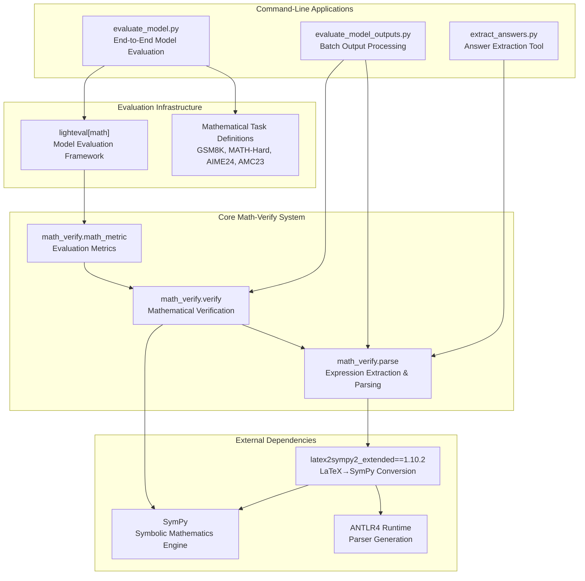
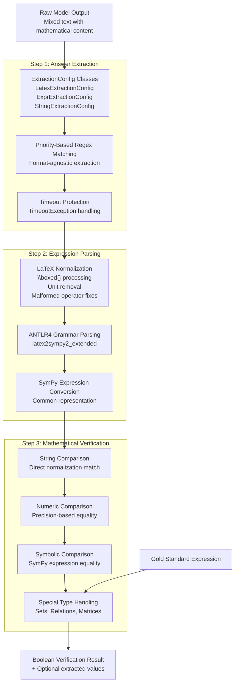
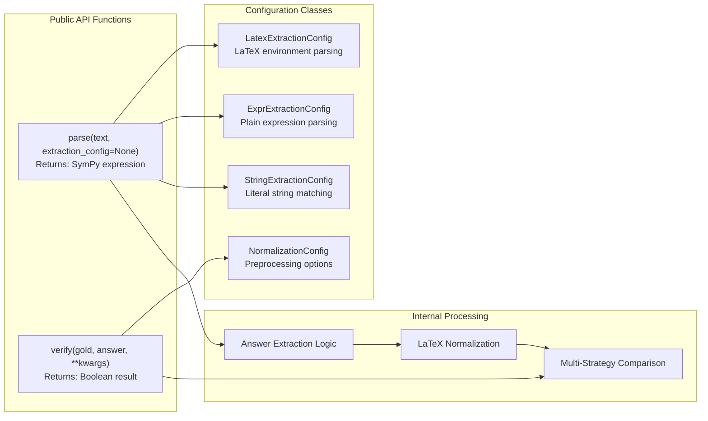
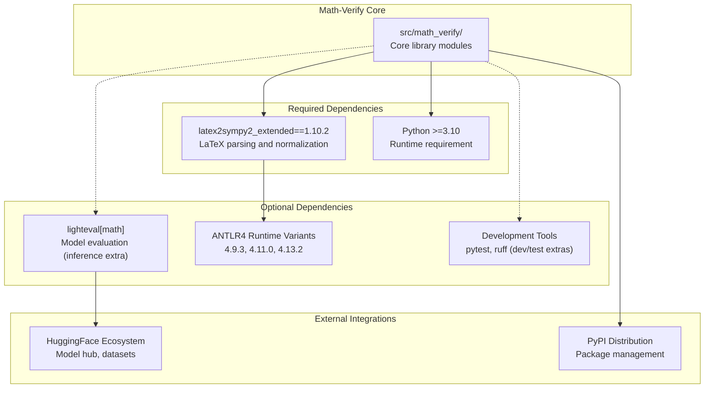

<!-- source: DeepWiki mcp.deepwiki.com · repo huggingface/Math-Verify · page 1 Overview · fetched 2026-10-26 -->

# Overview

Relevant source files

The following files were used as context for generating this wiki page:

- [CHANGELOG.md](CHANGELOG.md)
- [README.md](README.md)
- [pyproject.toml](pyproject.toml)

This document provides a comprehensive overview of the Math-Verify system, a robust mathematical expression evaluation library designed for assessing Large Language Model (LLM) outputs in mathematical tasks. Math-Verify addresses critical limitations in existing mathematical evaluators by providing format-agnostic answer extraction, advanced parsing capabilities, and intelligent expression comparison.

For detailed information about specific components, see [Core Components](#3). For practical usage instructions, see [Usage Guide](#4). For model evaluation workflows, see [Evaluation Framework](#5).

## Purpose and Scope

Math-Verify is a HuggingFace library that solves a fundamental problem in LLM evaluation: accurately assessing mathematical answers regardless of their format or representation. The system achieves higher accuracy than existing evaluators on the MATH dataset, with a score of 0.1328 compared to 0.0802 (Harness) and 0.1288 (Qwen).

The library serves three primary use cases:
- **Individual Expression Verification**: Direct comparison of mathematical expressions using `parse()` and `verify()` functions
- **Batch Output Processing**: Evaluation of model outputs stored in CSV format using `evaluate_model_outputs.py`
- **End-to-End Model Evaluation**: Complete evaluation pipeline using `evaluate_model.py` with support for datasets including GSM8K, MATH-Hard, AIME24, and AMC23

**Sources**: [pyproject.toml:1-25](), [README.md:1-8](), [README.md:78-105]()

## System Architecture

Math-Verify follows a layered architecture with clear separation between parsing, verification, and evaluation concerns:

**Sources**: [pyproject.toml:22-30](), [README.md:85-105]()

## Core Processing Workflow

The mathematical verification process follows a three-step pipeline that transforms raw text input into verified mathematical results:

**Sources**: [README.md:112-175]()

## Key Components and Modules

Math-Verify consists of three primary modules that handle different aspects of mathematical verification:

| Module | Primary Functions | Purpose |
|--------|------------------|---------|
| `math_verify.parse` | `parse()`, extraction configs | Format-agnostic answer extraction from text |
| `math_verify.verify` | `verify()`, comparison strategies | Mathematical expression verification |
| `math_verify.math_metric` | Evaluation metrics | Model performance assessment |

### Core Function Interface

**Sources**: [README.md:23-36](), [README.md:38-46]()

## Supported Mathematical Types

Math-Verify provides comprehensive support for diverse mathematical expression types commonly found in LLM outputs:

| Type Category | Examples | Verification Strategy |
|---------------|----------|----------------------|
| **Numeric** | `1/3`, `0.333`, `33.33%` | Precision-based comparison |
| **Symbolic** | `x + 2y`, `sin(π/4)` | SymPy symbolic equality |
| **Sets** | `{1,2,3}`, `(1,3) ∪ (2,4)` | Element-wise and operation comparison |
| **Relations** | `x < 2`, `1 ≤ y ≤ 5` | Normalized form and flip support |
| **Matrices** | `[[1,2],[3,4]]` | Element-wise with shape validation |
| **Complex** | `2+3i`, `Re(z)` | Component-wise comparison |

**Sources**: [README.md:55-77](), [README.md:145-175]()

## Integration Points and Dependencies

Math-Verify integrates with the broader Python mathematical and ML ecosystem through well-defined dependency relationships:

**Sources**: [pyproject.toml:22-56](), [README.md:10-21]()

## Version and Compatibility

The current version 0.8.0 introduces enhanced error handling capabilities with the `raise_on_error` parameter and improved `\boxed{}` expression processing. The system maintains compatibility across Python 3.10+ and supports multiple ANTLR4 runtime versions for maximum deployment flexibility.

Key version features include:
- **Flexible ANTLR4 Support**: Compatible with runtimes 4.9.3, 4.11.0, and 4.13.2
- **Error Handling Options**: Configurable exception propagation via `raise_on_error` parameter  
- **Enhanced Logging**: Debug-level error logging with optional verbose modes
- **Boxed Expression Improvements**: Better handling of units, percentages, and multiple boxed values

**Sources**: [pyproject.toml:3](), [pyproject.toml:16-18](), [pyproject.toml:45-55](), [CHANGELOG.md:3-10]()

---

