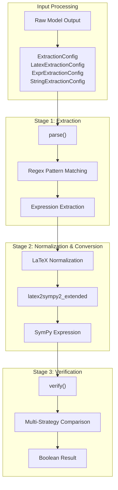
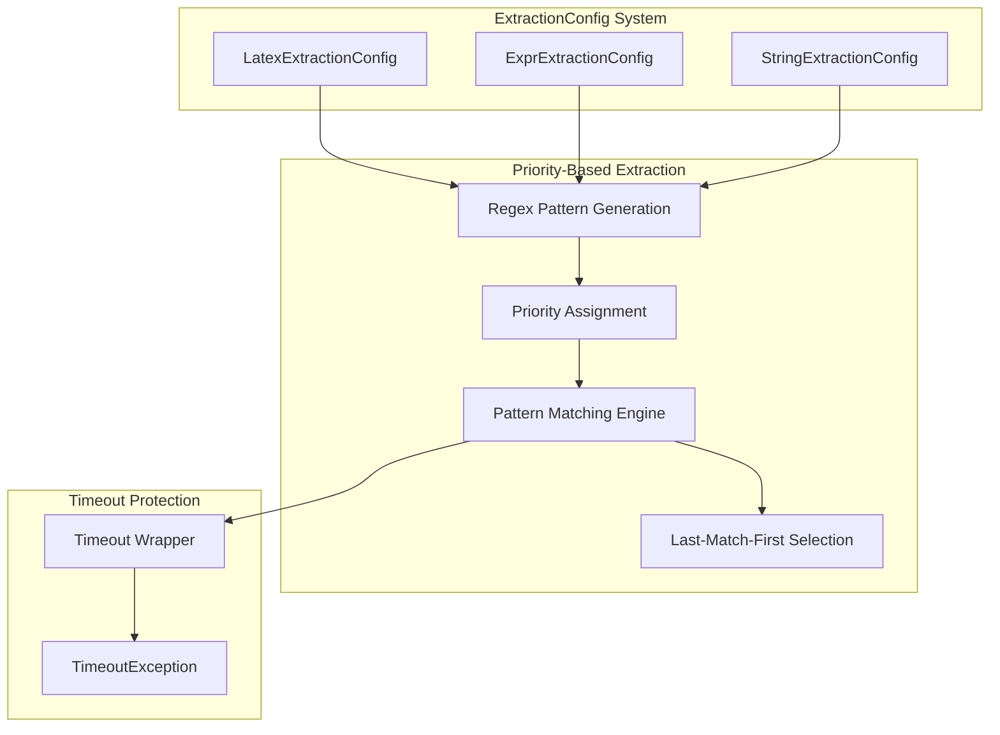
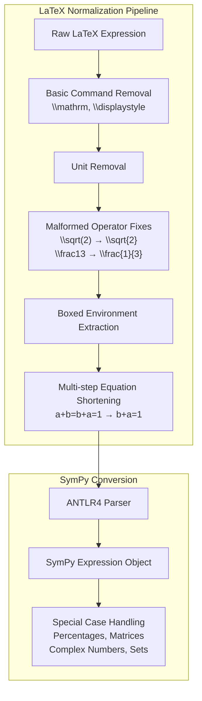
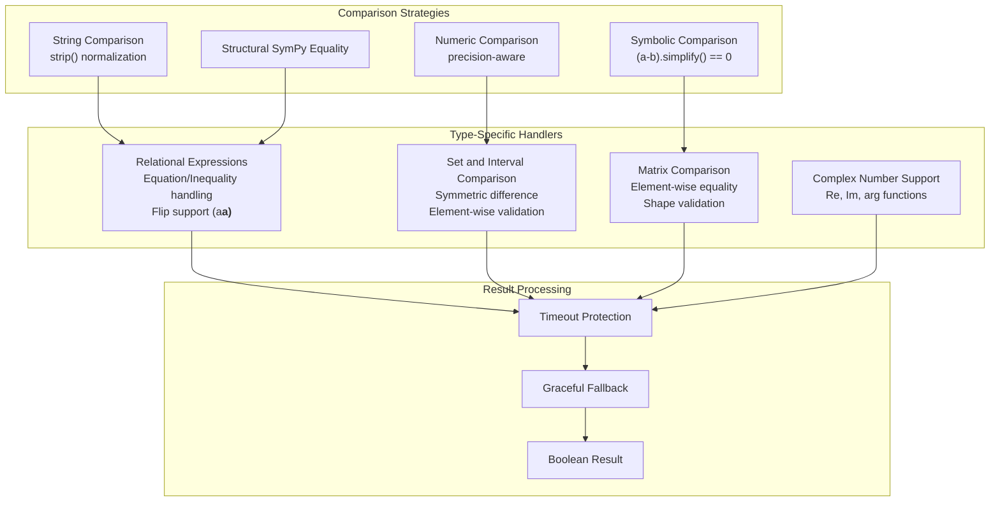
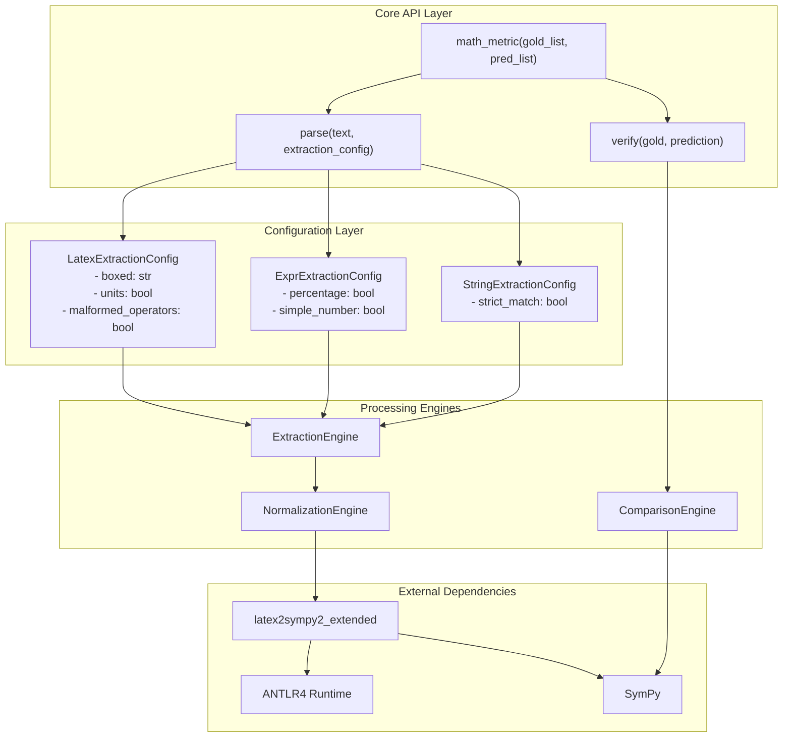
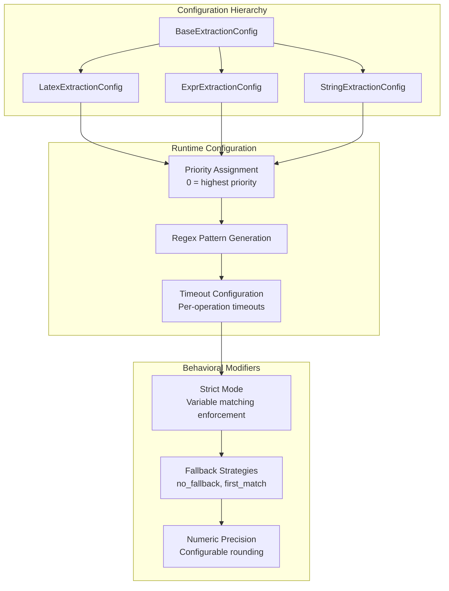
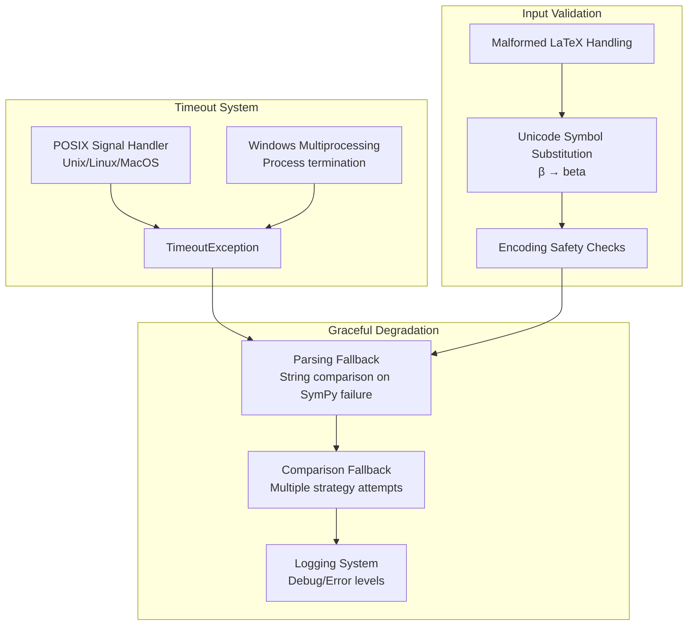
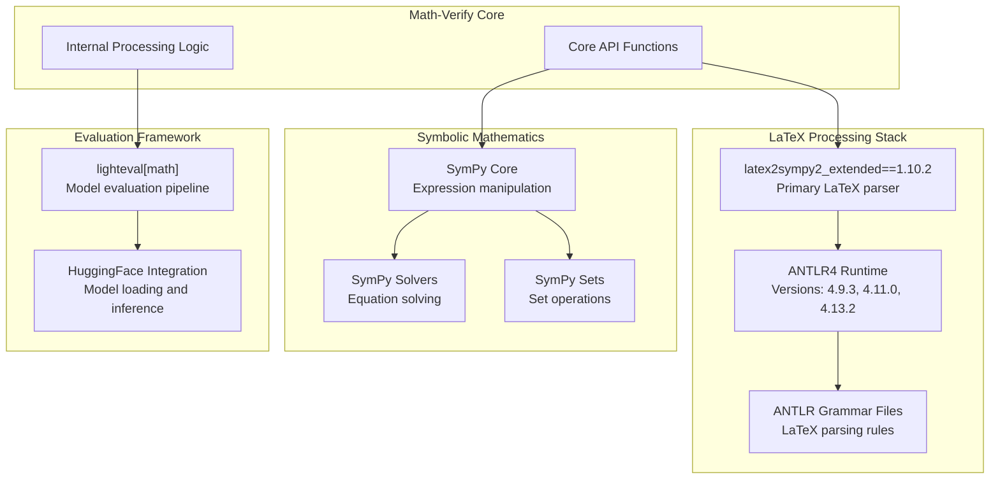

<!-- source: DeepWiki mcp.deepwiki.com · repo huggingface/Math-Verify · page 2 Architecture · fetched 2026-10-26 -->

# Architecture

Relevant source files

The following files were used as context for generating this wiki page:

- [README.md](README.md)
- [assets/flow.svg](assets/flow.svg)
- [src/math_verify/errors.py](src/math_verify/errors.py)

This document describes the detailed system architecture of Math-Verify, including data flow patterns, component relationships, and the core processing pipeline. It covers how mathematical expressions are extracted, normalized, converted, and compared across different representation formats.

For practical usage instructions, see [Usage Guide](#4). For specific component implementations, see [Core Components](#3).

## System Overview

Math-Verify implements a three-stage pipeline architecture designed for robust mathematical expression evaluation:

**Sources:** [README.md:107-175](), [src/math_verify/parser.py](), [src/math_verify/grader.py]()

## Core Processing Pipeline

The architecture follows a strict sequential processing model where each stage handles specific aspects of mathematical expression processing:

### Stage 1: Expression Extraction

**Sources:** [src/math_verify/parser.py](), [src/math_verify/errors.py:1-3](), [README.md:115-121]()

### Stage 2: Normalization and Conversion

The normalization pipeline handles LaTeX preprocessing before SymPy conversion:

**Sources:** [README.md:122-138](), [latex2sympy2_extended/latex2sympy2.py]()

### Stage 3: Verification Engine

**Sources:** [src/math_verify/grader.py](), [README.md:139-175]()

## Component Interaction Model

The system uses a modular architecture where components interact through well-defined interfaces:

**Sources:** [src/math_verify/__init__.py](), [src/math_verify/math_metric.py](), [pyproject.toml]()

## Configuration Architecture

The system uses a flexible configuration architecture that allows fine-grained control over extraction and comparison behavior:

| Configuration Class | Purpose | Key Parameters |
|---------------------|---------|----------------|
| `LatexExtractionConfig` | LaTeX expression extraction | `boxed`, `units`, `malformed_operators`, `basic_latex` |
| `ExprExtractionConfig` | Plain expression extraction | `percentage`, `simple_number`, `timeout` |
| `StringExtractionConfig` | String literal extraction | `strict_match`, `case_sensitive` |
| `NormalizationConfig` | LaTeX preprocessing | `operator_fixes`, `unit_removal`, `equation_splitting` |

**Sources:** [README.md:195-210](), [src/math_verify/parser.py](), [tests/test_configs.py]()

## Error Handling and Robustness

Math-Verify implements comprehensive error handling to ensure reliable operation across different platforms and input conditions:

**Sources:** [src/math_verify/errors.py](), [src/math_verify/timeout.py](), [README.md:171-175]()

## External Dependency Integration

The system integrates with several external libraries through well-defined interfaces:

**Sources:** [pyproject.toml](), [README.md:10-21](), [requirements.txt]()

---

