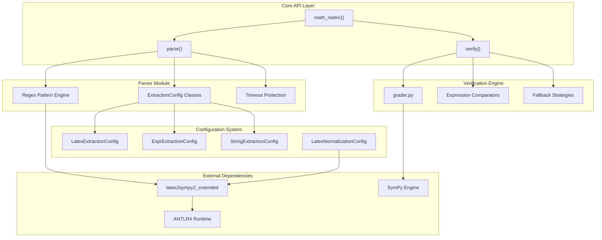
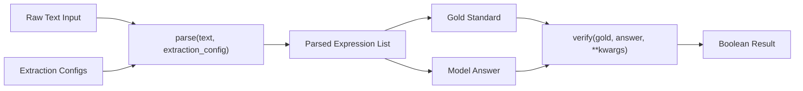
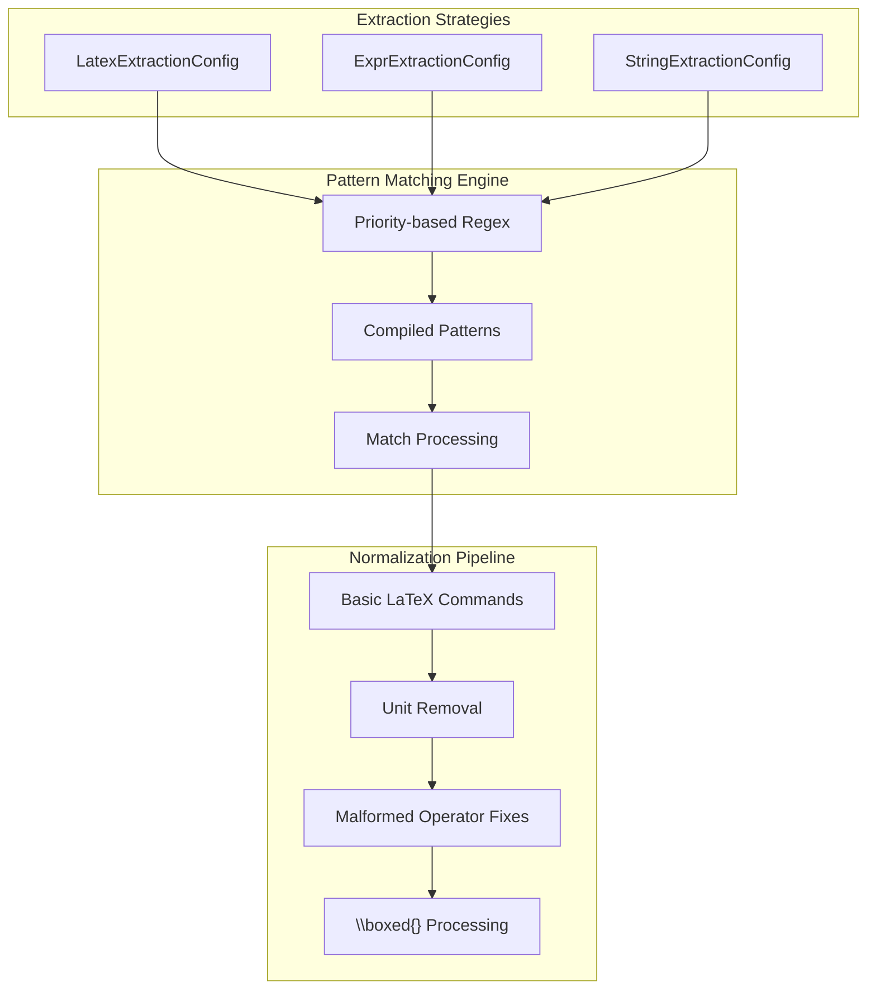
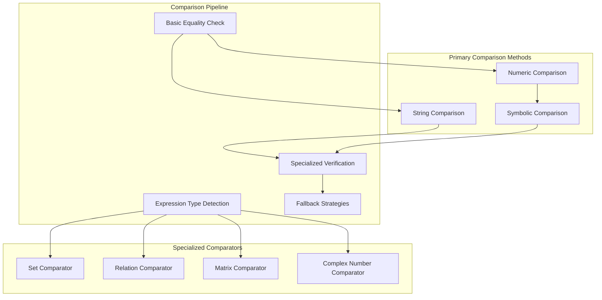
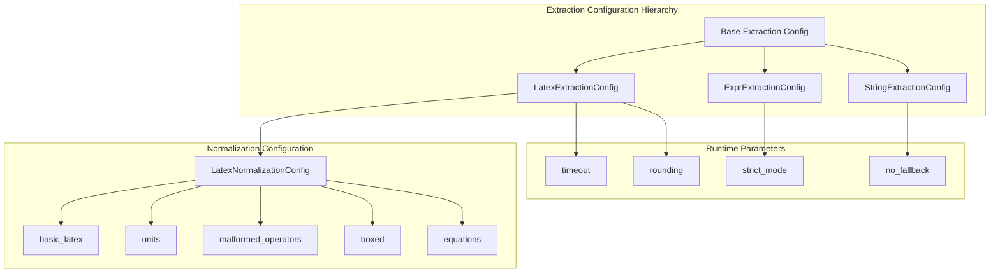
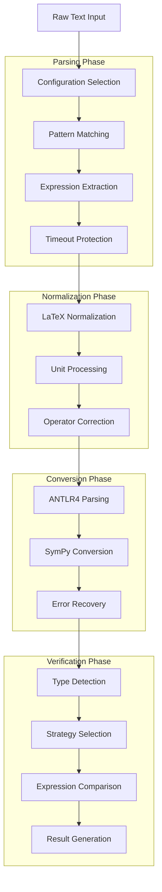

<!-- source: DeepWiki mcp.deepwiki.com · repo huggingface/Math-Verify · page 3 Core Components · fetched 2026-10-26 -->

# Core Components

Relevant source files

The following files were used as context for generating this wiki page:

- [README.md](README.md)
- [src/math_verify/__init__.py](src/math_verify/__init__.py)
- [tests/test_string_extraction.py](tests/test_string_extraction.py)

This page provides an overview of the main functional components that comprise the Math-Verify system. It covers the core modules responsible for mathematical expression parsing, verification, and evaluation, along with their configuration systems and utilities.

For detailed implementation specifics of individual components, see the Parser Module ([3.1](#3.1)), Grader Module ([3.2](#3.2)), and Metrics and Evaluation ([3.3](#3.3)). For usage examples and configuration options, see the Usage Guide ([4](#4)).

## Component Architecture Overview

The Math-Verify system is built around four primary components that work together to extract, parse, and verify mathematical expressions:

Sources: [src/math_verify/__init__.py:1-23](), [README.md:115-175]()

## Main API Components

The system exposes four primary functions through its public API, each serving a distinct role in the mathematical verification pipeline:

| Function | Purpose | Primary Use Case |
|----------|---------|------------------|
| `parse()` | Extract mathematical expressions from text | Convert model outputs to structured format |
| `verify()` | Compare two parsed expressions for equivalence | Validate model answers against gold standards |
| `math_metric()` | Calculate evaluation metrics over datasets | Batch evaluation and scoring |
| Configuration Classes | Control extraction and normalization behavior | Customize parsing for specific formats |

### Core Function Signatures

The main API functions operate with the following key interfaces:

Sources: [src/math_verify/__init__.py:5-12](), [README.md:24-36]()

## Parser Module Components

The parser module implements a multi-strategy extraction system with configurable extraction targets:

### Extraction Configuration Classes

Each extraction strategy is implemented as a configuration class that defines pattern matching behavior:

| Configuration Class | Target Format | Example Input | Use Case |
|-------------------|---------------|---------------|----------|
| `LatexExtractionConfig` | LaTeX expressions in environments | `$\sqrt{2}$`, `\[\frac{1}{2}\]` | Mathematical notation parsing |
| `ExprExtractionConfig` | Plain numerical expressions | `1/2`, `3.14159` | Simple arithmetic extraction |
| `StringExtractionConfig` | Literal string matching | `A`, `B`, `C`, `D` | Multiple choice answers |

Sources: [src/math_verify/__init__.py:8-11](), [README.md:38-45](), [tests/test_string_extraction.py:1-28]()

## Verification Engine Components

The verification engine implements multiple comparison strategies with fallback mechanisms:

### Verification Strategies

The `verify()` function employs multiple comparison approaches based on expression types:

| Strategy | Expression Types | Comparison Method | Example |
|----------|-----------------|-------------------|---------|
| String Comparison | All types | Direct string matching after normalization | `"1/2" == "0.5"` |
| Numeric Comparison | Numbers, fractions | Floating point with configurable precision | `0.333... ≈ 1/3` |
| Symbolic Comparison | Algebraic expressions | SymPy symbolic equality | `x + 1 == 1 + x` |
| Set Comparison | Sets, intervals | Element-wise and structural comparison | `{1,2,3} == {3,2,1}` |
| Relation Comparison | Equations, inequalities | Normalized form comparison with flipping | `a < b == b > a` |

Sources: [README.md:139-175](), [src/math_verify/__init__.py:5]()

## Configuration System Architecture

The configuration system provides fine-grained control over extraction and normalization behavior:

### Configuration Parameters

Key configuration options that control system behavior:

| Parameter Category | Options | Purpose |
|-------------------|---------|---------|
| Extraction Target | `latex`, `expr`, `string` | Defines what patterns to extract |
| Normalization | `basic_latex`, `units`, `malformed_operators` | Controls LaTeX preprocessing |
| Matching Strategy | `boxed_match_priority`, `first_match` | Prioritizes extraction patterns |
| Comparison | `rounding`, `strict_mode`, `allow_set_relation_comp` | Controls verification behavior |
| Error Handling | `timeout`, `raise_on_error`, `no_fallback` | Manages failure modes |

Sources: [src/math_verify/__init__.py:1-3](), [README.md:195-210]()

## Data Flow and Integration

The complete data flow through the Math-Verify system follows this processing pipeline:

### Integration with External Dependencies

The system integrates with several external libraries:

| Dependency | Integration Point | Purpose |
|------------|------------------|---------|
| `latex2sympy2_extended` | Normalization and parsing | LaTeX to SymPy conversion |
| `sympy` | Verification engine | Symbolic mathematics operations |
| `antlr4-python3-runtime` | Parser generation | Grammar-based expression parsing |
| `lighteval` | Evaluation framework | Model evaluation pipeline |

Sources: [README.md:115-138](), [README.md:10-21]()

---

