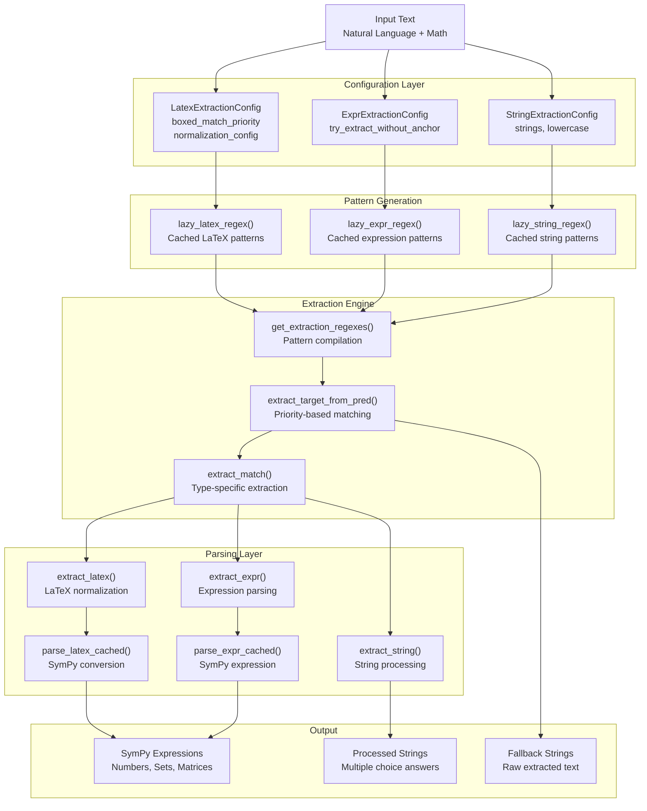
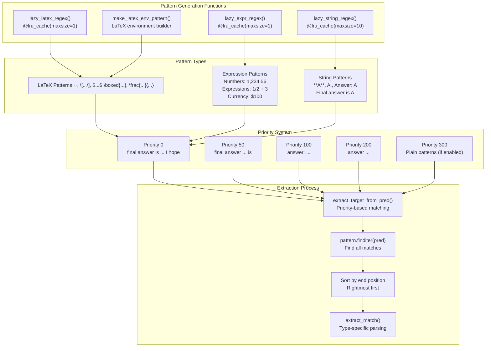

<!-- source: DeepWiki mcp.deepwiki.com · repo huggingface/Math-Verify · page 3.1 Parser Module · fetched 2026-10-26 -->

# Parser Module

<details>
<summary>Relevant source files</summary>

The following files were used as context for generating this wiki page:

- [src/math_verify/parser.py](src/math_verify/parser.py)
- [tests/test_configs.py](tests/test_configs.py)

</details>


The Parser Module is responsible for extracting and parsing mathematical expressions from natural language text. It converts unstructured text containing mathematical content into structured SymPy expressions through configurable extraction strategies, pattern matching, and normalization processes.

This module handles LaTeX expressions, plain mathematical expressions, and string-based answers (like multiple choice options). For information about how parsed expressions are compared and verified, see [Grader Module](#3.2). For details about timeout mechanisms and error handling utilities, see [Utilities and Error Handling](#3.4).

## Architecture Overview

The parser module follows a multi-stage pipeline architecture that transforms natural language text into structured mathematical objects:



Sources: [src/math_verify/parser.py:49-108](), [src/math_verify/parser.py:651-733]()

## Extraction Configurations

The parser module uses three main configuration classes to control extraction behavior:

### LatexExtractionConfig

Controls LaTeX expression extraction with configurable normalization and priority settings:

| Attribute | Type | Default | Description |
|-----------|------|---------|-------------|
| `try_extract_without_anchor` | `bool` | `True` | Extract LaTeX without requiring anchor words like "answer:" |
| `boxed_match_priority` | `int` | `50` | Priority for `\boxed{}` expressions (0=highest, -1=disabled) |
| `normalization_config` | `NormalizationConfig` | Complex default | Controls LaTeX preprocessing options |

The default `NormalizationConfig` enables basic LaTeX cleanup, unit handling, operator fixes, and boxed expression processing while disabling equation parsing.

Sources: [src/math_verify/parser.py:49-81]()

### ExprExtractionConfig

Simple configuration for mathematical expression extraction:

| Attribute | Type | Default | Description |
|-----------|------|---------|-------------|
| `try_extract_without_anchor` | `bool` | `True` | Extract expressions without anchor words |

Sources: [src/math_verify/parser.py:83-92]()

### StringExtractionConfig

Configuration for extracting literal string answers (typically multiple choice):

| Attribute | Type | Default | Description |
|-----------|------|---------|-------------|
| `strings` | `tuple[str, ...]` | `("A", "B", "C", "D")` | Valid string options to extract |
| `try_extract_without_anchor` | `bool` | `True` | Extract without anchor words |
| `lowercase` | `bool` | `True` | Convert extracted strings to lowercase |

Sources: [src/math_verify/parser.py:94-106]()

## Pattern Matching System

The parser uses a sophisticated regex-based pattern matching system with caching and priority-based extraction:



### Pattern Priority System

The system uses numeric priorities to determine extraction order:

- **Priority 0**: Highest priority patterns like "final answer is X I hope"
- **Priority 50**: "final answer ... is X" patterns  
- **Priority 100**: "answer: X" patterns
- **Priority 200**: "answer X" patterns
- **Priority 300**: Plain patterns (when `try_extract_without_anchor=True`)

Patterns are processed in priority order, and within each priority group, matches are sorted by position (rightmost first, then leftmost first).

Sources: [src/math_verify/parser.py:111-164](), [src/math_verify/parser.py:167-236](), [src/math_verify/parser.py:299-356](), [src/math_verify/parser.py:575-649]()

## LaTeX Processing Pipeline

LaTeX expressions undergo specialized processing through multiple stages:

### Environment Pattern Matching

The `make_latex_env_pattern()` function creates regex patterns for various LaTeX environments:

- **Display math**: `$$...$$`, `\[...\]`
- **Inline math**: `$...$`, `\(...\)`, ` [...] `
- **Fractions**: `\frac{num}{den}`
- **Boxed expressions**: `\boxed{...}`

Each pattern can be configured for different contexts (`"boxed"`, `"plain"`) and supports percentage detection.

Sources: [src/math_verify/parser.py:238-297]()

### LaTeX Extraction and Normalization

The `extract_latex()` function processes matched LaTeX content:

1. **Group Collection**: Collects all LaTeX groups (first_ and nextN_ prefixes) from regex matches
2. **Normalization**: Applies `normalize_latex()` with appropriate `NormalizationConfig`
3. **Parsing**: Converts normalized LaTeX to SymPy using `parse_latex_cached()`
4. **Multiple Expression Handling**: Combines multiple expressions into `FiniteSet` when appropriate
5. **Percentage Conversion**: Applies percentage conversion when detected

The function uses a modified normalization config for boxed expressions, setting `boxed="last"` to extract the final boxed content.

Sources: [src/math_verify/parser.py:466-543]()

## Expression and String Processing

### Mathematical Expression Extraction

The `extract_expr()` function handles non-LaTeX mathematical content:

- **Number Processing**: Handles various number formats including thousand separators, decimals, and percentages
- **Expression Parsing**: Parses mathematical expressions with operators (+, -, *, /, ^, parentheses)
- **SymPy Conversion**: Converts expressions to SymPy objects using `parse_expr_cached()`
- **Percentage Handling**: Automatically converts percentages using `convert_to_pct()`

Sources: [src/math_verify/parser.py:408-447](), [src/math_verify/parser.py:449-451]()

### String Extraction

The `extract_string()` function processes literal string answers:

- **Case Normalization**: Converts to lowercase when `lowercase=True`
- **Direct Extraction**: Returns both processed and original strings

Sources: [src/math_verify/parser.py:545-551]()

## Main Parse Function

The `parse()` function serves as the main entry point, orchestrating the entire parsing pipeline:

```python
def parse(
    pred: str,
    extraction_config: Sequence[ExtractionTarget] = [LatexExtractionConfig(), ExprExtractionConfig()],
    fallback_mode: Literal["no_fallback", "first_match"] = "first_match",
    extraction_mode: Literal["first_match", "any_match"] = "any_match",
    parsing_timeout: int = 5,
    raise_on_error: bool = False
) -> list
```

### Parameters

| Parameter | Description |
|-----------|-------------|
| `pred` | Input text to parse |
| `extraction_config` | Sequence of extraction configurations to try |
| `fallback_mode` | How to handle parsing failures (`"no_fallback"` or `"first_match"`) |
| `extraction_mode` | Strategy for finding matches (`"first_match"` or `"any_match"`) |
| `parsing_timeout` | Timeout in seconds for parsing operations |
| `raise_on_error` | Whether to raise exceptions or return empty list on errors |

### Return Value

Returns a list containing:
- **SymPy expressions** for successfully parsed mathematical content
- **Strings** for processed string matches  
- **Fallback strings** when `fallback_mode="first_match"` and parsing fails

Sources: [src/math_verify/parser.py:651-733]()

## Caching and Performance

The parser module employs extensive caching to optimize performance:

- **Pattern Caching**: `@lru_cache` decorators on regex compilation functions
- **Parse Caching**: `parse_latex_cached()` and `parse_expr_cached()` cache SymPy conversions
- **Timeout Protection**: Configurable timeouts prevent infinite parsing loops

The caching system uses small cache sizes (1-20 entries) optimized for repeated evaluation scenarios where the same patterns and expressions are processed multiple times.

Sources: [src/math_verify/parser.py:111](), [src/math_verify/parser.py:167](), [src/math_verify/parser.py:299](), [src/math_verify/parser.py:379-401](), [src/math_verify/parser.py:403-406]()

---

