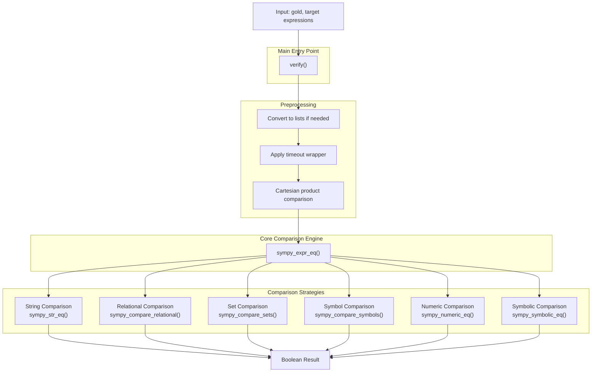
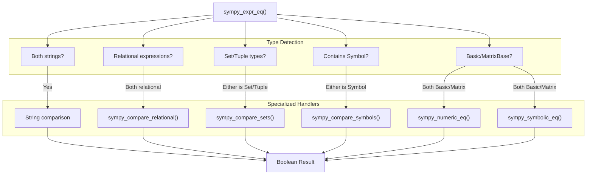
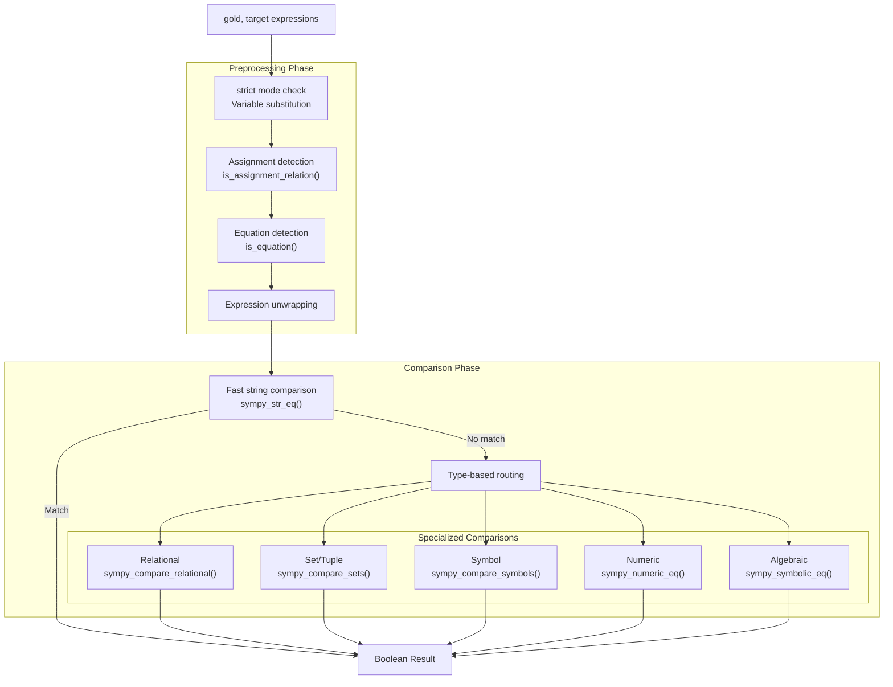
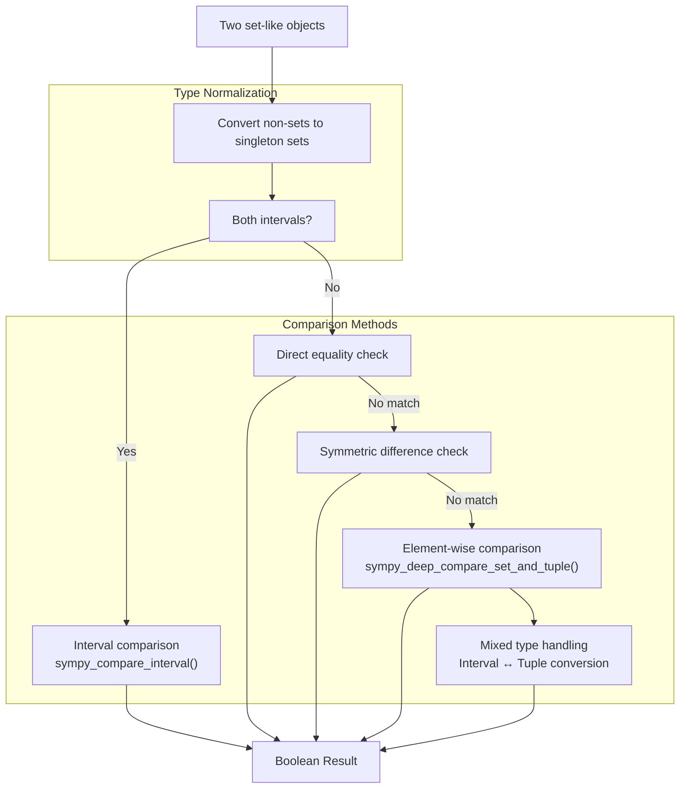
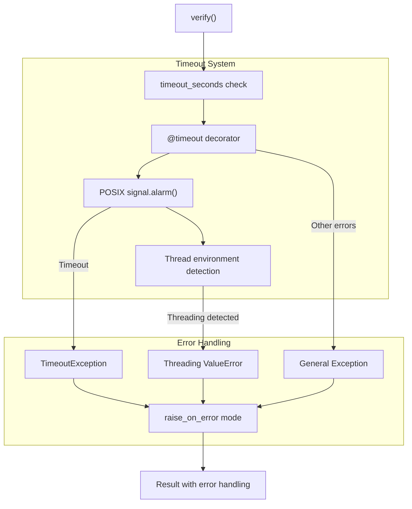

<!-- source: DeepWiki mcp.deepwiki.com · repo huggingface/Math-Verify · page 3.2 Grader Module · fetched 2026-10-26 -->

# Grader Module

Relevant source files

The following files were used as context for generating this wiki page:

- [src/math_verify/grader.py](src/math_verify/grader.py)
- [tests/test_boxed.py](tests/test_boxed.py)
- [tests/test_raise_on_error.py](tests/test_raise_on_error.py)
- [tests/test_strict.py](tests/test_strict.py)

The Grader Module is the core verification engine of the Math-Verify system, responsible for comparing mathematical expressions using multiple comparison strategies. This module implements comprehensive logic for determining whether two mathematical expressions are equivalent, handling various types of mathematical objects including numbers, algebraic expressions, sets, matrices, and relational expressions.

This document covers the verification and comparison algorithms implemented in the grader. For information about parsing mathematical expressions before verification, see [Parser Module](#3.1). For evaluation metrics that utilize the grader, see [Metrics and Evaluation](#3.3).

## Architecture Overview

The Grader Module follows a multi-strategy comparison approach, where expressions are compared using increasingly sophisticated methods until a match is found or all strategies are exhausted.

### Core Verification Flow

Sources: [src/math_verify/grader.py:743-877](), [src/math_verify/grader.py:599-705]()

### Comparison Strategy Selection

Sources: [src/math_verify/grader.py:679-704]()

## Core Components

### Main Verification Function

The `verify()` function serves as the primary entry point for all mathematical expression comparisons. It accepts various input types and applies comprehensive comparison strategies.

| Parameter | Type | Default | Description |
|-----------|------|---------|-------------|
| `gold` | `list[Basic \| MatrixBase \| str] \| Basic \| MatrixBase \| str` | Required | Reference/correct expression(s) |
| `target` | `list[Basic \| MatrixBase \| str] \| Basic \| MatrixBase \| str` | Required | Expression(s) to verify |
| `float_rounding` | `int` | 6 | Decimal places for float rounding |
| `numeric_precision` | `int` | 15 | Decimal places for numeric comparisons |
| `strict` | `bool` | True | Whether to enforce strict variable matching |
| `allow_set_relation_comp` | `bool` | False | Allow set-relation comparisons |
| `timeout_seconds` | `int \| None` | 5 | Maximum time per comparison operation |
| `raise_on_error` | `bool` | False | Whether to raise exceptions on errors |

Sources: [src/math_verify/grader.py:743-804]()

### Expression Comparison Engine

The `sympy_expr_eq()` function implements the core comparison logic with multiple fallback strategies:

Sources: [src/math_verify/grader.py:599-705]()

## Specialized Comparison Functions

### Numeric Comparison

The `sympy_numeric_eq()` function handles numerical comparisons with configurable precision, supporting floats, percentages, and matrices.

**Key Features:**
- Float rounding with configurable precision
- Percentage number support (X% → X * Rational(1,100))
- Matrix element-wise comparison
- Safe evaluation with `safe_sympy_doit()`

Sources: [src/math_verify/grader.py:117-171]()

### Symbolic Comparison

The `sympy_symbolic_eq()` function performs algebraic equivalence testing through symbolic manipulation.

**Algorithm:**
1. Compute difference: `simplify(a - b)`
2. Check if result is zero (scalar) or zero matrix
3. Handle exceptions gracefully

Sources: [src/math_verify/grader.py:174-193]()

### Set Comparison

The `sympy_compare_sets()` function handles various set types including finite sets, intervals, and tuples.

**Supported Types:**
- `SympyFiniteSet` - Finite mathematical sets
- `Tuple` - Ordered collections
- `Interval` - Continuous ranges
- Mixed type comparisons (e.g., open interval vs. tuple)

**Comparison Strategy:**

Sources: [src/math_verify/grader.py:377-438]()

### Relational Comparison

The `sympy_compare_relational()` function handles equations, inequalities, and compound relations.

**Supported Relations:**
- `Eq` - Equations (=)
- `GreaterThan`, `LessThan` - Inequalities (≥, ≤)
- `StrictGreaterThan`, `StrictLessThan` - Strict inequalities (>, <)
- `And` - Compound relations

**Comparison Features:**
- Flipped inequality detection (a ≤ b ≡ b ≥ a)
- Solution-based comparison via `solve()`
- Compound relation handling

Sources: [src/math_verify/grader.py:297-354](), [src/math_verify/grader.py:68-74]()

### Symbol Comparison

The `sympy_compare_symbols()` function handles symbolic expressions with special cases for mathematical notation.

**Special Handling:**
- E vs. Symbol('e') equivalence
- Concatenated symbols (abc → a*b*c)
- Case-insensitive symbol names
- LaTeX symbol normalization

Sources: [src/math_verify/grader.py:441-494]()

## Configuration and Modes

### Strict vs Non-Strict Mode

The `strict` parameter controls variable matching behavior:

| Mode | Variable Handling | Example |
|------|-------------------|---------|
| `strict=True` | Variables must match exactly | `f(x) ≠ f(y)` |
| `strict=False` | Variables matched by position | `f(x) = f(y)` |

Sources: [src/math_verify/grader.py:623-632](), [tests/test_strict.py:6-14]()

### Assignment and Equation Handling

The grader implements sophisticated logic for handling mathematical assignments and equations:

**Expression Types:**
- **Assignment Relations**: `x = 1` (detected by `is_assignment_relation()`)
- **Equations**: `2x + 1 = 5` (detected by `is_equation()`)
- **General Relations**: `x < 5` (detected by `is_relation()`)

**Normalization Rules:**
1. Assignment chains are truncated: `x = y = 1` → `x = 1`
2. Equation unwrapping: `y = 1` compared with `1` → both become `1`
3. Set-relation conversion: `1 < x < 2` → interval representation

Sources: [src/math_verify/grader.py:531-563](), [src/math_verify/grader.py:639-677]()

## Error Handling and Robustness

### Timeout Protection

The grader implements comprehensive timeout protection to prevent infinite computation:

Sources: [src/math_verify/grader.py:806-868](), [src/math_verify/utils.py](), [tests/test_raise_on_error.py:8-21]()

### Safe Expression Evaluation

The `safe_sympy_doit()` function provides robust expression evaluation:

**Safety Features:**
- Exception catching for failed evaluations
- Graceful fallback to original expression
- Protection against infinite evaluation loops

Sources: [src/math_verify/grader.py:77-94]()

### Complex Number Detection

The grader includes pattern-based detection for complex mathematical expressions:

**Detection Patterns:**
- Complex number indicators: `\mathbb{C}`, `\i`, `\text{i}`
- Matrix operations: `\det`, `\operatorname{tr}`, `\operatorname{rank}`
- Complex functions: `\arg{}`, `\Re{}`, `\Im{}`

Sources: [src/math_verify/grader.py:708-740]()

## Integration Points

The Grader Module integrates with other system components through well-defined interfaces:

- **Parser Module**: Receives parsed SymPy expressions from [Parser Module](#3.1)
- **Utilities**: Uses timeout mechanisms from [Utilities and Error Handling](#3.4)
- **Evaluation Framework**: Provides verification results to [Model Evaluation Pipeline](#5.2)

The grader serves as the foundational comparison engine that enables reliable mathematical expression verification across the entire Math-Verify system.

---

