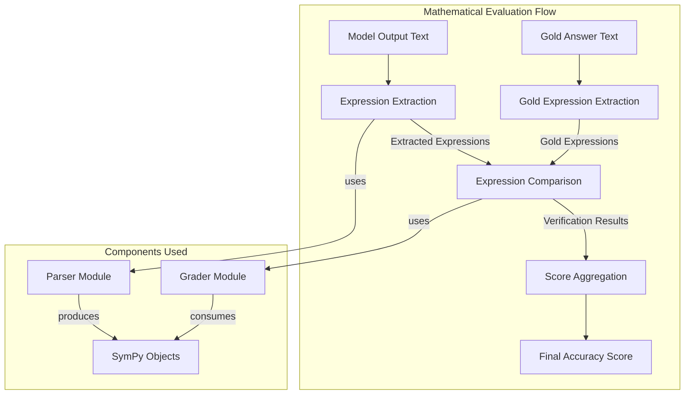
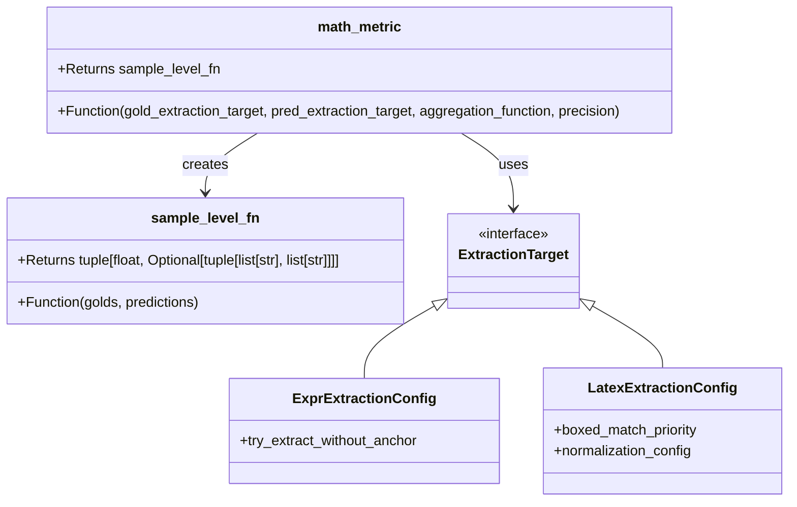
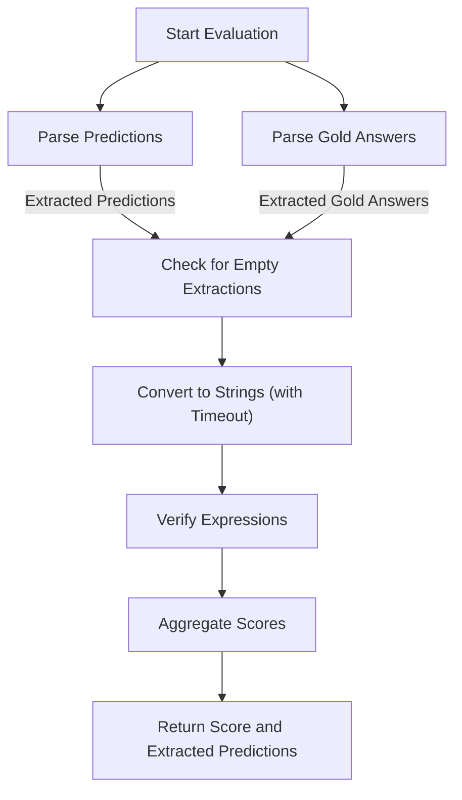
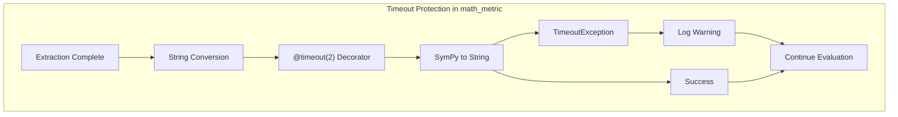
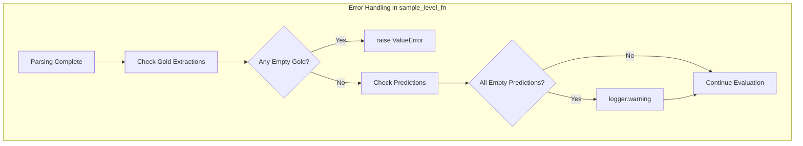
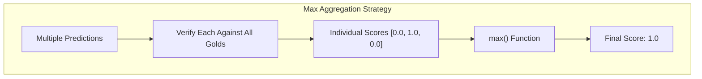
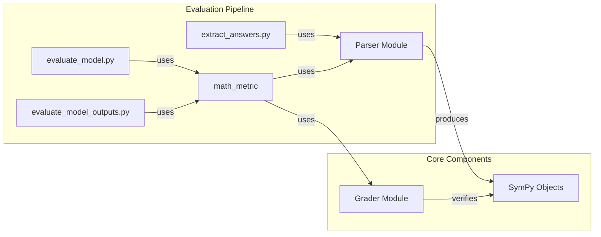

<!-- source: DeepWiki mcp.deepwiki.com · repo huggingface/Math-Verify · page 3.3 Metrics and Evaluation · fetched 2026-10-26 -->

# Metrics and Evaluation

<details>
<summary>Relevant source files</summary>

The following files were used as context for generating this wiki page:

- [src/math_verify/metric.py](src/math_verify/metric.py)

</details>


This document explains the metrics and evaluation methods used in the Math-Verify system to assess mathematical expressions in language model outputs. It covers the core metric functions, their integration with evaluation frameworks, and configuration options for different mathematical datasets.

For information about the parser that extracts expressions for evaluation, see [Parser Module](#3.1). For details on the verification process used to compare expressions, see [Grader Module](#3.2).

## 1. Overview of Math-Verify Metrics

Math-Verify provides a robust framework for evaluating mathematical reasoning in language model outputs. The central component is the `math_metric` function, which bridges the gap between natural language responses and mathematical accuracy assessment.



Sources: [src/math_verify/metric.py:1-103]()

## 2. The `math_metric` Function

The `math_metric` function is the core of the evaluation system. It creates a metric that extracts and compares mathematical expressions from model outputs against gold answers.

### 2.1 Function Signature and Parameters



The `math_metric` function takes the following parameters:

- `gold_extraction_target`: Sequence of extraction targets for gold answers (default: `ExprExtractionConfig()`)
- `pred_extraction_target`: Sequence of extraction targets for predictions (default: `ExprExtractionConfig()`)
- `aggregation_function`: Function to aggregate scores when multiple predictions/golds are present (default: `max`)
- `precision`: Number of decimal places for numerical comparison (default: `6`)

It returns a sample-level metric function that takes lists of gold and prediction strings and returns a score along with extracted predictions.

Sources: [src/math_verify/metric.py:12-46]()

### 2.2 How the Metric Works

The metric operates in several key steps:

1. **Expression Extraction**: Uses the `parse` function to extract mathematical expressions from both gold answers and predictions using the specified extraction targets.
2. **Verification**: Uses the `verify` function to compare extracted gold expressions with extracted prediction expressions.
3. **Aggregation**: Applies the aggregation function to the verification results to produce a final score.
4. **Timeout Handling**: Implements a timeout mechanism for SymPy string conversion to prevent hanging on complex expressions.



Sources: [src/math_verify/metric.py:56-102]()

## 3. Core Metric Implementation Details

### 3.1 Timeout Mechanism

The `math_metric` function implements a crucial timeout mechanism to handle complex mathematical expressions that could cause SymPy operations to hang:



The `get_str_preds_with_timeout` function at line 48 is decorated with `@timeout(2)`, providing a 2-second timeout for string conversion operations that could otherwise hang indefinitely on complex expressions.

Sources: [src/math_verify/metric.py:48-54]()

### 3.2 Error Handling and Validation

The metric implements comprehensive error handling for edge cases:



- **Empty Gold Validation**: Raises `ValueError` if any gold answer fails to extract (lines 65-68)
- **Empty Prediction Warning**: Logs warning if all predictions fail to extract (lines 70-73)
- **Timeout Handling**: Gracefully handles string conversion timeouts (lines 75-85)

Sources: [src/math_verify/metric.py:65-85]()

## 4. Aggregation Strategies

The `math_metric` function supports different aggregation strategies for handling multiple predictions or gold answers through the `aggregation_function` parameter.

### 4.1 Default Aggregation (`max`)

The default `max` aggregation strategy provides the most lenient evaluation approach:



This means if any prediction matches any gold answer, the sample receives a score of 1.0.

### 4.2 Custom Aggregation Functions

Users can provide custom aggregation functions to implement different evaluation strategies:

| Aggregation Function | Behavior | Use Case |
|---------------------|----------|----------|
| `max` (default) | Any correct answer counts | Most lenient, standard for most tasks |
| `min` | All answers must be correct | Strictest evaluation |
| `lambda x: sum(x)/len(x) if x else 0` | Average correctness | Partial credit scenarios |
| `lambda x: 1.0 if all(x) else 0.0` | All-or-nothing | Tasks requiring complete accuracy |

Sources: [src/math_verify/metric.py:87-100]()

## 5. Custom Evaluation and Best Practices

### 5.1 Creating Custom Metrics

You can create custom metrics by configuring the `math_metric` function with appropriate extraction targets and aggregation functions:

```python
# Example of a custom metric with specialized extraction and aggregation
custom_metric = math_metric(
    gold_extraction_target=(
        LatexExtractionConfig(boxed_match_priority=1),
        ExprExtractionConfig(try_extract_without_anchor=True),
    ),
    pred_extraction_target=(
        LatexExtractionConfig(),
        ExprExtractionConfig(),
    ),
    aggregation_function=lambda scores: sum(scores)/len(scores) if scores else 0,
    precision=10,
)
```

### 5.2 Known Limitations and Best Practices

1. **Expression Simplification**: The metric may overestimate accuracy for simplification tasks because SymPy may simplify expressions that the model doesn't actually simplify.

2. **Timeout Handling**: Complex expressions can cause timeout issues. The default timeout is 2 seconds, which balances performance with handling complex expressions.

3. **Extraction Configuration**: Careful selection of extraction targets is essential for accurate evaluation:
   - For structured formal mathematics, prioritize LaTeX extraction
   - For simple arithmetic, use expression extraction
   - Use multiple extraction targets for robust evaluation

4. **Aggregation Functions**: The choice of aggregation function impacts how multiple answers are evaluated:
   - `max`: Any correct answer counts (default, most lenient)
   - `min`: All answers must be correct (most strict)
   - `mean`: Average correctness across all answers

Sources: [src/math_verify/metric.py:22-26](), [src/math_verify/metric.py:48-102]()

## 6. Integration with Evaluation Pipelines

The metrics system integrates with evaluation scripts to provide comprehensive model assessment:



This integration allows for streamlined evaluation of model outputs across various mathematical tasks and datasets.

Sources: [src/math_verify/metric.py:1-102](), [src/math_verify/tasks.py:1-324]()

---

