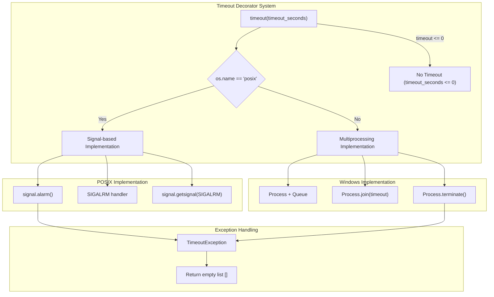
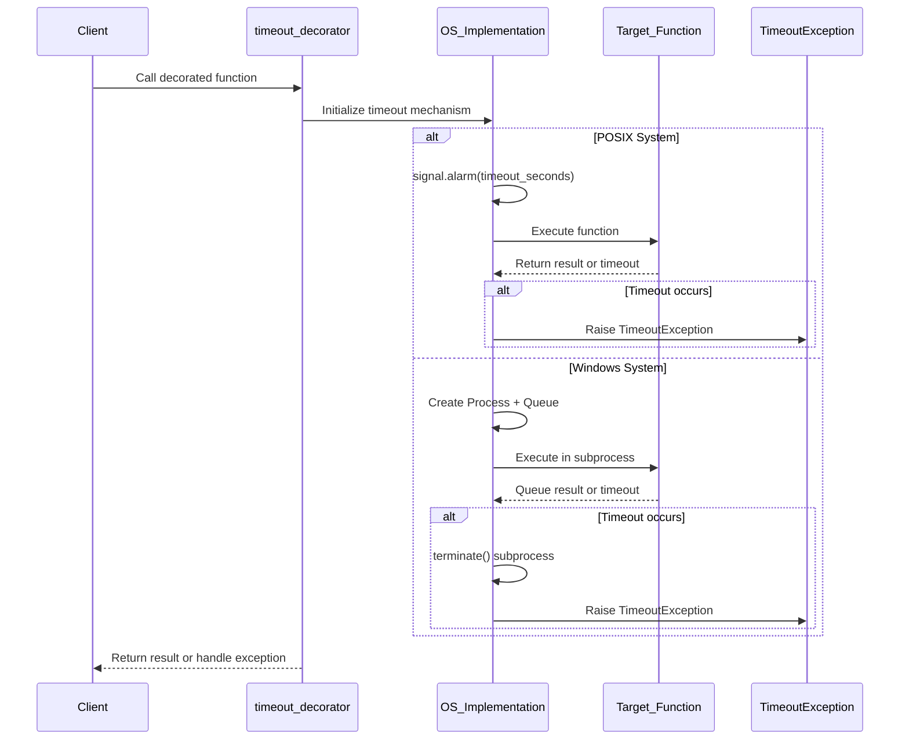
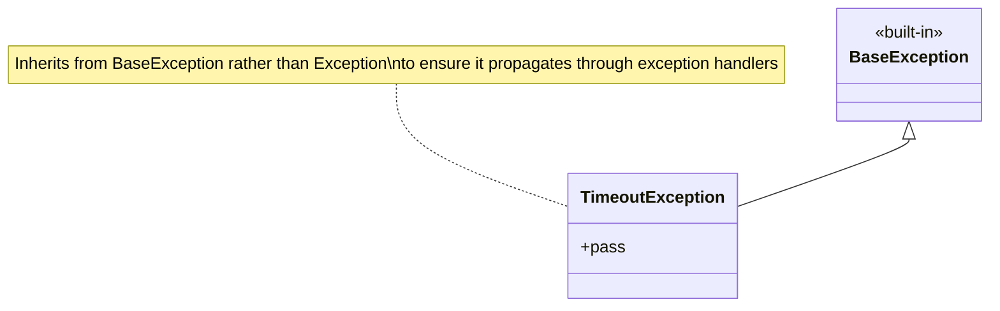
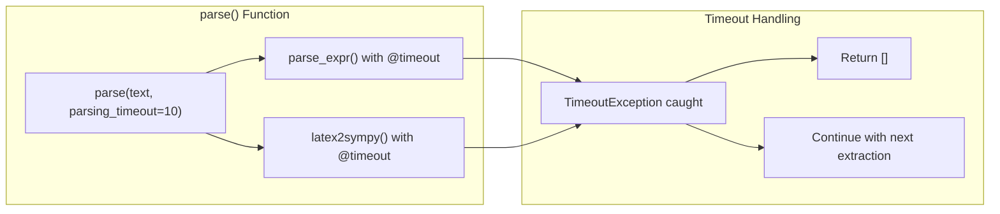
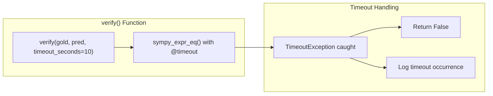
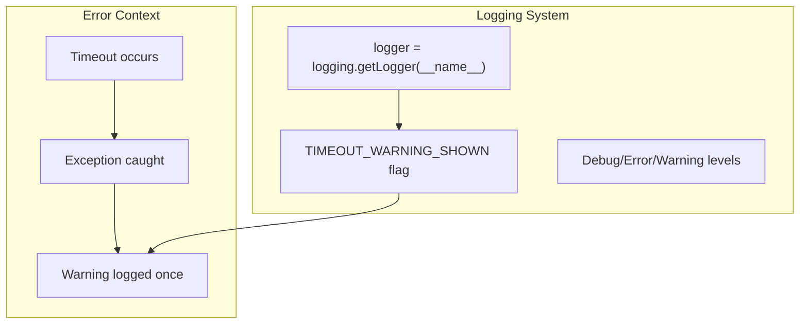
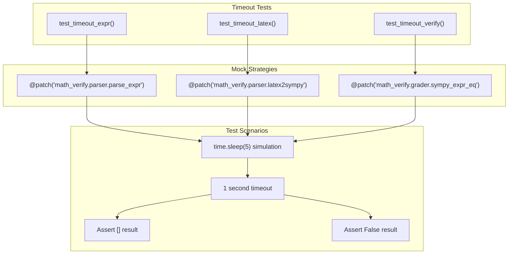

<!-- source: DeepWiki mcp.deepwiki.com · repo huggingface/Math-Verify · page 3.4 Utilities and Error Handling · fetched 2026-10-26 -->

# Utilities and Error Handling

Relevant source files

The following files were used as context for generating this wiki page:

- [src/math_verify/errors.py](src/math_verify/errors.py)
- [src/math_verify/utils.py](src/math_verify/utils.py)
- [tests/test_timeout.py](tests/test_timeout.py)

This section documents the utility functions and error handling mechanisms that provide robustness and reliability to the Math-Verify system. The utilities primarily focus on timeout management for mathematical expression processing, while the error handling system provides custom exceptions and graceful degradation patterns.

For information about configuration options that control error handling behavior, see [Configuration Options](#4.3). For details about the core parsing and verification functions that utilize these utilities, see [Parser Module](#3.1) and [Grader Module](#3.2).

## Timeout System Architecture

The Math-Verify system implements a sophisticated timeout mechanism to prevent indefinite blocking during mathematical expression processing. The timeout system is built around the `timeout` decorator and provides cross-platform compatibility with different implementation strategies.

Sources: [src/math_verify/utils.py:32-108]()

## Cross-Platform Implementation Details

The timeout system adapts to different operating systems with optimized implementations for each platform:

### POSIX Systems (Unix/Linux/macOS)

The POSIX implementation uses the efficient signal-based approach with `signal.alarm()`:

| Component | Function | Purpose |
|-----------|----------|---------|
| Signal Handler | `handler(signum, frame)` | Raises `TimeoutException` on SIGALRM |
| Alarm Setup | `signal.alarm(timeout_seconds)` | Sets OS-level timeout |
| Cleanup | `signal.alarm(0)` | Cancels pending alarm |
| State Restoration | `signal.signal(SIGALRM, old_handler)` | Restores previous signal handler |

### Windows Systems

The Windows implementation uses multiprocessing due to the lack of `signal.alarm()`:

| Component | Function | Purpose |
|-----------|----------|---------|
| Process Creation | `Process(target=run_func)` | Spawns isolated process |
| Communication | `Queue()` | Inter-process result passing |
| Timeout Control | `Process.join(timeout_seconds)` | Wait with timeout |
| Process Cleanup | `Process.terminate()` | Force process termination |

Sources: [src/math_verify/utils.py:50-71](), [src/math_verify/utils.py:73-108]()

## Custom Exception System

The error handling system defines custom exceptions to provide clear error categorization and enable specific error handling patterns:

The `TimeoutException` inherits from `BaseException` rather than `Exception`, which ensures it will propagate through most exception handling code and cannot be accidentally caught by broad `except Exception:` clauses.

Sources: [src/math_verify/errors.py:1-2]()

## Integration with Core Components

The timeout system integrates seamlessly with the core parsing and verification functions:

### Parser Integration

The `parse` function uses timeouts during expression parsing operations:

### Grader Integration

The `verify` function applies timeouts to comparison operations:

Sources: [tests/test_timeout.py:8-24](), [tests/test_timeout.py:27-43](), [tests/test_timeout.py:46-56]()

## Error Handling Patterns

The Math-Verify system implements consistent error handling patterns throughout the codebase:

### Graceful Degradation

When timeouts or other errors occur, the system gracefully degrades rather than failing completely:

| Function | Error Condition | Graceful Response |
|----------|----------------|-------------------|
| `parse()` | Parsing timeout | Return empty list `[]` |
| `verify()` | Verification timeout | Return `False` |
| Expression extraction | Regex timeout | Skip problematic expression |
| LaTeX conversion | Conversion timeout | Try alternative extraction methods |

### Logging Integration

The utilities module integrates with Python's logging system to provide diagnostic information:

Sources: [src/math_verify/utils.py:23-29]()

## Configuration and Performance Considerations

### Timeout Configuration

Timeout values can be configured based on performance requirements:

| Timeout Setting | Recommended Value | Use Case |
|----------------|-------------------|----------|
| `parsing_timeout` | 10 seconds | Standard parsing operations |
| `timeout_seconds` | 10 seconds | Verification operations |
| No timeout | `None` or `<= 0` | Debugging or complex expressions |

### Performance Impact

The cross-platform implementation has different performance characteristics:

| Platform | Method | Performance | Overhead |
|----------|--------|-------------|----------|
| POSIX | Signal-based | High | Minimal |
| Windows | Multiprocessing | Lower | Process creation overhead |

The Windows implementation incurs significant performance penalties due to process spawning, as noted in the code comments.

Sources: [src/math_verify/utils.py:40-42]()

## Testing and Validation

The timeout system includes comprehensive tests to ensure reliability:

### Test Coverage

Each test simulates a 5-second delay while setting a 1-second timeout, ensuring that timeout mechanisms activate correctly and return appropriate default values.

Sources: [tests/test_timeout.py:1-57]()

---

