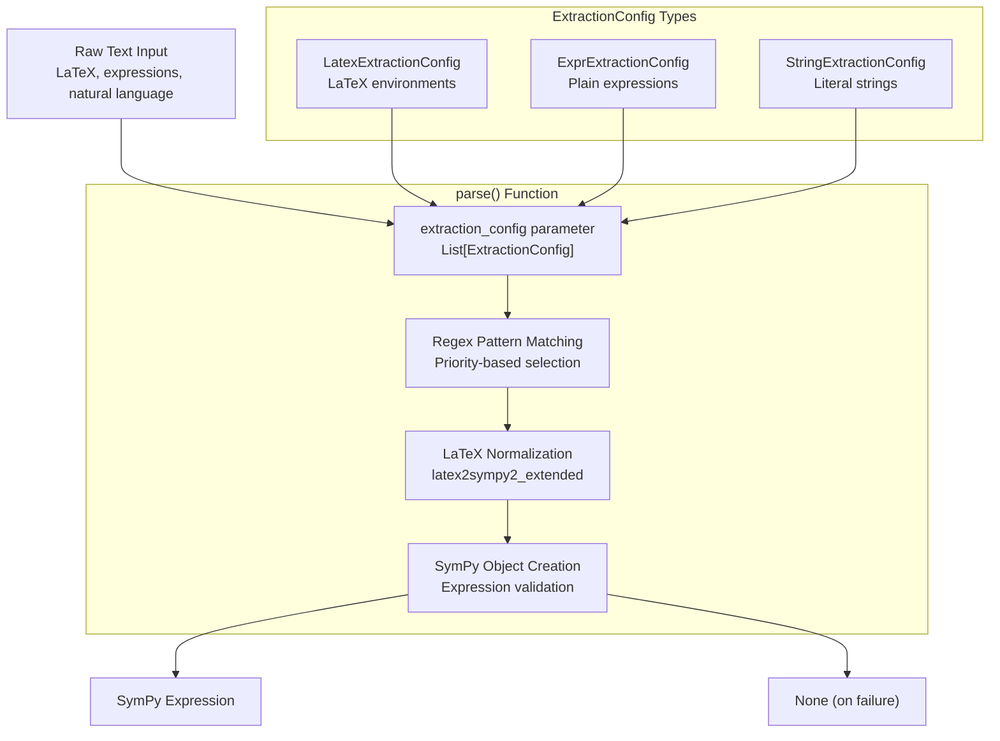
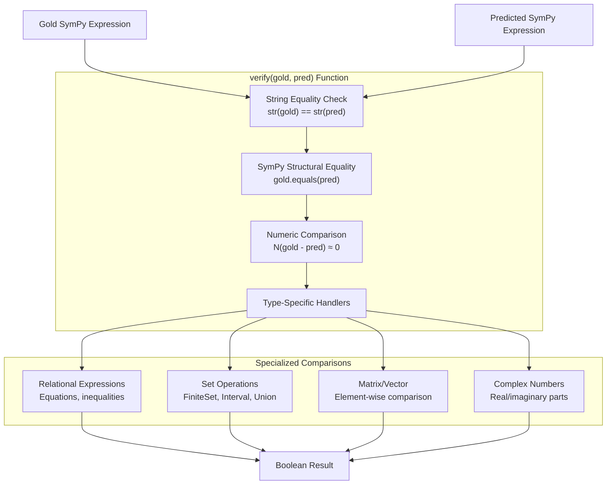
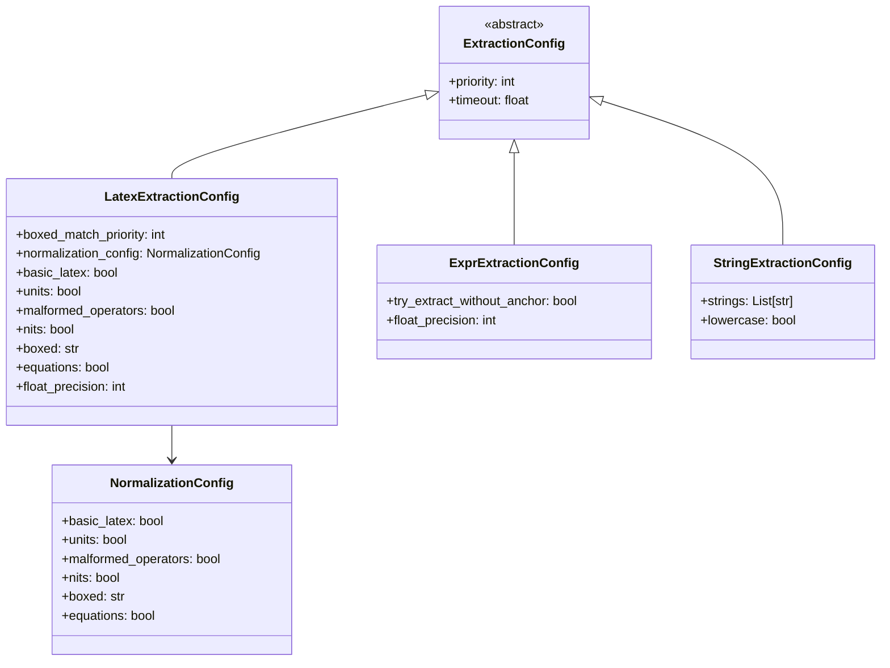
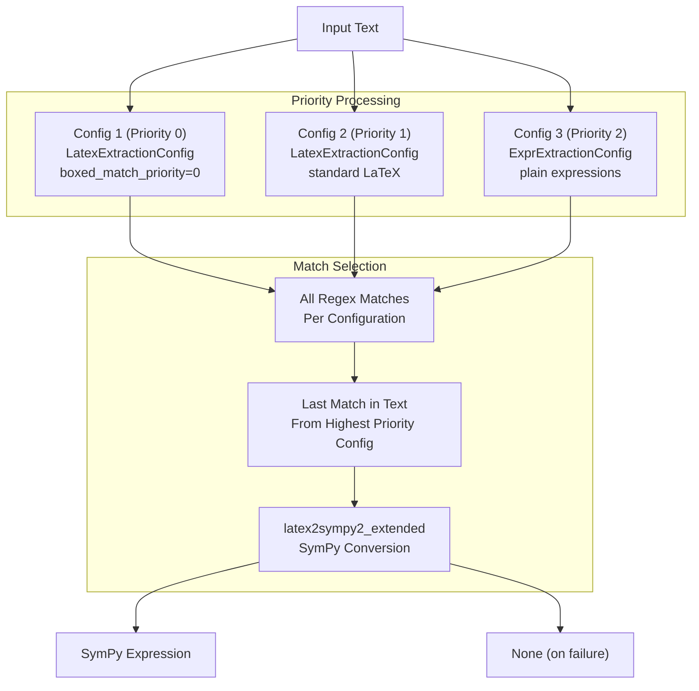
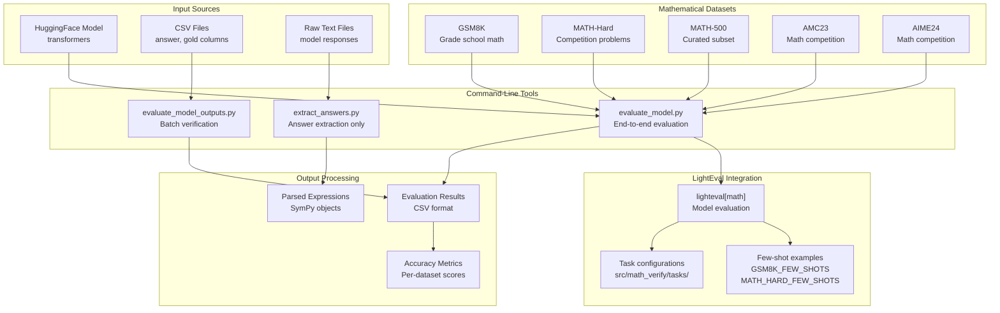
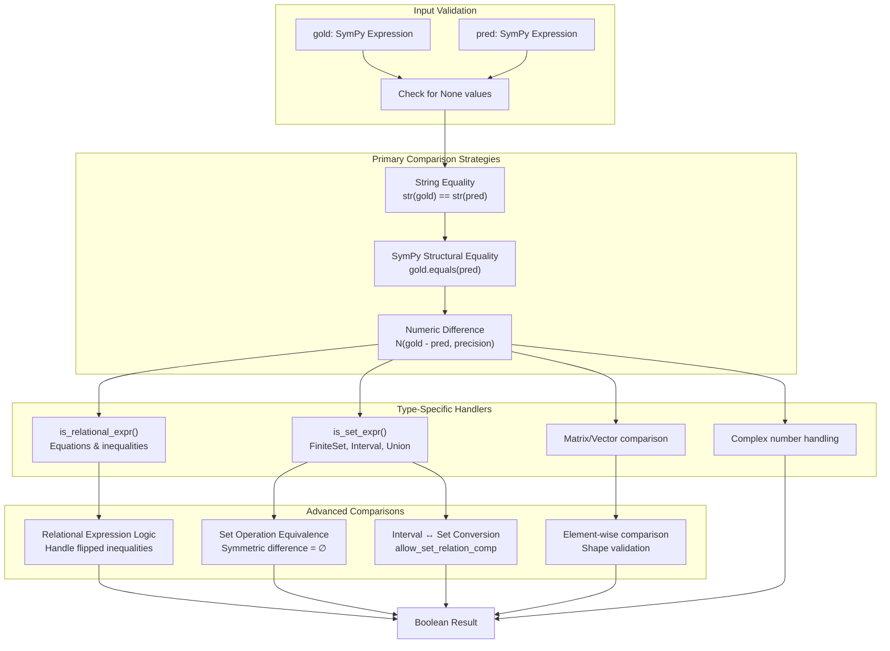

<!-- source: DeepWiki mcp.deepwiki.com · repo huggingface/Math-Verify · page 4 Usage Guide · fetched 2026-10-26 -->

# Usage Guide

<details>
<summary>Relevant source files</summary>

The following files were used as context for generating this wiki page:

- [README.md](README.md)
- [pyproject.toml](pyproject.toml)

</details>


This guide provides comprehensive instructions for using the Math-Verify library to evaluate mathematical expressions in Large Language Model outputs. It covers installation, basic functionality, and advanced configuration options. For information about the system architecture and internal components, see [Architecture](#2) and [Core Components](#3).

## Installation and Setup

Math-Verify supports Python 3.10+ and provides flexible installation options to accommodate different use cases and dependency constraints.

### System Requirements

Math-Verify requires:
- Python >= 3.10 (supports 3.10, 3.11, 3.12)
- Core dependency: `latex2sympy2_extended==1.10.2`
- ANTLR4 runtime (one of: 4.9.3, 4.11.0, 4.13.2)

### Installation Matrix

Math-Verify supports multiple ANTLR4 runtime versions to ensure compatibility across different environments:

| ANTLR4 Version | Installation Command | Use Case |
|----------------|---------------------|----------|
| 4.13.2 (recommended) | `pip install math-verify[antlr4_13_2]` | Latest features and performance |
| 4.11.0 | `pip install math-verify[antlr4_11_0]` | Compatibility with existing systems |
| 4.9.3 | `pip install math-verify[antlr4_9_3]` | Legacy environment support |

### Optional Dependencies

Math-Verify provides modular installation options:

```bash
# Core mathematical verification only
pip install math-verify[antlr4_13_2]

# Add model evaluation capabilities (includes lighteval[math])
pip install math-verify[inference,antlr4_13_2]

# Development environment with testing and formatting
pip install math-verify[dev,antlr4_13_2]

# Individual components
pip install math-verify[test,antlr4_13_2]      # pytest only
pip install math-verify[format,antlr4_13_2]    # ruff formatting only
```

### Verification of Installation

After installation, verify that Math-Verify is working correctly:

```python
from math_verify import parse, verify

# Test basic functionality
gold = parse("$5$")
answer = parse("5")
assert verify(gold, answer) == True
print("Math-Verify installed successfully!")
```

Sources: [pyproject.toml:16-25](), [pyproject.toml:27-55](), [README.md:9-20]()

## Core API Functions

Math-Verify provides a focused API with two primary functions from the `math_verify` module:

### Function Overview

| Function | Purpose | Returns | Module Location |
|----------|---------|---------|-----------------|
| `parse()` | Extract and convert mathematical expressions to SymPy objects | SymPy expression or None | `src/math_verify/__init__.py` |
| `verify()` | Compare two parsed mathematical expressions for equivalence | Boolean | `src/math_verify/__init__.py` |

### Expression Parsing Workflow

**Diagram: From Text to SymPy Objects**



### Basic Parsing Examples

```python
from math_verify import parse

# Parse LaTeX set notation
set_expr = parse("${1,3} \\cup {2,4}$")
# Returns: Union(FiniteSet(1, 3), FiniteSet(2, 4))

# Parse fraction
fraction = parse("1/2")  
# Returns: Rational(1, 2)

# Parse with timeout protection (default 5 seconds)
complex_expr = parse("$\\int_0^1 x^2 dx$", timeout=10)

# Parse from model output with mixed formats
model_output = "The solution is $\\boxed{\\frac{1}{2}}$ or 0.5"
result = parse(model_output)  # Extracts the boxed LaTeX first
```

### Expression Verification Process

**Diagram: verify() Function Logic**



### Verification Examples

```python
from math_verify import parse, verify

# Basic numeric verification
gold = parse("5")
answer = parse("10/2")
result = verify(gold, answer)  # True

# Set equivalence 
gold = parse("${1,2,3}$")
answer = parse("${3,1,2}$")  # Order doesn't matter for sets
result = verify(gold, answer)  # True

# Symbolic equivalence
gold = parse("$x^2 - 1$")
answer = parse("$(x-1)(x+1)$")
result = verify(gold, answer)  # True

# Important: Order matters (asymmetric)
gold = parse("$x > 5$")
answer = parse("$(5, \\infty)$")
verify(gold, answer)  # True (inequality → interval allowed)
verify(answer, gold)  # False (interval → inequality not allowed)
```

### Error Handling and Edge Cases

```python
from math_verify import parse, verify

# Parsing failures return None
invalid = parse("invalid_expression")  # Returns None

# Verification with None values
gold = parse("5")
answer = None
result = verify(gold, answer)  # False

# Timeout protection for complex expressions
try:
    result = parse("very_complex_expression", timeout=1)
except TimeoutError:
    print("Parsing timed out")

# Verification with raise_on_error parameter
result = verify(gold, answer, raise_on_error=False)  # Handles errors gracefully
```

Sources: [README.md:22-36](), [README.md:177-192]()

## Configuration System

Math-Verify uses a priority-based extraction system with configurable normalization options. The `extraction_config` parameter accepts a list of configuration objects that define how mathematical expressions are identified and processed.

### ExtractionConfig Class Hierarchy

**Diagram: Configuration Classes and Parameters**



### LatexExtractionConfig Parameters

The `LatexExtractionConfig` class handles LaTeX expression extraction with extensive normalization options:

```python
from math_verify import parse
from math_verify.parser import LatexExtractionConfig

# Full configuration example
latex_config = LatexExtractionConfig(
    boxed_match_priority=0,        # Prioritize \boxed{} expressions (0 = highest)
    basic_latex=True,              # Remove \mathrm, \displaystyle, etc.
    units=True,                    # Strip units like "cm", "kg"  
    malformed_operators=True,      # Fix \frac13 → \frac{1}{3}
    nits=True,                     # Minor formatting fixes
    boxed="all",                   # Extract from \boxed{} environments
    equations=True,                # Handle equations and solve for variables
    float_precision=3              # Rounding precision for float comparisons
)

result = parse(
    "The distance is $\\boxed{5.333 \\text{ cm}}$ approximately",
    extraction_config=[latex_config]
)
# Returns: 5.333 (units stripped, precision preserved)
```

#### Supported LaTeX Environments

| Environment | Syntax | Example | Priority |
|-------------|--------|---------|----------|
| Boxed | `\boxed{...}` | `\boxed{x=5}` | Configurable via `boxed_match_priority` |
| Display Math | `\[ ... \]` | `\[ x^2 + 1 \]` | Standard |
| Double Dollar | `$$ ... $$` | `$$ \frac{1}{2} $$` | Standard |
| Inline Math | `$...$` | `$x = 5$` | Standard |
| Parentheses | `\( ... \)` | `\( a + b \)` | Standard |
| Brackets | `[ ... ]` | `[ x > 0 ]` | Standard |

### ExprExtractionConfig Parameters

The `ExprExtractionConfig` class extracts plain mathematical expressions:

```python
from math_verify import parse
from math_verify.parser import ExprExtractionConfig

expr_config = ExprExtractionConfig(
    try_extract_without_anchor=True,  # Try extraction without word boundaries
    float_precision=5                  # Precision for float comparisons
)

# Extracts numeric expressions from natural language
result = parse("The final answer is 0.33333", extraction_config=[expr_config])
# Returns: 0.33333 with specified precision
```

### StringExtractionConfig Parameters

The `StringExtractionConfig` class extracts literal string matches:

```python
from math_verify import parse
from math_verify.parser import StringExtractionConfig

# Multiple choice configuration
mcq_config = StringExtractionConfig(
    strings=["A", "B", "C", "D", "E"],  # Valid answer choices
    lowercase=False                      # Case-sensitive matching
)

result = parse("The correct answer is B", extraction_config=[mcq_config])
# Returns: "B"

# Case-insensitive matching
flexible_config = StringExtractionConfig(
    strings=["true", "false"],
    lowercase=True  # Matches "True", "TRUE", "true", etc.
)
```

### Priority-Based Extraction System

**Diagram: Extraction Priority Processing**



### Configuration Combinations and Best Practices

```python
from math_verify import parse
from math_verify.parser import (
    LatexExtractionConfig, 
    ExprExtractionConfig, 
    StringExtractionConfig
)

# Recommended configuration for model outputs
model_output_configs = [
    # Highest priority: boxed LaTeX answers
    LatexExtractionConfig(boxed_match_priority=0),
    # Standard LaTeX extraction
    LatexExtractionConfig(),
    # Fallback: plain expressions
    ExprExtractionConfig()
]

# Parse complex model output
model_response = """
Let me solve this step by step:
First, I calculate x = 5/2 = 2.5
Then I need to find $y = x^2 = (5/2)^2$
Therefore, the final answer is $\\boxed{\\frac{25}{4}}$
"""

result = parse(model_response, extraction_config=model_output_configs)
# Returns: Rational(25, 4) - extracts the boxed answer

# Configuration for reward-based training (stricter)
reward_config = [
    LatexExtractionConfig(
        basic_latex=True,           # Enforce proper LaTeX
        units=True,                 # Require unit handling
        malformed_operators=False,  # Don't fix malformed LaTeX
        nits=False,                 # Don't apply minor fixes
        boxed="all",               # Require boxed format
        equations=False            # Don't solve equations automatically
    )
]
```

### Configuration Validation and Debugging

```python
from math_verify import parse

# Debug configuration behavior
def debug_parse(text, configs):
    for i, config in enumerate(configs):
        result = parse(text, extraction_config=[config])
        print(f"Config {i} ({type(config).__name__}): {result}")
    
    # Combined result
    combined = parse(text, extraction_config=configs)
    print(f"Combined result: {combined}")

# Test different configurations
text = "The answer is $x = 5$ or approximately 5.0"
configs = [
    LatexExtractionConfig(),
    ExprExtractionConfig()
]

debug_parse(text, configs)
```

Sources: [README.md:38-45](), [README.md:194-209](), [README.md:210-219]()

## Command-Line Tools and Batch Processing

Math-Verify provides three command-line utilities for batch processing and model evaluation. These tools integrate with the LightEval framework for comprehensive mathematical benchmarking.

### Command-Line Tool Architecture

**Diagram: Evaluation Pipeline and Tools**



### evaluate_model.py - End-to-End Model Evaluation

This tool evaluates HuggingFace models on mathematical datasets using the LightEval framework:

```bash
# Basic model evaluation
python evaluate_model.py \
    --model HuggingFaceTB/SmolLM2-135M \
    --use_chat_template True \
    --task gsm8k

# Advanced evaluation with custom parameters
python evaluate_model.py \
    --model microsoft/phi-3-mini-4k-instruct \
    --use_chat_template True \
    --task math_hard \
    --batch_size 8 \
    --max_samples 100
```

#### Supported Task Parameters

| Task Name | Dataset | Description | Few-Shot Support |
|-----------|---------|-------------|------------------|
| `gsm8k` | GSM8K | Grade school math word problems | Yes |
| `math_hard` | MATH-Hard | Competition-level problems | Yes |
| `math_500` | MATH-500 | Curated MATH subset | No |
| `amc23` | AMC23 | American Mathematics Competition 2023 | No |
| `aime24` | AIME24 | American Invitational Mathematics Exam 2024 | No |

#### Required Dependencies

```bash
# Install inference capabilities
pip install math-verify[inference,antlr4_13_2]
```

### evaluate_model_outputs.py - Batch Output Verification

This tool processes pre-generated model outputs stored in CSV files:

```bash
# Basic batch evaluation
python evaluate_model_outputs.py \
    --input_csv examples/model_outputs.csv \
    --output_csv results.csv

# With custom extraction configuration
python evaluate_model_outputs.py \
    --input_csv model_responses.csv \
    --output_csv scored_results.csv \
    --timeout 10
```

#### Expected CSV Format

Input CSV must contain these columns:
- `answer`: Model-generated response text
- `gold`: Reference answer (ground truth)

Output CSV includes:
- Original columns
- `parsed_answer`: Extracted mathematical expression
- `parsed_gold`: Parsed reference answer  
- `correct`: Boolean verification result
- `extraction_success`: Whether parsing succeeded

#### Example CSV Processing

```python
# Equivalent programmatic usage
import pandas as pd
from math_verify import parse, verify

df = pd.read_csv("model_outputs.csv")
results = []

for _, row in df.iterrows():
    gold_parsed = parse(row["gold"])
    answer_parsed = parse(row["answer"])
    
    is_correct = verify(gold_parsed, answer_parsed) if gold_parsed and answer_parsed else False
    
    results.append({
        "answer": row["answer"],
        "gold": row["gold"], 
        "parsed_answer": str(answer_parsed),
        "parsed_gold": str(gold_parsed),
        "correct": is_correct,
        "extraction_success": answer_parsed is not None
    })

pd.DataFrame(results).to_csv("results.csv", index=False)
```

### extract_answers.py - Answer Extraction Only

This tool extracts mathematical expressions from text without verification:

```bash
# Extract answers from model outputs
python extract_answers.py \
    --input_csv examples/sample_answers.csv \
    --output_csv extracted.csv

# With custom extraction timeout
python extract_answers.py \
    --input_csv complex_outputs.csv \
    --output_csv extracted.csv \
    --timeout 15
```

#### Use Cases for Answer Extraction

1. **Preprocessing**: Extract answers before manual verification
2. **Analysis**: Study extraction success rates across different models
3. **Debugging**: Identify parsing failures in model outputs
4. **Data Preparation**: Create clean datasets for further analysis

#### Output Format

The tool adds columns to the input CSV:
- `extracted_answer`: Parsed mathematical expression (SymPy format)
- `extraction_success`: Boolean indicating successful parsing
- `extraction_method`: Which configuration successfully extracted the answer

### Error Handling and Diagnostics

All command-line tools include robust error handling:

```bash
# Enable verbose logging
python evaluate_model.py --model test_model --task gsm8k --verbose

# Handle timeouts gracefully
python evaluate_model_outputs.py \
    --input_csv large_dataset.csv \
    --output_csv results.csv \
    --timeout 30 \
    --raise_on_error False
```

#### Common Issues and Solutions

| Issue | Symptom | Solution |
|-------|---------|----------|
| Import errors | `ModuleNotFoundError: lighteval` | Install with `pip install math-verify[inference]` |
| Timeout errors | Parsing hangs on complex expressions | Increase `--timeout` parameter |
| Memory issues | Large batch processing fails | Reduce batch size or process in chunks |
| Model access | HuggingFace authentication required | Set `HF_TOKEN` environment variable |

Sources: [README.md:78-105]()

## Configuration Recommendations

### Dataset-Specific Configurations

The optimal configuration depends on the format of your dataset:

| Dataset Type | Gold Answer Format | Recommended Gold Config | Recommended Prediction Config |
|--------------|-------------------|-------------------------|------------------------------|
| Simple numbers | `5`, `10`, `1/2` | `ExprExtractionConfig()` | `LatexExtractionConfig(), ExprExtractionConfig()` |
| LaTeX expressions | `$\frac{1}{2}$` | `LatexExtractionConfig()` | `LatexExtractionConfig(), ExprExtractionConfig()` |
| Multiple choice | `A`, `B`, `C`, `D` | `StringExtractionConfig(strings=["A", "B", "C", "D"])` | Same as gold |
| Float values | `0.333` | `ExprExtractionConfig(float_precision=3)` | `LatexExtractionConfig(), ExprExtractionConfig(float_precision=3)` |

### Best Practices

1. **For model outputs**: Use both `LatexExtractionConfig()` and `ExprExtractionConfig()` together unless you have strict control over the output format.

2. **For boxed answers**: Instruct models to output answers in a `\boxed{}` environment and set `boxed_match_priority=0` in the `LatexExtractionConfig`.

3. **For reward-based fine-tuning**: Use stricter normalization to enforce valid LaTeX:
   ```python
   LatexExtractionConfig(
       basic_latex=True,
       units=True,
       malformed_operators=False,
       nits=False,
       boxed="all",
       equations=False
   )
   ```

4. **Avoid mixing `StringExtractionConfig`** with other configs when not necessary, as it might produce unexpected results, especially when searching for A/B/C/D answers.

Sources: [README.md:194-209](), [README.md:210-219]()

## Verification Logic and Asymmetric Comparison

The `verify()` function implements a sophisticated multi-strategy comparison system that handles mathematical equivalence across different representation formats. Understanding its asymmetric behavior is crucial for proper evaluation setup.

### Verification Algorithm Flow

**Diagram: Multi-Strategy Verification Process**



### Asymmetric Verification Behavior

The verification system intentionally implements asymmetric comparison to prevent specific types of evaluation gaming:

#### 1. Representation Asymmetry (Interval ↔ Inequality)

```python
from math_verify import parse, verify

# Case 1: Gold inequality → Prediction interval (ALLOWED)
gold = parse("$1 < x < 2$")        # Relational expression
pred = parse("$(1, 2)$")           # Interval
result = verify(gold, pred)        # True

# Case 2: Gold interval → Prediction inequality (BLOCKED)  
gold = parse("$(1, 2)$")           # Interval
pred = parse("$1 < x < 2$")        # Relational expression
result = verify(gold, pred)        # False

# Override with allow_set_relation_comp=True
result = verify(gold, pred, allow_set_relation_comp=True)  # True
```

**Rationale**: Prevents models from simply echoing the input inequality instead of solving it.

#### 2. Solution Context Asymmetry (Number ↔ Equation Chain)

```python
# Case 1: Gold number → Prediction equation chain (ALLOWED)
gold = parse("101")                           # Simple number
pred = parse("$a + 2z = 2z + a = 101$")     # Solution steps
result = verify(gold, pred)                  # True

# Case 2: Gold equation chain → Prediction number (BLOCKED)
gold = parse("$a + 2z = 2z + a = 101$")     # Solution steps  
pred = parse("101")                          # Simple number
result = verify(gold, pred)                  # False
```

**Rationale**: Encourages showing work while accepting final answers that demonstrate understanding.

### Type-Specific Verification Strategies

#### Relational Expressions (Equations and Inequalities)

```python
from math_verify import parse, verify

# Equation solving
gold = parse("$x = 5$")
pred = parse("$2x - 10 = 0$")  # Different form, same solution
verify(gold, pred)  # Uses equation solving logic

# Inequality flipping
gold = parse("$x \\leq 5$")
pred = parse("$5 \\geq x$")    # Flipped inequality
verify(gold, pred)  # True - handles inequality flips

# System of equations
gold = parse("$x = 2, y = 3$")
pred = parse("$x + y = 5, x - y = -1$")
verify(gold, pred)  # Solves system and compares solutions
```

#### Set and Interval Operations

```python
# Set equivalence (order-independent)
gold = parse("${1, 2, 3}$")
pred = parse("${3, 1, 2}$")
verify(gold, pred)  # True

# Set operations
gold = parse("${1, 2} \\cup {3, 4}$")
pred = parse("${1, 2, 3, 4}$")
verify(gold, pred)  # True

# Interval comparisons
gold = parse("$[0, 1]$")
pred = parse("$\\{x : 0 \\leq x \\leq 1\\}$")
verify(gold, pred)  # True

# Mixed interval/set with precision
gold = parse("$(0, 1)$")
pred = parse("${0.001, 0.002, ..., 0.999}$")  # Finite approximation
verify(gold, pred, precision=3)  # May be True depending on interpretation
```

#### Matrix and Vector Comparisons

```python
# Matrix equality
gold = parse("$\\begin{pmatrix} 1 & 2 \\\\ 3 & 4 \\end{pmatrix}$")
pred = parse("$\\begin{pmatrix} 1.0 & 2.0 \\\\ 3.0 & 4.0 \\end{pmatrix}$")
verify(gold, pred)  # True

# Vector operations
gold = parse("$\\vec{v} = (1, 2, 3)$")
pred = parse("$\\begin{pmatrix} 1 \\\\ 2 \\\\ 3 \\end{pmatrix}$")
verify(gold, pred)  # True - different notation, same vector
```

### Verification Parameters and Fine-Tuning

```python
from math_verify import verify

# Precision control for numeric comparisons
verify(gold, pred, precision=5)           # 5 decimal places
verify(gold, pred, precision=None)        # Exact comparison only

# Error handling behavior
verify(gold, pred, raise_on_error=False)  # Return False on errors
verify(gold, pred, raise_on_error=True)   # Raise exceptions

# Set-relation comparison control
verify(gold, pred, allow_set_relation_comp=True)   # Bidirectional interval↔inequality
verify(gold, pred, allow_set_relation_comp=False)  # Default asymmetric behavior

# Complex expression handling
verify(gold, pred, handle_complex=True)   # Special complex number logic
```

### Debugging Verification Results

```python
def debug_verify(gold_text, pred_text):
    """Debug helper to understand verification decisions"""
    from math_verify import parse, verify
    
    gold = parse(gold_text)
    pred = parse(pred_text)
    
    print(f"Gold: {gold_text} → {gold} (type: {type(gold)})")
    print(f"Pred: {pred_text} → {pred} (type: {type(pred)})")
    
    # Test both directions
    result1 = verify(gold, pred)
    result2 = verify(pred, gold)
    
    print(f"verify(gold, pred): {result1}")
    print(f"verify(pred, gold): {result2}")
    print(f"Symmetric: {result1 == result2}")
    
    return result1

# Example usage
debug_verify("$x > 5$", "$(5, \\infty)$")
debug_verify("$\\{1, 2, 3\\}$", "$\\{3, 2, 1\\}$")
```

### Error Recovery and Fallback Mechanisms

The verification system includes robust error handling:

```python
# Graceful handling of parsing failures
gold = parse("valid_expression")
pred = None  # Parsing failed
result = verify(gold, pred)  # Returns False, doesn't crash

# Timeout protection during complex symbolic operations
result = verify(gold, pred, timeout=30)  # Custom timeout

# Fallback comparison strategies
# 1. String comparison (fastest)
# 2. SymPy structural equality  
# 3. Numeric evaluation with precision
# 4. Type-specific handlers
# 5. Graceful failure (return False)
```

Sources: [README.md:107-175](), [README.md:177-192]()

## Troubleshooting

### LaTeX Extraction Issues

If LaTeX extraction is not working, ensure that all LaTeX expressions are placed in a proper LaTeX environment:

- Multi-line environments:
  - `\[ ... \]`
  - `$$ ... $$`
  - `\boxed{...}`
  
- Single-line environments:
  - `$...$`
  - `\( ... \)`
  - `[ ... ]`

For example, `\[ x = 1 \]` is valid, but `x = 1` without a LaTeX environment will not be extracted.

Sources: [README.md:210-219]()

---

