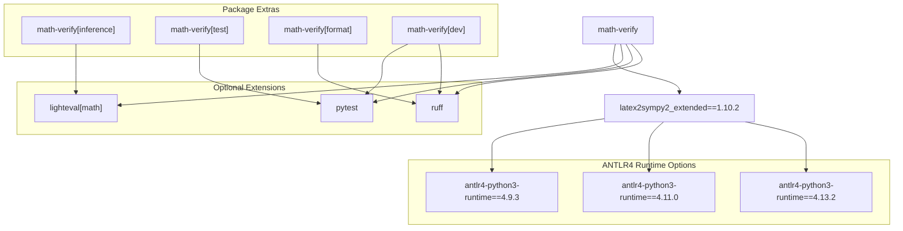
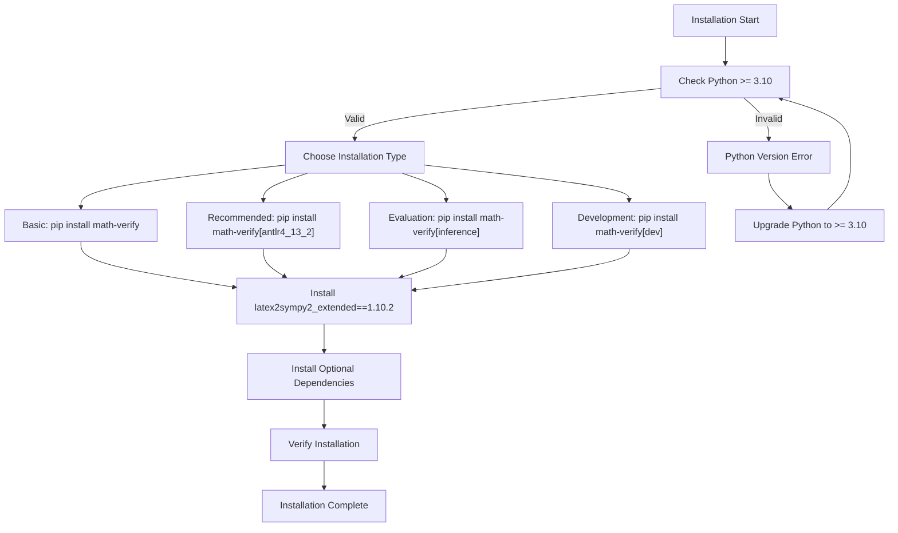

<!-- source: DeepWiki mcp.deepwiki.com · repo huggingface/Math-Verify · page 4.1 Installation and Setup · fetched 2026-10-26 -->

# Installation and Setup

<details>
<summary>Relevant source files</summary>

The following files were used as context for generating this wiki page:

- [.gitmodules](.gitmodules)
- [README.md](README.md)
- [pyproject.toml](pyproject.toml)

</details>


This document provides comprehensive installation instructions and setup procedures for the Math-Verify system. It covers system requirements, package installation options, dependency configurations, and environment setup for both end-users and developers.

For information about basic usage patterns after installation, see [Basic Usage](#4.2). For advanced configuration options, see [Configuration Options](#4.3).

## System Requirements

Math-Verify requires Python 3.10 or higher and has specific dependency requirements for mathematical expression parsing and evaluation.

### Python Version Support

The system supports the following Python versions as defined in [pyproject.toml:16-18]():

| Python Version | Support Status |
|----------------|----------------|
| 3.10           | ✅ Supported  |
| 3.11           | ✅ Supported  |
| 3.12           | ✅ Supported  |
| < 3.10         | ❌ Not Supported |

### Core Dependencies

The minimal installation requires only one core dependency as specified in [pyproject.toml:22-24]():

```toml
dependencies = [
    "latex2sympy2_extended==1.10.2",
]
```

## Installation Methods

### Standard Installation

The basic installation provides core mathematical verification functionality:

```bash
pip install math-verify
```

### ANTLR4 Runtime Configurations

Math-Verify supports multiple ANTLR4 runtime versions for enhanced compatibility. The recommended approach is to specify the ANTLR4 version explicitly to avoid potential compatibility issues.

#### Installation Dependencies Overview



#### Recommended Installation with ANTLR4

Install with the latest ANTLR4 runtime (recommended):

```bash
pip install math-verify[antlr4_13_2]
```

Alternative ANTLR4 versions as defined in [pyproject.toml:45-55]():

```bash
# For ANTLR4 4.11.0
pip install math-verify[antlr4_11_0]

# For ANTLR4 4.9.3  
pip install math-verify[antlr4_9_3]
```

## Optional Dependencies and Use Cases

### Model Evaluation Setup

For end-to-end model evaluation capabilities, install the inference dependencies:

```bash
pip install math-verify[inference]
```

This installs `lighteval[math]` as specified in [pyproject.toml:28-30](), enabling evaluation scripts like:
- `evaluate_model.py` for complete model evaluation pipelines
- `evaluate_model_outputs.py` for batch output processing

### Development Environment Setup

#### Testing Dependencies

For running the test suite:

```bash
pip install math-verify[test]
```

#### Code Formatting Dependencies

For code formatting and linting:

```bash
pip install math-verify[format]
```

#### Complete Development Setup

For full development environment with all dependencies:

```bash
pip install math-verify[dev]
```

This combines both test and format dependencies as defined in [pyproject.toml:40-43]().

## Installation Workflow

### Installation Process Flow



## Git Submodule Configuration

The project includes a Git submodule for the `latex2sympy2_extended` dependency as shown in [.gitmodules:1-4]():

```gitmodules
[submodule "latex2sympy2_extended_cloned"]
	path = latex2sympy2_extended_cloned
	url = git@github.com:huggingface/latex2sympy2_extended.git
```

For development installations from source, initialize the submodule:

```bash
git clone https://github.com/huggingface/math-verify.git
cd math-verify
git submodule update --init --recursive
```

## Installation Verification

### Basic Functionality Test

Verify the installation by testing core functionality:

```python
from math_verify import parse, verify

# Test basic parsing and verification
gold = parse("${1,3} \\cup {2,4}$")
answer = parse("${1,2,3,4}$")
result = verify(gold, answer)
print(f"Verification result: {result}")  # Should print: True
```

### Component Availability Check

Verify optional components are properly installed:

```python
# Check if inference capabilities are available
try:
    import lighteval
    print("✅ Inference capabilities available")
except ImportError:
    print("❌ Inference capabilities not available - install with [inference]")

# Check if development tools are available  
try:
    import pytest
    print("✅ Testing framework available")
except ImportError:
    print("❌ Testing framework not available - install with [test] or [dev]")
```

## Package Configuration Overview

### Build System Configuration

The package uses `setuptools` as specified in [pyproject.toml:60-66]():

```toml
[build-system]
requires = ["setuptools"]
build-backend = "setuptools.build_meta"

[tool.setuptools.packages.find]
where = ["src"]
```

### Code Quality Configuration

Development installations include code formatting tools configured in [pyproject.toml:67-82]():

- **Ruff**: Line length 88, selected lint rules E, F, I, N, W, B, A
- **Black**: Line length 88 with preview features enabled

## Troubleshooting Common Installation Issues

### ANTLR4 Version Conflicts

If you encounter ANTLR4 runtime conflicts:

1. Uninstall existing math-verify: `pip uninstall math-verify`
2. Clear pip cache: `pip cache purge`
3. Reinstall with explicit ANTLR4 version: `pip install math-verify[antlr4_13_2]`

### Dependency Resolution Issues

For dependency conflicts with `latex2sympy2_extended`:

1. Check installed version: `pip show latex2sympy2_extended`
2. Ensure version matches requirement: `1.10.2`
3. Force reinstall if needed: `pip install --force-reinstall latex2sympy2_extended==1.10.2`

### Python Version Compatibility

For Python version issues:

1. Verify Python version: `python --version`
2. Ensure Python >= 3.10 is installed
3. Use virtual environments to isolate dependencies

Sources: [pyproject.toml:1-83](), [README.md:9-21](), [.gitmodules:1-4]()

---

