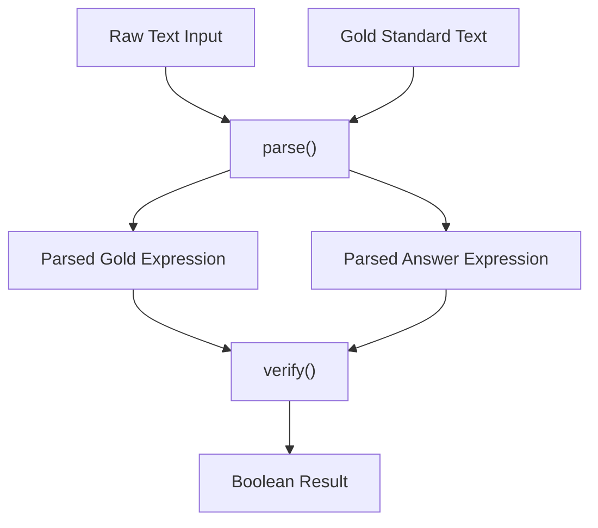
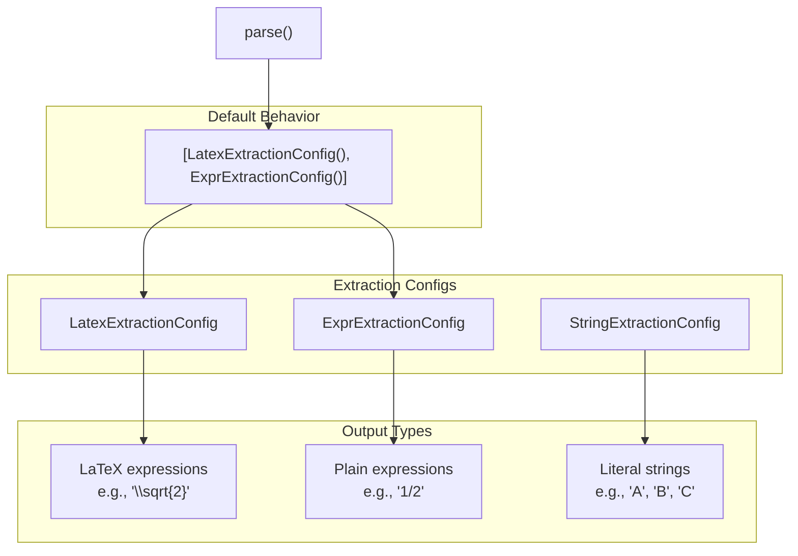
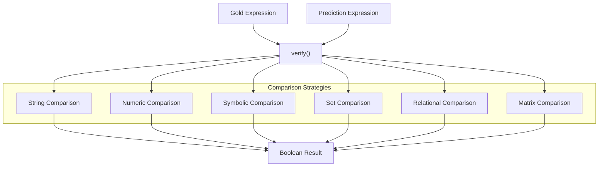
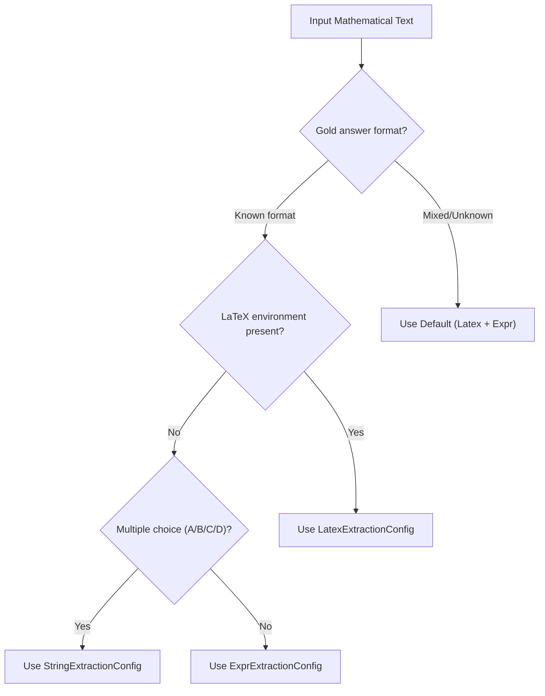

<!-- source: DeepWiki mcp.deepwiki.com · repo huggingface/Math-Verify · page 4.2 Basic Usage · fetched 2026-10-26 -->

# Basic Usage

<details>
<summary>Relevant source files</summary>

The following files were used as context for generating this wiki page:

- [README.md](README.md)
- [examples/sample_answers.csv](examples/sample_answers.csv)
- [src/math_verify/__init__.py](src/math_verify/__init__.py)
- [tests/test_string_extraction.py](tests/test_string_extraction.py)

</details>


This page covers the fundamental usage patterns for the Math-Verify system, demonstrating how to use the core `parse` and `verify` functions for mathematical expression evaluation. For detailed installation instructions, see [Installation and Setup](#4.1). For advanced configuration options, see [Configuration Options](#4.3).

## Core Function Overview

The Math-Verify system provides two primary functions for mathematical expression evaluation:

| Function | Purpose | Input | Output |
|----------|---------|--------|--------|
| `parse` | Extract and normalize mathematical expressions from text | Raw text string, optional extraction configs | List of parsed expressions |
| `verify` | Compare two mathematical expressions for equivalence | Two parsed expressions (gold, prediction) | Boolean result |

The typical workflow follows a simple two-step pattern: parse the mathematical expressions from text, then verify if they are equivalent.

### Basic Workflow Diagram



Sources: [README.md:22-36](), [src/math_verify/__init__.py:5-12]()

## Basic Parsing

The `parse` function extracts mathematical expressions from raw text and converts them to a standardized format for comparison. By default, it uses both LaTeX and plain expression extraction.

### Simple Parsing Examples

```python
from math_verify import parse

# Parse LaTeX expressions
gold = parse("${1,3} \\cup {2,4}$")
answer = parse("${1,2,3,4}$")

# Parse plain expressions  
result = parse("1/2 + 3/4")

# Parse multiple formats in same text
mixed = parse("The answer is $\\frac{1}{2}$ or 0.5")
```

### Extraction Configuration System



Sources: [README.md:38-46](), [src/math_verify/__init__.py:7-11](), [tests/test_string_extraction.py:6-27]()

## Basic Verification

The `verify` function compares two parsed expressions to determine if they are mathematically equivalent. The order of arguments matters: the first argument is treated as the gold standard.

### Simple Verification Examples

```python
from math_verify import parse, verify

# Set comparison
gold = parse("${1,3} \\cup {2,4}$")
answer = parse("${1,2,3,4}$")
result = verify(gold, answer)  # Returns: True

# Numerical equivalence
gold = parse("1/2")
answer = parse("0.5")
result = verify(gold, answer)  # Returns: True

# Expression equivalence
gold = parse("$x^2 + 2x + 1$")
answer = parse("$(x + 1)^2$")
result = verify(gold, answer)  # Returns: True
```

### Verification Process Flow



Sources: [README.md:139-175](), [src/math_verify/__init__.py:5]()

## Extraction Configuration Types

The Math-Verify system supports three main extraction strategies, each optimized for different types of mathematical content:

### LatexExtractionConfig

Extracts mathematical expressions from LaTeX environments. Requires expressions to be properly enclosed in LaTeX delimiters.

**Supported LaTeX Environments:**
- Multi-line: `\[ ... \]`, `$$ ... $$`, `\boxed{...}`
- Single-line: `$...$`, `\( ... \)`, `[ ... ]`

```python
from math_verify import parse, LatexExtractionConfig

# Extract only LaTeX expressions
config = LatexExtractionConfig()
result = parse("The answer is $\\frac{1}{2}$", [config])
```

### ExprExtractionConfig

Extracts plain mathematical expressions without LaTeX formatting.

```python
from math_verify import parse, ExprExtractionConfig

# Extract only plain expressions
config = ExprExtractionConfig()
result = parse("The answer is 1/2", [config])
```

### StringExtractionConfig

Extracts literal string answers, commonly used for multiple-choice questions.

```python
from math_verify import parse, StringExtractionConfig

# Extract string answers (A, B, C, D, etc.)
config = StringExtractionConfig()
result = parse("The answer is A.", [config])  # Returns: ["A", "A"]
```

Sources: [README.md:38-46](), [README.md:211-221](), [tests/test_string_extraction.py:6-27]()

## Common Usage Patterns

### Pattern 1: Default Parsing and Verification

Most common usage pattern with automatic extraction of both LaTeX and plain expressions:

```python
from math_verify import parse, verify

# Parse with default configurations
gold = parse("$\\sqrt{4}$")
answer = parse("2")

# Verify equivalence
is_correct = verify(gold, answer)
```

### Pattern 2: Specific Extraction Configuration

When you know the format of your mathematical expressions:

```python
from math_verify import parse, verify, LatexExtractionConfig

# Parse only LaTeX expressions
latex_config = [LatexExtractionConfig()]
gold = parse("$\\frac{1}{2}$", latex_config)
answer = parse("$0.5$", latex_config)

result = verify(gold, answer)
```

### Pattern 3: Multiple Choice Questions

For string-based answers like multiple choice:

```python
from math_verify import parse, verify, StringExtractionConfig

# Parse string answers
string_config = [StringExtractionConfig()]
gold = parse("A", string_config)
answer = parse("The correct answer is A.", string_config)

result = verify(gold, answer)
```

### Usage Pattern Decision Tree



Sources: [README.md:195-210](), [examples/sample_answers.csv:1-8]()

## Error Handling and Edge Cases

The Math-Verify system includes robust error handling for common edge cases:

- **Timeout Protection**: Long computations are automatically terminated
- **Malformed Input**: Graceful handling of invalid mathematical expressions  
- **Format Mismatch**: Multiple extraction strategies attempt to parse expressions
- **Precision Issues**: Configurable numerical comparison tolerance

For detailed information about error handling mechanisms, see [Utilities and Error Handling](#3.4). For advanced configuration of these behaviors, see [Configuration Options](#4.3).

Sources: [README.md:171-175]()

---

