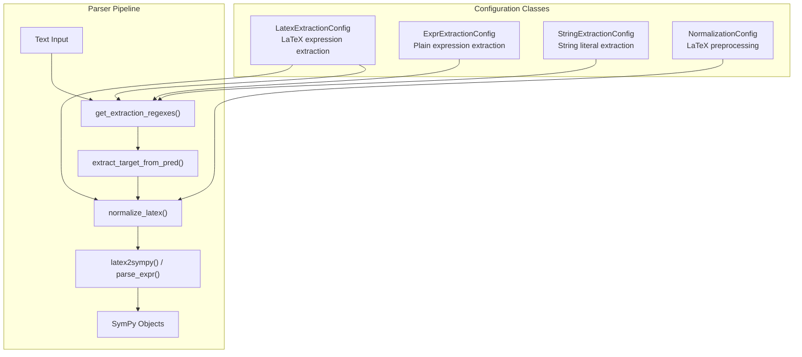
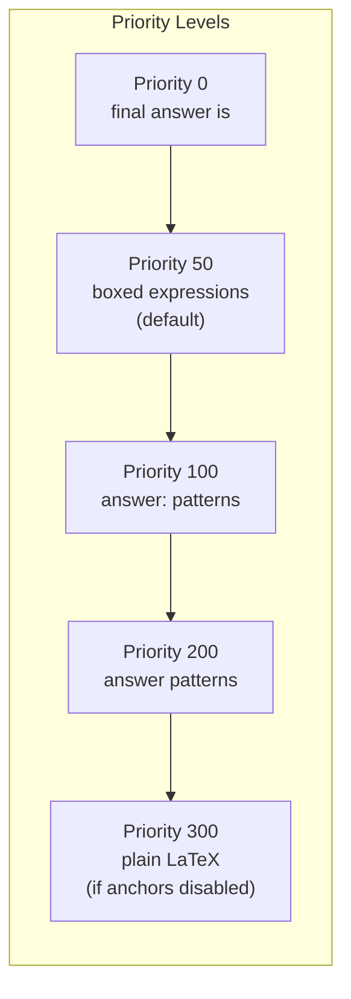
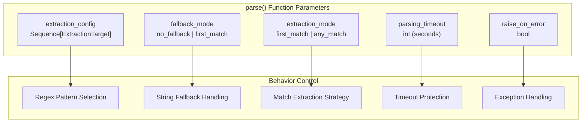
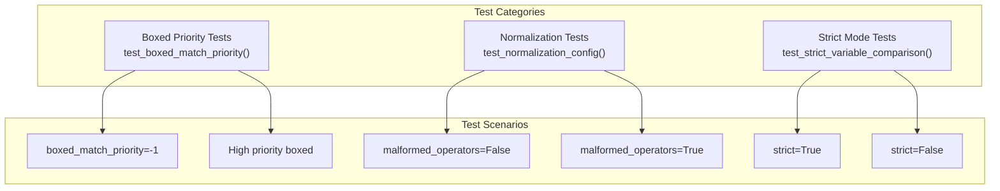

<!-- source: DeepWiki mcp.deepwiki.com · repo huggingface/Math-Verify · page 4.3 Configuration Options · fetched 2026-10-26 -->

# Configuration Options

<details>
<summary>Relevant source files</summary>

The following files were used as context for generating this wiki page:

- [src/math_verify/parser.py](src/math_verify/parser.py)
- [tests/test_configs.py](tests/test_configs.py)
- [tests/test_strict.py](tests/test_strict.py)

</details>


This document covers the comprehensive configuration system used to customize mathematical expression extraction, normalization, and parsing behavior in Math-Verify. For basic usage patterns and examples, see [Basic Usage](#4.2). For information about the underlying parser and grader modules that these configurations control, see [Parser Module](#3.1) and [Grader Module](#3.2).

The configuration system provides fine-grained control over how mathematical expressions are detected, extracted, and processed from text inputs, with separate configuration classes for different extraction strategies and processing stages.

## Configuration Architecture

The Math-Verify configuration system is built around three main extraction configuration classes and one normalization configuration class, each controlling different aspects of the parsing pipeline.



**Configuration Flow Diagram**

Sources: [src/math_verify/parser.py:49-106](), [src/math_verify/parser.py:358-376]()

## Extraction Configuration Classes

### LatexExtractionConfig

The `LatexExtractionConfig` class controls how LaTeX mathematical expressions are detected and extracted from text.

| Attribute | Type | Default | Description |
|-----------|------|---------|-------------|
| `try_extract_without_anchor` | `bool` | `True` | Extract LaTeX without requiring anchor words like "answer:" |
| `boxed_match_priority` | `int` | `50` | Priority for `\boxed{}` expressions (0=highest, -1=disabled) |
| `normalization_config` | `NormalizationConfig` | See below | LaTeX preprocessing configuration |



**LaTeX Extraction Priority System**

The default `normalization_config` includes:
- `basic_latex=True`: Basic LaTeX cleanup
- `units=True`: Unit handling and removal
- `malformed_operators=True`: Fix malformed operators
- `nits=True`: Minor formatting fixes
- `boxed="all"`: Extract all boxed expressions
- `equations=False`: Don't parse as equations

Sources: [src/math_verify/parser.py:49-81](), [src/math_verify/parser.py:299-356]()

### ExprExtractionConfig

The `ExprExtractionConfig` class controls extraction of plain mathematical expressions and numbers.

| Attribute | Type | Default | Description |
|-----------|------|---------|-------------|
| `try_extract_without_anchor` | `bool` | `True` | Extract expressions without anchor words |

This configuration handles:
- Numbers with thousand separators (e.g., "1,234.56")
- Decimal numbers with various formats 
- Mathematical expressions with operators (`+`, `-`, `*`, `/`, `^`, `×`, `÷`)
- Percentage values with automatic conversion
- Currency-prefixed numbers

Sources: [src/math_verify/parser.py:83-92](), [src/math_verify/parser.py:167-235]()

### StringExtractionConfig

The `StringExtractionConfig` class controls extraction of literal string values, commonly used for multiple-choice answers.

| Attribute | Type | Default | Description |
|-----------|------|---------|-------------|
| `strings` | `tuple[str, ...]` | `("A", "B", "C", "D")` | Strings to match and extract |
| `try_extract_without_anchor` | `bool` | `True` | Extract without anchor words |
| `lowercase` | `bool` | `True` | Convert extracted strings to lowercase |

Sources: [src/math_verify/parser.py:94-106](), [src/math_verify/parser.py:111-164]()

## Runtime Configuration Options

### Parsing Function Parameters

The main `parse()` function accepts several configuration parameters that control parsing behavior:



**Parse Function Configuration Flow**

| Parameter | Type | Default | Description |
|-----------|------|---------|-------------|
| `extraction_config` | `Sequence[ExtractionTarget]` | `[LatexExtractionConfig(), ExprExtractionConfig()]` | List of extraction configurations to try |
| `fallback_mode` | `Literal` | `"first_match"` | How to handle parsing failures |
| `extraction_mode` | `Literal` | `"any_match"` | Strategy for finding matches |
| `parsing_timeout` | `int` | `5` | Timeout in seconds for parsing operations |
| `raise_on_error` | `bool` | `False` | Whether to raise exceptions or return empty list |

Sources: [src/math_verify/parser.py:651-733]()

### Fallback and Extraction Modes

**Fallback Mode Options:**
- `"no_fallback"`: Return only successfully parsed expressions
- `"first_match"`: Include first string match even if parsing failed

**Extraction Mode Options:**
- `"first_match"`: Stop after finding first match in priority order
- `"any_match"`: Try all patterns, return first successful parse

## Advanced Configuration Examples

### Custom LaTeX Configuration

```python
from math_verify.parser import LatexExtractionConfig, parse
from latex2sympy2_extended import NormalizationConfig

# Disable boxed expression matching
config = LatexExtractionConfig(
    boxed_match_priority=-1,  # Disable boxed matching
    try_extract_without_anchor=False  # Require anchor words
)

# Custom normalization - disable malformed operator fixing
custom_norm = NormalizationConfig(
    basic_latex=True,
    units=True,
    malformed_operators=False,  # Keep operators as-is
    nits=True,
    boxed=True,
    equations=True
)

advanced_config = LatexExtractionConfig(
    normalization_config=custom_norm
)
```

Sources: [tests/test_configs.py:7-33](), [tests/test_configs.py:35-73]()

### Multi-Strategy Extraction

```python
from math_verify.parser import (
    LatexExtractionConfig, 
    ExprExtractionConfig, 
    StringExtractionConfig,
    parse
)

# Configure multiple extraction strategies with priorities
configs = [
    LatexExtractionConfig(boxed_match_priority=0),  # Highest priority for boxed
    ExprExtractionConfig(),  # Standard expression extraction
    StringExtractionConfig(strings=("Yes", "No", "Maybe"))  # Custom strings
]

result = parse(
    "The final answer is $\\boxed{42}$",
    extraction_config=configs,
    fallback_mode="no_fallback",
    extraction_mode="first_match"
)
```

## Configuration Testing and Validation

The configuration system includes comprehensive test coverage for various scenarios:



**Configuration Test Coverage**

Sources: [tests/test_configs.py:1-73](), [tests/test_strict.py:1-15]()

## Integration with Grader Module

Configuration options also affect the comparison and grading process through the `strict` parameter and other grader-specific settings:

| Configuration | Effect on Grading | Example |
|---------------|-------------------|---------|
| `strict=True` | Exact variable matching required | `f(x)` ≠ `f(y)` |
| `strict=False` | Flexible variable matching | `f(x)` = `f(y)` |
| Normalization settings | Affects LaTeX preprocessing | Unit removal, operator fixing |

The configuration system provides a powerful and flexible way to customize Math-Verify's behavior for different mathematical domains and use cases, from basic arithmetic to advanced mathematical notation.

Sources: [tests/test_strict.py:6-14]()

---

