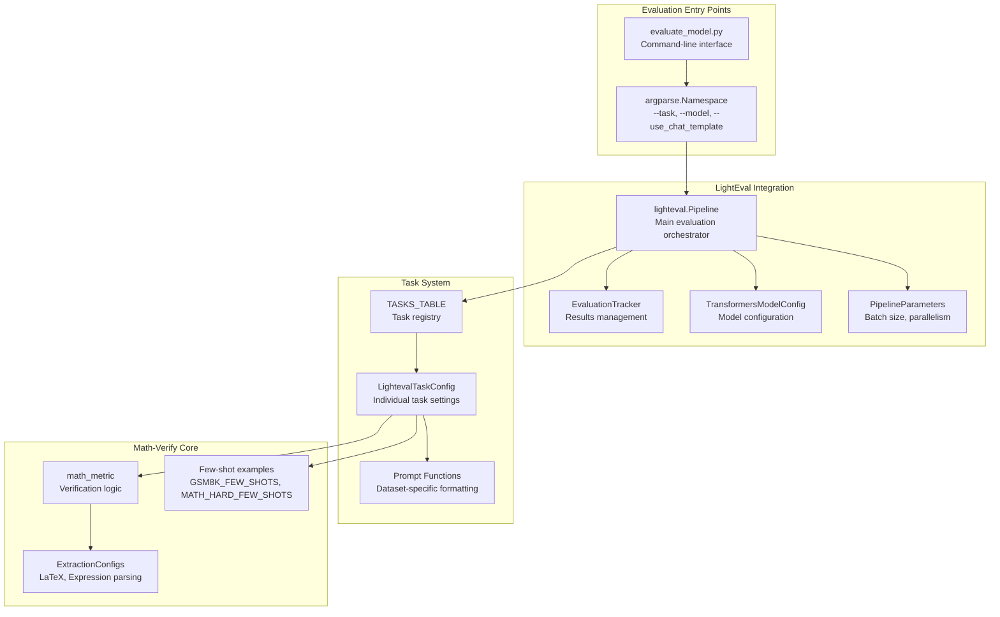
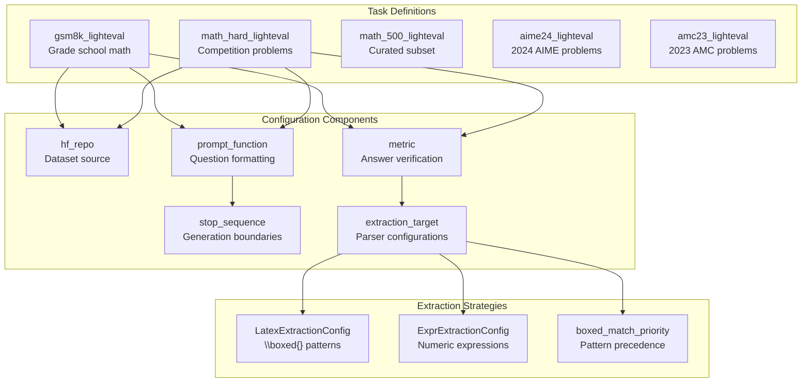
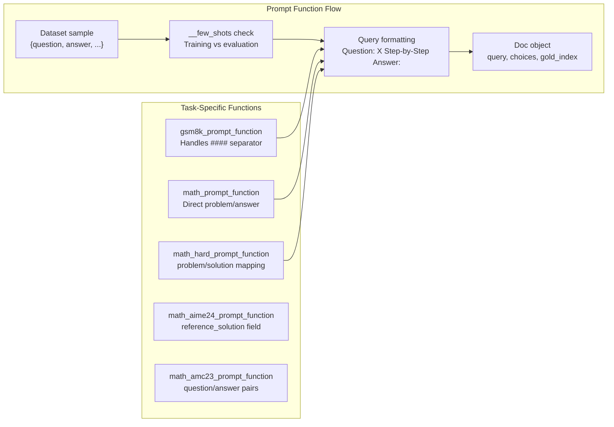
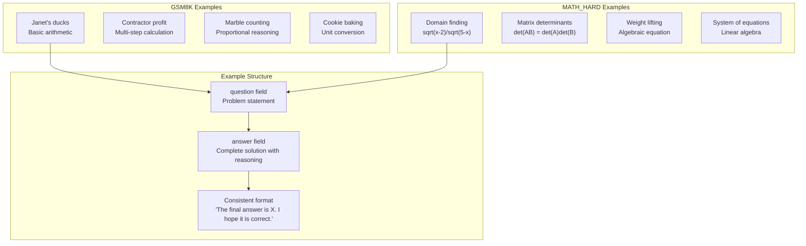
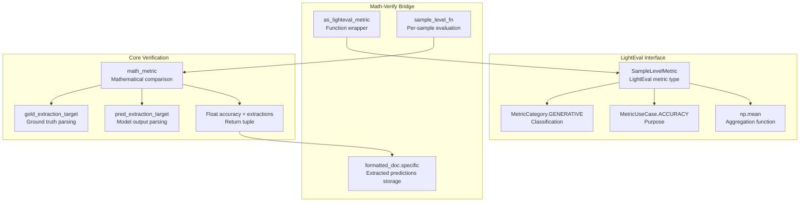
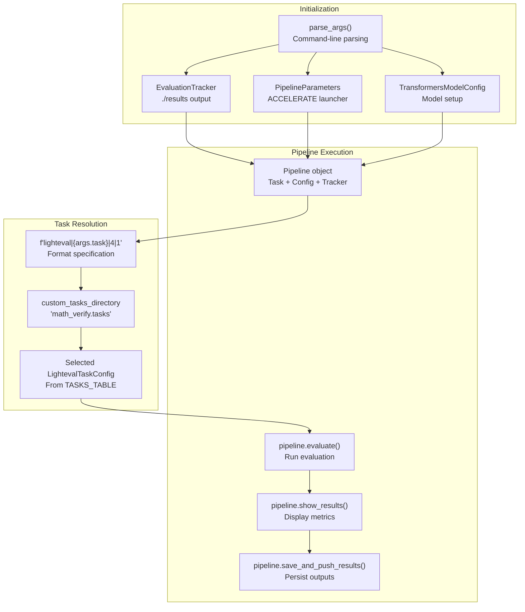

<!-- source: DeepWiki mcp.deepwiki.com · repo huggingface/Math-Verify · page 5 Evaluation Framework · fetched 2026-10-26 -->

# Evaluation Framework

<details>
<summary>Relevant source files</summary>

The following files were used as context for generating this wiki page:

- [evaluate_model.py](evaluate_model.py)
- [src/math_verify/few_shots.py](src/math_verify/few_shots.py)
- [src/math_verify/tasks.py](src/math_verify/tasks.py)

</details>


This section documents the evaluation framework provided by Math-Verify for assessing mathematical model outputs. The framework integrates with the LightEval evaluation system to provide standardized benchmarking across multiple mathematical datasets including GSM8K, MATH, AIME, and AMC competitions. For core mathematical verification functionality, see [Core Components](#3). For specific metrics and scoring mechanisms, see [Metrics and Evaluation](#3.3).

## System Architecture

The evaluation framework operates as a high-level orchestration layer that coordinates mathematical task execution, few-shot prompting, and result verification through the core Math-Verify components.

### Overall Evaluation System



Sources: [evaluate_model.py:1-71](), [src/math_verify/tasks.py:318-324]()

### Task Configuration System

The framework defines mathematical evaluation tasks through `LightevalTaskConfig` objects that specify dataset sources, prompt formatting, and verification metrics.



Sources: [src/math_verify/tasks.py:167-324]()

## Task Configurations

The framework supports multiple mathematical benchmarks with task-specific configurations for dataset access, prompt formatting, and answer extraction.

### Supported Mathematical Tasks

| Task | Dataset Source | Subsets | Gold Extraction | Prediction Extraction |
|------|----------------|---------|-----------------|----------------------|
| `gsm8k` | `openai/gsm8k` | main | `ExprExtractionConfig` | `LatexExtractionConfig`, `ExprExtractionConfig` |
| `math_hard` | `lighteval/MATH-Hard` | algebra, geometry, etc. | `LatexExtractionConfig` | `LatexExtractionConfig`, `ExprExtractionConfig` |
| `math_500` | `HuggingFaceH4/MATH-500` | default | `LatexExtractionConfig` | `LatexExtractionConfig`, `ExprExtractionConfig` |
| `aime24` | `zwhe99/aime24` | default | `LatexExtractionConfig` | `LatexExtractionConfig`, `ExprExtractionConfig` |
| `amc23` | `zwhe99/amc23` | default | `ExprExtractionConfig` | `LatexExtractionConfig`, `ExprExtractionConfig` |

Sources: [src/math_verify/tasks.py:167-324]()

### Prompt Function Architecture

Each task implements a specialized prompt function that formats questions and handles few-shot examples consistently.



Sources: [src/math_verify/tasks.py:43-164]()

## Few-Shot Prompting System

The framework provides curated few-shot examples to improve model performance through in-context learning.

### Few-Shot Example Structure

The system maintains separate few-shot collections for different mathematical domains:

- **GSM8K_FEW_SHOTS**: Grade school word problems with step-by-step arithmetic solutions
- **MATH_HARD_FEW_SHOTS**: Competition-level problems requiring advanced mathematical reasoning



Sources: [src/math_verify/few_shots.py:1-69]()

### Few-Shot Selection Logic

The framework implements dynamic few-shot selection based on sample indices during evaluation.

```python
# Example from math_hard_prompt_function
if x.get("__few_shots"):
    index = x["__index"]
    few_shot_doc = (
        MATH_HARD_FEW_SHOTS[index]
        if index < len(MATH_HARD_FEW_SHOTS)
        else MATH_HARD_FEW_SHOTS[-1]
    )
```

Sources: [src/math_verify/tasks.py:44-50]()

## Metric Integration

The evaluation framework bridges LightEval's metric system with Math-Verify's mathematical verification capabilities through the `as_lighteval_metric` adapter function.

### Metric Adapter Architecture



Sources: [src/math_verify/tasks.py:18-40]()

## Evaluation Pipeline Execution

The main evaluation script coordinates the entire evaluation process through LightEval's pipeline system.

### Command-Line Interface

The `evaluate_model.py` script provides a streamlined interface for model evaluation:

```bash
python evaluate_model.py --task gsm8k --model microsoft/Phi-3-mini-4k-instruct --use_chat_template
```

### Pipeline Configuration

The evaluation pipeline configures multiple components for robust execution:

| Component | Configuration | Purpose |
|-----------|---------------|---------|
| `EvaluationTracker` | `output_dir="./results"`, `save_details=True` | Results storage and management |
| `PipelineParameters` | `launcher_type=ACCELERATE`, `max_samples=1000` | Parallelism and sampling control |
| `TransformersModelConfig` | `dtype="bfloat16"`, `use_chat_template` | Model loading configuration |
| `Pipeline` | `tasks="lighteval\|task\|4\|1"` | Task specification and few-shot count |

Sources: [evaluate_model.py:35-68]()

### Execution Flow



Sources: [evaluate_model.py:16-71]()

## Integration Points

The evaluation framework integrates with several external systems and internal components to provide comprehensive mathematical model assessment.

### External Dependencies

- **LightEval Framework**: Provides the core evaluation infrastructure, parallelism management, and result tracking
- **HuggingFace Datasets**: Sources mathematical benchmarks through standardized dataset interfaces
- **Accelerate**: Enables distributed evaluation across multiple GPUs when available

### Internal Component Integration

- **Math-Verify Parser**: Extracts mathematical expressions from model outputs using configurable strategies
- **Math-Verify Grader**: Performs mathematical equivalence checking between predictions and ground truth
- **Timeout System**: Protects against infinite loops during complex mathematical parsing operations

Sources: [evaluate_model.py:1-14](), [src/math_verify/tasks.py:1-13]()

---

