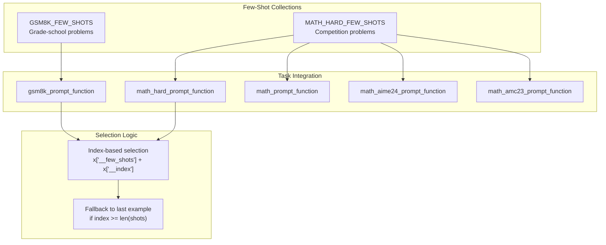
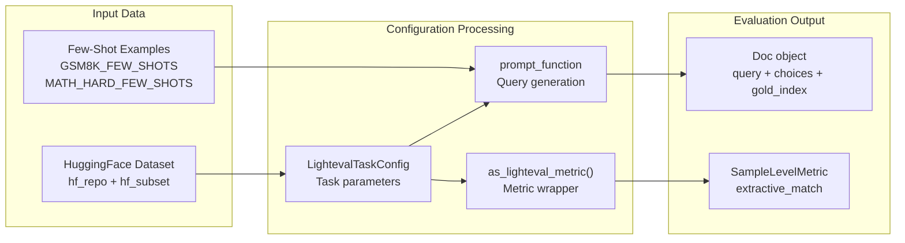
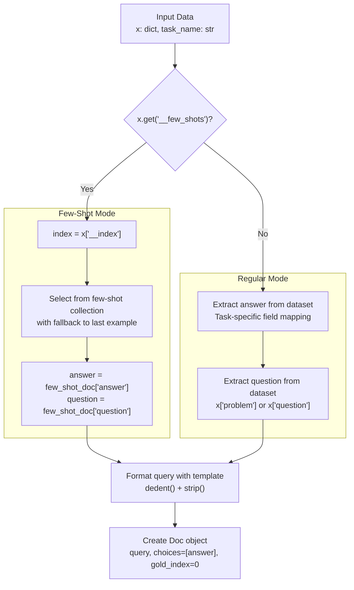

<!-- source: DeepWiki mcp.deepwiki.com · repo huggingface/Math-Verify · page 5.1 Task Definitions and Few-Shot Examples · fetched 2026-10-26 -->

# Task Definitions and Few-Shot Examples

<details>
<summary>Relevant source files</summary>

The following files were used as context for generating this wiki page:

- [src/math_verify/few_shots.py](src/math_verify/few_shots.py)
- [src/math_verify/tasks.py](src/math_verify/tasks.py)

</details>


This document describes the mathematical task definitions and few-shot prompting system used for evaluating language models on mathematical reasoning tasks. The system provides standardized task configurations, curated few-shot examples, and prompt templates for consistent model evaluation across different mathematical domains.

For information about the broader model evaluation pipeline, see [Model Evaluation Pipeline](#5.2). For details about output processing after evaluation, see [Output Processing Tools](#5.3).

## Few-Shot Example Collections

The Math-Verify system includes two curated collections of few-shot examples designed to demonstrate mathematical reasoning patterns to language models before evaluation.

### GSM8K Few-Shot Examples

The `GSM8K_FEW_SHOTS` collection contains four grade-school level mathematical word problems with step-by-step solutions. These examples demonstrate arithmetic reasoning, unit conversions, and multi-step problem solving.

Example structure from the collection:
- **Problem Type**: Grade-school arithmetic word problems
- **Solution Format**: Step-by-step natural language explanations
- **Final Answer Format**: "The final answer is X. I hope it is correct."

### MATH Competition Few-Shot Examples  

The `MATH_HARD_FEW_SHOTS` collection contains four competition-level mathematical problems covering algebra, linear algebra, and advanced mathematical concepts. These examples demonstrate formal mathematical reasoning with LaTeX notation.

Example domains included:
- **Domain Analysis**: Function domains with square root constraints
- **Linear Algebra**: Matrix determinant properties  
- **Applied Mathematics**: Weight and proportion problems
- **System of Equations**: Linear system analysis

**Few-Shot Example System Architecture**



Sources: [src/math_verify/few_shots.py:1-70](), [src/math_verify/tasks.py:142-165](), [src/math_verify/tasks.py:43-66]()

## Task Configuration Framework

The system uses `LightevalTaskConfig` objects to define mathematical evaluation tasks with standardized parameters and metrics.

### Core Configuration Components

| Component | Purpose | Example Values |
|-----------|---------|----------------|
| `name` | Task identifier | `"gsm8k"`, `"math_hard:algebra"` |
| `suite` | Task categorization | `["lighteval", "math"]` |
| `prompt_function` | Prompt generation logic | `gsm8k_prompt_function` |
| `hf_repo` | HuggingFace dataset repository | `"openai/gsm8k"` |
| `evaluation_splits` | Dataset splits for evaluation | `["test"]` |
| `generation_size` | Maximum tokens for generation | `1024` |
| `metric` | Evaluation metrics | `math_metric` wrapped as `SampleLevelMetric` |
| `stop_sequence` | Generation termination tokens | `["\nQuestion:", "\nProblem:"]` |

### Metric Integration

The `as_lighteval_metric` function converts Math-Verify's `math_metric` into LightEval's `SampleLevelMetric` format, enabling seamless integration with the evaluation framework.

**Task Configuration Data Flow**



Sources: [src/math_verify/tasks.py:18-41](), [src/math_verify/tasks.py:167-204]()

## Mathematical Task Definitions

The system defines five major mathematical task categories, each optimized for different types of mathematical reasoning.

### GSM8K Tasks

**Dataset**: Grade School Math 8K problems  
**Repository**: `openai/gsm8k`  
**Target**: Elementary arithmetic and word problems  
**Extraction Strategy**: Expression-based with first-match fallback

Configuration details:
- **Gold Extraction**: `ExprExtractionConfig()` - Numeric expression extraction
- **Prediction Extraction**: `LatexExtractionConfig()` + `ExprExtractionConfig()` - Multi-format support
- **Fallback Mode**: `"first_match"` - Accept first valid extraction

### MATH-Hard Tasks

**Dataset**: Competition mathematics problems by subject area  
**Repository**: `lighteval/MATH-Hard`  
**Target**: Advanced mathematical reasoning across seven domains  
**Extraction Strategy**: LaTeX-prioritized with boxed answer support

Supported subsets:
- `algebra`, `counting_and_probability`, `geometry`
- `intermediate_algebra`, `number_theory`, `prealgebra`, `precalculus`

Configuration details:
- **Gold Extraction**: `LatexExtractionConfig(boxed_match_priority=0)` - Prioritize `\boxed{}` answers
- **Prediction Extraction**: `LatexExtractionConfig()` + `ExprExtractionConfig()` - Dual extraction modes

### MATH-500 Tasks

**Dataset**: Curated subset of 500 mathematical problems  
**Repository**: `HuggingFaceH4/MATH-500`  
**Target**: Representative sample of competition mathematics  
**Extraction Strategy**: Identical to MATH-Hard configuration

### AIME24 Tasks

**Dataset**: American Invitational Mathematics Examination 2024  
**Repository**: `zwhe99/aime24`  
**Target**: High-level competition problems with integer answers  
**Extraction Strategy**: LaTeX-based without boxed priority

### AMC23 Tasks

**Dataset**: American Mathematics Competitions 2023  
**Repository**: `zwhe99/amc23`  
**Target**: Multiple-choice competition mathematics  
**Extraction Strategy**: Expression-based for gold standard

## Prompt Engineering System

The system employs specialized prompt functions for each task type, ensuring consistent formatting and optimal model performance.

### Universal Prompt Template

All tasks use a standardized template structure:

```
Question: {question}
Step-by-Step Answer:
```

### Prompt Function Architecture

Each prompt function implements the following logic:

1. **Few-Shot Detection**: Check for `x.get("__few_shots")` flag
2. **Index-Based Selection**: Use `x["__index"]` to select specific few-shot examples
3. **Fallback Strategy**: Default to last example if index exceeds collection size
4. **Answer Formatting**: Apply task-specific answer processing

**Prompt Function Decision Tree**



Sources: [src/math_verify/tasks.py:43-165]()

### Task-Specific Answer Processing

| Task | Answer Field | Processing Logic |
|------|-------------|------------------|
| GSM8K | `x['answer']` | Split on `'####'`, take last part, strip whitespace |
| MATH-Hard | `x['solution']` | Use solution field directly as string |
| MATH-500 | `x['answer']` | Use answer field directly as string |
| AIME24 | `x['reference_solution']` | Use reference solution directly |
| AMC23 | `x['answer']` | Use answer field directly as string |

## Task Registry and Export

The `TASKS_TABLE` aggregates all task configurations into a single exportable list for LightEval integration:

```python
TASKS_TABLE = [
    *gsm8k_lighteval,      # 1 task configuration
    *math_hard_lighteval,  # 7 task configurations (one per subset)
    *math_500_lighteval,   # 1 task configuration  
    *aime24_lighteval,     # 1 task configuration
    *amc23_lighteval,      # 1 task configuration
]
```

This registry provides a centralized access point for all mathematical evaluation tasks, enabling batch evaluation and consistent task management across the evaluation pipeline.

Sources: [src/math_verify/tasks.py:318-325](), [src/math_verify/tasks.py:290-316](), [src/math_verify/tasks.py:235-289]()

---

