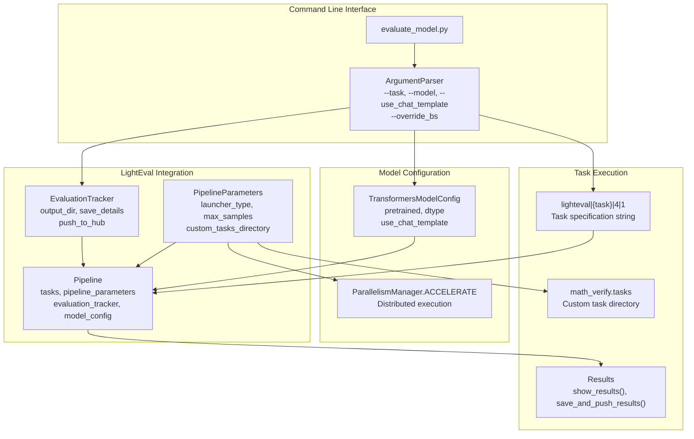
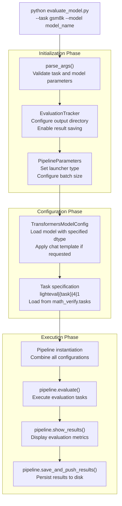
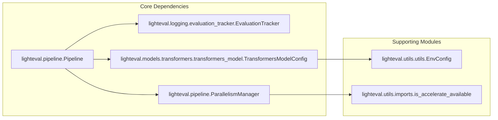

<!-- source: DeepWiki mcp.deepwiki.com · repo huggingface/Math-Verify · page 5.2 Model Evaluation Pipeline · fetched 2026-10-26 -->

# Model Evaluation Pipeline

<details>
<summary>Relevant source files</summary>

The following files were used as context for generating this wiki page:

- [evaluate_model.py](evaluate_model.py)

</details>


This document covers the end-to-end model evaluation system that orchestrates mathematical task evaluation using the LightEval framework. The pipeline handles model loading, task execution, result collection, and output generation for mathematical reasoning benchmarks.

For task definitions and few-shot examples, see [Task Definitions and Few-Shot Examples](#5.1). For batch processing of existing model outputs, see [Output Processing Tools](#5.3).

## Pipeline Architecture

The Model Evaluation Pipeline serves as the orchestration layer that coordinates model evaluation across mathematical tasks. The system is built around the `evaluate_model.py` script, which integrates with the LightEval framework to provide distributed evaluation capabilities.

### System Components Diagram



Sources: [evaluate_model.py:1-71]()

### Evaluation Workflow

The pipeline follows a structured workflow from initialization to result generation:



Sources: [evaluate_model.py:35-69]()

## Configuration System

The pipeline uses a layered configuration approach that combines command-line arguments with LightEval framework configurations.

### Command Line Interface

The `parse_args()` function defines the available evaluation parameters:

| Parameter | Type | Description | Choices |
|-----------|------|-------------|---------|
| `--task` | str | Mathematical task to evaluate | `gsm8k`, `math`, `math_hard`, `math_500`, `aime24`, `amc23` |
| `--model` | str | Model name or local path | Any HuggingFace model identifier |
| `--use_chat_template` | flag | Apply model's chat template | boolean |
| `--override_bs` | int | Manual batch size override | -1 for automatic sizing |

Sources: [evaluate_model.py:16-32]()

### Pipeline Parameters Configuration

The `PipelineParameters` object configures the evaluation execution environment:

```python
pipeline_params = PipelineParameters(
    launcher_type=ParallelismManager.ACCELERATE,
    max_samples=1000,
    custom_tasks_directory="math_verify.tasks",
    env_config=EnvConfig(cache_dir="tmp/"),
    override_batch_size=args.override_bs,
)
```

Key configuration aspects:
- **Launcher Type**: Uses `ParallelismManager.ACCELERATE` for distributed execution
- **Sample Limiting**: Caps evaluation at 1000 samples per task
- **Custom Tasks**: Points to `math_verify.tasks` module for task definitions
- **Caching**: Uses temporary directory for intermediate results
- **Batch Size**: Supports automatic or manual batch size configuration

Sources: [evaluate_model.py:45-51]()

### Model Configuration

The `TransformersModelConfig` handles model-specific settings:

```python
model_config = TransformersModelConfig(
    pretrained=args.model,
    dtype="bfloat16",
    use_chat_template=args.use_chat_template,
)
```

Configuration features:
- **Model Loading**: Supports both HuggingFace model names and local paths
- **Precision**: Defaults to `bfloat16` for memory efficiency
- **Chat Templates**: Optional application of model-specific formatting

Sources: [evaluate_model.py:53-57]()

## Execution Environment

### Accelerate Integration

The pipeline integrates with HuggingFace Accelerate for distributed evaluation:

```python
if is_accelerate_available():
    from accelerate import Accelerator, InitProcessGroupKwargs
    accelerator = Accelerator(kwargs_handlers=[InitProcessGroupKwargs(timeout=timedelta(seconds=3000))])
else:
    accelerator = None
```

Key features:
- **Timeout Handling**: 3000-second timeout for process group initialization
- **Graceful Degradation**: Falls back when Accelerate is unavailable
- **Distributed Support**: Enables multi-GPU evaluation when available

Sources: [evaluate_model.py:10-14]()

### Task Specification Format

Tasks are specified using LightEval's string format: `lighteval|{task}|4|1`

This format indicates:
- **Framework**: `lighteval` evaluation framework
- **Task Name**: One of the supported mathematical tasks
- **Few-shot Examples**: 4 examples per task
- **Repetitions**: Single evaluation run

Sources: [evaluate_model.py:60]()

## Result Management

### Evaluation Tracking

The `EvaluationTracker` manages result collection and persistence:

```python
evaluation_tracker = EvaluationTracker(
    output_dir="./results",
    save_details=True,
    push_to_hub=False,
)
```

Tracking capabilities:
- **Local Storage**: Results saved to `./results` directory
- **Detailed Logging**: Comprehensive evaluation details preserved
- **Hub Integration**: Optional push to HuggingFace Hub (disabled by default)

Sources: [evaluate_model.py:39-43]()

### Pipeline Execution Flow

The evaluation process follows these stages:

1. **`pipeline.evaluate()`**: Executes the configured tasks
2. **`pipeline.show_results()`**: Displays evaluation metrics to console
3. **`pipeline.save_and_push_results()`**: Persists results and optionally uploads

Sources: [evaluate_model.py:66-68]()

## Integration Points

### LightEval Framework Dependencies

The pipeline relies on several LightEval components:



Sources: [evaluate_model.py:4-8]()

### Math-Verify Integration

The pipeline connects to Math-Verify through the custom tasks directory specification:

- **Task Directory**: `"math_verify.tasks"` references the task definitions
- **Evaluation Logic**: LightEval calls Math-Verify's verification functions
- **Result Processing**: Math-Verify metrics feed into LightEval's result aggregation

Sources: [evaluate_model.py:48]()

---

