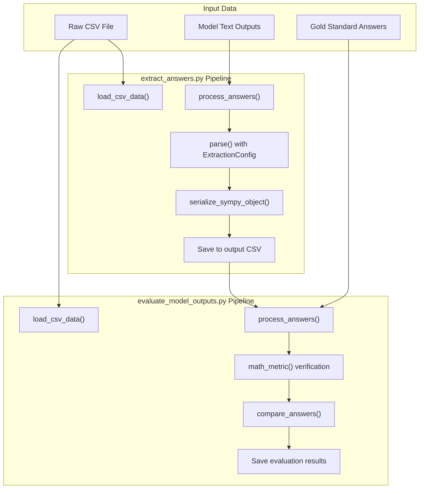
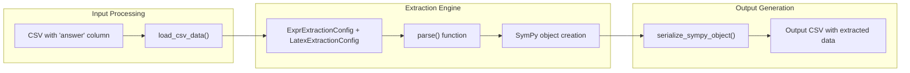
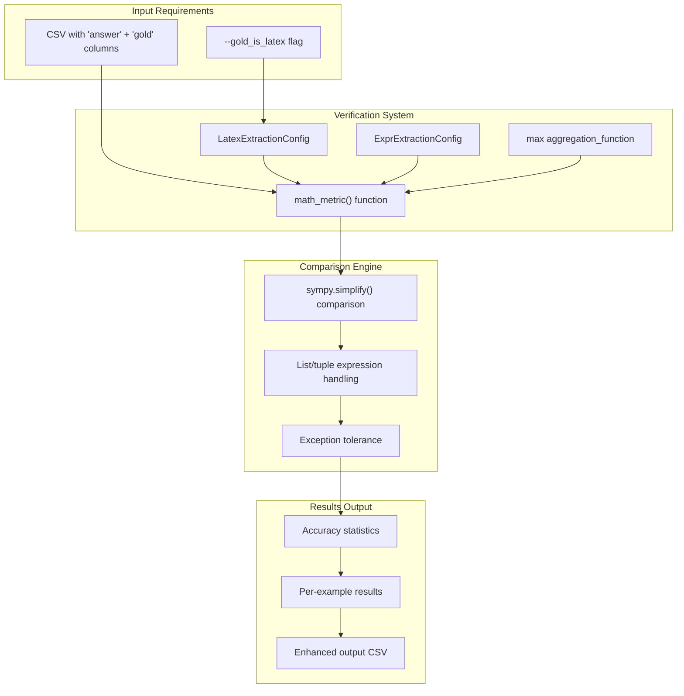
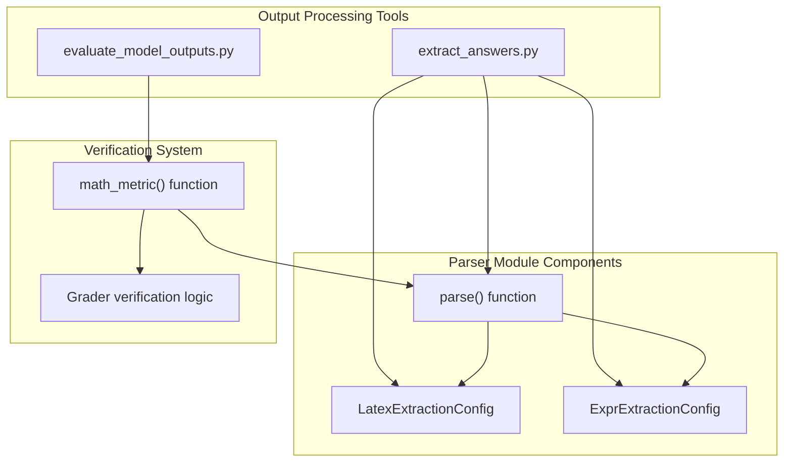

<!-- source: DeepWiki mcp.deepwiki.com · repo huggingface/Math-Verify · page 5.3 Output Processing Tools · fetched 2026-10-26 -->

# Output Processing Tools

<details>
<summary>Relevant source files</summary>

The following files were used as context for generating this wiki page:

- [CITATION.cff](CITATION.cff)
- [evaluate_model_outputs.py](evaluate_model_outputs.py)
- [extract_answers.py](extract_answers.py)
- [output.csv](output.csv)

</details>


This document covers the batch processing and extraction tools designed to handle model outputs in the Math-Verify system. These tools provide command-line interfaces for processing large volumes of mathematical text data, extracting answers, and evaluating model performance against gold standards.

For information about the core verification algorithms, see [Grader Module](#3.2). For details about the evaluation framework integration, see [Model Evaluation Pipeline](#5.2).

## Purpose and Scope

The output processing tools serve two primary functions:
1. **Answer Extraction**: Parse mathematical expressions from raw model outputs and convert them to standardized formats
2. **Batch Evaluation**: Compare extracted answers against gold standards and compute accuracy metrics

These tools operate on CSV data formats and are designed for processing evaluation results from mathematical reasoning tasks.

## Processing Pipeline Overview

The output processing system follows a structured pipeline that transforms raw model outputs into evaluated results:



Sources: [evaluate_model_outputs.py:1-142](), [extract_answers.py:1-98]()

## Answer Extraction Tool

The `extract_answers.py` script provides standalone mathematical expression extraction from text data.

### Core Functionality

The extraction tool processes text through the following stages:



### Key Components

| Component | Function | Description |
|-----------|----------|-------------|
| `load_csv_data()` | [extract_answers.py:12-21]() | Validates CSV format and required columns |
| `process_answers()` | [extract_answers.py:34-79]() | Main processing loop for answer extraction |
| `serialize_sympy_object()` | [extract_answers.py:23-32]() | Converts SymPy objects to string representation |

### Usage Pattern

The tool expects CSV input with an `answer` column containing raw text:

```bash
python extract_answers.py --input_csv model_outputs.csv --output_csv extracted.csv
```

The extraction process uses both `ExprExtractionConfig` and `LatexExtractionConfig` as extraction targets [extract_answers.py:39](), allowing it to handle diverse mathematical notation formats.

Sources: [extract_answers.py:1-98]()

## Model Output Evaluation Tool

The `evaluate_model_outputs.py` script provides comprehensive evaluation of extracted answers against gold standards.

### Evaluation Architecture



### Verification Configuration

The evaluation tool creates a `math_metric` verification function with specific configuration [evaluate_model_outputs.py:63-68]():

| Parameter | Value | Purpose |
|-----------|-------|---------|
| `gold_extraction_target` | `LatexExtractionConfig()` or `ExprExtractionConfig()` | Gold standard parsing |
| `pred_extraction_target` | `(ExprExtractionConfig(), LatexExtractionConfig())` | Prediction parsing with fallback |
| `aggregation_function` | `max` | Best match selection |
| `precision` | `6` | Numerical precision for comparisons |

### Comparison Logic

The `compare_answers()` function [evaluate_model_outputs.py:37-52]() implements sophisticated comparison logic:

- **List/Tuple Handling**: Compares sequences element-wise using SymPy simplification
- **Single Expression**: Uses `sympy.simplify(extracted - gold) == 0` for equality
- **Error Tolerance**: Returns `False` for type mismatches or computation failures

Sources: [evaluate_model_outputs.py:1-142]()

## Data Formats and CSV Structure

### Input CSV Requirements

Both tools expect specific CSV column structures:

| Tool | Required Columns | Optional Columns |
|------|------------------|------------------|
| `extract_answers.py` | `answer` | Any (preserved in output) |
| `evaluate_model_outputs.py` | `answer`, `gold` | None |

### Output CSV Formats

#### Extract Answers Output

The extraction tool produces CSV files with the following structure [extract_answers.py:57-67]():

| Column | Type | Description |
|--------|------|-------------|
| `original_answer` | String | Raw input text |
| `extracted_answer` | String | Serialized SymPy object |
| `extracted_feedback` | String | LaTeX feedback representation |
| `extraction_success` | Boolean | Whether extraction succeeded |

#### Evaluation Output

The evaluation tool generates comprehensive results [evaluate_model_outputs.py:89-106]():

| Column | Type | Description |
|--------|------|-------------|
| `original_answer` | String | Raw model output |
| `gold_answer` | String | Gold standard answer |
| `extracted_answer` | String | Processed prediction |
| `extracted_gold` | String | Processed gold standard |
| `is_correct` | Boolean | Verification result |

### Sample Output Format

```csv
original_answer,extracted_answer,extracted_feedback,extraction_success
"so that x == 1 or x == 2, thus the result is $2*\pi*r$",2*pi*r,2*\pi*r,True
The answer is $$\sin(x)$$,sin(x),\sin(x),True
"After solving, we get $1/2$",1/2,\frac{1}{2},True
```

Sources: [output.csv:1-8](), [extract_answers.py:57-67](), [evaluate_model_outputs.py:89-106]()

## Integration with Core Components

### Parser Module Integration

Both tools leverage the core parsing infrastructure:



### Error Handling and Robustness

The tools implement comprehensive error handling patterns:

- **CSV Validation**: Column presence checks and file loading error handling
- **Extraction Failures**: Graceful degradation when parsing fails
- **SymPy Serialization**: Safe conversion of mathematical objects to strings
- **Comparison Errors**: Exception tolerance in mathematical comparisons

The `serialize_sympy_object()` function [extract_answers.py:23-32]() and [evaluate_model_outputs.py:26-35]() provides robust string conversion with error recovery.

Sources: [extract_answers.py:12-21](), [evaluate_model_outputs.py:15-24](), [extract_answers.py:23-32](), [evaluate_model_outputs.py:26-35]()

---

