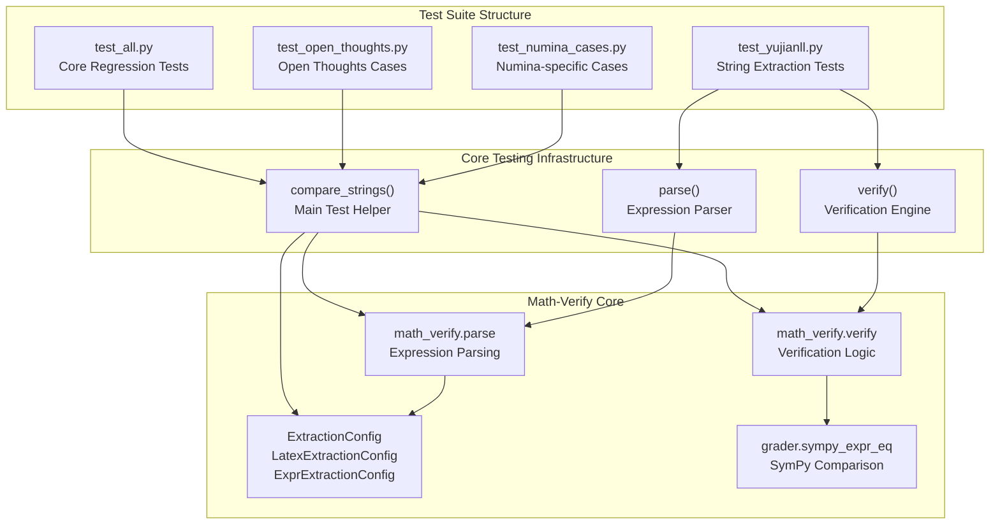
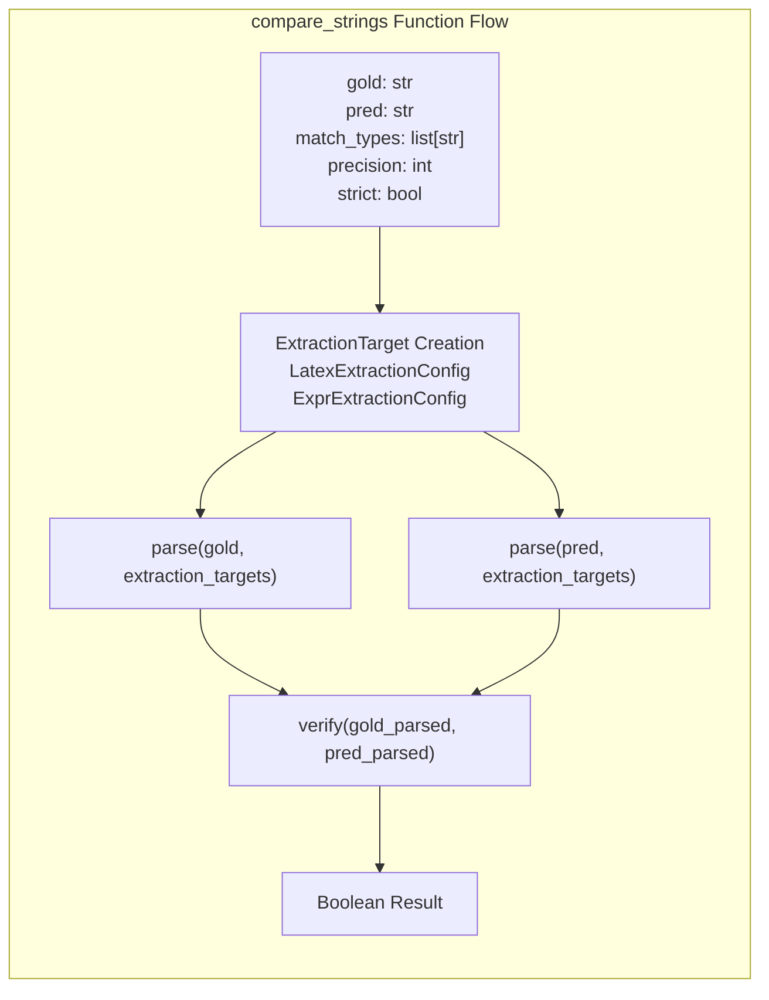
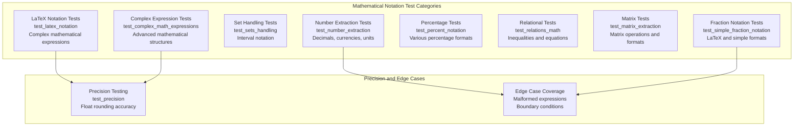
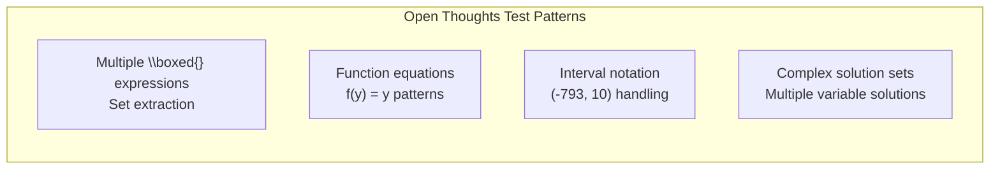
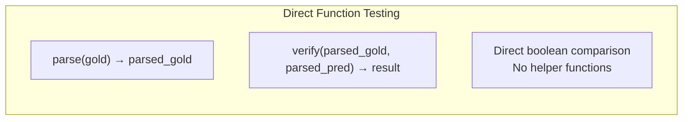
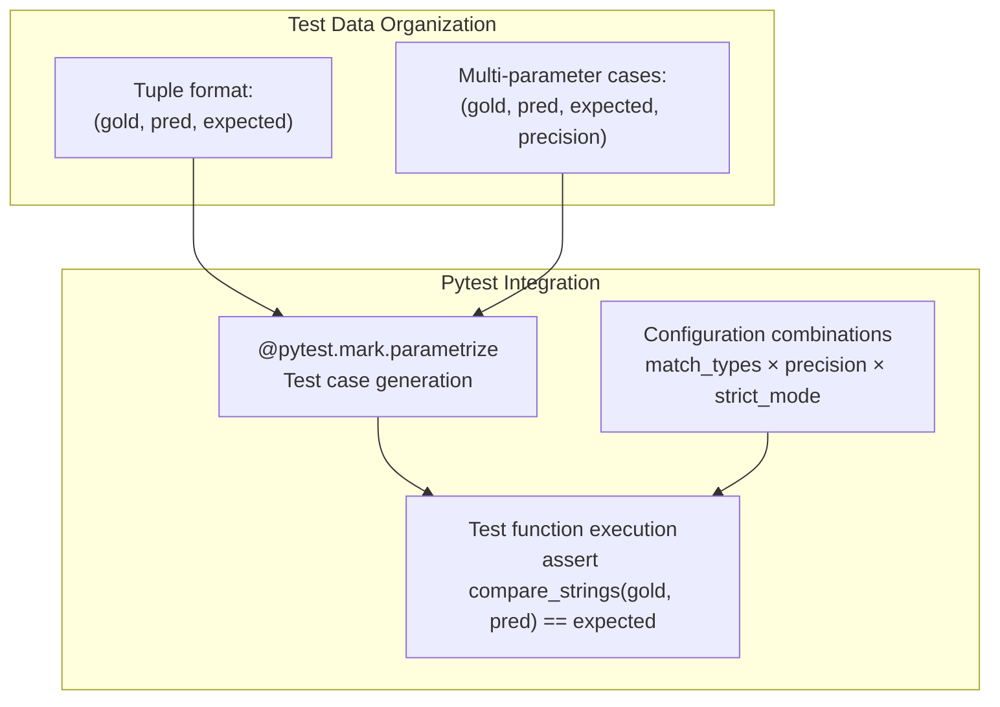

<!-- source: DeepWiki mcp.deepwiki.com · repo huggingface/Math-Verify · page 6 Testing Framework · fetched 2026-10-26 -->

# Testing Framework

<details>
<summary>Relevant source files</summary>

The following files were used as context for generating this wiki page:

- [tests/test_all.py](tests/test_all.py)
- [tests/test_numina_cases.py](tests/test_numina_cases.py)
- [tests/test_open_thoughts.py](tests/test_open_thoughts.py)
- [tests/test_yujianll.py](tests/test_yujianll.py)

</details>


The Math-Verify testing framework provides comprehensive validation for mathematical expression parsing, normalization, and verification capabilities. This system ensures accuracy and reliability across diverse mathematical notation formats, edge cases, and precision requirements through extensive regression testing and parametrized test suites.

For information about the core verification engine being tested, see [Core Components](#3). For details about evaluation metrics and scoring, see [Metrics and Evaluation](#3.3).

## Test Suite Architecture

The testing framework is organized into specialized test modules that target different aspects of mathematical expression verification:



Sources: [tests/test_all.py:1-615](), [tests/test_open_thoughts.py:1-163](), [tests/test_numina_cases.py:1-149](), [tests/test_yujianll.py:1-37]()

## Core Testing Components

### Primary Test Helper Function

The `compare_strings` function serves as the central testing utility, providing a standardized interface for mathematical expression comparison:



The function supports multiple comparison modes through the `match_types` parameter:
- `"latex"`: LaTeX mathematical notation parsing
- `"expr"`: General expression parsing

Sources: [tests/test_all.py:36-56]()

### Configuration Management

Test configurations are managed through extraction target objects that define parsing behavior:

| Configuration Type | Purpose | Key Parameters |
|-------------------|---------|----------------|
| `LatexExtractionConfig` | LaTeX notation parsing | `boxed_match_priority=0` |
| `ExprExtractionConfig` | General expression parsing | Default settings |

Sources: [tests/test_all.py:46-52]()

## Test Categories and Coverage

### Mathematical Notation Testing

The framework covers comprehensive mathematical notation formats through parametrized test suites:



Sources: [tests/test_all.py:58-615]()

### Test Case Examples

#### Number Format Validation
The system handles diverse number representations including:
- Thousand separators: `"7425000"` vs `"7,425,000"`
- Decimal variations: `"1000.99"` vs `"1,000.99"`
- Currency notation: `"1000.99"` vs `"$1,000.99"`
- Units handling: `"1000.99"` vs `"1,000.99m²"`

Sources: [tests/test_all.py:58-94]()

#### LaTeX Expression Testing
Complex LaTeX expressions are validated including:
- Mathematical functions: `"$\\tan^2(y)+1$"` vs `"$\\sec^2(y)$"`
- Matrix operations: `"$\\begin{pmatrix}1 & 2 \\\\ 3 & 4\\end{pmatrix}$"`
- Equation normalization: `"$x^2/4 + y^2/3 = 1$"` vs `"$x^2/16 + y^2/12 = 1/4$"`

Sources: [tests/test_all.py:164-330](), [tests/test_all.py:560-615]()

## Specialized Test Modules

### Open Thoughts Test Cases

The `test_open_thoughts.py` module focuses on complex mathematical expressions with multiple solutions:



Sources: [tests/test_open_thoughts.py:6-163]()

### Numina-Specific Cases

The `test_numina_cases.py` module validates specialized mathematical notation patterns:

- Tuple extraction: `"$(37,3,3,13),(17,3,3,7)$"`
- Ratio notation: `"$S_{MBCN}:S=7:32$"`
- Text handling: `"$\\text{odd}$"` vs `"$odd$"`

Sources: [tests/test_numina_cases.py:6-149]()

### String Extraction Validation

The `test_yujianll.py` module provides direct testing of parsing and verification functions:



Sources: [tests/test_yujianll.py:6-37]()

## Precision and Accuracy Testing

### Float Rounding Configuration

The framework supports configurable precision testing through the `precision` parameter:

| Test Type | Precision Level | Example |
|-----------|----------------|---------|
| Basic comparison | 6 digits | `"$\\frac{1}{3}$"` vs `"0.333333"` |
| High precision | 15 digits | Rational vs Float comparison |
| Decimal equivalence | 2-4 digits | `"$(0.6,2.6667]$"` vs `"$(\\frac{3}{5},\\frac{8}{3}]$"` |

The `sympy_expr_eq` function from the grader module handles precision-aware comparison:

```python
sympy_expr_eq(
    sympy.Rational(1, 3), 
    sympy.Float(0.333), 
    float_rounding=3, 
    numeric_precision=15
)
```

Sources: [tests/test_all.py:529-558](), [tests/test_all.py:560-615]()

## Test Execution Framework

### Parametrized Testing Structure

The testing framework uses pytest's parametrization for comprehensive coverage:



Sources: [tests/test_all.py:58-615]()

### Test Assertion Patterns

The framework employs consistent assertion patterns across all test modules:

- **Standard comparison**: `assert compare_strings(gold, pred, match_types=["expr"]) == expected`
- **Multi-mode testing**: `assert compare_strings(gold, pred, match_types=["latex", "expr"]) == expected`
- **Precision-aware**: `assert compare_strings(gold, pred, precision=4) == expected`
- **Direct verification**: `assert int(verify(parse(gold), parse(pred))) == result`

Sources: [tests/test_all.py:93](), [tests/test_all.py:104](), [tests/test_yujianll.py:36]()

# Testing Framework

The Math-Verify testing framework provides comprehensive validation for mathematical expression parsing, normalization, and verification capabilities. This system ensures accuracy and reliability across diverse mathematical notation formats, edge cases, and precision requirements through extensive regression testing and parametrized test suites.

For information about the core verification engine being tested, see [Core Components](#3). For details about evaluation metrics and scoring, see [Metrics and Evaluation](#3.3).

## Test Suite Architecture

The testing framework is organized into specialized test modules that target different aspects of mathematical expression verification:


Sources: [tests/test_all.py:1-615](), [tests/test_open_thoughts.py:1-163](), [tests/test_numina_cases.py:1-149](), [tests/test_yujianll.py:1-37]()

## Core Testing Components

### Primary Test Helper Function

The `compare_strings` function serves as the central testing utility, providing a standardized interface for mathematical expression comparison:


The function supports multiple comparison modes through the `match_types` parameter:
- `"latex"`: LaTeX mathematical notation parsing
- `"expr"`: General expression parsing

Sources: [tests/test_all.py:36-56]()

### Configuration Management

Test configurations are managed through extraction target objects that define parsing behavior:

| Configuration Type | Purpose | Key Parameters |
|-------------------|---------|----------------|
| `LatexExtractionConfig` | LaTeX notation parsing | `boxed_match_priority=0` |
| `ExprExtractionConfig` | General expression parsing | Default settings |

Sources: [tests/test_all.py:46-52]()

## Test Categories and Coverage

### Mathematical Notation Testing

The framework covers comprehensive mathematical notation formats through parametrized test suites:


Sources: [tests/test_all.py:58-615]()

### Test Case Examples

#### Number Format Validation
The system handles diverse number representations including:
- Thousand separators: `"7425000"` vs `"7,425,000"`
- Decimal variations: `"1000.99"` vs `"1,000.99"`
- Currency notation: `"1000.99"` vs `"$1,000.99"`
- Units handling: `"1000.99"` vs `"1,000.99m²"`

Sources: [tests/test_all.py:58-94]()

#### LaTeX Expression Testing
Complex LaTeX expressions are validated including:
- Mathematical functions: `"$\\tan^2(y)+1$"` vs `"$\\sec^2(y)$"`
- Matrix operations: `"$\\begin{pmatrix}1 & 2 \\\\ 3 & 4\\end{pmatrix}$"`
- Equation normalization: `"$x^2/4 + y^2/3 = 1$"` vs `"$x^2/16 + y^2/12 = 1/4$"`

Sources: [tests/test_all.py:164-330](), [tests/test_all.py:560-615]()

## Specialized Test Modules

### Open Thoughts Test Cases

The `test_open_thoughts.py` module focuses on complex mathematical expressions with multiple solutions:


Sources: [tests/test_open_thoughts.py:6-163]()

### Numina-Specific Cases

The `test_numina_cases.py` module validates specialized mathematical notation patterns:

- Tuple extraction: `"$(37,3,3,13),(17,3,3,7)$"`
- Ratio notation: `"$S_{MBCN}:S=7:32$"`
- Text handling: `"$\\text{odd}$"` vs `"$odd$"`

Sources: [tests/test_numina_cases.py:6-149]()

### String Extraction Validation

The `test_yujianll.py` module provides direct testing of parsing and verification functions:


Sources: [tests/test_yujianll.py:6-37]()

## Precision and Accuracy Testing

### Float Rounding Configuration

The framework supports configurable precision testing through the `precision` parameter:

| Test Type | Precision Level | Example |
|-----------|----------------|---------|
| Basic comparison | 6 digits | `"$\\frac{1}{3}$"` vs `"0.333333"` |
| High precision | 15 digits | Rational vs Float comparison |
| Decimal equivalence | 2-4 digits | `"$(0.6,2.6667]$"` vs `"$(\\frac{3}{5},\\frac{8}{3}]$"` |

The `sympy_expr_eq` function from the grader module handles precision-aware comparison:

```python
sympy_expr_eq(
    sympy.Rational(1, 3), 
    sympy.Float(0.333), 
    float_rounding=3, 
    numeric_precision=15
)
```

Sources: [tests/test_all.py:529-558](), [tests/test_all.py:560-615]()

## Test Execution Framework

### Parametrized Testing Structure

The testing framework uses pytest's parametrization for comprehensive coverage:


Sources: [tests/test_all.py:58-615]()

### Test Assertion Patterns

The framework employs consistent assertion patterns across all test modules:

- **Standard comparison**: `assert compare_strings(gold, pred, match_types=["expr"]) == expected`
- **Multi-mode testing**: `assert compare_strings(gold, pred, match_types=["latex", "expr"]) == expected`
- **Precision-aware**: `assert compare_strings(gold, pred, precision=4) == expected`
- **Direct verification**: `assert int(verify(parse(gold), parse(pred))) == result`

Sources: [tests/test_all.py:93](), [tests/test_all.py:104](), [tests/test_yujianll.py:36]()

---

