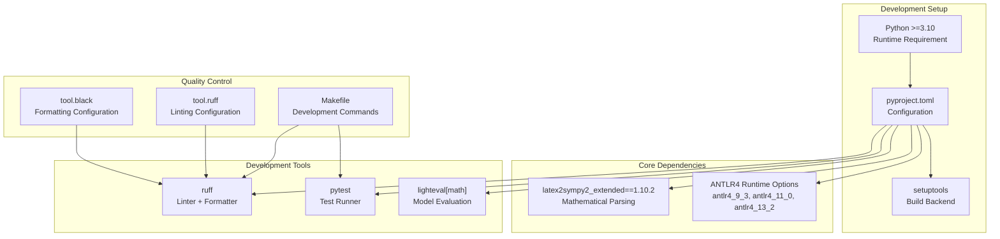
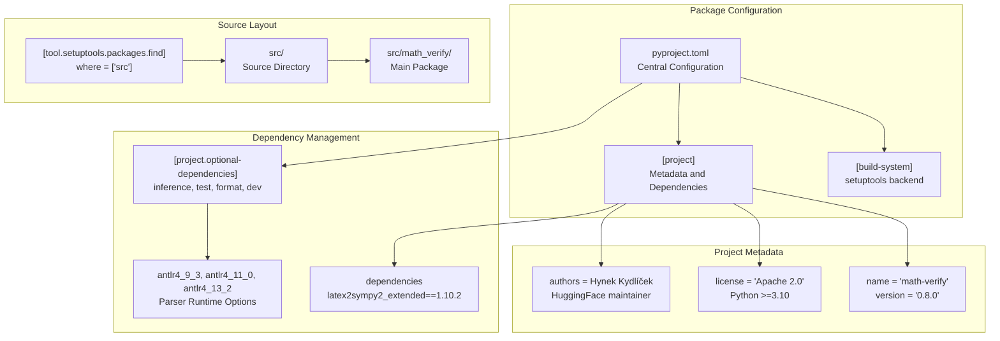
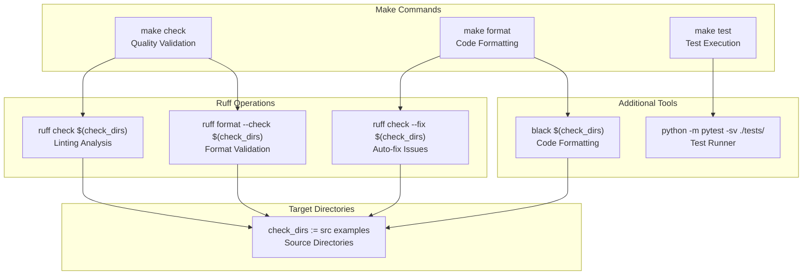
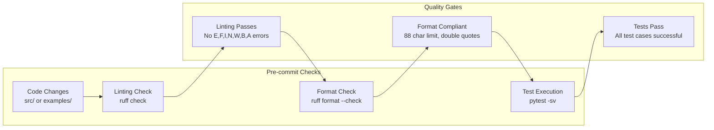

<!-- source: DeepWiki mcp.deepwiki.com · repo huggingface/Math-Verify · page 7 Development Guide · fetched 2026-10-26 -->

# Development Guide

<details>
<summary>Relevant source files</summary>

The following files were used as context for generating this wiki page:

- [Makefile](Makefile)
- [pyproject.toml](pyproject.toml)

</details>


This document provides comprehensive guidance for developers contributing to the Math-Verify project. It covers development environment setup, project structure, build system configuration, code quality standards, and contributing workflows.

For installation and basic usage information, see [Installation and Setup](#4.1) and [Basic Usage](#4.2). For project organization details, see [Project Structure and Build System](#7.1). For specific contribution guidelines, see [Contributing Guidelines](#7.2).

## Development Environment Setup

Math-Verify requires Python 3.10 or higher and uses modern Python packaging standards. The project follows a source-based layout with comprehensive tooling for development.

### Prerequisites and Dependencies

The core development environment requires several categories of dependencies as defined in the project configuration:

| Dependency Category | Purpose | Key Packages |
|-------------------|---------|-------------|
| Core Runtime | Mathematical expression parsing | `latex2sympy2_extended==1.10.2` |
| Development Tools | Code quality and testing | `pytest`, `ruff` |
| Optional Inference | Model evaluation capabilities | `lighteval[math]` |
| ANTLR Variants | Parser runtime options | Multiple ANTLR4 versions |

### Development Environment Diagram



Sources: [pyproject.toml:1-83](), [Makefile:1-14]()

## Build System and Package Configuration

The project uses a modern Python packaging approach with `pyproject.toml` as the central configuration file and `setuptools` as the build backend.

### Package Metadata and Structure

The package is configured with comprehensive metadata and follows Python packaging best practices:



Sources: [pyproject.toml:1-83]()

### Optional Dependencies and Installation Profiles

The project provides several installation profiles for different use cases:

| Profile | Command | Purpose |
|---------|---------|---------|
| Basic | `pip install math-verify` | Core mathematical verification |
| Development | `pip install math-verify[dev]` | Full development environment |
| Inference | `pip install math-verify[inference]` | Model evaluation capabilities |
| Testing | `pip install math-verify[test]` | Testing framework only |
| ANTLR Variants | `pip install math-verify[antlr4_13_2]` | Specific parser runtime |

## Code Quality and Standards

Math-Verify enforces strict code quality standards using modern Python tooling with automated formatting and linting.

### Linting and Formatting Configuration

The project uses `ruff` as the primary tool for both linting and formatting, with configuration specified in `pyproject.toml`:

| Tool Configuration | Setting | Value |
|-------------------|---------|-------|
| Line Length | `line-length` | 88 characters |
| Selected Rules | `lint.select` | E, F, I, N, W, B, A |
| Ignored Rules | `lint.ignore` | E501 (line length) |
| Quote Style | `quote-style` | Double quotes |
| Import Sorting | `known-first-party` | math_verify |

### Development Commands Workflow



Sources: [Makefile:1-14](), [pyproject.toml:67-83]()

## Development Workflow

The typical development workflow involves several stages of code modification, quality checking, and testing.

### Standard Development Process

1. **Environment Setup**: Install development dependencies using `pip install math-verify[dev]`
2. **Code Modification**: Make changes to source files in `src/` or `examples/`
3. **Quality Check**: Run `make check` to validate code quality
4. **Auto-formatting**: Run `make format` to fix formatting issues
5. **Testing**: Run `make test` to execute the test suite
6. **Commit**: Commit changes after all checks pass

### Continuous Integration Preparation

Before submitting contributions, developers should ensure all quality gates pass:



Sources: [Makefile:1-14](), [pyproject.toml:67-83]()

## Project Structure and Organization

The Math-Verify project follows Python packaging best practices with a clear separation of concerns between source code, configuration, and development tools.

### Directory Layout

The project structure is organized as follows:

| Directory/File | Purpose | Key Contents |
|---------------|---------|-------------|
| `src/math_verify/` | Main package source | Core library modules |
| `examples/` | Usage examples | Demonstration scripts |
| `tests/` | Test suite | Unit and integration tests |
| `pyproject.toml` | Project configuration | Dependencies, build settings |
| `Makefile` | Development automation | Quality control commands |

### Package Discovery and Build

The build system uses `setuptools` with package discovery configured to find packages in the `src/` directory, following the modern Python packaging layout recommended by PyPA.

Sources: [pyproject.toml:60-66]()

## Testing and Validation

The project uses `pytest` as the primary testing framework with comprehensive test coverage across multiple categories as referenced in the testing framework documentation.

### Test Execution

The standard test command runs all tests with verbose output and no capture for debugging:

```bash
python -m pytest -sv ./tests/
```

This configuration provides detailed test output and immediate feedback on test failures, making it suitable for both development and CI/CD environments.

Sources: [Makefile:13-14](), [pyproject.toml:32-34]()

## Dependency Management and Compatibility

Math-Verify carefully manages its dependencies to ensure compatibility across different environments while providing flexibility for various use cases.

### ANTLR4 Runtime Compatibility

The project supports multiple ANTLR4 runtime versions through optional dependencies, allowing users to choose the appropriate version for their environment:

- `antlr4_9_3`: Compatible with older systems
- `antlr4_11_0`: Balanced compatibility and features  
- `antlr4_13_2`: Latest features and improvements

This approach ensures compatibility with various downstream dependencies while maintaining access to the latest parser improvements.

Sources: [pyproject.toml:45-55]()

---

