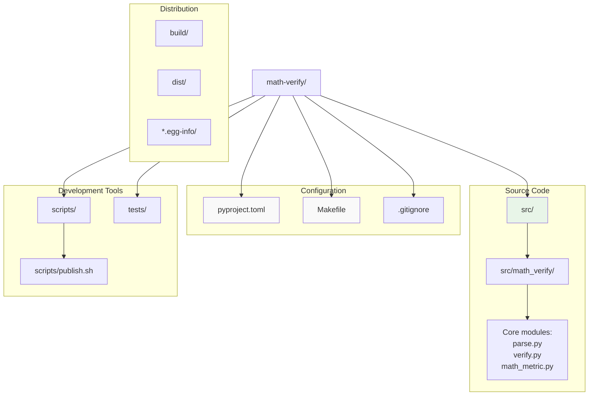
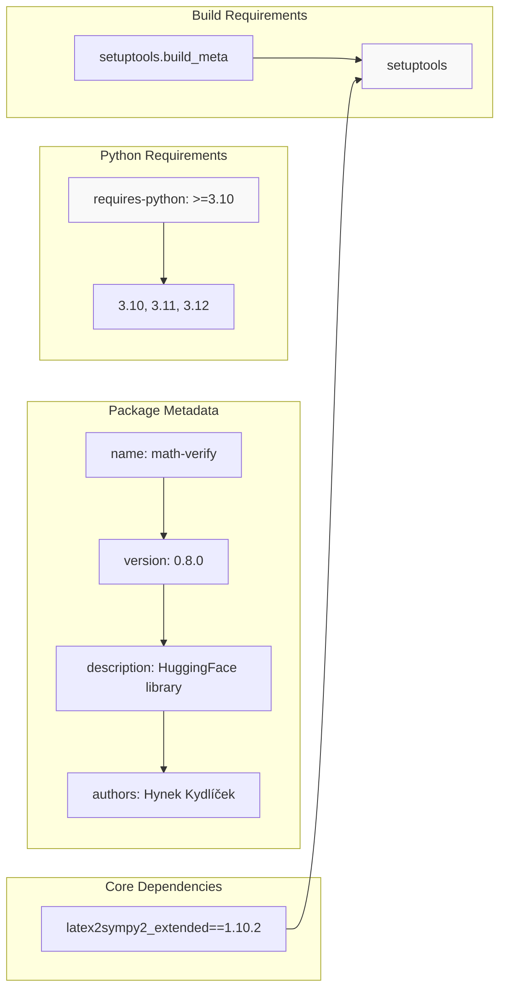
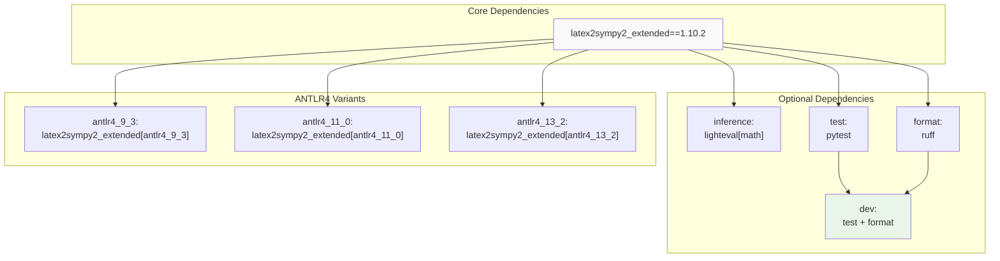
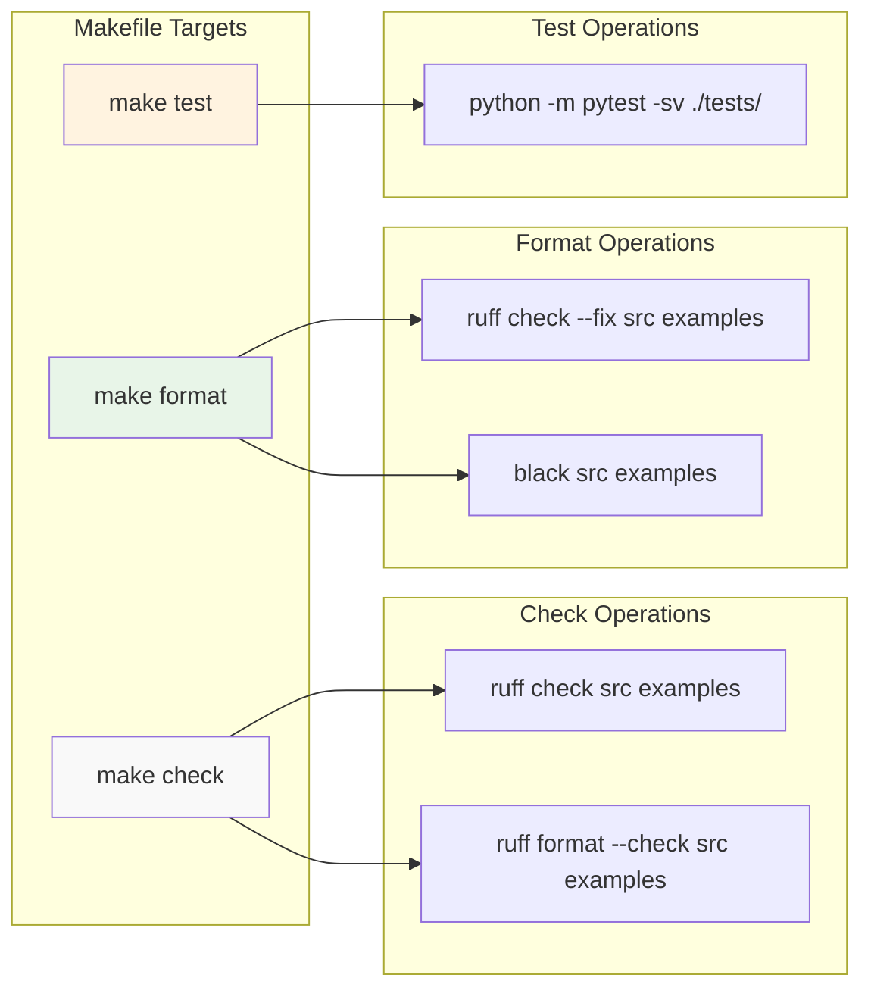
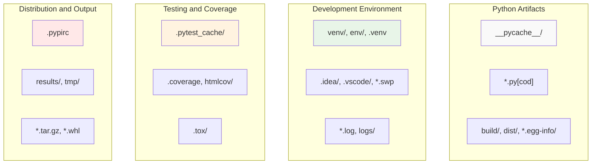

<!-- source: DeepWiki mcp.deepwiki.com · repo huggingface/Math-Verify · page 7.1 Project Structure and Build System · fetched 2026-10-26 -->

# Project Structure and Build System

Relevant source files

The following files were used as context for generating this wiki page:

- [.gitignore](.gitignore)
- [Makefile](Makefile)
- [pyproject.toml](pyproject.toml)
- [scripts/publish.sh](scripts/publish.sh)

## Purpose and Scope

This document covers the project organization, build system configuration, and development workflow for the Math-Verify codebase. It details the package structure, dependency management, code quality tools, and distribution mechanisms that support the development and maintenance of the mathematical expression verification library.

For information about the core mathematical verification components, see [Core Components](#3). For testing procedures and validation, see [Testing Framework](#6). For contribution guidelines and code standards, see [Contributing Guidelines](#7.2).

## Project Organization

The Math-Verify project follows Python packaging best practices with a modern `src/` layout structure and comprehensive development tooling.

### Directory Structure

**Sources:** [pyproject.toml:64-65](), [.gitignore:7-21](), [Makefile:3]()

### Package Structure Configuration

The project uses the modern `src/` layout with package discovery configured in `pyproject.toml`. The `setuptools.packages.find` directive specifies that packages should be discovered within the `src/` directory:

| Configuration Key | Value | Purpose |
|---|---|---|
| `where` | `["src"]` | Package discovery root directory |
| `build-backend` | `"setuptools.build_meta"` | Modern build system backend |
| `requires` | `["setuptools"]` | Build system requirements |

**Sources:** [pyproject.toml:60-65]()

## Build System Configuration

The project uses a modern Python build system based on PEP 517/518 standards with `pyproject.toml` as the primary configuration file.

### Build System Specification

**Sources:** [pyproject.toml:1-25](), [pyproject.toml:60-62]()

### Package Metadata and Classification

The package is configured with comprehensive metadata for PyPI distribution:

| Field | Value |
|---|---|
| Package Name | `math-verify` |
| Current Version | `0.8.0` |
| License | Apache 2.0 |
| Python Version Support | `>=3.10` (3.10, 3.11, 3.12) |
| Target Audience | Developers, Education, Science/Research |
| Keywords | `verification`, `math`, `evaluation` |

**Sources:** [pyproject.toml:1-21]()

## Dependency Management

The project uses optional dependency groups to organize different usage scenarios and development requirements.

### Dependency Groups

**Sources:** [pyproject.toml:22-55]()

### ANTLR4 Version Management

The project provides multiple ANTLR4 runtime options to handle compatibility requirements:

| Dependency Group | ANTLR4 Version | Use Case |
|---|---|---|
| `antlr4_9_3` | 4.9.3 | Legacy compatibility |
| `antlr4_11_0` | 4.11.0 | Standard runtime |
| `antlr4_13_2` | 4.13.2 | Latest features |

**Sources:** [pyproject.toml:45-55]()

## Development Workflow

The project includes automation tools for code quality, testing, and development tasks through a `Makefile` and configuration files.

### Development Commands

**Sources:** [Makefile:1-14]()

### Code Quality Configuration

The project uses `ruff` as the primary linter and formatter with specific configuration:

| Tool | Configuration | Purpose |
|---|---|---|
| `ruff` | Line length: 88, Select: E,F,I,N,W,B,A | Linting and formatting |
| `black` | Line length: 88, Preview mode | Code formatting |
| `isort` | First-party: math_verify | Import sorting |

**Sources:** [pyproject.toml:67-83]()

## Version Control and Ignore Patterns

The project uses Git with comprehensive ignore patterns to exclude build artifacts, development files, and distribution materials.

### Ignore Categories

**Sources:** [.gitignore:1-57]()

## Distribution and Publishing

The project includes automated publishing capabilities for PyPI distribution through a dedicated script.

### Publishing Pipeline

The publishing process is automated through `scripts/publish.sh`:

1. **Build Phase**: Uses `python3 -m build` to create distribution packages
2. **Upload Phase**: Uses `twine upload` with configuration from `.pypirc`
3. **Error Handling**: Script exits immediately on any command failure (`set -e`)

| Step | Command | Purpose |
|---|---|---|
| Package Building | `python3 -m build` | Creates wheel and source distributions |
| PyPI Upload | `twine upload --config-file .pypirc dist/*` | Publishes to PyPI using stored credentials |

**Sources:** [scripts/publish.sh:1-12]()

### Distribution Artifacts

The build process generates standard Python distribution formats that are excluded from version control but included in the publishing pipeline:

- **Wheel files** (`*.whl`): Binary distribution format
- **Source distributions** (`*.tar.gz`): Source code archives  
- **Egg info directories** (`*.egg-info/`): Package metadata

**Sources:** [.gitignore:18-21](), [.gitignore:44-45]()

---

