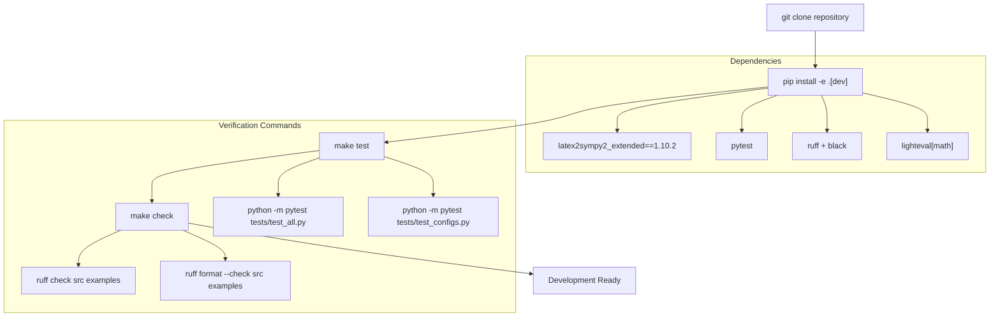
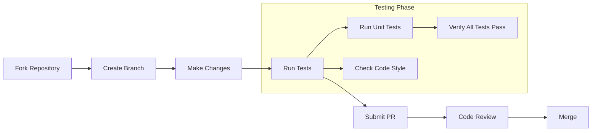
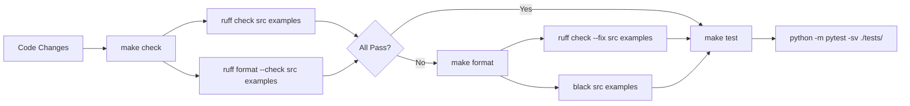
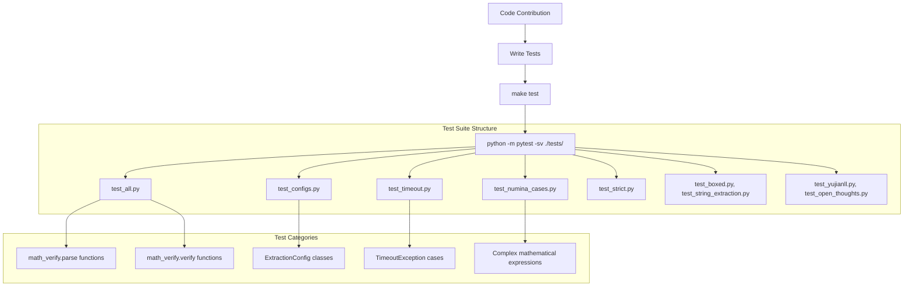
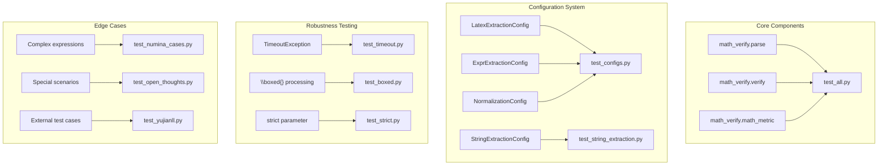
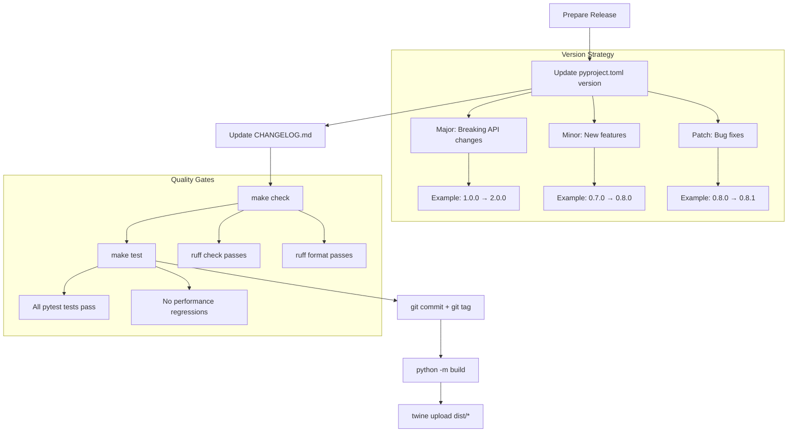

<!-- source: DeepWiki mcp.deepwiki.com · repo huggingface/Math-Verify · page 7.2 Contributing Guidelines · fetched 2026-10-26 -->

# Contributing Guidelines

<details>
<summary>Relevant source files</summary>

The following files were used as context for generating this wiki page:

- [CHANGELOG.md](CHANGELOG.md)
- [Makefile](Makefile)
- [tests/__init__.py](tests/__init__.py)

</details>


This page provides guidelines for developers who want to contribute to the Math-Verify project. It covers the development workflow, coding standards, testing requirements, and maintaining code quality. For information about the overall project structure, see [Project Structure and Build System](#7.1).

#### Development Environment Setup

Setting up a development environment for Math-Verify requires installing the necessary dependencies and configuring your development tools.

**Development Environment Setup Flow**



Sources: [Makefile:1-14](), [CHANGELOG.md:40-51]()

### Prerequisites

Before contributing to Math-Verify, ensure you have:

1. Python 3.10, 3.11, or 3.12 installed
2. Git for version control
3. A GitHub account for submitting pull requests

### Installation for Development

1. Fork the repository on GitHub
2. Clone your fork locally:
   ```bash
   git clone https://github.com/YOUR-USERNAME/Math-Verify.git
   cd Math-Verify
   ```
3. Install the package in development mode with all optional dependencies:
   ```bash
   pip install -e ".[dev]"
   ```

This will install the core dependencies and development tools like pytest and ruff.

## Development Workflow

The following diagram illustrates the typical contribution workflow for Math-Verify:



### Branch Naming Convention

When creating a branch for your contribution, use the following naming format:

- `feature/short-description` - For new features
- `fix/short-description` - For bug fixes
- `docs/short-description` - For documentation improvements
- `refactor/short-description` - For code refactoring

### Code Quality and Standards

Math-Verify uses automated tools to maintain code quality and consistency. The quality checks are defined in the [Makefile:1-14]() and must pass before contributions are accepted.

**Quality Assurance Pipeline**



#### Quality Commands

| Command | Purpose | Files Checked |
|---------|---------|---------------|
| `make check` | Run linter and format checker | `src examples` |
| `make format` | Auto-fix linting and formatting | `src examples` |
| `make test` | Run full test suite | `./tests/` |

#### Linting Rules

The project uses `ruff` for both linting and formatting:
- Linter: `ruff check` enforces code quality rules
- Formatter: `ruff format` ensures consistent code style
- Fallback formatter: `black` for additional formatting

Sources: [Makefile:3-14]()

## Testing Framework and Requirements

Testing is critical for maintaining the reliability of mathematical expression verification. Every contribution must include appropriate tests and pass the existing test suite.

**Testing Architecture**



#### Test File Organization

| Test File | Purpose | Core Components Tested |
|-----------|---------|------------------------|
| `test_all.py` | Core functionality | `parse()`, `verify()`, `math_metric()` |
| `test_configs.py` | Configuration classes | `LatexExtractionConfig`, `ExprExtractionConfig` |
| `test_timeout.py` | Timeout mechanisms | `TimeoutException`, cross-platform handling |
| `test_numina_cases.py` | Complex edge cases | Set comparisons, boxed expressions |
| `test_strict.py` | Comparison modes | Strict vs non-strict verification |
| `test_boxed.py` | LaTeX boxed expressions | `\\boxed{}` handling and normalization |
| `test_string_extraction.py` | String parsing | `StringExtractionConfig` |

#### Running Tests

```bash
# Run all tests
make test

# Run specific test files
python -m pytest tests/test_all.py -v
python -m pytest tests/test_strict.py -v

# Run tests with coverage
python -m pytest --cov=src/math_verify tests/
```

Sources: [Makefile:13-14](), [CHANGELOG.md:69-95]()

### Running Tests

To run the entire test suite:

```bash
pytest
```

To run specific test files:

```bash
pytest tests/test_numina_cases.py
pytest tests/test_strict.py
```

#### Test Coverage Requirements

New contributions must include tests that cover:

1. **Core Function Testing**: All new functions in `math_verify.parse`, `math_verify.verify`, or `math_verify.math_metric`
2. **Configuration Testing**: New extraction or normalization configurations
3. **Edge Case Testing**: Complex mathematical expressions that might cause parsing or verification issues
4. **Error Handling**: Timeout scenarios and exception handling paths

**Test Coverage by Component**



Sources: [CHANGELOG.md:92-95]()

## Component-Specific Contribution Guidelines

Different components have specific requirements for testing and implementation. Follow these guidelines based on the component you're modifying.

**Component Contribution Workflow**

```mermaid
flowchart TD
    Identify["Identify Component"] --> Parser["math_verify.parse"]
    Identify --> Grader["math_verify.verify"]  
    Identify --> Metric["math_verify.math_metric"]
    Identify --> Evaluation["evaluation tools"]
    
    Parser --> parser_reqs["Parser Requirements"]
    Grader --> grader_reqs["Grader Requirements"]
    Metric --> metric_reqs["Metric Requirements"]
    Evaluation --> eval_reqs["Evaluation Requirements"]
    
    subgraph "Parser Module Changes"
        parser_reqs --> extraction_config["Update ExtractionConfig classes"]
        parser_reqs --> latex_handling["Modify LaTeX processing"]
        parser_reqs --> timeout_safe["Ensure timeout safety"]
        parser_reqs --> test_complex["Add test_all.py cases"]
    end
    
    subgraph "Grader Module Changes"
        grader_reqs --> comparison_logic["Update sympy_compare_* functions"]
        grader_reqs --> strict_mode["Handle strict parameter"]
        grader_reqs --> error_handling["Implement raise_on_error"]
        grader_reqs --> test_verify["Add verification tests"]
    end
    
    subgraph "Metric Module Changes"
        metric_reqs --> scoring_logic["Update math_metric function"]
        metric_reqs --> precision_handling["Handle numeric precision"]
        metric_reqs --> test_metrics["Add metric test cases"]
    end
```



Sources: [CHANGELOG.md:5-8](), [CHANGELOG.md:17-19]()

### Parser Module (`math_verify.parse`) Contributions

When modifying parsing functionality:

| Requirement | Implementation | Testing |
|-------------|----------------|---------|
| Backwards compatibility | Preserve existing `ExtractionConfig` APIs | Run `test_configs.py` |
| Timeout safety | Wrap parsing calls with timeout protection | Add `test_timeout.py` cases |
| LaTeX handling | Update normalization in `latex2sympy2_extended` usage | Test with `test_boxed.py` |
| Complex expressions | Handle edge cases in extraction | Add `test_numina_cases.py` scenarios |

**Critical Functions to Test:**
- `parse()` function with various `ExtractionConfig` instances
- `LatexExtractionConfig`, `ExprExtractionConfig`, `StringExtractionConfig` classes
- Timeout behavior with `TimeoutException`

### Grader Module (`math_verify.verify`) Contributions

When working on verification logic:

| Requirement | Implementation | Testing |
|-------------|----------------|---------|
| Comparison strategies | Update `sympy_compare_*` functions | Add `test_strict.py` cases |
| Error propagation | Implement `raise_on_error` parameter | Test exception handling |
| Special objects | Handle sets, relations, matrices correctly | Add `test_numina_cases.py` tests |
| Strict mode | Support `strict` parameter in comparisons | Test both modes in `test_strict.py` |

**Critical Functions to Test:**
- `verify()` function with `strict` and `raise_on_error` parameters
- Comparison functions: `sympy_compare_sets`, `sympy_compare_relational`, etc.
- Edge cases from `test_open_thoughts.py` and `test_yujianll.py`

### Evaluation Tools Contributions

For changes to model evaluation scripts:

| Component | Testing Requirements | Datasets |
|-----------|---------------------|----------|
| `evaluate_model.py` | Test with sample models | GSM8K, MATH-Hard, AIME24 |
| `evaluate_model_outputs.py` | Test batch processing | Real model output files |
| `extract_answers.py` | Test answer extraction | Various text formats |

**Integration Testing:**
- Verify `lighteval` framework compatibility
- Test few-shot prompt integration
- Validate output format consistency

Sources: [CHANGELOG.md:23-26](), [CHANGELOG.md:85-89]()

## Release Process and Version Management

The release process for Math-Verify follows semantic versioning and requires thorough testing before publishing.

**Release Pipeline**



Sources: [CHANGELOG.md:3-33]()

### Version Numbering

Math-Verify follows semantic versioning:

- **Major version**: Incompatible API changes
- **Minor version**: Backwards-compatible feature additions
- **Patch version**: Backwards-compatible bug fixes

### Changelog Maintenance

The [CHANGELOG.md:1-114]() file documents all changes and must be updated for each release. Follow the established format:

**Changelog Structure**

```markdown
## [0.X.Y]
### Added
- New feature descriptions with component references

### Changed  
- Modifications to existing functionality
- Dependency updates (e.g., "Bumped latex2sympy2_extended to 1.0.9")

### Fixed
- Bug fixes with issue references
- Performance improvements

### Removed
- Deprecated functionality removal
```

**Recent Release Examples:**

| Version | Key Changes | Components Affected |
|---------|-------------|-------------------|
| 0.8.0 | Added `raise_on_error` parameter | `verify()`, `parse()` functions |
| 0.7.0 | Improved `\\boxed{}` handling | Parser, normalization logic |
| 0.6.2 | Global parsing timeout | `TimeoutException`, cross-platform support |
| 0.6.0 | Numeric precision support | Grader comparison functions |
| 0.5.3 | Multiple ANTLR4 runtime support | Dependency management |

Sources: [CHANGELOG.md:3-51]()

### Publishing a New Version

For maintainers with publish access:

1. Update version number in pyproject.toml
2. Update CHANGELOG.md
3. Create a release commit and tag
4. Use the publish script to release to PyPI:
   ```bash
   ./scripts/publish.sh
   ```

This script builds the package and uploads it to PyPI using the credentials in .pypirc.

## Documentation Guidelines

Documentation is an essential part of the contribution process. Update or add documentation for any changes you make.

### Code Documentation

- Use descriptive docstrings for all functions, classes, and methods
- Follow Google-style docstring format
- Include type hints for function parameters and return values

### Wiki Documentation

When significant changes are made to the codebase, consider updating the relevant wiki pages:

- [Overview](#1) for fundamental changes
- [Architecture](#2) for structural changes
- [Core Components](#3) for modifications to parser or grader
- [Usage Guide](#4) for user-facing changes
- [Development Guide](#7) for development workflow changes

## Getting Help

If you need assistance with your contribution:

1. Check existing issues on GitHub
2. Create a new issue to discuss your proposed changes before starting significant work
3. Ask questions in pull requests if you're uncertain about implementation details

## Summary of Contribution Process

| Step | Description | Key Considerations |
|------|-------------|-------------------|
| 1. Fork & Clone | Fork the repository and clone it locally | Use HTTPS or SSH depending on your setup |
| 2. Create Branch | Create a branch for your changes | Follow naming conventions |
| 3. Develop | Make your code changes | Follow coding standards |
| 4. Test | Write and run tests | Ensure all tests pass |
| 5. Document | Update documentation | Include code comments and wiki updates |
| 6. Commit | Create focused commits | Write clear commit messages |
| 7. Push | Push changes to your fork | - |
| 8. Pull Request | Create a PR to the main repo | Describe changes clearly |
| 9. Review | Address review comments | Make requested changes |
| 10. Merge | Maintainers will merge your PR | - |

Following these guidelines will help ensure a smooth contribution process and maintain the quality of the Math-Verify codebase.