# Page: Overview

# Overview

<details>
<summary>Relevant source files</summary>

The following files were used as context for generating this wiki page:

- [CHANGELOG.md](CHANGELOG.md)
- [README.md](README.md)
- [pyproject.toml](pyproject.toml)

</details>


This document provides a comprehensive overview of the Math-Verify system, a robust mathematical expression evaluation library designed for assessing Large Language Model (LLM) outputs in mathematical tasks. Math-Verify addresses critical limitations in existing mathematical evaluators by providing format-agnostic answer extraction, advanced parsing capabilities, and intelligent expression comparison.

For detailed information about specific components, see [Core Components](#3). For practical usage instructions, see [Usage Guide](#4). For model evaluation workflows, see [Evaluation Framework](#5).

## Purpose and Scope

Math-Verify is a HuggingFace library that solves a fundamental problem in LLM evaluation: accurately assessing mathematical answers regardless of their format or representation. The system achieves higher accuracy than existing evaluators on the MATH dataset, with a score of 0.1328 compared to 0.0802 (Harness) and 0.1288 (Qwen).

The library serves three primary use cases:
- **Individual Expression Verification**: Direct comparison of mathematical expressions using `parse()` and `verify()` functions
- **Batch Output Processing**: Evaluation of model outputs stored in CSV format using `evaluate_model_outputs.py`
- **End-to-End Model Evaluation**: Complete evaluation pipeline using `evaluate_model.py` with support for datasets including GSM8K, MATH-Hard, AIME24, and AMC23

**Sources**: [pyproject.toml:1-25](), [README.md:1-8](), [README.md:78-105]()

## System Architecture

Math-Verify follows a layered architecture with clear separation between parsing, verification, and evaluation concerns:

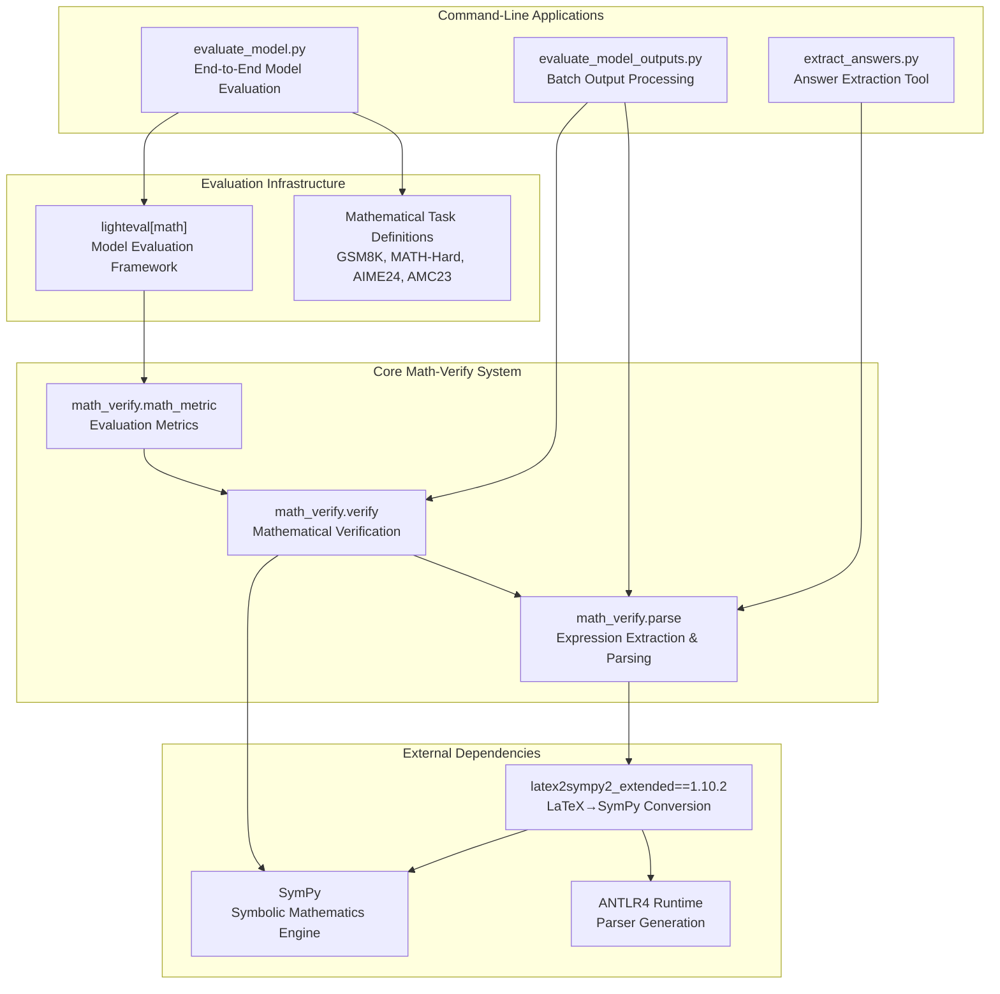

**Sources**: [pyproject.toml:22-30](), [README.md:85-105]()

## Core Processing Workflow

The mathematical verification process follows a three-step pipeline that transforms raw text input into verified mathematical results:

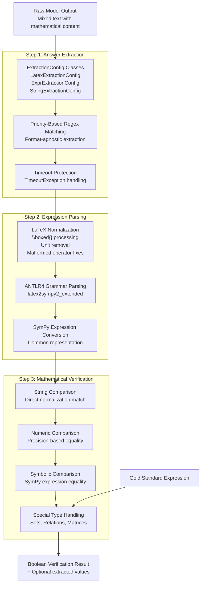

**Sources**: [README.md:112-175]()

## Key Components and Modules

Math-Verify consists of three primary modules that handle different aspects of mathematical verification:

| Module | Primary Functions | Purpose |
|--------|------------------|---------|
| `math_verify.parse` | `parse()`, extraction configs | Format-agnostic answer extraction from text |
| `math_verify.verify` | `verify()`, comparison strategies | Mathematical expression verification |
| `math_verify.math_metric` | Evaluation metrics | Model performance assessment |

### Core Function Interface

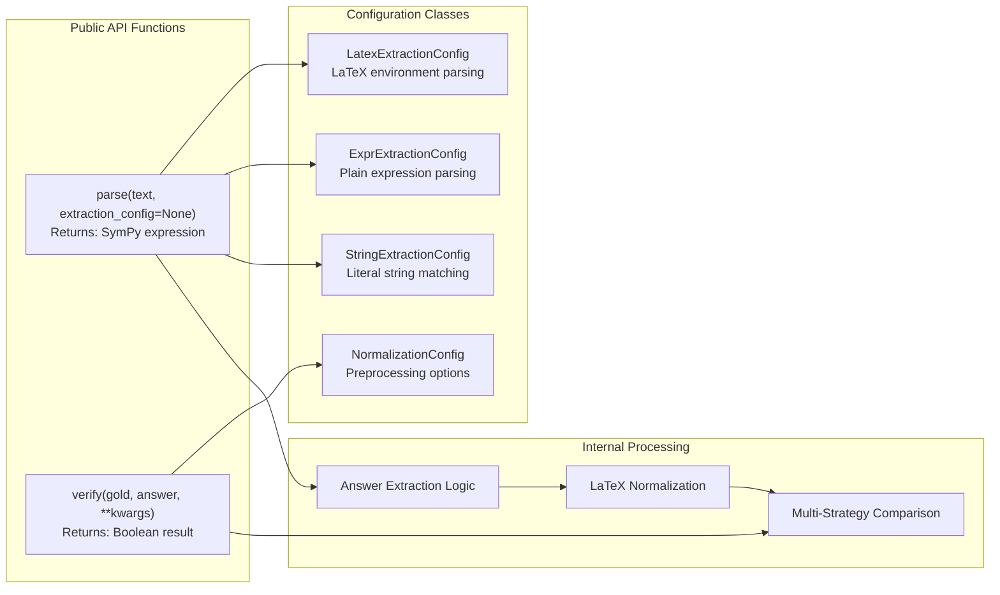

**Sources**: [README.md:23-36](), [README.md:38-46]()

## Supported Mathematical Types

Math-Verify provides comprehensive support for diverse mathematical expression types commonly found in LLM outputs:

| Type Category | Examples | Verification Strategy |
|---------------|----------|----------------------|
| **Numeric** | `1/3`, `0.333`, `33.33%` | Precision-based comparison |
| **Symbolic** | `x + 2y`, `sin(π/4)` | SymPy symbolic equality |
| **Sets** | `{1,2,3}`, `(1,3) ∪ (2,4)` | Element-wise and operation comparison |
| **Relations** | `x < 2`, `1 ≤ y ≤ 5` | Normalized form and flip support |
| **Matrices** | `[[1,2],[3,4]]` | Element-wise with shape validation |
| **Complex** | `2+3i`, `Re(z)` | Component-wise comparison |

**Sources**: [README.md:55-77](), [README.md:145-175]()

## Integration Points and Dependencies

Math-Verify integrates with the broader Python mathematical and ML ecosystem through well-defined dependency relationships:

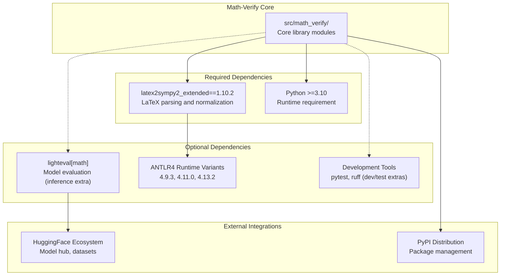

**Sources**: [pyproject.toml:22-56](), [README.md:10-21]()

## Version and Compatibility

The current version 0.8.0 introduces enhanced error handling capabilities with the `raise_on_error` parameter and improved `\boxed{}` expression processing. The system maintains compatibility across Python 3.10+ and supports multiple ANTLR4 runtime versions for maximum deployment flexibility.

Key version features include:
- **Flexible ANTLR4 Support**: Compatible with runtimes 4.9.3, 4.11.0, and 4.13.2
- **Error Handling Options**: Configurable exception propagation via `raise_on_error` parameter  
- **Enhanced Logging**: Debug-level error logging with optional verbose modes
- **Boxed Expression Improvements**: Better handling of units, percentages, and multiple boxed values

**Sources**: [pyproject.toml:3](), [pyproject.toml:16-18](), [pyproject.toml:45-55](), [CHANGELOG.md:3-10]()

---

# Page: Architecture

# Architecture

<details>
<summary>Relevant source files</summary>

The following files were used as context for generating this wiki page:

- [README.md](README.md)
- [assets/flow.svg](assets/flow.svg)
- [src/math_verify/errors.py](src/math_verify/errors.py)

</details>


This document describes the detailed system architecture of Math-Verify, including data flow patterns, component relationships, and the core processing pipeline. It covers how mathematical expressions are extracted, normalized, converted, and compared across different representation formats.

For practical usage instructions, see [Usage Guide](#4). For specific component implementations, see [Core Components](#3).

## System Overview

Math-Verify implements a three-stage pipeline architecture designed for robust mathematical expression evaluation:

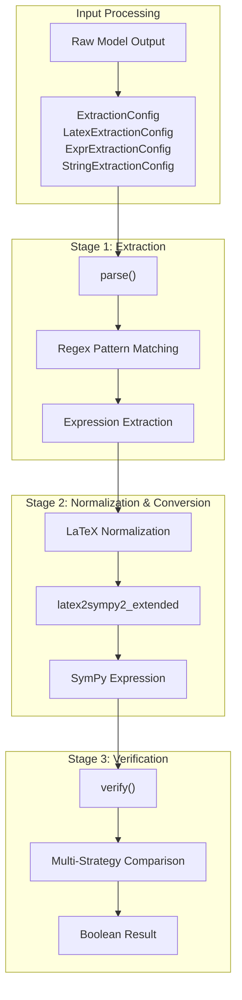

**Sources:** [README.md:107-175](), [src/math_verify/parser.py](), [src/math_verify/grader.py]()

## Core Processing Pipeline

The architecture follows a strict sequential processing model where each stage handles specific aspects of mathematical expression processing:

### Stage 1: Expression Extraction

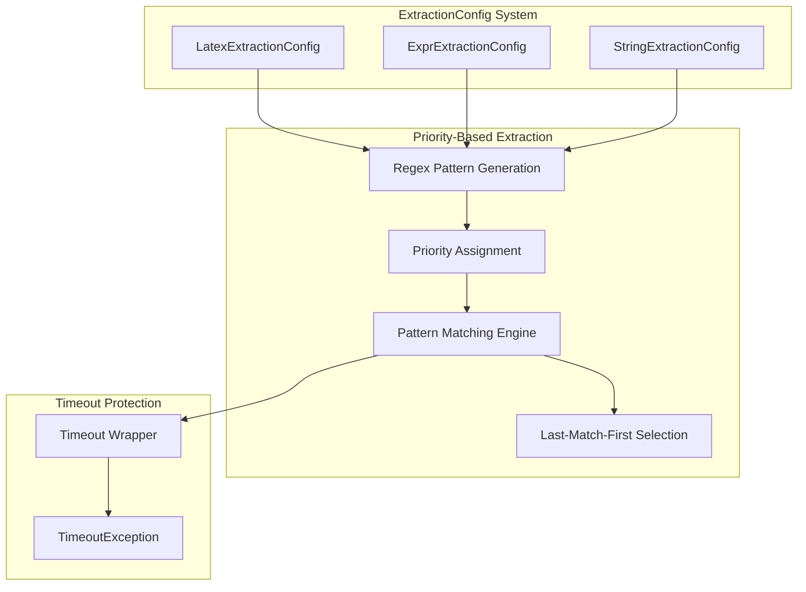

**Sources:** [src/math_verify/parser.py](), [src/math_verify/errors.py:1-3](), [README.md:115-121]()

### Stage 2: Normalization and Conversion

The normalization pipeline handles LaTeX preprocessing before SymPy conversion:

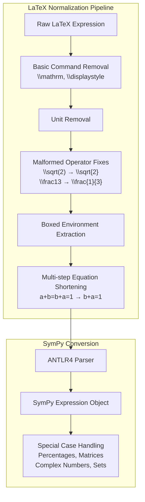

**Sources:** [README.md:122-138](), [latex2sympy2_extended/latex2sympy2.py]()

### Stage 3: Verification Engine

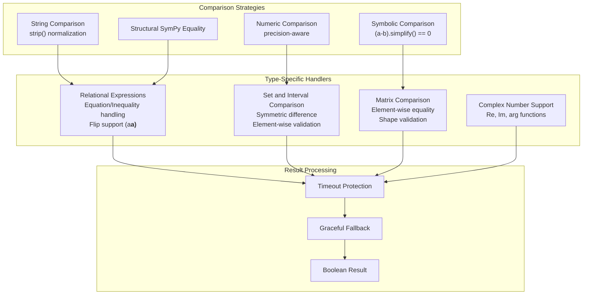

**Sources:** [src/math_verify/grader.py](), [README.md:139-175]()

## Component Interaction Model

The system uses a modular architecture where components interact through well-defined interfaces:

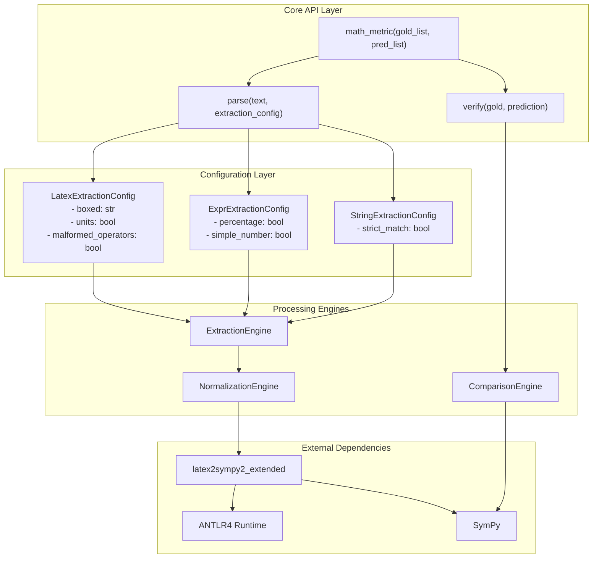

**Sources:** [src/math_verify/__init__.py](), [src/math_verify/math_metric.py](), [pyproject.toml]()

## Configuration Architecture

The system uses a flexible configuration architecture that allows fine-grained control over extraction and comparison behavior:

| Configuration Class | Purpose | Key Parameters |
|---------------------|---------|----------------|
| `LatexExtractionConfig` | LaTeX expression extraction | `boxed`, `units`, `malformed_operators`, `basic_latex` |
| `ExprExtractionConfig` | Plain expression extraction | `percentage`, `simple_number`, `timeout` |
| `StringExtractionConfig` | String literal extraction | `strict_match`, `case_sensitive` |
| `NormalizationConfig` | LaTeX preprocessing | `operator_fixes`, `unit_removal`, `equation_splitting` |

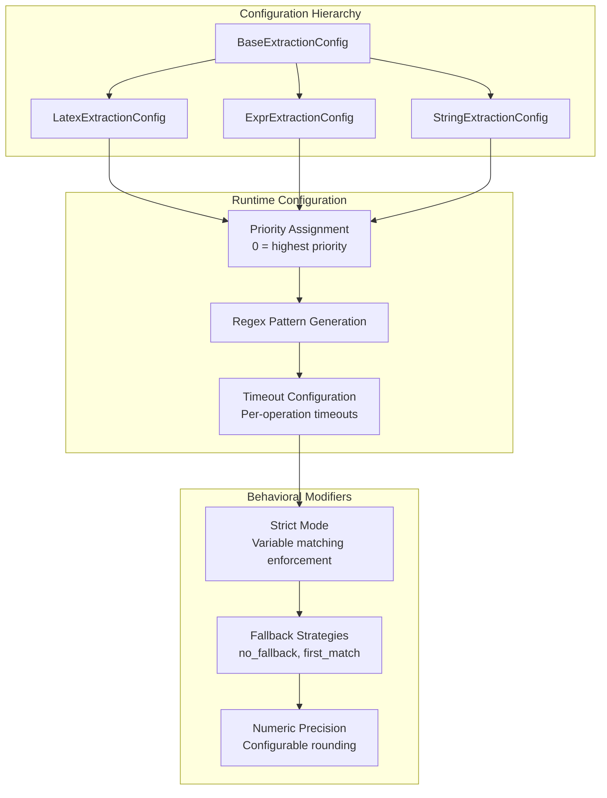

**Sources:** [README.md:195-210](), [src/math_verify/parser.py](), [tests/test_configs.py]()

## Error Handling and Robustness

Math-Verify implements comprehensive error handling to ensure reliable operation across different platforms and input conditions:

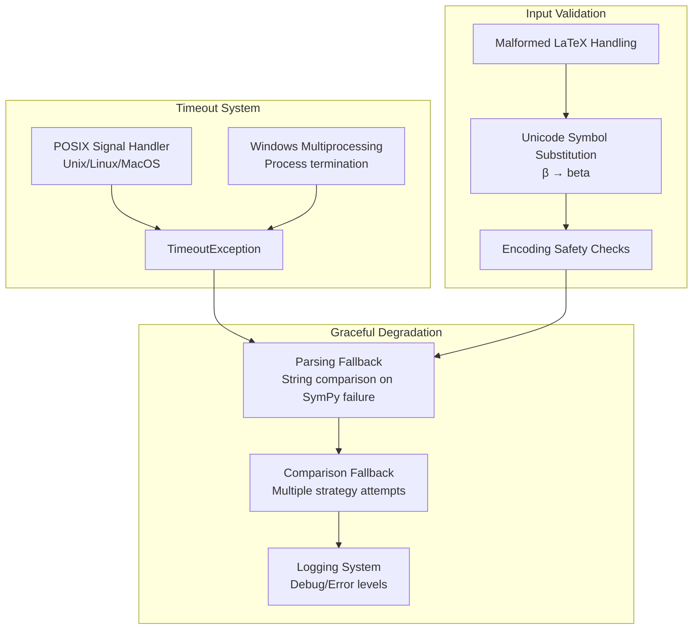

**Sources:** [src/math_verify/errors.py](), [src/math_verify/timeout.py](), [README.md:171-175]()

## External Dependency Integration

The system integrates with several external libraries through well-defined interfaces:

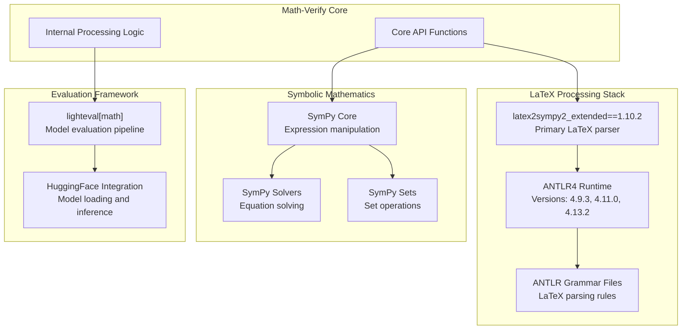

**Sources:** [pyproject.toml](), [README.md:10-21](), [requirements.txt]()

---

# Page: Core Components

# Core Components

<details>
<summary>Relevant source files</summary>

The following files were used as context for generating this wiki page:

- [README.md](README.md)
- [src/math_verify/__init__.py](src/math_verify/__init__.py)
- [tests/test_string_extraction.py](tests/test_string_extraction.py)

</details>


This page provides an overview of the main functional components that comprise the Math-Verify system. It covers the core modules responsible for mathematical expression parsing, verification, and evaluation, along with their configuration systems and utilities.

For detailed implementation specifics of individual components, see the Parser Module ([3.1](#3.1)), Grader Module ([3.2](#3.2)), and Metrics and Evaluation ([3.3](#3.3)). For usage examples and configuration options, see the Usage Guide ([4](#4)).

## Component Architecture Overview

The Math-Verify system is built around four primary components that work together to extract, parse, and verify mathematical expressions:

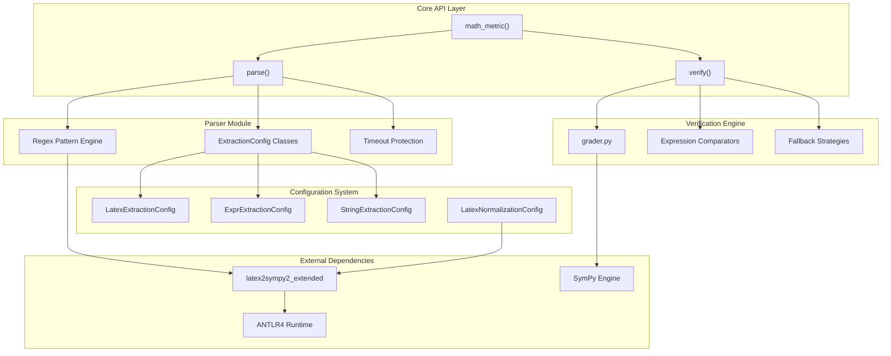

Sources: [src/math_verify/__init__.py:1-23](), [README.md:115-175]()

## Main API Components

The system exposes four primary functions through its public API, each serving a distinct role in the mathematical verification pipeline:

| Function | Purpose | Primary Use Case |
|----------|---------|------------------|
| `parse()` | Extract mathematical expressions from text | Convert model outputs to structured format |
| `verify()` | Compare two parsed expressions for equivalence | Validate model answers against gold standards |
| `math_metric()` | Calculate evaluation metrics over datasets | Batch evaluation and scoring |
| Configuration Classes | Control extraction and normalization behavior | Customize parsing for specific formats |

### Core Function Signatures

The main API functions operate with the following key interfaces:

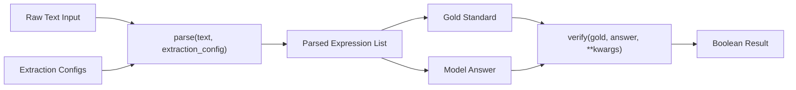

Sources: [src/math_verify/__init__.py:5-12](), [README.md:24-36]()

## Parser Module Components

The parser module implements a multi-strategy extraction system with configurable extraction targets:

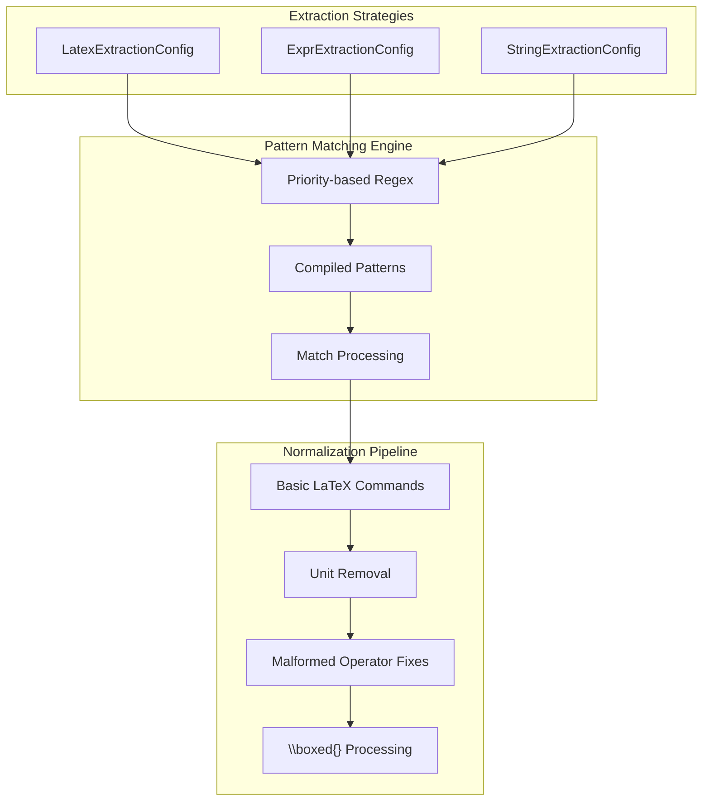

### Extraction Configuration Classes

Each extraction strategy is implemented as a configuration class that defines pattern matching behavior:

| Configuration Class | Target Format | Example Input | Use Case |
|-------------------|---------------|---------------|----------|
| `LatexExtractionConfig` | LaTeX expressions in environments | `$\sqrt{2}$`, `\[\frac{1}{2}\]` | Mathematical notation parsing |
| `ExprExtractionConfig` | Plain numerical expressions | `1/2`, `3.14159` | Simple arithmetic extraction |
| `StringExtractionConfig` | Literal string matching | `A`, `B`, `C`, `D` | Multiple choice answers |

Sources: [src/math_verify/__init__.py:8-11](), [README.md:38-45](), [tests/test_string_extraction.py:1-28]()

## Verification Engine Components

The verification engine implements multiple comparison strategies with fallback mechanisms:

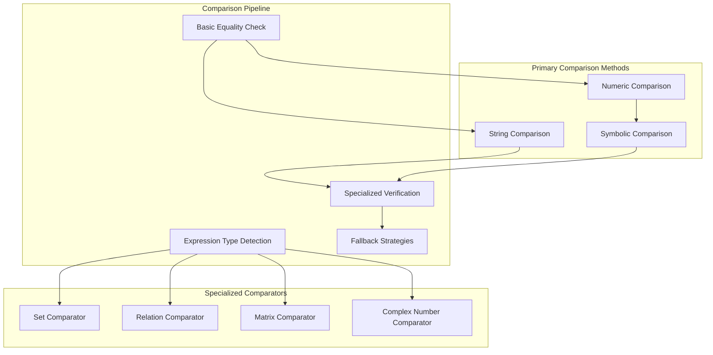

### Verification Strategies

The `verify()` function employs multiple comparison approaches based on expression types:

| Strategy | Expression Types | Comparison Method | Example |
|----------|-----------------|-------------------|---------|
| String Comparison | All types | Direct string matching after normalization | `"1/2" == "0.5"` |
| Numeric Comparison | Numbers, fractions | Floating point with configurable precision | `0.333... ≈ 1/3` |
| Symbolic Comparison | Algebraic expressions | SymPy symbolic equality | `x + 1 == 1 + x` |
| Set Comparison | Sets, intervals | Element-wise and structural comparison | `{1,2,3} == {3,2,1}` |
| Relation Comparison | Equations, inequalities | Normalized form comparison with flipping | `a < b == b > a` |

Sources: [README.md:139-175](), [src/math_verify/__init__.py:5]()

## Configuration System Architecture

The configuration system provides fine-grained control over extraction and normalization behavior:

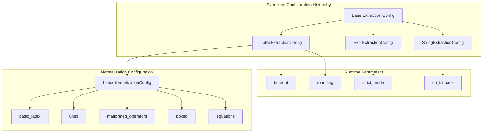

### Configuration Parameters

Key configuration options that control system behavior:

| Parameter Category | Options | Purpose |
|-------------------|---------|---------|
| Extraction Target | `latex`, `expr`, `string` | Defines what patterns to extract |
| Normalization | `basic_latex`, `units`, `malformed_operators` | Controls LaTeX preprocessing |
| Matching Strategy | `boxed_match_priority`, `first_match` | Prioritizes extraction patterns |
| Comparison | `rounding`, `strict_mode`, `allow_set_relation_comp` | Controls verification behavior |
| Error Handling | `timeout`, `raise_on_error`, `no_fallback` | Manages failure modes |

Sources: [src/math_verify/__init__.py:1-3](), [README.md:195-210]()

## Data Flow and Integration

The complete data flow through the Math-Verify system follows this processing pipeline:

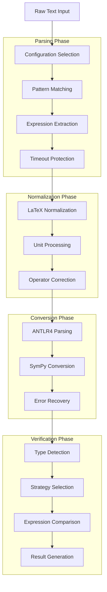

### Integration with External Dependencies

The system integrates with several external libraries:

| Dependency | Integration Point | Purpose |
|------------|------------------|---------|
| `latex2sympy2_extended` | Normalization and parsing | LaTeX to SymPy conversion |
| `sympy` | Verification engine | Symbolic mathematics operations |
| `antlr4-python3-runtime` | Parser generation | Grammar-based expression parsing |
| `lighteval` | Evaluation framework | Model evaluation pipeline |

Sources: [README.md:115-138](), [README.md:10-21]()

---

# Page: Parser Module

# Parser Module

<details>
<summary>Relevant source files</summary>

The following files were used as context for generating this wiki page:

- [src/math_verify/parser.py](src/math_verify/parser.py)
- [tests/test_configs.py](tests/test_configs.py)

</details>


The Parser Module is responsible for extracting and parsing mathematical expressions from natural language text. It converts unstructured text containing mathematical content into structured SymPy expressions through configurable extraction strategies, pattern matching, and normalization processes.

This module handles LaTeX expressions, plain mathematical expressions, and string-based answers (like multiple choice options). For information about how parsed expressions are compared and verified, see [Grader Module](#3.2). For details about timeout mechanisms and error handling utilities, see [Utilities and Error Handling](#3.4).

## Architecture Overview

The parser module follows a multi-stage pipeline architecture that transforms natural language text into structured mathematical objects:

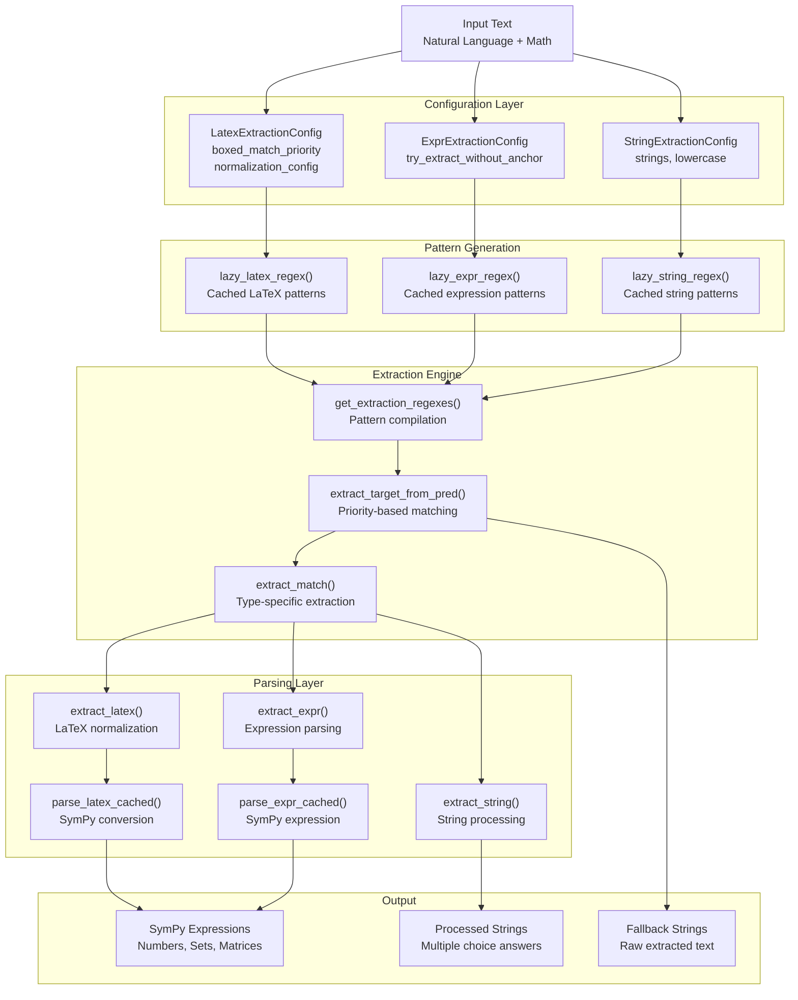

Sources: [src/math_verify/parser.py:49-108](), [src/math_verify/parser.py:651-733]()

## Extraction Configurations

The parser module uses three main configuration classes to control extraction behavior:

### LatexExtractionConfig

Controls LaTeX expression extraction with configurable normalization and priority settings:

| Attribute | Type | Default | Description |
|-----------|------|---------|-------------|
| `try_extract_without_anchor` | `bool` | `True` | Extract LaTeX without requiring anchor words like "answer:" |
| `boxed_match_priority` | `int` | `50` | Priority for `\boxed{}` expressions (0=highest, -1=disabled) |
| `normalization_config` | `NormalizationConfig` | Complex default | Controls LaTeX preprocessing options |

The default `NormalizationConfig` enables basic LaTeX cleanup, unit handling, operator fixes, and boxed expression processing while disabling equation parsing.

Sources: [src/math_verify/parser.py:49-81]()

### ExprExtractionConfig

Simple configuration for mathematical expression extraction:

| Attribute | Type | Default | Description |
|-----------|------|---------|-------------|
| `try_extract_without_anchor` | `bool` | `True` | Extract expressions without anchor words |

Sources: [src/math_verify/parser.py:83-92]()

### StringExtractionConfig

Configuration for extracting literal string answers (typically multiple choice):

| Attribute | Type | Default | Description |
|-----------|------|---------|-------------|
| `strings` | `tuple[str, ...]` | `("A", "B", "C", "D")` | Valid string options to extract |
| `try_extract_without_anchor` | `bool` | `True` | Extract without anchor words |
| `lowercase` | `bool` | `True` | Convert extracted strings to lowercase |

Sources: [src/math_verify/parser.py:94-106]()

## Pattern Matching System

The parser uses a sophisticated regex-based pattern matching system with caching and priority-based extraction:

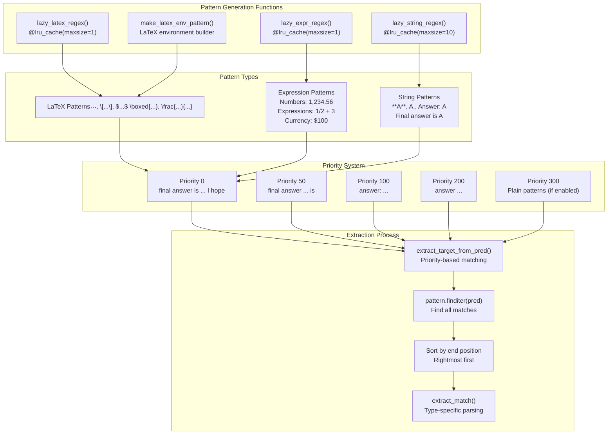

### Pattern Priority System

The system uses numeric priorities to determine extraction order:

- **Priority 0**: Highest priority patterns like "final answer is X I hope"
- **Priority 50**: "final answer ... is X" patterns  
- **Priority 100**: "answer: X" patterns
- **Priority 200**: "answer X" patterns
- **Priority 300**: Plain patterns (when `try_extract_without_anchor=True`)

Patterns are processed in priority order, and within each priority group, matches are sorted by position (rightmost first, then leftmost first).

Sources: [src/math_verify/parser.py:111-164](), [src/math_verify/parser.py:167-236](), [src/math_verify/parser.py:299-356](), [src/math_verify/parser.py:575-649]()

## LaTeX Processing Pipeline

LaTeX expressions undergo specialized processing through multiple stages:

### Environment Pattern Matching

The `make_latex_env_pattern()` function creates regex patterns for various LaTeX environments:

- **Display math**: `$$...$$`, `\[...\]`
- **Inline math**: `$...$`, `\(...\)`, ` [...] `
- **Fractions**: `\frac{num}{den}`
- **Boxed expressions**: `\boxed{...}`

Each pattern can be configured for different contexts (`"boxed"`, `"plain"`) and supports percentage detection.

Sources: [src/math_verify/parser.py:238-297]()

### LaTeX Extraction and Normalization

The `extract_latex()` function processes matched LaTeX content:

1. **Group Collection**: Collects all LaTeX groups (first_ and nextN_ prefixes) from regex matches
2. **Normalization**: Applies `normalize_latex()` with appropriate `NormalizationConfig`
3. **Parsing**: Converts normalized LaTeX to SymPy using `parse_latex_cached()`
4. **Multiple Expression Handling**: Combines multiple expressions into `FiniteSet` when appropriate
5. **Percentage Conversion**: Applies percentage conversion when detected

The function uses a modified normalization config for boxed expressions, setting `boxed="last"` to extract the final boxed content.

Sources: [src/math_verify/parser.py:466-543]()

## Expression and String Processing

### Mathematical Expression Extraction

The `extract_expr()` function handles non-LaTeX mathematical content:

- **Number Processing**: Handles various number formats including thousand separators, decimals, and percentages
- **Expression Parsing**: Parses mathematical expressions with operators (+, -, *, /, ^, parentheses)
- **SymPy Conversion**: Converts expressions to SymPy objects using `parse_expr_cached()`
- **Percentage Handling**: Automatically converts percentages using `convert_to_pct()`

Sources: [src/math_verify/parser.py:408-447](), [src/math_verify/parser.py:449-451]()

### String Extraction

The `extract_string()` function processes literal string answers:

- **Case Normalization**: Converts to lowercase when `lowercase=True`
- **Direct Extraction**: Returns both processed and original strings

Sources: [src/math_verify/parser.py:545-551]()

## Main Parse Function

The `parse()` function serves as the main entry point, orchestrating the entire parsing pipeline:

```python
def parse(
    pred: str,
    extraction_config: Sequence[ExtractionTarget] = [LatexExtractionConfig(), ExprExtractionConfig()],
    fallback_mode: Literal["no_fallback", "first_match"] = "first_match",
    extraction_mode: Literal["first_match", "any_match"] = "any_match",
    parsing_timeout: int = 5,
    raise_on_error: bool = False
) -> list
```

### Parameters

| Parameter | Description |
|-----------|-------------|
| `pred` | Input text to parse |
| `extraction_config` | Sequence of extraction configurations to try |
| `fallback_mode` | How to handle parsing failures (`"no_fallback"` or `"first_match"`) |
| `extraction_mode` | Strategy for finding matches (`"first_match"` or `"any_match"`) |
| `parsing_timeout` | Timeout in seconds for parsing operations |
| `raise_on_error` | Whether to raise exceptions or return empty list on errors |

### Return Value

Returns a list containing:
- **SymPy expressions** for successfully parsed mathematical content
- **Strings** for processed string matches  
- **Fallback strings** when `fallback_mode="first_match"` and parsing fails

Sources: [src/math_verify/parser.py:651-733]()

## Caching and Performance

The parser module employs extensive caching to optimize performance:

- **Pattern Caching**: `@lru_cache` decorators on regex compilation functions
- **Parse Caching**: `parse_latex_cached()` and `parse_expr_cached()` cache SymPy conversions
- **Timeout Protection**: Configurable timeouts prevent infinite parsing loops

The caching system uses small cache sizes (1-20 entries) optimized for repeated evaluation scenarios where the same patterns and expressions are processed multiple times.

Sources: [src/math_verify/parser.py:111](), [src/math_verify/parser.py:167](), [src/math_verify/parser.py:299](), [src/math_verify/parser.py:379-401](), [src/math_verify/parser.py:403-406]()

---

# Page: Grader Module

# Grader Module

<details>
<summary>Relevant source files</summary>

The following files were used as context for generating this wiki page:

- [src/math_verify/grader.py](src/math_verify/grader.py)
- [tests/test_boxed.py](tests/test_boxed.py)
- [tests/test_raise_on_error.py](tests/test_raise_on_error.py)
- [tests/test_strict.py](tests/test_strict.py)

</details>


The Grader Module is the core verification engine of the Math-Verify system, responsible for comparing mathematical expressions using multiple comparison strategies. This module implements comprehensive logic for determining whether two mathematical expressions are equivalent, handling various types of mathematical objects including numbers, algebraic expressions, sets, matrices, and relational expressions.

This document covers the verification and comparison algorithms implemented in the grader. For information about parsing mathematical expressions before verification, see [Parser Module](#3.1). For evaluation metrics that utilize the grader, see [Metrics and Evaluation](#3.3).

## Architecture Overview

The Grader Module follows a multi-strategy comparison approach, where expressions are compared using increasingly sophisticated methods until a match is found or all strategies are exhausted.

### Core Verification Flow

```mermaid
flowchart TD
    Input["Input: gold, target expressions"]
    
    subgraph "Main Entry Point"
        verify["verify()"]
    end
    
    subgraph "Preprocessing"
        ListConv["Convert to lists if needed"]
        Timeout["Apply timeout wrapper"]
        ProductComp["Cartesian product comparison"]
    end
    
    subgraph "Core Comparison Engine"
        sympy_expr_eq["sympy_expr_eq()"]
    end
    
    subgraph "Comparison Strategies"
        StrComp["String Comparison<br/>sympy_str_eq()"]
        RelComp["Relational Comparison<br/>sympy_compare_relational()"]
        SetComp["Set Comparison<br/>sympy_compare_sets()"]
        SymComp["Symbol Comparison<br/>sympy_compare_symbols()"]
        NumComp["Numeric Comparison<br/>sympy_numeric_eq()"]
        AlgComp["Symbolic Comparison<br/>sympy_symbolic_eq()"]
    end
    
    Result["Boolean Result"]
    
    Input --> verify
    verify --> ListConv
    ListConv --> Timeout
    Timeout --> ProductComp
    ProductComp --> sympy_expr_eq
    
    sympy_expr_eq --> StrComp
    sympy_expr_eq --> RelComp
    sympy_expr_eq --> SetComp
    sympy_expr_eq --> SymComp
    sympy_expr_eq --> NumComp
    sympy_expr_eq --> AlgComp
    
    StrComp --> Result
    RelComp --> Result
    SetComp --> Result
    SymComp --> Result
    NumComp --> Result
    AlgComp --> Result
```

Sources: [src/math_verify/grader.py:743-877](), [src/math_verify/grader.py:599-705]()

### Comparison Strategy Selection

```mermaid
flowchart TD
    sympy_expr_eq["sympy_expr_eq()"]
    
    subgraph "Type Detection"
        StrCheck["Both strings?"]
        RelCheck["Relational expressions?"]
        SetCheck["Set/Tuple types?"]
        SymCheck["Contains Symbol?"]
        BasicCheck["Basic/MatrixBase?"]
    end
    
    subgraph "Specialized Handlers"
        StringComp["String comparison"]
        RelationalComp["sympy_compare_relational()"]
        SetComp["sympy_compare_sets()"]
        SymbolComp["sympy_compare_symbols()"]
        NumericComp["sympy_numeric_eq()"]
        SymbolicComp["sympy_symbolic_eq()"]
    end
    
    sympy_expr_eq --> StrCheck
    sympy_expr_eq --> RelCheck
    sympy_expr_eq --> SetCheck
    sympy_expr_eq --> SymCheck
    sympy_expr_eq --> BasicCheck
    
    StrCheck -->|Yes| StringComp
    RelCheck -->|Both relational| RelationalComp
    SetCheck -->|Either is Set/Tuple| SetComp
    SymCheck -->|Either is Symbol| SymbolComp
    BasicCheck -->|Both Basic/Matrix| NumericComp
    BasicCheck -->|Both Basic/Matrix| SymbolicComp
    
    StringComp --> Result["Boolean Result"]
    RelationalComp --> Result
    SetComp --> Result
    SymbolComp --> Result
    NumericComp --> Result
    SymbolicComp --> Result
```

Sources: [src/math_verify/grader.py:679-704]()

## Core Components

### Main Verification Function

The `verify()` function serves as the primary entry point for all mathematical expression comparisons. It accepts various input types and applies comprehensive comparison strategies.

| Parameter | Type | Default | Description |
|-----------|------|---------|-------------|
| `gold` | `list[Basic \| MatrixBase \| str] \| Basic \| MatrixBase \| str` | Required | Reference/correct expression(s) |
| `target` | `list[Basic \| MatrixBase \| str] \| Basic \| MatrixBase \| str` | Required | Expression(s) to verify |
| `float_rounding` | `int` | 6 | Decimal places for float rounding |
| `numeric_precision` | `int` | 15 | Decimal places for numeric comparisons |
| `strict` | `bool` | True | Whether to enforce strict variable matching |
| `allow_set_relation_comp` | `bool` | False | Allow set-relation comparisons |
| `timeout_seconds` | `int \| None` | 5 | Maximum time per comparison operation |
| `raise_on_error` | `bool` | False | Whether to raise exceptions on errors |

Sources: [src/math_verify/grader.py:743-804]()

### Expression Comparison Engine

The `sympy_expr_eq()` function implements the core comparison logic with multiple fallback strategies:

```mermaid
flowchart TD
    Input["gold, target expressions"]
    
    subgraph "Preprocessing Phase"
        StrictCheck["strict mode check<br/>Variable substitution"]
        AssignCheck["Assignment detection<br/>is_assignment_relation()"]
        EquationCheck["Equation detection<br/>is_equation()"]
        Unwrap["Expression unwrapping"]
    end
    
    subgraph "Comparison Phase"
        FastComp["Fast string comparison<br/>sympy_str_eq()"]
        TypeRoute["Type-based routing"]
        
        subgraph "Specialized Comparisons"
            RelComp["Relational<br/>sympy_compare_relational()"]
            SetComp["Set/Tuple<br/>sympy_compare_sets()"]
            SymComp["Symbol<br/>sympy_compare_symbols()"]
            NumComp["Numeric<br/>sympy_numeric_eq()"]
            AlgComp["Algebraic<br/>sympy_symbolic_eq()"]
        end
    end
    
    Result["Boolean Result"]
    
    Input --> StrictCheck
    StrictCheck --> AssignCheck
    AssignCheck --> EquationCheck
    EquationCheck --> Unwrap
    Unwrap --> FastComp
    FastComp -->|No match| TypeRoute
    TypeRoute --> RelComp
    TypeRoute --> SetComp
    TypeRoute --> SymComp
    TypeRoute --> NumComp
    TypeRoute --> AlgComp
    
    FastComp -->|Match| Result
    RelComp --> Result
    SetComp --> Result
    SymComp --> Result
    NumComp --> Result
    AlgComp --> Result
```

Sources: [src/math_verify/grader.py:599-705]()

## Specialized Comparison Functions

### Numeric Comparison

The `sympy_numeric_eq()` function handles numerical comparisons with configurable precision, supporting floats, percentages, and matrices.

**Key Features:**
- Float rounding with configurable precision
- Percentage number support (X% → X * Rational(1,100))
- Matrix element-wise comparison
- Safe evaluation with `safe_sympy_doit()`

Sources: [src/math_verify/grader.py:117-171]()

### Symbolic Comparison

The `sympy_symbolic_eq()` function performs algebraic equivalence testing through symbolic manipulation.

**Algorithm:**
1. Compute difference: `simplify(a - b)`
2. Check if result is zero (scalar) or zero matrix
3. Handle exceptions gracefully

Sources: [src/math_verify/grader.py:174-193]()

### Set Comparison

The `sympy_compare_sets()` function handles various set types including finite sets, intervals, and tuples.

**Supported Types:**
- `SympyFiniteSet` - Finite mathematical sets
- `Tuple` - Ordered collections
- `Interval` - Continuous ranges
- Mixed type comparisons (e.g., open interval vs. tuple)

**Comparison Strategy:**
```mermaid
flowchart TD
    SetInput["Two set-like objects"]
    
    subgraph "Type Normalization"
        Convert["Convert non-sets to singleton sets"]
        IntervalCheck["Both intervals?"]
    end
    
    subgraph "Comparison Methods"
        DirectEq["Direct equality check"]
        SymDiff["Symmetric difference check"]
        ElementWise["Element-wise comparison<br/>sympy_deep_compare_set_and_tuple()"]
        IntervalComp["Interval comparison<br/>sympy_compare_interval()"]
        MixedComp["Mixed type handling<br/>Interval ↔ Tuple conversion"]
    end
    
    Result["Boolean Result"]
    
    SetInput --> Convert
    Convert --> IntervalCheck
    IntervalCheck -->|Yes| IntervalComp
    IntervalCheck -->|No| DirectEq
    DirectEq -->|No match| SymDiff
    SymDiff -->|No match| ElementWise
    ElementWise --> MixedComp
    
    IntervalComp --> Result
    DirectEq --> Result
    SymDiff --> Result
    ElementWise --> Result
    MixedComp --> Result
```

Sources: [src/math_verify/grader.py:377-438]()

### Relational Comparison

The `sympy_compare_relational()` function handles equations, inequalities, and compound relations.

**Supported Relations:**
- `Eq` - Equations (=)
- `GreaterThan`, `LessThan` - Inequalities (≥, ≤)
- `StrictGreaterThan`, `StrictLessThan` - Strict inequalities (>, <)
- `And` - Compound relations

**Comparison Features:**
- Flipped inequality detection (a ≤ b ≡ b ≥ a)
- Solution-based comparison via `solve()`
- Compound relation handling

Sources: [src/math_verify/grader.py:297-354](), [src/math_verify/grader.py:68-74]()

### Symbol Comparison

The `sympy_compare_symbols()` function handles symbolic expressions with special cases for mathematical notation.

**Special Handling:**
- E vs. Symbol('e') equivalence
- Concatenated symbols (abc → a*b*c)
- Case-insensitive symbol names
- LaTeX symbol normalization

Sources: [src/math_verify/grader.py:441-494]()

## Configuration and Modes

### Strict vs Non-Strict Mode

The `strict` parameter controls variable matching behavior:

| Mode | Variable Handling | Example |
|------|-------------------|---------|
| `strict=True` | Variables must match exactly | `f(x) ≠ f(y)` |
| `strict=False` | Variables matched by position | `f(x) = f(y)` |

Sources: [src/math_verify/grader.py:623-632](), [tests/test_strict.py:6-14]()

### Assignment and Equation Handling

The grader implements sophisticated logic for handling mathematical assignments and equations:

**Expression Types:**
- **Assignment Relations**: `x = 1` (detected by `is_assignment_relation()`)
- **Equations**: `2x + 1 = 5` (detected by `is_equation()`)
- **General Relations**: `x < 5` (detected by `is_relation()`)

**Normalization Rules:**
1. Assignment chains are truncated: `x = y = 1` → `x = 1`
2. Equation unwrapping: `y = 1` compared with `1` → both become `1`
3. Set-relation conversion: `1 < x < 2` → interval representation

Sources: [src/math_verify/grader.py:531-563](), [src/math_verify/grader.py:639-677]()

## Error Handling and Robustness

### Timeout Protection

The grader implements comprehensive timeout protection to prevent infinite computation:

```mermaid
flowchart TD
    verify["verify()"]
    
    subgraph "Timeout System"
        TimeoutCheck["timeout_seconds check"]
        Wrapper["@timeout decorator"]
        SignalHandler["POSIX signal.alarm()"]
        ThreadCheck["Thread environment detection"]
    end
    
    subgraph "Error Handling"
        TimeoutExc["TimeoutException"]
        ThreadExc["Threading ValueError"]
        GeneralExc["General Exception"]
        ErrorMode["raise_on_error mode"]
    end
    
    Result["Result with error handling"]
    
    verify --> TimeoutCheck
    TimeoutCheck --> Wrapper
    Wrapper --> SignalHandler
    SignalHandler --> ThreadCheck
    
    ThreadCheck -->|Threading detected| ThreadExc
    SignalHandler -->|Timeout| TimeoutExc
    Wrapper -->|Other errors| GeneralExc
    
    TimeoutExc --> ErrorMode
    ThreadExc --> ErrorMode
    GeneralExc --> ErrorMode
    ErrorMode --> Result
```

Sources: [src/math_verify/grader.py:806-868](), [src/math_verify/utils.py](), [tests/test_raise_on_error.py:8-21]()

### Safe Expression Evaluation

The `safe_sympy_doit()` function provides robust expression evaluation:

**Safety Features:**
- Exception catching for failed evaluations
- Graceful fallback to original expression
- Protection against infinite evaluation loops

Sources: [src/math_verify/grader.py:77-94]()

### Complex Number Detection

The grader includes pattern-based detection for complex mathematical expressions:

**Detection Patterns:**
- Complex number indicators: `\mathbb{C}`, `\i`, `\text{i}`
- Matrix operations: `\det`, `\operatorname{tr}`, `\operatorname{rank}`
- Complex functions: `\arg{}`, `\Re{}`, `\Im{}`

Sources: [src/math_verify/grader.py:708-740]()

## Integration Points

The Grader Module integrates with other system components through well-defined interfaces:

- **Parser Module**: Receives parsed SymPy expressions from [Parser Module](#3.1)
- **Utilities**: Uses timeout mechanisms from [Utilities and Error Handling](#3.4)
- **Evaluation Framework**: Provides verification results to [Model Evaluation Pipeline](#5.2)

The grader serves as the foundational comparison engine that enables reliable mathematical expression verification across the entire Math-Verify system.

---

# Page: Metrics and Evaluation

# Metrics and Evaluation

<details>
<summary>Relevant source files</summary>

The following files were used as context for generating this wiki page:

- [src/math_verify/metric.py](src/math_verify/metric.py)

</details>


This document explains the metrics and evaluation methods used in the Math-Verify system to assess mathematical expressions in language model outputs. It covers the core metric functions, their integration with evaluation frameworks, and configuration options for different mathematical datasets.

For information about the parser that extracts expressions for evaluation, see [Parser Module](#3.1). For details on the verification process used to compare expressions, see [Grader Module](#3.2).

## 1. Overview of Math-Verify Metrics

Math-Verify provides a robust framework for evaluating mathematical reasoning in language model outputs. The central component is the `math_metric` function, which bridges the gap between natural language responses and mathematical accuracy assessment.

```mermaid
graph TD
    subgraph "Mathematical Evaluation Flow"
        Input["Model Output Text"] --> Extraction["Expression Extraction"]
        Gold["Gold Answer Text"] --> GoldExtraction["Gold Expression Extraction"]
        Extraction --> |"Extracted Expressions"| Comparison["Expression Comparison"]
        GoldExtraction --> |"Gold Expressions"| Comparison
        Comparison --> |"Verification Results"| Aggregation["Score Aggregation"]
        Aggregation --> FinalScore["Final Accuracy Score"]
    end
    
    subgraph "Components Used"
        Extraction --> |"uses"| Parser["Parser Module"]
        Comparison --> |"uses"| Grader["Grader Module"]
        Parser --> |"produces"| SymPyObjects["SymPy Objects"]
        Grader --> |"consumes"| SymPyObjects
    end
```

Sources: [src/math_verify/metric.py:1-103]()

## 2. The `math_metric` Function

The `math_metric` function is the core of the evaluation system. It creates a metric that extracts and compares mathematical expressions from model outputs against gold answers.

### 2.1 Function Signature and Parameters

```mermaid
classDiagram
    class math_metric {
        +Function(gold_extraction_target, pred_extraction_target, aggregation_function, precision)
        +Returns sample_level_fn
    }
    
    class sample_level_fn {
        +Function(golds, predictions)
        +Returns tuple[float, Optional[tuple[list[str], list[str]]]]
    }
    
    class ExtractionTarget {
        <<interface>>
    }
    
    class ExprExtractionConfig {
        +try_extract_without_anchor
    }
    
    class LatexExtractionConfig {
        +boxed_match_priority
        +normalization_config
    }
    
    math_metric --> sample_level_fn : creates
    ExtractionTarget <|-- ExprExtractionConfig
    ExtractionTarget <|-- LatexExtractionConfig
    math_metric --> ExtractionTarget : uses
```

The `math_metric` function takes the following parameters:

- `gold_extraction_target`: Sequence of extraction targets for gold answers (default: `ExprExtractionConfig()`)
- `pred_extraction_target`: Sequence of extraction targets for predictions (default: `ExprExtractionConfig()`)
- `aggregation_function`: Function to aggregate scores when multiple predictions/golds are present (default: `max`)
- `precision`: Number of decimal places for numerical comparison (default: `6`)

It returns a sample-level metric function that takes lists of gold and prediction strings and returns a score along with extracted predictions.

Sources: [src/math_verify/metric.py:12-46]()

### 2.2 How the Metric Works

The metric operates in several key steps:

1. **Expression Extraction**: Uses the `parse` function to extract mathematical expressions from both gold answers and predictions using the specified extraction targets.
2. **Verification**: Uses the `verify` function to compare extracted gold expressions with extracted prediction expressions.
3. **Aggregation**: Applies the aggregation function to the verification results to produce a final score.
4. **Timeout Handling**: Implements a timeout mechanism for SymPy string conversion to prevent hanging on complex expressions.

```mermaid
flowchart TD
    Start["Start Evaluation"] --> ParsePreds["Parse Predictions"]
    Start --> ParseGolds["Parse Gold Answers"]
    ParsePreds --> |"Extracted Predictions"| CheckEmpty["Check for Empty Extractions"]
    ParseGolds --> |"Extracted Gold Answers"| CheckEmpty
    CheckEmpty --> StrConversion["Convert to Strings (with Timeout)"]
    StrConversion --> Verify["Verify Expressions"]
    Verify --> Aggregate["Aggregate Scores"]
    Aggregate --> Return["Return Score and Extracted Predictions"]
```

Sources: [src/math_verify/metric.py:56-102]()

## 3. Core Metric Implementation Details

### 3.1 Timeout Mechanism

The `math_metric` function implements a crucial timeout mechanism to handle complex mathematical expressions that could cause SymPy operations to hang:

```mermaid
flowchart TD
    subgraph "Timeout Protection in math_metric"
        ExtractionComplete["Extraction Complete"] --> StringConversion["String Conversion"]
        StringConversion --> TimeoutWrapper["@timeout(2) Decorator"]
        TimeoutWrapper --> SymPyConversion["SymPy to String"]
        SymPyConversion --> Success["Success"]
        SymPyConversion --> TimeoutException["TimeoutException"]
        TimeoutException --> LogWarning["Log Warning"]
        LogWarning --> ContinueEval["Continue Evaluation"]
        Success --> ContinueEval
    end
```

The `get_str_preds_with_timeout` function at line 48 is decorated with `@timeout(2)`, providing a 2-second timeout for string conversion operations that could otherwise hang indefinitely on complex expressions.

Sources: [src/math_verify/metric.py:48-54]()

### 3.2 Error Handling and Validation

The metric implements comprehensive error handling for edge cases:

```mermaid
flowchart TD
    subgraph "Error Handling in sample_level_fn"
        ParseComplete["Parsing Complete"] --> CheckGold["Check Gold Extractions"]
        CheckGold --> EmptyGold{"Any Empty Gold?"}
        EmptyGold --> |"Yes"| RaiseError["raise ValueError"]
        EmptyGold --> |"No"| CheckPred["Check Predictions"]
        CheckPred --> EmptyPred{"All Empty Predictions?"}
        EmptyPred --> |"Yes"| LogWarning["logger.warning"]
        EmptyPred --> |"No"| ContinueEval["Continue Evaluation"]
        LogWarning --> ContinueEval
    end
```

- **Empty Gold Validation**: Raises `ValueError` if any gold answer fails to extract (lines 65-68)
- **Empty Prediction Warning**: Logs warning if all predictions fail to extract (lines 70-73)
- **Timeout Handling**: Gracefully handles string conversion timeouts (lines 75-85)

Sources: [src/math_verify/metric.py:65-85]()

## 4. Aggregation Strategies

The `math_metric` function supports different aggregation strategies for handling multiple predictions or gold answers through the `aggregation_function` parameter.

### 4.1 Default Aggregation (`max`)

The default `max` aggregation strategy provides the most lenient evaluation approach:

```mermaid
flowchart TD
    subgraph "Max Aggregation Strategy"
        MultiPreds["Multiple Predictions"] --> VerifyEach["Verify Each Against All Golds"]
        VerifyEach --> Scores["Individual Scores [0.0, 1.0, 0.0]"]
        Scores --> MaxFunc["max() Function"]
        MaxFunc --> FinalScore["Final Score: 1.0"]
    end
```

This means if any prediction matches any gold answer, the sample receives a score of 1.0.

### 4.2 Custom Aggregation Functions

Users can provide custom aggregation functions to implement different evaluation strategies:

| Aggregation Function | Behavior | Use Case |
|---------------------|----------|----------|
| `max` (default) | Any correct answer counts | Most lenient, standard for most tasks |
| `min` | All answers must be correct | Strictest evaluation |
| `lambda x: sum(x)/len(x) if x else 0` | Average correctness | Partial credit scenarios |
| `lambda x: 1.0 if all(x) else 0.0` | All-or-nothing | Tasks requiring complete accuracy |

Sources: [src/math_verify/metric.py:87-100]()

## 5. Custom Evaluation and Best Practices

### 5.1 Creating Custom Metrics

You can create custom metrics by configuring the `math_metric` function with appropriate extraction targets and aggregation functions:

```python
# Example of a custom metric with specialized extraction and aggregation
custom_metric = math_metric(
    gold_extraction_target=(
        LatexExtractionConfig(boxed_match_priority=1),
        ExprExtractionConfig(try_extract_without_anchor=True),
    ),
    pred_extraction_target=(
        LatexExtractionConfig(),
        ExprExtractionConfig(),
    ),
    aggregation_function=lambda scores: sum(scores)/len(scores) if scores else 0,
    precision=10,
)
```

### 5.2 Known Limitations and Best Practices

1. **Expression Simplification**: The metric may overestimate accuracy for simplification tasks because SymPy may simplify expressions that the model doesn't actually simplify.

2. **Timeout Handling**: Complex expressions can cause timeout issues. The default timeout is 2 seconds, which balances performance with handling complex expressions.

3. **Extraction Configuration**: Careful selection of extraction targets is essential for accurate evaluation:
   - For structured formal mathematics, prioritize LaTeX extraction
   - For simple arithmetic, use expression extraction
   - Use multiple extraction targets for robust evaluation

4. **Aggregation Functions**: The choice of aggregation function impacts how multiple answers are evaluated:
   - `max`: Any correct answer counts (default, most lenient)
   - `min`: All answers must be correct (most strict)
   - `mean`: Average correctness across all answers

Sources: [src/math_verify/metric.py:22-26](), [src/math_verify/metric.py:48-102]()

## 6. Integration with Evaluation Pipelines

The metrics system integrates with evaluation scripts to provide comprehensive model assessment:

```mermaid
flowchart LR
    subgraph "Evaluation Pipeline"
        EvalModel["evaluate_model.py"] --> |"uses"| MathMetric["math_metric"]
        EvalOutputs["evaluate_model_outputs.py"] --> |"uses"| MathMetric
        ExtractAnswers["extract_answers.py"] --> |"uses"| Parser["Parser Module"]
    end
    
    subgraph "Core Components"
        MathMetric --> |"uses"| Parser
        MathMetric --> |"uses"| Grader["Grader Module"]
        Parser --> |"produces"| SymPy["SymPy Objects"]
        Grader --> |"verifies"| SymPy
    end
```

This integration allows for streamlined evaluation of model outputs across various mathematical tasks and datasets.

Sources: [src/math_verify/metric.py:1-102](), [src/math_verify/tasks.py:1-324]()

---

# Page: Utilities and Error Handling

# Utilities and Error Handling

<details>
<summary>Relevant source files</summary>

The following files were used as context for generating this wiki page:

- [src/math_verify/errors.py](src/math_verify/errors.py)
- [src/math_verify/utils.py](src/math_verify/utils.py)
- [tests/test_timeout.py](tests/test_timeout.py)

</details>


This section documents the utility functions and error handling mechanisms that provide robustness and reliability to the Math-Verify system. The utilities primarily focus on timeout management for mathematical expression processing, while the error handling system provides custom exceptions and graceful degradation patterns.

For information about configuration options that control error handling behavior, see [Configuration Options](#4.3). For details about the core parsing and verification functions that utilize these utilities, see [Parser Module](#3.1) and [Grader Module](#3.2).

## Timeout System Architecture

The Math-Verify system implements a sophisticated timeout mechanism to prevent indefinite blocking during mathematical expression processing. The timeout system is built around the `timeout` decorator and provides cross-platform compatibility with different implementation strategies.

```mermaid
graph TD
    subgraph "Timeout Decorator System"
        timeout_func["timeout(timeout_seconds)"]
        posix_check{"os.name == 'posix'"}
        signal_impl["Signal-based Implementation"]
        multiproc_impl["Multiprocessing Implementation"]
        no_timeout["No Timeout (timeout_seconds <= 0)"]
    end
    
    subgraph "POSIX Implementation"
        signal_alarm["signal.alarm()"]
        sigalrm_handler["SIGALRM handler"]
        old_handler["signal.getsignal(SIGALRM)"]
    end
    
    subgraph "Windows Implementation"
        process_queue["Process + Queue"]
        process_join["Process.join(timeout)"]
        process_terminate["Process.terminate()"]
    end
    
    subgraph "Exception Handling"
        timeout_exception["TimeoutException"]
        graceful_return["Return empty list []"]
    end
    
    timeout_func --> posix_check
    posix_check -->|"Yes"| signal_impl
    posix_check -->|"No"| multiproc_impl
    timeout_func -->|"timeout <= 0"| no_timeout
    
    signal_impl --> signal_alarm
    signal_impl --> sigalrm_handler
    signal_impl --> old_handler
    
    multiproc_impl --> process_queue
    multiproc_impl --> process_join
    multiproc_impl --> process_terminate
    
    signal_alarm --> timeout_exception
    process_terminate --> timeout_exception
    timeout_exception --> graceful_return
```

Sources: [src/math_verify/utils.py:32-108]()

## Cross-Platform Implementation Details

The timeout system adapts to different operating systems with optimized implementations for each platform:

### POSIX Systems (Unix/Linux/macOS)

The POSIX implementation uses the efficient signal-based approach with `signal.alarm()`:

| Component | Function | Purpose |
|-----------|----------|---------|
| Signal Handler | `handler(signum, frame)` | Raises `TimeoutException` on SIGALRM |
| Alarm Setup | `signal.alarm(timeout_seconds)` | Sets OS-level timeout |
| Cleanup | `signal.alarm(0)` | Cancels pending alarm |
| State Restoration | `signal.signal(SIGALRM, old_handler)` | Restores previous signal handler |

### Windows Systems

The Windows implementation uses multiprocessing due to the lack of `signal.alarm()`:

| Component | Function | Purpose |
|-----------|----------|---------|
| Process Creation | `Process(target=run_func)` | Spawns isolated process |
| Communication | `Queue()` | Inter-process result passing |
| Timeout Control | `Process.join(timeout_seconds)` | Wait with timeout |
| Process Cleanup | `Process.terminate()` | Force process termination |

```mermaid
sequenceDiagram
    participant Client
    participant timeout_decorator
    participant OS_Implementation
    participant Target_Function
    participant TimeoutException
    
    Client->>timeout_decorator: Call decorated function
    timeout_decorator->>OS_Implementation: Initialize timeout mechanism
    
    alt POSIX System
        OS_Implementation->>OS_Implementation: signal.alarm(timeout_seconds)
        OS_Implementation->>Target_Function: Execute function
        Target_Function-->>OS_Implementation: Return result or timeout
        alt Timeout occurs
            OS_Implementation->>TimeoutException: Raise TimeoutException
        end
    else Windows System
        OS_Implementation->>OS_Implementation: Create Process + Queue
        OS_Implementation->>Target_Function: Execute in subprocess
        Target_Function-->>OS_Implementation: Queue result or timeout
        alt Timeout occurs
            OS_Implementation->>OS_Implementation: terminate() subprocess
            OS_Implementation->>TimeoutException: Raise TimeoutException
        end
    end
    
    timeout_decorator-->>Client: Return result or handle exception
```

Sources: [src/math_verify/utils.py:50-71](), [src/math_verify/utils.py:73-108]()

## Custom Exception System

The error handling system defines custom exceptions to provide clear error categorization and enable specific error handling patterns:

```mermaid
classDiagram
    class BaseException {
        <<built-in>>
    }
    
    class TimeoutException {
        +pass
    }
    
    BaseException <|-- TimeoutException
    
    note for TimeoutException "Inherits from BaseException rather than Exception\nto ensure it propagates through exception handlers"
```

The `TimeoutException` inherits from `BaseException` rather than `Exception`, which ensures it will propagate through most exception handling code and cannot be accidentally caught by broad `except Exception:` clauses.

Sources: [src/math_verify/errors.py:1-2]()

## Integration with Core Components

The timeout system integrates seamlessly with the core parsing and verification functions:

### Parser Integration

The `parse` function uses timeouts during expression parsing operations:

```mermaid
graph LR
    subgraph "parse() Function"
        parse_call["parse(text, parsing_timeout=10)"]
        parse_expr_call["parse_expr() with @timeout"]
        latex2sympy_call["latex2sympy() with @timeout"]
    end
    
    subgraph "Timeout Handling"
        timeout_caught["TimeoutException caught"]
        empty_return["Return []"]
        continue_processing["Continue with next extraction"]
    end
    
    parse_call --> parse_expr_call
    parse_call --> latex2sympy_call
    parse_expr_call --> timeout_caught
    latex2sympy_call --> timeout_caught
    timeout_caught --> empty_return
    timeout_caught --> continue_processing
```

### Grader Integration

The `verify` function applies timeouts to comparison operations:

```mermaid
graph LR
    subgraph "verify() Function"
        verify_call["verify(gold, pred, timeout_seconds=10)"]
        sympy_expr_eq_call["sympy_expr_eq() with @timeout"]
    end
    
    subgraph "Timeout Handling"
        timeout_caught["TimeoutException caught"]
        false_return["Return False"]
        log_timeout["Log timeout occurrence"]
    end
    
    verify_call --> sympy_expr_eq_call
    sympy_expr_eq_call --> timeout_caught
    timeout_caught --> false_return
    timeout_caught --> log_timeout
```

Sources: [tests/test_timeout.py:8-24](), [tests/test_timeout.py:27-43](), [tests/test_timeout.py:46-56]()

## Error Handling Patterns

The Math-Verify system implements consistent error handling patterns throughout the codebase:

### Graceful Degradation

When timeouts or other errors occur, the system gracefully degrades rather than failing completely:

| Function | Error Condition | Graceful Response |
|----------|----------------|-------------------|
| `parse()` | Parsing timeout | Return empty list `[]` |
| `verify()` | Verification timeout | Return `False` |
| Expression extraction | Regex timeout | Skip problematic expression |
| LaTeX conversion | Conversion timeout | Try alternative extraction methods |

### Logging Integration

The utilities module integrates with Python's logging system to provide diagnostic information:

```mermaid
graph TD
    subgraph "Logging System"
        logger_init["logger = logging.getLogger(__name__)"]
        timeout_warning["TIMEOUT_WARNING_SHOWN flag"]
        log_levels["Debug/Error/Warning levels"]
    end
    
    subgraph "Error Context"
        timeout_occurs["Timeout occurs"]
        exception_caught["Exception caught"]
        warning_logged["Warning logged once"]
    end
    
    logger_init --> timeout_warning
    timeout_occurs --> exception_caught
    exception_caught --> warning_logged
    timeout_warning --> warning_logged
```

Sources: [src/math_verify/utils.py:23-29]()

## Configuration and Performance Considerations

### Timeout Configuration

Timeout values can be configured based on performance requirements:

| Timeout Setting | Recommended Value | Use Case |
|----------------|-------------------|----------|
| `parsing_timeout` | 10 seconds | Standard parsing operations |
| `timeout_seconds` | 10 seconds | Verification operations |
| No timeout | `None` or `<= 0` | Debugging or complex expressions |

### Performance Impact

The cross-platform implementation has different performance characteristics:

| Platform | Method | Performance | Overhead |
|----------|--------|-------------|----------|
| POSIX | Signal-based | High | Minimal |
| Windows | Multiprocessing | Lower | Process creation overhead |

The Windows implementation incurs significant performance penalties due to process spawning, as noted in the code comments.

Sources: [src/math_verify/utils.py:40-42]()

## Testing and Validation

The timeout system includes comprehensive tests to ensure reliability:

### Test Coverage

```mermaid
graph TD
    subgraph "Timeout Tests"
        test_timeout_expr["test_timeout_expr()"]
        test_timeout_latex["test_timeout_latex()"]
        test_timeout_verify["test_timeout_verify()"]
    end
    
    subgraph "Mock Strategies"
        mock_parse_expr["@patch('math_verify.parser.parse_expr')"]
        mock_latex2sympy["@patch('math_verify.parser.latex2sympy')"]
        mock_sympy_expr_eq["@patch('math_verify.grader.sympy_expr_eq')"]
    end
    
    subgraph "Test Scenarios"
        delayed_parse["time.sleep(5) simulation"]
        timeout_trigger["1 second timeout"]
        empty_result["Assert [] result"]
        false_result["Assert False result"]
    end
    
    test_timeout_expr --> mock_parse_expr
    test_timeout_latex --> mock_latex2sympy
    test_timeout_verify --> mock_sympy_expr_eq
    
    mock_parse_expr --> delayed_parse
    mock_latex2sympy --> delayed_parse
    mock_sympy_expr_eq --> delayed_parse
    
    delayed_parse --> timeout_trigger
    timeout_trigger --> empty_result
    timeout_trigger --> false_result
```

Each test simulates a 5-second delay while setting a 1-second timeout, ensuring that timeout mechanisms activate correctly and return appropriate default values.

Sources: [tests/test_timeout.py:1-57]()

---

# Page: Usage Guide

# Usage Guide

<details>
<summary>Relevant source files</summary>

The following files were used as context for generating this wiki page:

- [README.md](README.md)
- [pyproject.toml](pyproject.toml)

</details>


This guide provides comprehensive instructions for using the Math-Verify library to evaluate mathematical expressions in Large Language Model outputs. It covers installation, basic functionality, and advanced configuration options. For information about the system architecture and internal components, see [Architecture](#2) and [Core Components](#3).

## Installation and Setup

Math-Verify supports Python 3.10+ and provides flexible installation options to accommodate different use cases and dependency constraints.

### System Requirements

Math-Verify requires:
- Python >= 3.10 (supports 3.10, 3.11, 3.12)
- Core dependency: `latex2sympy2_extended==1.10.2`
- ANTLR4 runtime (one of: 4.9.3, 4.11.0, 4.13.2)

### Installation Matrix

Math-Verify supports multiple ANTLR4 runtime versions to ensure compatibility across different environments:

| ANTLR4 Version | Installation Command | Use Case |
|----------------|---------------------|----------|
| 4.13.2 (recommended) | `pip install math-verify[antlr4_13_2]` | Latest features and performance |
| 4.11.0 | `pip install math-verify[antlr4_11_0]` | Compatibility with existing systems |
| 4.9.3 | `pip install math-verify[antlr4_9_3]` | Legacy environment support |

### Optional Dependencies

Math-Verify provides modular installation options:

```bash
# Core mathematical verification only
pip install math-verify[antlr4_13_2]

# Add model evaluation capabilities (includes lighteval[math])
pip install math-verify[inference,antlr4_13_2]

# Development environment with testing and formatting
pip install math-verify[dev,antlr4_13_2]

# Individual components
pip install math-verify[test,antlr4_13_2]      # pytest only
pip install math-verify[format,antlr4_13_2]    # ruff formatting only
```

### Verification of Installation

After installation, verify that Math-Verify is working correctly:

```python
from math_verify import parse, verify

# Test basic functionality
gold = parse("$5$")
answer = parse("5")
assert verify(gold, answer) == True
print("Math-Verify installed successfully!")
```

Sources: [pyproject.toml:16-25](), [pyproject.toml:27-55](), [README.md:9-20]()

## Core API Functions

Math-Verify provides a focused API with two primary functions from the `math_verify` module:

### Function Overview

| Function | Purpose | Returns | Module Location |
|----------|---------|---------|-----------------|
| `parse()` | Extract and convert mathematical expressions to SymPy objects | SymPy expression or None | `src/math_verify/__init__.py` |
| `verify()` | Compare two parsed mathematical expressions for equivalence | Boolean | `src/math_verify/__init__.py` |

### Expression Parsing Workflow

**Diagram: From Text to SymPy Objects**

```mermaid
flowchart TD
    Input["Raw Text Input<br/>LaTeX, expressions, natural language"]
    
    subgraph "parse() Function"
        ExtractConfigs["extraction_config parameter<br/>List[ExtractionConfig]"]
        RegexExtraction["Regex Pattern Matching<br/>Priority-based selection"]
        Normalization["LaTeX Normalization<br/>latex2sympy2_extended"]
        SymPyConversion["SymPy Object Creation<br/>Expression validation"]
    end
    
    subgraph "ExtractionConfig Types"
        LatexConfig["LatexExtractionConfig<br/>LaTeX environments"]
        ExprConfig["ExprExtractionConfig<br/>Plain expressions"]
        StringConfig["StringExtractionConfig<br/>Literal strings"]
    end
    
    Input --> ExtractConfigs
    LatexConfig --> ExtractConfigs
    ExprConfig --> ExtractConfigs
    StringConfig --> ExtractConfigs
    
    ExtractConfigs --> RegexExtraction
    RegexExtraction --> Normalization
    Normalization --> SymPyConversion
    SymPyConversion --> SymPyObject["SymPy Expression"]
    
    SymPyConversion --> ParseFailure["None (on failure)"]
```

### Basic Parsing Examples

```python
from math_verify import parse

# Parse LaTeX set notation
set_expr = parse("${1,3} \\cup {2,4}$")
# Returns: Union(FiniteSet(1, 3), FiniteSet(2, 4))

# Parse fraction
fraction = parse("1/2")  
# Returns: Rational(1, 2)

# Parse with timeout protection (default 5 seconds)
complex_expr = parse("$\\int_0^1 x^2 dx$", timeout=10)

# Parse from model output with mixed formats
model_output = "The solution is $\\boxed{\\frac{1}{2}}$ or 0.5"
result = parse(model_output)  # Extracts the boxed LaTeX first
```

### Expression Verification Process

**Diagram: verify() Function Logic**

```mermaid
flowchart TD
    GoldExpr["Gold SymPy Expression"]
    PredExpr["Predicted SymPy Expression"]
    
    subgraph "verify(gold, pred) Function"
        StringComp["String Equality Check<br/>str(gold) == str(pred)"]
        SymPyEq["SymPy Structural Equality<br/>gold.equals(pred)"]
        NumericComp["Numeric Comparison<br/>N(gold - pred) ≈ 0"]
        TypeSpecific["Type-Specific Handlers"]
    end
    
    subgraph "Specialized Comparisons"
        RelationalComp["Relational Expressions<br/>Equations, inequalities"]
        SetComp["Set Operations<br/>FiniteSet, Interval, Union"]
        MatrixComp["Matrix/Vector<br/>Element-wise comparison"]
        ComplexComp["Complex Numbers<br/>Real/imaginary parts"]
    end
    
    GoldExpr --> StringComp
    PredExpr --> StringComp
    
    StringComp --> SymPyEq
    SymPyEq --> NumericComp
    NumericComp --> TypeSpecific
    
    TypeSpecific --> RelationalComp
    TypeSpecific --> SetComp  
    TypeSpecific --> MatrixComp
    TypeSpecific --> ComplexComp
    
    RelationalComp --> Result["Boolean Result"]
    SetComp --> Result
    MatrixComp --> Result
    ComplexComp --> Result
```

### Verification Examples

```python
from math_verify import parse, verify

# Basic numeric verification
gold = parse("5")
answer = parse("10/2")
result = verify(gold, answer)  # True

# Set equivalence 
gold = parse("${1,2,3}$")
answer = parse("${3,1,2}$")  # Order doesn't matter for sets
result = verify(gold, answer)  # True

# Symbolic equivalence
gold = parse("$x^2 - 1$")
answer = parse("$(x-1)(x+1)$")
result = verify(gold, answer)  # True

# Important: Order matters (asymmetric)
gold = parse("$x > 5$")
answer = parse("$(5, \\infty)$")
verify(gold, answer)  # True (inequality → interval allowed)
verify(answer, gold)  # False (interval → inequality not allowed)
```

### Error Handling and Edge Cases

```python
from math_verify import parse, verify

# Parsing failures return None
invalid = parse("invalid_expression")  # Returns None

# Verification with None values
gold = parse("5")
answer = None
result = verify(gold, answer)  # False

# Timeout protection for complex expressions
try:
    result = parse("very_complex_expression", timeout=1)
except TimeoutError:
    print("Parsing timed out")

# Verification with raise_on_error parameter
result = verify(gold, answer, raise_on_error=False)  # Handles errors gracefully
```

Sources: [README.md:22-36](), [README.md:177-192]()

## Configuration System

Math-Verify uses a priority-based extraction system with configurable normalization options. The `extraction_config` parameter accepts a list of configuration objects that define how mathematical expressions are identified and processed.

### ExtractionConfig Class Hierarchy

**Diagram: Configuration Classes and Parameters**

```mermaid
classDiagram
    class ExtractionConfig {
        <<abstract>>
        +priority: int
        +timeout: float
    }
    
    class LatexExtractionConfig {
        +boxed_match_priority: int
        +normalization_config: NormalizationConfig
        +basic_latex: bool
        +units: bool
        +malformed_operators: bool
        +nits: bool  
        +boxed: str
        +equations: bool
        +float_precision: int
    }
    
    class ExprExtractionConfig {
        +try_extract_without_anchor: bool
        +float_precision: int
    }
    
    class StringExtractionConfig {
        +strings: List[str]
        +lowercase: bool
    }
    
    class NormalizationConfig {
        +basic_latex: bool
        +units: bool
        +malformed_operators: bool
        +nits: bool
        +boxed: str
        +equations: bool
    }
    
    ExtractionConfig <|-- LatexExtractionConfig
    ExtractionConfig <|-- ExprExtractionConfig
    ExtractionConfig <|-- StringExtractionConfig
    LatexExtractionConfig --> NormalizationConfig
```

### LatexExtractionConfig Parameters

The `LatexExtractionConfig` class handles LaTeX expression extraction with extensive normalization options:

```python
from math_verify import parse
from math_verify.parser import LatexExtractionConfig

# Full configuration example
latex_config = LatexExtractionConfig(
    boxed_match_priority=0,        # Prioritize \boxed{} expressions (0 = highest)
    basic_latex=True,              # Remove \mathrm, \displaystyle, etc.
    units=True,                    # Strip units like "cm", "kg"  
    malformed_operators=True,      # Fix \frac13 → \frac{1}{3}
    nits=True,                     # Minor formatting fixes
    boxed="all",                   # Extract from \boxed{} environments
    equations=True,                # Handle equations and solve for variables
    float_precision=3              # Rounding precision for float comparisons
)

result = parse(
    "The distance is $\\boxed{5.333 \\text{ cm}}$ approximately",
    extraction_config=[latex_config]
)
# Returns: 5.333 (units stripped, precision preserved)
```

#### Supported LaTeX Environments

| Environment | Syntax | Example | Priority |
|-------------|--------|---------|----------|
| Boxed | `\boxed{...}` | `\boxed{x=5}` | Configurable via `boxed_match_priority` |
| Display Math | `\[ ... \]` | `\[ x^2 + 1 \]` | Standard |
| Double Dollar | `$$ ... $$` | `$$ \frac{1}{2} $$` | Standard |
| Inline Math | `$...$` | `$x = 5$` | Standard |
| Parentheses | `\( ... \)` | `\( a + b \)` | Standard |
| Brackets | `[ ... ]` | `[ x > 0 ]` | Standard |

### ExprExtractionConfig Parameters

The `ExprExtractionConfig` class extracts plain mathematical expressions:

```python
from math_verify import parse
from math_verify.parser import ExprExtractionConfig

expr_config = ExprExtractionConfig(
    try_extract_without_anchor=True,  # Try extraction without word boundaries
    float_precision=5                  # Precision for float comparisons
)

# Extracts numeric expressions from natural language
result = parse("The final answer is 0.33333", extraction_config=[expr_config])
# Returns: 0.33333 with specified precision
```

### StringExtractionConfig Parameters

The `StringExtractionConfig` class extracts literal string matches:

```python
from math_verify import parse
from math_verify.parser import StringExtractionConfig

# Multiple choice configuration
mcq_config = StringExtractionConfig(
    strings=["A", "B", "C", "D", "E"],  # Valid answer choices
    lowercase=False                      # Case-sensitive matching
)

result = parse("The correct answer is B", extraction_config=[mcq_config])
# Returns: "B"

# Case-insensitive matching
flexible_config = StringExtractionConfig(
    strings=["true", "false"],
    lowercase=True  # Matches "True", "TRUE", "true", etc.
)
```

### Priority-Based Extraction System

**Diagram: Extraction Priority Processing**

```mermaid
flowchart TD
    Input["Input Text"]
    
    subgraph "Priority Processing"
        Config1["Config 1 (Priority 0)<br/>LatexExtractionConfig<br/>boxed_match_priority=0"]
        Config2["Config 2 (Priority 1)<br/>LatexExtractionConfig<br/>standard LaTeX"]
        Config3["Config 3 (Priority 2)<br/>ExprExtractionConfig<br/>plain expressions"]
    end
    
    subgraph "Match Selection"
        Matches["All Regex Matches<br/>Per Configuration"]
        Selection["Last Match in Text<br/>From Highest Priority Config"]
        Conversion["latex2sympy2_extended<br/>SymPy Conversion"]
    end
    
    Input --> Config1
    Input --> Config2  
    Input --> Config3
    
    Config1 --> Matches
    Config2 --> Matches
    Config3 --> Matches
    
    Matches --> Selection
    Selection --> Conversion
    Conversion --> SymPyExpr["SymPy Expression"]
    Conversion --> ConversionFail["None (on failure)"]
```

### Configuration Combinations and Best Practices

```python
from math_verify import parse
from math_verify.parser import (
    LatexExtractionConfig, 
    ExprExtractionConfig, 
    StringExtractionConfig
)

# Recommended configuration for model outputs
model_output_configs = [
    # Highest priority: boxed LaTeX answers
    LatexExtractionConfig(boxed_match_priority=0),
    # Standard LaTeX extraction
    LatexExtractionConfig(),
    # Fallback: plain expressions
    ExprExtractionConfig()
]

# Parse complex model output
model_response = """
Let me solve this step by step:
First, I calculate x = 5/2 = 2.5
Then I need to find $y = x^2 = (5/2)^2$
Therefore, the final answer is $\\boxed{\\frac{25}{4}}$
"""

result = parse(model_response, extraction_config=model_output_configs)
# Returns: Rational(25, 4) - extracts the boxed answer

# Configuration for reward-based training (stricter)
reward_config = [
    LatexExtractionConfig(
        basic_latex=True,           # Enforce proper LaTeX
        units=True,                 # Require unit handling
        malformed_operators=False,  # Don't fix malformed LaTeX
        nits=False,                 # Don't apply minor fixes
        boxed="all",               # Require boxed format
        equations=False            # Don't solve equations automatically
    )
]
```

### Configuration Validation and Debugging

```python
from math_verify import parse

# Debug configuration behavior
def debug_parse(text, configs):
    for i, config in enumerate(configs):
        result = parse(text, extraction_config=[config])
        print(f"Config {i} ({type(config).__name__}): {result}")
    
    # Combined result
    combined = parse(text, extraction_config=configs)
    print(f"Combined result: {combined}")

# Test different configurations
text = "The answer is $x = 5$ or approximately 5.0"
configs = [
    LatexExtractionConfig(),
    ExprExtractionConfig()
]

debug_parse(text, configs)
```

Sources: [README.md:38-45](), [README.md:194-209](), [README.md:210-219]()

## Command-Line Tools and Batch Processing

Math-Verify provides three command-line utilities for batch processing and model evaluation. These tools integrate with the LightEval framework for comprehensive mathematical benchmarking.

### Command-Line Tool Architecture

**Diagram: Evaluation Pipeline and Tools**

```mermaid
flowchart TD
    subgraph "Input Sources"
        HFModel["HuggingFace Model<br/>transformers"]
        ModelOutputs["CSV Files<br/>answer, gold columns"]
        TextFiles["Raw Text Files<br/>model responses"]
    end
    
    subgraph "Command-Line Tools"
        EvalModel["evaluate_model.py<br/>End-to-end evaluation"]
        EvalOutputs["evaluate_model_outputs.py<br/>Batch verification"]
        ExtractAnswers["extract_answers.py<br/>Answer extraction only"]
    end
    
    subgraph "Mathematical Datasets"
        GSM8K["GSM8K<br/>Grade school math"]
        MATHHard["MATH-Hard<br/>Competition problems"]
        MATH500["MATH-500<br/>Curated subset"]
        AMC23["AMC23<br/>Math competition"]
        AIME24["AIME24<br/>Math competition"]
    end
    
    subgraph "LightEval Integration"
        LightEvalFramework["lighteval[math]<br/>Model evaluation"]
        FewShotPrompts["Few-shot examples<br/>GSM8K_FEW_SHOTS<br/>MATH_HARD_FEW_SHOTS"]
        TaskDefinitions["Task configurations<br/>src/math_verify/tasks/"]
    end
    
    subgraph "Output Processing"
        CSVResults["Evaluation Results<br/>CSV format"]
        Metrics["Accuracy Metrics<br/>Per-dataset scores"]
        ExtractedAnswers["Parsed Expressions<br/>SymPy objects"]
    end
    
    HFModel --> EvalModel
    GSM8K --> EvalModel
    MATHHard --> EvalModel
    MATH500 --> EvalModel
    AMC23 --> EvalModel
    AIME24 --> EvalModel
    
    EvalModel --> LightEvalFramework
    LightEvalFramework --> FewShotPrompts
    LightEvalFramework --> TaskDefinitions
    
    ModelOutputs --> EvalOutputs
    TextFiles --> ExtractAnswers
    
    EvalModel --> CSVResults
    EvalOutputs --> CSVResults
    ExtractAnswers --> ExtractedAnswers
    
    CSVResults --> Metrics
```

### evaluate_model.py - End-to-End Model Evaluation

This tool evaluates HuggingFace models on mathematical datasets using the LightEval framework:

```bash
# Basic model evaluation
python evaluate_model.py \
    --model HuggingFaceTB/SmolLM2-135M \
    --use_chat_template True \
    --task gsm8k

# Advanced evaluation with custom parameters
python evaluate_model.py \
    --model microsoft/phi-3-mini-4k-instruct \
    --use_chat_template True \
    --task math_hard \
    --batch_size 8 \
    --max_samples 100
```

#### Supported Task Parameters

| Task Name | Dataset | Description | Few-Shot Support |
|-----------|---------|-------------|------------------|
| `gsm8k` | GSM8K | Grade school math word problems | Yes |
| `math_hard` | MATH-Hard | Competition-level problems | Yes |
| `math_500` | MATH-500 | Curated MATH subset | No |
| `amc23` | AMC23 | American Mathematics Competition 2023 | No |
| `aime24` | AIME24 | American Invitational Mathematics Exam 2024 | No |

#### Required Dependencies

```bash
# Install inference capabilities
pip install math-verify[inference,antlr4_13_2]
```

### evaluate_model_outputs.py - Batch Output Verification

This tool processes pre-generated model outputs stored in CSV files:

```bash
# Basic batch evaluation
python evaluate_model_outputs.py \
    --input_csv examples/model_outputs.csv \
    --output_csv results.csv

# With custom extraction configuration
python evaluate_model_outputs.py \
    --input_csv model_responses.csv \
    --output_csv scored_results.csv \
    --timeout 10
```

#### Expected CSV Format

Input CSV must contain these columns:
- `answer`: Model-generated response text
- `gold`: Reference answer (ground truth)

Output CSV includes:
- Original columns
- `parsed_answer`: Extracted mathematical expression
- `parsed_gold`: Parsed reference answer  
- `correct`: Boolean verification result
- `extraction_success`: Whether parsing succeeded

#### Example CSV Processing

```python
# Equivalent programmatic usage
import pandas as pd
from math_verify import parse, verify

df = pd.read_csv("model_outputs.csv")
results = []

for _, row in df.iterrows():
    gold_parsed = parse(row["gold"])
    answer_parsed = parse(row["answer"])
    
    is_correct = verify(gold_parsed, answer_parsed) if gold_parsed and answer_parsed else False
    
    results.append({
        "answer": row["answer"],
        "gold": row["gold"], 
        "parsed_answer": str(answer_parsed),
        "parsed_gold": str(gold_parsed),
        "correct": is_correct,
        "extraction_success": answer_parsed is not None
    })

pd.DataFrame(results).to_csv("results.csv", index=False)
```

### extract_answers.py - Answer Extraction Only

This tool extracts mathematical expressions from text without verification:

```bash
# Extract answers from model outputs
python extract_answers.py \
    --input_csv examples/sample_answers.csv \
    --output_csv extracted.csv

# With custom extraction timeout
python extract_answers.py \
    --input_csv complex_outputs.csv \
    --output_csv extracted.csv \
    --timeout 15
```

#### Use Cases for Answer Extraction

1. **Preprocessing**: Extract answers before manual verification
2. **Analysis**: Study extraction success rates across different models
3. **Debugging**: Identify parsing failures in model outputs
4. **Data Preparation**: Create clean datasets for further analysis

#### Output Format

The tool adds columns to the input CSV:
- `extracted_answer`: Parsed mathematical expression (SymPy format)
- `extraction_success`: Boolean indicating successful parsing
- `extraction_method`: Which configuration successfully extracted the answer

### Error Handling and Diagnostics

All command-line tools include robust error handling:

```bash
# Enable verbose logging
python evaluate_model.py --model test_model --task gsm8k --verbose

# Handle timeouts gracefully
python evaluate_model_outputs.py \
    --input_csv large_dataset.csv \
    --output_csv results.csv \
    --timeout 30 \
    --raise_on_error False
```

#### Common Issues and Solutions

| Issue | Symptom | Solution |
|-------|---------|----------|
| Import errors | `ModuleNotFoundError: lighteval` | Install with `pip install math-verify[inference]` |
| Timeout errors | Parsing hangs on complex expressions | Increase `--timeout` parameter |
| Memory issues | Large batch processing fails | Reduce batch size or process in chunks |
| Model access | HuggingFace authentication required | Set `HF_TOKEN` environment variable |

Sources: [README.md:78-105]()

## Configuration Recommendations

### Dataset-Specific Configurations

The optimal configuration depends on the format of your dataset:

| Dataset Type | Gold Answer Format | Recommended Gold Config | Recommended Prediction Config |
|--------------|-------------------|-------------------------|------------------------------|
| Simple numbers | `5`, `10`, `1/2` | `ExprExtractionConfig()` | `LatexExtractionConfig(), ExprExtractionConfig()` |
| LaTeX expressions | `$\frac{1}{2}$` | `LatexExtractionConfig()` | `LatexExtractionConfig(), ExprExtractionConfig()` |
| Multiple choice | `A`, `B`, `C`, `D` | `StringExtractionConfig(strings=["A", "B", "C", "D"])` | Same as gold |
| Float values | `0.333` | `ExprExtractionConfig(float_precision=3)` | `LatexExtractionConfig(), ExprExtractionConfig(float_precision=3)` |

### Best Practices

1. **For model outputs**: Use both `LatexExtractionConfig()` and `ExprExtractionConfig()` together unless you have strict control over the output format.

2. **For boxed answers**: Instruct models to output answers in a `\boxed{}` environment and set `boxed_match_priority=0` in the `LatexExtractionConfig`.

3. **For reward-based fine-tuning**: Use stricter normalization to enforce valid LaTeX:
   ```python
   LatexExtractionConfig(
       basic_latex=True,
       units=True,
       malformed_operators=False,
       nits=False,
       boxed="all",
       equations=False
   )
   ```

4. **Avoid mixing `StringExtractionConfig`** with other configs when not necessary, as it might produce unexpected results, especially when searching for A/B/C/D answers.

Sources: [README.md:194-209](), [README.md:210-219]()

## Verification Logic and Asymmetric Comparison

The `verify()` function implements a sophisticated multi-strategy comparison system that handles mathematical equivalence across different representation formats. Understanding its asymmetric behavior is crucial for proper evaluation setup.

### Verification Algorithm Flow

**Diagram: Multi-Strategy Verification Process**

```mermaid
flowchart TD
    subgraph "Input Validation"
        GoldInput["gold: SymPy Expression"]
        PredInput["pred: SymPy Expression"]
        NoneCheck["Check for None values"]
    end
    
    subgraph "Primary Comparison Strategies"
        StringEqual["String Equality<br/>str(gold) == str(pred)"]
        SymPyEquals["SymPy Structural Equality<br/>gold.equals(pred)"]
        NumericDiff["Numeric Difference<br/>N(gold - pred, precision)"]
    end
    
    subgraph "Type-Specific Handlers"
        RelationalHandler["is_relational_expr()<br/>Equations & inequalities"]
        SetHandler["is_set_expr()<br/>FiniteSet, Interval, Union"]
        MatrixHandler["Matrix/Vector comparison"]
        ComplexHandler["Complex number handling"]
    end
    
    subgraph "Advanced Comparisons"
        RelationalComp["Relational Expression Logic<br/>Handle flipped inequalities"]
        SetComp["Set Operation Equivalence<br/>Symmetric difference = ∅"]
        IntervalSetComp["Interval ↔ Set Conversion<br/>allow_set_relation_comp"]
        MatrixElementwise["Element-wise comparison<br/>Shape validation"]
    end
    
    GoldInput --> NoneCheck
    PredInput --> NoneCheck
    NoneCheck --> StringEqual
    
    StringEqual --> SymPyEquals
    SymPyEquals --> NumericDiff
    NumericDiff --> RelationalHandler
    NumericDiff --> SetHandler
    NumericDiff --> MatrixHandler
    NumericDiff --> ComplexHandler
    
    RelationalHandler --> RelationalComp
    SetHandler --> SetComp
    SetHandler --> IntervalSetComp
    MatrixHandler --> MatrixElementwise
    
    RelationalComp --> BoolResult["Boolean Result"]
    SetComp --> BoolResult
    IntervalSetComp --> BoolResult
    MatrixElementwise --> BoolResult
    ComplexHandler --> BoolResult
```

### Asymmetric Verification Behavior

The verification system intentionally implements asymmetric comparison to prevent specific types of evaluation gaming:

#### 1. Representation Asymmetry (Interval ↔ Inequality)

```python
from math_verify import parse, verify

# Case 1: Gold inequality → Prediction interval (ALLOWED)
gold = parse("$1 < x < 2$")        # Relational expression
pred = parse("$(1, 2)$")           # Interval
result = verify(gold, pred)        # True

# Case 2: Gold interval → Prediction inequality (BLOCKED)  
gold = parse("$(1, 2)$")           # Interval
pred = parse("$1 < x < 2$")        # Relational expression
result = verify(gold, pred)        # False

# Override with allow_set_relation_comp=True
result = verify(gold, pred, allow_set_relation_comp=True)  # True
```

**Rationale**: Prevents models from simply echoing the input inequality instead of solving it.

#### 2. Solution Context Asymmetry (Number ↔ Equation Chain)

```python
# Case 1: Gold number → Prediction equation chain (ALLOWED)
gold = parse("101")                           # Simple number
pred = parse("$a + 2z = 2z + a = 101$")     # Solution steps
result = verify(gold, pred)                  # True

# Case 2: Gold equation chain → Prediction number (BLOCKED)
gold = parse("$a + 2z = 2z + a = 101$")     # Solution steps  
pred = parse("101")                          # Simple number
result = verify(gold, pred)                  # False
```

**Rationale**: Encourages showing work while accepting final answers that demonstrate understanding.

### Type-Specific Verification Strategies

#### Relational Expressions (Equations and Inequalities)

```python
from math_verify import parse, verify

# Equation solving
gold = parse("$x = 5$")
pred = parse("$2x - 10 = 0$")  # Different form, same solution
verify(gold, pred)  # Uses equation solving logic

# Inequality flipping
gold = parse("$x \\leq 5$")
pred = parse("$5 \\geq x$")    # Flipped inequality
verify(gold, pred)  # True - handles inequality flips

# System of equations
gold = parse("$x = 2, y = 3$")
pred = parse("$x + y = 5, x - y = -1$")
verify(gold, pred)  # Solves system and compares solutions
```

#### Set and Interval Operations

```python
# Set equivalence (order-independent)
gold = parse("${1, 2, 3}$")
pred = parse("${3, 1, 2}$")
verify(gold, pred)  # True

# Set operations
gold = parse("${1, 2} \\cup {3, 4}$")
pred = parse("${1, 2, 3, 4}$")
verify(gold, pred)  # True

# Interval comparisons
gold = parse("$[0, 1]$")
pred = parse("$\\{x : 0 \\leq x \\leq 1\\}$")
verify(gold, pred)  # True

# Mixed interval/set with precision
gold = parse("$(0, 1)$")
pred = parse("${0.001, 0.002, ..., 0.999}$")  # Finite approximation
verify(gold, pred, precision=3)  # May be True depending on interpretation
```

#### Matrix and Vector Comparisons

```python
# Matrix equality
gold = parse("$\\begin{pmatrix} 1 & 2 \\\\ 3 & 4 \\end{pmatrix}$")
pred = parse("$\\begin{pmatrix} 1.0 & 2.0 \\\\ 3.0 & 4.0 \\end{pmatrix}$")
verify(gold, pred)  # True

# Vector operations
gold = parse("$\\vec{v} = (1, 2, 3)$")
pred = parse("$\\begin{pmatrix} 1 \\\\ 2 \\\\ 3 \\end{pmatrix}$")
verify(gold, pred)  # True - different notation, same vector
```

### Verification Parameters and Fine-Tuning

```python
from math_verify import verify

# Precision control for numeric comparisons
verify(gold, pred, precision=5)           # 5 decimal places
verify(gold, pred, precision=None)        # Exact comparison only

# Error handling behavior
verify(gold, pred, raise_on_error=False)  # Return False on errors
verify(gold, pred, raise_on_error=True)   # Raise exceptions

# Set-relation comparison control
verify(gold, pred, allow_set_relation_comp=True)   # Bidirectional interval↔inequality
verify(gold, pred, allow_set_relation_comp=False)  # Default asymmetric behavior

# Complex expression handling
verify(gold, pred, handle_complex=True)   # Special complex number logic
```

### Debugging Verification Results

```python
def debug_verify(gold_text, pred_text):
    """Debug helper to understand verification decisions"""
    from math_verify import parse, verify
    
    gold = parse(gold_text)
    pred = parse(pred_text)
    
    print(f"Gold: {gold_text} → {gold} (type: {type(gold)})")
    print(f"Pred: {pred_text} → {pred} (type: {type(pred)})")
    
    # Test both directions
    result1 = verify(gold, pred)
    result2 = verify(pred, gold)
    
    print(f"verify(gold, pred): {result1}")
    print(f"verify(pred, gold): {result2}")
    print(f"Symmetric: {result1 == result2}")
    
    return result1

# Example usage
debug_verify("$x > 5$", "$(5, \\infty)$")
debug_verify("$\\{1, 2, 3\\}$", "$\\{3, 2, 1\\}$")
```

### Error Recovery and Fallback Mechanisms

The verification system includes robust error handling:

```python
# Graceful handling of parsing failures
gold = parse("valid_expression")
pred = None  # Parsing failed
result = verify(gold, pred)  # Returns False, doesn't crash

# Timeout protection during complex symbolic operations
result = verify(gold, pred, timeout=30)  # Custom timeout

# Fallback comparison strategies
# 1. String comparison (fastest)
# 2. SymPy structural equality  
# 3. Numeric evaluation with precision
# 4. Type-specific handlers
# 5. Graceful failure (return False)
```

Sources: [README.md:107-175](), [README.md:177-192]()

## Troubleshooting

### LaTeX Extraction Issues

If LaTeX extraction is not working, ensure that all LaTeX expressions are placed in a proper LaTeX environment:

- Multi-line environments:
  - `\[ ... \]`
  - `$$ ... $$`
  - `\boxed{...}`
  
- Single-line environments:
  - `$...$`
  - `\( ... \)`
  - `[ ... ]`

For example, `\[ x = 1 \]` is valid, but `x = 1` without a LaTeX environment will not be extracted.

Sources: [README.md:210-219]()

---

# Page: Installation and Setup

# Installation and Setup

<details>
<summary>Relevant source files</summary>

The following files were used as context for generating this wiki page:

- [.gitmodules](.gitmodules)
- [README.md](README.md)
- [pyproject.toml](pyproject.toml)

</details>


This document provides comprehensive installation instructions and setup procedures for the Math-Verify system. It covers system requirements, package installation options, dependency configurations, and environment setup for both end-users and developers.

For information about basic usage patterns after installation, see [Basic Usage](#4.2). For advanced configuration options, see [Configuration Options](#4.3).

## System Requirements

Math-Verify requires Python 3.10 or higher and has specific dependency requirements for mathematical expression parsing and evaluation.

### Python Version Support

The system supports the following Python versions as defined in [pyproject.toml:16-18]():

| Python Version | Support Status |
|----------------|----------------|
| 3.10           | ✅ Supported  |
| 3.11           | ✅ Supported  |
| 3.12           | ✅ Supported  |
| < 3.10         | ❌ Not Supported |

### Core Dependencies

The minimal installation requires only one core dependency as specified in [pyproject.toml:22-24]():

```toml
dependencies = [
    "latex2sympy2_extended==1.10.2",
]
```

## Installation Methods

### Standard Installation

The basic installation provides core mathematical verification functionality:

```bash
pip install math-verify
```

### ANTLR4 Runtime Configurations

Math-Verify supports multiple ANTLR4 runtime versions for enhanced compatibility. The recommended approach is to specify the ANTLR4 version explicitly to avoid potential compatibility issues.

#### Installation Dependencies Overview

```mermaid
graph TD
    Core["math-verify"] --> L2S["latex2sympy2_extended==1.10.2"]
    
    subgraph "ANTLR4 Runtime Options"
        ANTLR_9_3["antlr4-python3-runtime==4.9.3"]
        ANTLR_11_0["antlr4-python3-runtime==4.11.0"] 
        ANTLR_13_2["antlr4-python3-runtime==4.13.2"]
    end
    
    subgraph "Optional Extensions"
        Inference["lighteval[math]"]
        Testing["pytest"]
        Formatting["ruff"]
    end
    
    L2S --> ANTLR_9_3
    L2S --> ANTLR_11_0
    L2S --> ANTLR_13_2
    
    Core --> Inference
    Core --> Testing
    Core --> Formatting
    
    subgraph "Package Extras"
        Extra_Inf["math-verify[inference]"]
        Extra_Test["math-verify[test]"]
        Extra_Format["math-verify[format]"]
        Extra_Dev["math-verify[dev]"]
    end
    
    Extra_Inf --> Inference
    Extra_Test --> Testing
    Extra_Format --> Formatting
    Extra_Dev --> Testing
    Extra_Dev --> Formatting
```

#### Recommended Installation with ANTLR4

Install with the latest ANTLR4 runtime (recommended):

```bash
pip install math-verify[antlr4_13_2]
```

Alternative ANTLR4 versions as defined in [pyproject.toml:45-55]():

```bash
# For ANTLR4 4.11.0
pip install math-verify[antlr4_11_0]

# For ANTLR4 4.9.3  
pip install math-verify[antlr4_9_3]
```

## Optional Dependencies and Use Cases

### Model Evaluation Setup

For end-to-end model evaluation capabilities, install the inference dependencies:

```bash
pip install math-verify[inference]
```

This installs `lighteval[math]` as specified in [pyproject.toml:28-30](), enabling evaluation scripts like:
- `evaluate_model.py` for complete model evaluation pipelines
- `evaluate_model_outputs.py` for batch output processing

### Development Environment Setup

#### Testing Dependencies

For running the test suite:

```bash
pip install math-verify[test]
```

#### Code Formatting Dependencies

For code formatting and linting:

```bash
pip install math-verify[format]
```

#### Complete Development Setup

For full development environment with all dependencies:

```bash
pip install math-verify[dev]
```

This combines both test and format dependencies as defined in [pyproject.toml:40-43]().

## Installation Workflow

### Installation Process Flow

```mermaid
flowchart TD
    Start["Installation Start"] --> CheckPython["Check Python >= 3.10"]
    CheckPython -->|"Valid"| ChooseInstall["Choose Installation Type"]
    CheckPython -->|"Invalid"| PythonError["Python Version Error"]
    
    ChooseInstall --> BasicInstall["Basic: pip install math-verify"]
    ChooseInstall --> ANTLRInstall["Recommended: pip install math-verify[antlr4_13_2]"]
    ChooseInstall --> InferenceInstall["Evaluation: pip install math-verify[inference]"]
    ChooseInstall --> DevInstall["Development: pip install math-verify[dev]"]
    
    BasicInstall --> CoreDeps["Install latex2sympy2_extended==1.10.2"]
    ANTLRInstall --> CoreDeps
    InferenceInstall --> CoreDeps
    DevInstall --> CoreDeps
    
    CoreDeps --> OptionalDeps["Install Optional Dependencies"]
    OptionalDeps --> Verify["Verify Installation"]
    Verify --> Complete["Installation Complete"]
    
    PythonError --> Upgrade["Upgrade Python to >= 3.10"]
    Upgrade --> CheckPython
```

## Git Submodule Configuration

The project includes a Git submodule for the `latex2sympy2_extended` dependency as shown in [.gitmodules:1-4]():

```gitmodules
[submodule "latex2sympy2_extended_cloned"]
	path = latex2sympy2_extended_cloned
	url = git@github.com:huggingface/latex2sympy2_extended.git
```

For development installations from source, initialize the submodule:

```bash
git clone https://github.com/huggingface/math-verify.git
cd math-verify
git submodule update --init --recursive
```

## Installation Verification

### Basic Functionality Test

Verify the installation by testing core functionality:

```python
from math_verify import parse, verify

# Test basic parsing and verification
gold = parse("${1,3} \\cup {2,4}$")
answer = parse("${1,2,3,4}$")
result = verify(gold, answer)
print(f"Verification result: {result}")  # Should print: True
```

### Component Availability Check

Verify optional components are properly installed:

```python
# Check if inference capabilities are available
try:
    import lighteval
    print("✅ Inference capabilities available")
except ImportError:
    print("❌ Inference capabilities not available - install with [inference]")

# Check if development tools are available  
try:
    import pytest
    print("✅ Testing framework available")
except ImportError:
    print("❌ Testing framework not available - install with [test] or [dev]")
```

## Package Configuration Overview

### Build System Configuration

The package uses `setuptools` as specified in [pyproject.toml:60-66]():

```toml
[build-system]
requires = ["setuptools"]
build-backend = "setuptools.build_meta"

[tool.setuptools.packages.find]
where = ["src"]
```

### Code Quality Configuration

Development installations include code formatting tools configured in [pyproject.toml:67-82]():

- **Ruff**: Line length 88, selected lint rules E, F, I, N, W, B, A
- **Black**: Line length 88 with preview features enabled

## Troubleshooting Common Installation Issues

### ANTLR4 Version Conflicts

If you encounter ANTLR4 runtime conflicts:

1. Uninstall existing math-verify: `pip uninstall math-verify`
2. Clear pip cache: `pip cache purge`
3. Reinstall with explicit ANTLR4 version: `pip install math-verify[antlr4_13_2]`

### Dependency Resolution Issues

For dependency conflicts with `latex2sympy2_extended`:

1. Check installed version: `pip show latex2sympy2_extended`
2. Ensure version matches requirement: `1.10.2`
3. Force reinstall if needed: `pip install --force-reinstall latex2sympy2_extended==1.10.2`

### Python Version Compatibility

For Python version issues:

1. Verify Python version: `python --version`
2. Ensure Python >= 3.10 is installed
3. Use virtual environments to isolate dependencies

Sources: [pyproject.toml:1-83](), [README.md:9-21](), [.gitmodules:1-4]()

---

# Page: Basic Usage

# Basic Usage

<details>
<summary>Relevant source files</summary>

The following files were used as context for generating this wiki page:

- [README.md](README.md)
- [examples/sample_answers.csv](examples/sample_answers.csv)
- [src/math_verify/__init__.py](src/math_verify/__init__.py)
- [tests/test_string_extraction.py](tests/test_string_extraction.py)

</details>


This page covers the fundamental usage patterns for the Math-Verify system, demonstrating how to use the core `parse` and `verify` functions for mathematical expression evaluation. For detailed installation instructions, see [Installation and Setup](#4.1). For advanced configuration options, see [Configuration Options](#4.3).

## Core Function Overview

The Math-Verify system provides two primary functions for mathematical expression evaluation:

| Function | Purpose | Input | Output |
|----------|---------|--------|--------|
| `parse` | Extract and normalize mathematical expressions from text | Raw text string, optional extraction configs | List of parsed expressions |
| `verify` | Compare two mathematical expressions for equivalence | Two parsed expressions (gold, prediction) | Boolean result |

The typical workflow follows a simple two-step pattern: parse the mathematical expressions from text, then verify if they are equivalent.

### Basic Workflow Diagram

```mermaid
flowchart TD
    Input["Raw Text Input"]
    GoldText["Gold Standard Text"]
    
    ParseFunc["parse()"]
    VerifyFunc["verify()"]
    
    GoldParsed["Parsed Gold Expression"]
    AnswerParsed["Parsed Answer Expression"]
    
    Result["Boolean Result"]
    
    Input --> ParseFunc
    GoldText --> ParseFunc
    
    ParseFunc --> AnswerParsed
    ParseFunc --> GoldParsed
    
    GoldParsed --> VerifyFunc
    AnswerParsed --> VerifyFunc
    
    VerifyFunc --> Result
```

Sources: [README.md:22-36](), [src/math_verify/__init__.py:5-12]()

## Basic Parsing

The `parse` function extracts mathematical expressions from raw text and converts them to a standardized format for comparison. By default, it uses both LaTeX and plain expression extraction.

### Simple Parsing Examples

```python
from math_verify import parse

# Parse LaTeX expressions
gold = parse("${1,3} \\cup {2,4}$")
answer = parse("${1,2,3,4}$")

# Parse plain expressions  
result = parse("1/2 + 3/4")

# Parse multiple formats in same text
mixed = parse("The answer is $\\frac{1}{2}$ or 0.5")
```

### Extraction Configuration System

```mermaid
graph TD
    ParseFunc["parse()"]
    
    subgraph "Extraction Configs"
        LatexConfig["LatexExtractionConfig"]
        ExprConfig["ExprExtractionConfig"] 
        StringConfig["StringExtractionConfig"]
    end
    
    subgraph "Default Behavior"
        DefaultConfigs["[LatexExtractionConfig(), ExprExtractionConfig()]"]
    end
    
    subgraph "Output Types"
        LatexOut["LaTeX expressions<br/>e.g., '\\sqrt{2}'"]
        ExprOut["Plain expressions<br/>e.g., '1/2'"]
        StringOut["Literal strings<br/>e.g., 'A', 'B', 'C'"]
    end
    
    ParseFunc --> DefaultConfigs
    
    LatexConfig --> LatexOut
    ExprConfig --> ExprOut
    StringConfig --> StringOut
    
    DefaultConfigs --> LatexConfig
    DefaultConfigs --> ExprConfig
```

Sources: [README.md:38-46](), [src/math_verify/__init__.py:7-11](), [tests/test_string_extraction.py:6-27]()

## Basic Verification

The `verify` function compares two parsed expressions to determine if they are mathematically equivalent. The order of arguments matters: the first argument is treated as the gold standard.

### Simple Verification Examples

```python
from math_verify import parse, verify

# Set comparison
gold = parse("${1,3} \\cup {2,4}$")
answer = parse("${1,2,3,4}$")
result = verify(gold, answer)  # Returns: True

# Numerical equivalence
gold = parse("1/2")
answer = parse("0.5")
result = verify(gold, answer)  # Returns: True

# Expression equivalence
gold = parse("$x^2 + 2x + 1$")
answer = parse("$(x + 1)^2$")
result = verify(gold, answer)  # Returns: True
```

### Verification Process Flow

```mermaid
flowchart TD
    GoldExpr["Gold Expression"]
    PredExpr["Prediction Expression"]
    
    VerifyFunc["verify()"]
    
    subgraph "Comparison Strategies"
        StringComp["String Comparison"]
        NumericComp["Numeric Comparison"]
        SymbolicComp["Symbolic Comparison"]
        SetComp["Set Comparison"]
        RelationalComp["Relational Comparison"]
        MatrixComp["Matrix Comparison"]
    end
    
    BoolResult["Boolean Result"]
    
    GoldExpr --> VerifyFunc
    PredExpr --> VerifyFunc
    
    VerifyFunc --> StringComp
    VerifyFunc --> NumericComp
    VerifyFunc --> SymbolicComp
    VerifyFunc --> SetComp
    VerifyFunc --> RelationalComp
    VerifyFunc --> MatrixComp
    
    StringComp --> BoolResult
    NumericComp --> BoolResult
    SymbolicComp --> BoolResult
    SetComp --> BoolResult
    RelationalComp --> BoolResult
    MatrixComp --> BoolResult
```

Sources: [README.md:139-175](), [src/math_verify/__init__.py:5]()

## Extraction Configuration Types

The Math-Verify system supports three main extraction strategies, each optimized for different types of mathematical content:

### LatexExtractionConfig

Extracts mathematical expressions from LaTeX environments. Requires expressions to be properly enclosed in LaTeX delimiters.

**Supported LaTeX Environments:**
- Multi-line: `\[ ... \]`, `$$ ... $$`, `\boxed{...}`
- Single-line: `$...$`, `\( ... \)`, `[ ... ]`

```python
from math_verify import parse, LatexExtractionConfig

# Extract only LaTeX expressions
config = LatexExtractionConfig()
result = parse("The answer is $\\frac{1}{2}$", [config])
```

### ExprExtractionConfig

Extracts plain mathematical expressions without LaTeX formatting.

```python
from math_verify import parse, ExprExtractionConfig

# Extract only plain expressions
config = ExprExtractionConfig()
result = parse("The answer is 1/2", [config])
```

### StringExtractionConfig

Extracts literal string answers, commonly used for multiple-choice questions.

```python
from math_verify import parse, StringExtractionConfig

# Extract string answers (A, B, C, D, etc.)
config = StringExtractionConfig()
result = parse("The answer is A.", [config])  # Returns: ["A", "A"]
```

Sources: [README.md:38-46](), [README.md:211-221](), [tests/test_string_extraction.py:6-27]()

## Common Usage Patterns

### Pattern 1: Default Parsing and Verification

Most common usage pattern with automatic extraction of both LaTeX and plain expressions:

```python
from math_verify import parse, verify

# Parse with default configurations
gold = parse("$\\sqrt{4}$")
answer = parse("2")

# Verify equivalence
is_correct = verify(gold, answer)
```

### Pattern 2: Specific Extraction Configuration

When you know the format of your mathematical expressions:

```python
from math_verify import parse, verify, LatexExtractionConfig

# Parse only LaTeX expressions
latex_config = [LatexExtractionConfig()]
gold = parse("$\\frac{1}{2}$", latex_config)
answer = parse("$0.5$", latex_config)

result = verify(gold, answer)
```

### Pattern 3: Multiple Choice Questions

For string-based answers like multiple choice:

```python
from math_verify import parse, verify, StringExtractionConfig

# Parse string answers
string_config = [StringExtractionConfig()]
gold = parse("A", string_config)
answer = parse("The correct answer is A.", string_config)

result = verify(gold, answer)
```

### Usage Pattern Decision Tree

```mermaid
flowchart TD
    Start["Input Mathematical Text"]
    
    Question1{"Gold answer format?"}
    Question2{"LaTeX environment present?"}
    Question3{"Multiple choice (A/B/C/D)?"}
    
    UseLatex["Use LatexExtractionConfig"]
    UseExpr["Use ExprExtractionConfig"] 
    UseString["Use StringExtractionConfig"]
    UseDefault["Use Default (Latex + Expr)"]
    
    Start --> Question1
    
    Question1 -->|"Known format"| Question2
    Question1 -->|"Mixed/Unknown"| UseDefault
    
    Question2 -->|"Yes"| UseLatex
    Question2 -->|"No"| Question3
    
    Question3 -->|"Yes"| UseString
    Question3 -->|"No"| UseExpr
```

Sources: [README.md:195-210](), [examples/sample_answers.csv:1-8]()

## Error Handling and Edge Cases

The Math-Verify system includes robust error handling for common edge cases:

- **Timeout Protection**: Long computations are automatically terminated
- **Malformed Input**: Graceful handling of invalid mathematical expressions  
- **Format Mismatch**: Multiple extraction strategies attempt to parse expressions
- **Precision Issues**: Configurable numerical comparison tolerance

For detailed information about error handling mechanisms, see [Utilities and Error Handling](#3.4). For advanced configuration of these behaviors, see [Configuration Options](#4.3).

Sources: [README.md:171-175]()

---

# Page: Configuration Options

# Configuration Options

<details>
<summary>Relevant source files</summary>

The following files were used as context for generating this wiki page:

- [src/math_verify/parser.py](src/math_verify/parser.py)
- [tests/test_configs.py](tests/test_configs.py)
- [tests/test_strict.py](tests/test_strict.py)

</details>


This document covers the comprehensive configuration system used to customize mathematical expression extraction, normalization, and parsing behavior in Math-Verify. For basic usage patterns and examples, see [Basic Usage](#4.2). For information about the underlying parser and grader modules that these configurations control, see [Parser Module](#3.1) and [Grader Module](#3.2).

The configuration system provides fine-grained control over how mathematical expressions are detected, extracted, and processed from text inputs, with separate configuration classes for different extraction strategies and processing stages.

## Configuration Architecture

The Math-Verify configuration system is built around three main extraction configuration classes and one normalization configuration class, each controlling different aspects of the parsing pipeline.

```mermaid
graph TB
    subgraph "Configuration Classes"
        LatexConfig["LatexExtractionConfig<br/>LaTeX expression extraction"]
        ExprConfig["ExprExtractionConfig<br/>Plain expression extraction"]
        StringConfig["StringExtractionConfig<br/>String literal extraction"]
        NormConfig["NormalizationConfig<br/>LaTeX preprocessing"]
    end
    
    subgraph "Parser Pipeline"
        Input["Text Input"]
        RegexGen["get_extraction_regexes()"]
        Extract["extract_target_from_pred()"]
        Normalize["normalize_latex()"]
        Parse["latex2sympy() / parse_expr()"]
        Output["SymPy Objects"]
    end
    
    LatexConfig --> RegexGen
    ExprConfig --> RegexGen
    StringConfig --> RegexGen
    NormConfig --> Normalize
    
    Input --> RegexGen
    RegexGen --> Extract
    Extract --> Normalize
    Normalize --> Parse
    Parse --> Output
    
    LatexConfig --> Normalize
```

**Configuration Flow Diagram**

Sources: [src/math_verify/parser.py:49-106](), [src/math_verify/parser.py:358-376]()

## Extraction Configuration Classes

### LatexExtractionConfig

The `LatexExtractionConfig` class controls how LaTeX mathematical expressions are detected and extracted from text.

| Attribute | Type | Default | Description |
|-----------|------|---------|-------------|
| `try_extract_without_anchor` | `bool` | `True` | Extract LaTeX without requiring anchor words like "answer:" |
| `boxed_match_priority` | `int` | `50` | Priority for `\boxed{}` expressions (0=highest, -1=disabled) |
| `normalization_config` | `NormalizationConfig` | See below | LaTeX preprocessing configuration |

```mermaid
graph LR
    subgraph "Priority Levels"
        P0["Priority 0<br/>final answer is"]
        P50["Priority 50<br/>boxed expressions<br/>(default)"]
        P100["Priority 100<br/>answer: patterns"]
        P200["Priority 200<br/>answer patterns"]
        P300["Priority 300<br/>plain LaTeX<br/>(if anchors disabled)"]
    end
    
    P0 --> P50
    P50 --> P100
    P100 --> P200
    P200 --> P300
```

**LaTeX Extraction Priority System**

The default `normalization_config` includes:
- `basic_latex=True`: Basic LaTeX cleanup
- `units=True`: Unit handling and removal
- `malformed_operators=True`: Fix malformed operators
- `nits=True`: Minor formatting fixes
- `boxed="all"`: Extract all boxed expressions
- `equations=False`: Don't parse as equations

Sources: [src/math_verify/parser.py:49-81](), [src/math_verify/parser.py:299-356]()

### ExprExtractionConfig

The `ExprExtractionConfig` class controls extraction of plain mathematical expressions and numbers.

| Attribute | Type | Default | Description |
|-----------|------|---------|-------------|
| `try_extract_without_anchor` | `bool` | `True` | Extract expressions without anchor words |

This configuration handles:
- Numbers with thousand separators (e.g., "1,234.56")
- Decimal numbers with various formats 
- Mathematical expressions with operators (`+`, `-`, `*`, `/`, `^`, `×`, `÷`)
- Percentage values with automatic conversion
- Currency-prefixed numbers

Sources: [src/math_verify/parser.py:83-92](), [src/math_verify/parser.py:167-235]()

### StringExtractionConfig

The `StringExtractionConfig` class controls extraction of literal string values, commonly used for multiple-choice answers.

| Attribute | Type | Default | Description |
|-----------|------|---------|-------------|
| `strings` | `tuple[str, ...]` | `("A", "B", "C", "D")` | Strings to match and extract |
| `try_extract_without_anchor` | `bool` | `True` | Extract without anchor words |
| `lowercase` | `bool` | `True` | Convert extracted strings to lowercase |

Sources: [src/math_verify/parser.py:94-106](), [src/math_verify/parser.py:111-164]()

## Runtime Configuration Options

### Parsing Function Parameters

The main `parse()` function accepts several configuration parameters that control parsing behavior:

```mermaid
graph TB
    subgraph "parse() Function Parameters"
        ExtractConfig["extraction_config<br/>Sequence[ExtractionTarget]"]
        FallbackMode["fallback_mode<br/>no_fallback | first_match"]
        ExtractMode["extraction_mode<br/>first_match | any_match"]
        Timeout["parsing_timeout<br/>int (seconds)"]
        RaiseError["raise_on_error<br/>bool"]
    end
    
    subgraph "Behavior Control"
        ExtractConfig --> RegexStrategy["Regex Pattern Selection"]
        FallbackMode --> FallbackStrategy["String Fallback Handling"]
        ExtractMode --> MatchStrategy["Match Extraction Strategy"]
        Timeout --> TimeoutControl["Timeout Protection"]
        RaiseError --> ErrorHandling["Exception Handling"]
    end
```

**Parse Function Configuration Flow**

| Parameter | Type | Default | Description |
|-----------|------|---------|-------------|
| `extraction_config` | `Sequence[ExtractionTarget]` | `[LatexExtractionConfig(), ExprExtractionConfig()]` | List of extraction configurations to try |
| `fallback_mode` | `Literal` | `"first_match"` | How to handle parsing failures |
| `extraction_mode` | `Literal` | `"any_match"` | Strategy for finding matches |
| `parsing_timeout` | `int` | `5` | Timeout in seconds for parsing operations |
| `raise_on_error` | `bool` | `False` | Whether to raise exceptions or return empty list |

Sources: [src/math_verify/parser.py:651-733]()

### Fallback and Extraction Modes

**Fallback Mode Options:**
- `"no_fallback"`: Return only successfully parsed expressions
- `"first_match"`: Include first string match even if parsing failed

**Extraction Mode Options:**
- `"first_match"`: Stop after finding first match in priority order
- `"any_match"`: Try all patterns, return first successful parse

## Advanced Configuration Examples

### Custom LaTeX Configuration

```python
from math_verify.parser import LatexExtractionConfig, parse
from latex2sympy2_extended import NormalizationConfig

# Disable boxed expression matching
config = LatexExtractionConfig(
    boxed_match_priority=-1,  # Disable boxed matching
    try_extract_without_anchor=False  # Require anchor words
)

# Custom normalization - disable malformed operator fixing
custom_norm = NormalizationConfig(
    basic_latex=True,
    units=True,
    malformed_operators=False,  # Keep operators as-is
    nits=True,
    boxed=True,
    equations=True
)

advanced_config = LatexExtractionConfig(
    normalization_config=custom_norm
)
```

Sources: [tests/test_configs.py:7-33](), [tests/test_configs.py:35-73]()

### Multi-Strategy Extraction

```python
from math_verify.parser import (
    LatexExtractionConfig, 
    ExprExtractionConfig, 
    StringExtractionConfig,
    parse
)

# Configure multiple extraction strategies with priorities
configs = [
    LatexExtractionConfig(boxed_match_priority=0),  # Highest priority for boxed
    ExprExtractionConfig(),  # Standard expression extraction
    StringExtractionConfig(strings=("Yes", "No", "Maybe"))  # Custom strings
]

result = parse(
    "The final answer is $\\boxed{42}$",
    extraction_config=configs,
    fallback_mode="no_fallback",
    extraction_mode="first_match"
)
```

## Configuration Testing and Validation

The configuration system includes comprehensive test coverage for various scenarios:

```mermaid
graph TB
    subgraph "Test Categories"
        BoxedTests["Boxed Priority Tests<br/>test_boxed_match_priority()"]
        NormTests["Normalization Tests<br/>test_normalization_config()"]
        StrictTests["Strict Mode Tests<br/>test_strict_variable_comparison()"]
    end
    
    subgraph "Test Scenarios"
        BoxedTests --> BoxedDisabled["boxed_match_priority=-1"]
        BoxedTests --> BoxedHigh["High priority boxed"]
        NormTests --> MalformedOff["malformed_operators=False"]
        NormTests --> MalformedOn["malformed_operators=True"]
        StrictTests --> StrictTrue["strict=True"]
        StrictTests --> StrictFalse["strict=False"]
    end
```

**Configuration Test Coverage**

Sources: [tests/test_configs.py:1-73](), [tests/test_strict.py:1-15]()

## Integration with Grader Module

Configuration options also affect the comparison and grading process through the `strict` parameter and other grader-specific settings:

| Configuration | Effect on Grading | Example |
|---------------|-------------------|---------|
| `strict=True` | Exact variable matching required | `f(x)` ≠ `f(y)` |
| `strict=False` | Flexible variable matching | `f(x)` = `f(y)` |
| Normalization settings | Affects LaTeX preprocessing | Unit removal, operator fixing |

The configuration system provides a powerful and flexible way to customize Math-Verify's behavior for different mathematical domains and use cases, from basic arithmetic to advanced mathematical notation.

Sources: [tests/test_strict.py:6-14]()

---

# Page: Evaluation Framework

# Evaluation Framework

<details>
<summary>Relevant source files</summary>

The following files were used as context for generating this wiki page:

- [evaluate_model.py](evaluate_model.py)
- [src/math_verify/few_shots.py](src/math_verify/few_shots.py)
- [src/math_verify/tasks.py](src/math_verify/tasks.py)

</details>


This section documents the evaluation framework provided by Math-Verify for assessing mathematical model outputs. The framework integrates with the LightEval evaluation system to provide standardized benchmarking across multiple mathematical datasets including GSM8K, MATH, AIME, and AMC competitions. For core mathematical verification functionality, see [Core Components](#3). For specific metrics and scoring mechanisms, see [Metrics and Evaluation](#3.3).

## System Architecture

The evaluation framework operates as a high-level orchestration layer that coordinates mathematical task execution, few-shot prompting, and result verification through the core Math-Verify components.

### Overall Evaluation System

```mermaid
graph TB
    subgraph "Evaluation Entry Points"
        CLI["evaluate_model.py<br/>Command-line interface"]
        Args["argparse.Namespace<br/>--task, --model, --use_chat_template"]
    end
    
    subgraph "LightEval Integration"
        Pipeline["lighteval.Pipeline<br/>Main evaluation orchestrator"]
        Tracker["EvaluationTracker<br/>Results management"]
        Config["TransformersModelConfig<br/>Model configuration"]
        Params["PipelineParameters<br/>Batch size, parallelism"]
    end
    
    subgraph "Task System"
        TaskTable["TASKS_TABLE<br/>Task registry"]
        TaskConfigs["LightevalTaskConfig<br/>Individual task settings"]
        Prompts["Prompt Functions<br/>Dataset-specific formatting"]
    end
    
    subgraph "Math-Verify Core"
        Metrics["math_metric<br/>Verification logic"]
        Extraction["ExtractionConfigs<br/>LaTeX, Expression parsing"]
        FewShots["Few-shot examples<br/>GSM8K_FEW_SHOTS, MATH_HARD_FEW_SHOTS"]
    end
    
    CLI --> Args
    Args --> Pipeline
    Pipeline --> Tracker
    Pipeline --> Config
    Pipeline --> Params
    Pipeline --> TaskTable
    
    TaskTable --> TaskConfigs
    TaskConfigs --> Prompts
    TaskConfigs --> Metrics
    TaskConfigs --> FewShots
    
    Metrics --> Extraction
```

Sources: [evaluate_model.py:1-71](), [src/math_verify/tasks.py:318-324]()

### Task Configuration System

The framework defines mathematical evaluation tasks through `LightevalTaskConfig` objects that specify dataset sources, prompt formatting, and verification metrics.

```mermaid
graph TB
    subgraph "Task Definitions"
        GSM8K["gsm8k_lighteval<br/>Grade school math"]
        MATH_HARD["math_hard_lighteval<br/>Competition problems"]
        MATH_500["math_500_lighteval<br/>Curated subset"]
        AIME24["aime24_lighteval<br/>2024 AIME problems"]
        AMC23["amc23_lighteval<br/>2023 AMC problems"]
    end
    
    subgraph "Configuration Components"
        HFRepo["hf_repo<br/>Dataset source"]
        PromptFunc["prompt_function<br/>Question formatting"]
        MetricFunc["metric<br/>Answer verification"]
        StopSeq["stop_sequence<br/>Generation boundaries"]
        ExtractConfig["extraction_target<br/>Parser configurations"]
    end
    
    subgraph "Extraction Strategies"
        LatexConfig["LatexExtractionConfig<br/>\\boxed{} patterns"]
        ExprConfig["ExprExtractionConfig<br/>Numeric expressions"]
        PriorityOrder["boxed_match_priority<br/>Pattern precedence"]
    end
    
    GSM8K --> HFRepo
    GSM8K --> PromptFunc
    GSM8K --> MetricFunc
    
    MATH_HARD --> HFRepo
    MATH_HARD --> PromptFunc
    MATH_HARD --> MetricFunc
    
    PromptFunc --> StopSeq
    MetricFunc --> ExtractConfig
    ExtractConfig --> LatexConfig
    ExtractConfig --> ExprConfig
    ExtractConfig --> PriorityOrder
```

Sources: [src/math_verify/tasks.py:167-324]()

## Task Configurations

The framework supports multiple mathematical benchmarks with task-specific configurations for dataset access, prompt formatting, and answer extraction.

### Supported Mathematical Tasks

| Task | Dataset Source | Subsets | Gold Extraction | Prediction Extraction |
|------|----------------|---------|-----------------|----------------------|
| `gsm8k` | `openai/gsm8k` | main | `ExprExtractionConfig` | `LatexExtractionConfig`, `ExprExtractionConfig` |
| `math_hard` | `lighteval/MATH-Hard` | algebra, geometry, etc. | `LatexExtractionConfig` | `LatexExtractionConfig`, `ExprExtractionConfig` |
| `math_500` | `HuggingFaceH4/MATH-500` | default | `LatexExtractionConfig` | `LatexExtractionConfig`, `ExprExtractionConfig` |
| `aime24` | `zwhe99/aime24` | default | `LatexExtractionConfig` | `LatexExtractionConfig`, `ExprExtractionConfig` |
| `amc23` | `zwhe99/amc23` | default | `ExprExtractionConfig` | `LatexExtractionConfig`, `ExprExtractionConfig` |

Sources: [src/math_verify/tasks.py:167-324]()

### Prompt Function Architecture

Each task implements a specialized prompt function that formats questions and handles few-shot examples consistently.

```mermaid
graph LR
    subgraph "Prompt Function Flow"
        Input["Dataset sample<br/>{question, answer, ...}"]
        FewShotCheck["__few_shots check<br/>Training vs evaluation"]
        Format["Query formatting<br/>Question: X Step-by-Step Answer:"]
        DocCreation["Doc object<br/>query, choices, gold_index"]
    end
    
    subgraph "Task-Specific Functions"
        GSM8KPrompt["gsm8k_prompt_function<br/>Handles #### separator"]
        MathPrompt["math_prompt_function<br/>Direct problem/answer"]
        MathHardPrompt["math_hard_prompt_function<br/>problem/solution mapping"]
        AIMEPrompt["math_aime24_prompt_function<br/>reference_solution field"]
        AMCPrompt["math_amc23_prompt_function<br/>question/answer pairs"]
    end
    
    Input --> FewShotCheck
    FewShotCheck --> Format
    Format --> DocCreation
    
    GSM8KPrompt --> Format
    MathPrompt --> Format
    MathHardPrompt --> Format
```

Sources: [src/math_verify/tasks.py:43-164]()

## Few-Shot Prompting System

The framework provides curated few-shot examples to improve model performance through in-context learning.

### Few-Shot Example Structure

The system maintains separate few-shot collections for different mathematical domains:

- **GSM8K_FEW_SHOTS**: Grade school word problems with step-by-step arithmetic solutions
- **MATH_HARD_FEW_SHOTS**: Competition-level problems requiring advanced mathematical reasoning

```mermaid
graph TB
    subgraph "GSM8K Examples"
        GSM8K1["Janet's ducks<br/>Basic arithmetic"]
        GSM8K2["Contractor profit<br/>Multi-step calculation"]
        GSM8K3["Marble counting<br/>Proportional reasoning"]
        GSM8K4["Cookie baking<br/>Unit conversion"]
    end
    
    subgraph "MATH_HARD Examples"
        MATH1["Domain finding<br/>sqrt(x-2)/sqrt(5-x)"]
        MATH2["Matrix determinants<br/>det(AB) = det(A)det(B)"]
        MATH3["Weight lifting<br/>Algebraic equation"]
        MATH4["System of equations<br/>Linear algebra"]
    end
    
    subgraph "Example Structure"
        Question["question field<br/>Problem statement"]
        Answer["answer field<br/>Complete solution with reasoning"]
        Format["Consistent format<br/>'The final answer is X. I hope it is correct.'"]
    end
    
    GSM8K1 --> Question
    MATH1 --> Question
    Question --> Answer
    Answer --> Format
```

Sources: [src/math_verify/few_shots.py:1-69]()

### Few-Shot Selection Logic

The framework implements dynamic few-shot selection based on sample indices during evaluation.

```python
# Example from math_hard_prompt_function
if x.get("__few_shots"):
    index = x["__index"]
    few_shot_doc = (
        MATH_HARD_FEW_SHOTS[index]
        if index < len(MATH_HARD_FEW_SHOTS)
        else MATH_HARD_FEW_SHOTS[-1]
    )
```

Sources: [src/math_verify/tasks.py:44-50]()

## Metric Integration

The evaluation framework bridges LightEval's metric system with Math-Verify's mathematical verification capabilities through the `as_lighteval_metric` adapter function.

### Metric Adapter Architecture

```mermaid
graph TB
    subgraph "LightEval Interface"
        SampleMetric["SampleLevelMetric<br/>LightEval metric type"]
        MetricCategory["MetricCategory.GENERATIVE<br/>Classification"]
        MetricUseCase["MetricUseCase.ACCURACY<br/>Purpose"]
        CorpusLevel["np.mean<br/>Aggregation function"]
    end
    
    subgraph "Math-Verify Bridge"
        Adapter["as_lighteval_metric<br/>Function wrapper"]
        SampleFn["sample_level_fn<br/>Per-sample evaluation"]
        ExtractionStore["formatted_doc.specific<br/>Extracted predictions storage"]
    end
    
    subgraph "Core Verification"
        MathMetric["math_metric<br/>Mathematical comparison"]
        GoldExtraction["gold_extraction_target<br/>Ground truth parsing"]
        PredExtraction["pred_extraction_target<br/>Model output parsing"]
        Result["Float accuracy + extractions<br/>Return tuple"]
    end
    
    Adapter --> SampleMetric
    SampleMetric --> MetricCategory
    SampleMetric --> MetricUseCase
    SampleMetric --> CorpusLevel
    
    SampleFn --> MathMetric
    MathMetric --> GoldExtraction
    MathMetric --> PredExtraction
    MathMetric --> Result
    Result --> ExtractionStore
```

Sources: [src/math_verify/tasks.py:18-40]()

## Evaluation Pipeline Execution

The main evaluation script coordinates the entire evaluation process through LightEval's pipeline system.

### Command-Line Interface

The `evaluate_model.py` script provides a streamlined interface for model evaluation:

```bash
python evaluate_model.py --task gsm8k --model microsoft/Phi-3-mini-4k-instruct --use_chat_template
```

### Pipeline Configuration

The evaluation pipeline configures multiple components for robust execution:

| Component | Configuration | Purpose |
|-----------|---------------|---------|
| `EvaluationTracker` | `output_dir="./results"`, `save_details=True` | Results storage and management |
| `PipelineParameters` | `launcher_type=ACCELERATE`, `max_samples=1000` | Parallelism and sampling control |
| `TransformersModelConfig` | `dtype="bfloat16"`, `use_chat_template` | Model loading configuration |
| `Pipeline` | `tasks="lighteval\|task\|4\|1"` | Task specification and few-shot count |

Sources: [evaluate_model.py:35-68]()

### Execution Flow

```mermaid
graph TD
    subgraph "Initialization"
        Args["parse_args()<br/>Command-line parsing"]
        Tracker["EvaluationTracker<br/>./results output"]
        PipeParams["PipelineParameters<br/>ACCELERATE launcher"]
        ModelConfig["TransformersModelConfig<br/>Model setup"]
    end
    
    subgraph "Pipeline Execution"
        Pipeline["Pipeline object<br/>Task + Config + Tracker"]
        Evaluate["pipeline.evaluate()<br/>Run evaluation"]
        Results["pipeline.show_results()<br/>Display metrics"]
        Save["pipeline.save_and_push_results()<br/>Persist outputs"]
    end
    
    subgraph "Task Resolution"
        TaskString["f'lighteval|{args.task}|4|1'<br/>Format specification"]
        TaskLookup["custom_tasks_directory<br/>'math_verify.tasks'"]
        TaskExecution["Selected LightevalTaskConfig<br/>From TASKS_TABLE"]
    end
    
    Args --> Tracker
    Args --> PipeParams
    Args --> ModelConfig
    
    Tracker --> Pipeline
    PipeParams --> Pipeline
    ModelConfig --> Pipeline
    
    Pipeline --> TaskString
    TaskString --> TaskLookup
    TaskLookup --> TaskExecution
    TaskExecution --> Evaluate
    
    Evaluate --> Results
    Results --> Save
```

Sources: [evaluate_model.py:16-71]()

## Integration Points

The evaluation framework integrates with several external systems and internal components to provide comprehensive mathematical model assessment.

### External Dependencies

- **LightEval Framework**: Provides the core evaluation infrastructure, parallelism management, and result tracking
- **HuggingFace Datasets**: Sources mathematical benchmarks through standardized dataset interfaces
- **Accelerate**: Enables distributed evaluation across multiple GPUs when available

### Internal Component Integration

- **Math-Verify Parser**: Extracts mathematical expressions from model outputs using configurable strategies
- **Math-Verify Grader**: Performs mathematical equivalence checking between predictions and ground truth
- **Timeout System**: Protects against infinite loops during complex mathematical parsing operations

Sources: [evaluate_model.py:1-14](), [src/math_verify/tasks.py:1-13]()

---

# Page: Task Definitions and Few-Shot Examples

# Task Definitions and Few-Shot Examples

<details>
<summary>Relevant source files</summary>

The following files were used as context for generating this wiki page:

- [src/math_verify/few_shots.py](src/math_verify/few_shots.py)
- [src/math_verify/tasks.py](src/math_verify/tasks.py)

</details>


This document describes the mathematical task definitions and few-shot prompting system used for evaluating language models on mathematical reasoning tasks. The system provides standardized task configurations, curated few-shot examples, and prompt templates for consistent model evaluation across different mathematical domains.

For information about the broader model evaluation pipeline, see [Model Evaluation Pipeline](#5.2). For details about output processing after evaluation, see [Output Processing Tools](#5.3).

## Few-Shot Example Collections

The Math-Verify system includes two curated collections of few-shot examples designed to demonstrate mathematical reasoning patterns to language models before evaluation.

### GSM8K Few-Shot Examples

The `GSM8K_FEW_SHOTS` collection contains four grade-school level mathematical word problems with step-by-step solutions. These examples demonstrate arithmetic reasoning, unit conversions, and multi-step problem solving.

Example structure from the collection:
- **Problem Type**: Grade-school arithmetic word problems
- **Solution Format**: Step-by-step natural language explanations
- **Final Answer Format**: "The final answer is X. I hope it is correct."

### MATH Competition Few-Shot Examples  

The `MATH_HARD_FEW_SHOTS` collection contains four competition-level mathematical problems covering algebra, linear algebra, and advanced mathematical concepts. These examples demonstrate formal mathematical reasoning with LaTeX notation.

Example domains included:
- **Domain Analysis**: Function domains with square root constraints
- **Linear Algebra**: Matrix determinant properties  
- **Applied Mathematics**: Weight and proportion problems
- **System of Equations**: Linear system analysis

**Few-Shot Example System Architecture**

```mermaid
graph TD
    subgraph "Few-Shot Collections"
        GSM8K_FEW_SHOTS["GSM8K_FEW_SHOTS<br/>Grade-school problems"]
        MATH_HARD_FEW_SHOTS["MATH_HARD_FEW_SHOTS<br/>Competition problems"]
    end
    
    subgraph "Task Integration"
        gsm8k_prompt_function["gsm8k_prompt_function"]
        math_hard_prompt_function["math_hard_prompt_function"] 
        math_prompt_function["math_prompt_function"]
        math_aime24_prompt_function["math_aime24_prompt_function"]
        math_amc23_prompt_function["math_amc23_prompt_function"]
    end
    
    subgraph "Selection Logic"
        index_based["Index-based selection<br/>x['__few_shots'] + x['__index']"]
        fallback["Fallback to last example<br/>if index >= len(shots)"]
    end
    
    GSM8K_FEW_SHOTS --> gsm8k_prompt_function
    MATH_HARD_FEW_SHOTS --> math_hard_prompt_function
    MATH_HARD_FEW_SHOTS --> math_prompt_function
    MATH_HARD_FEW_SHOTS --> math_aime24_prompt_function
    MATH_HARD_FEW_SHOTS --> math_amc23_prompt_function
    
    gsm8k_prompt_function --> index_based
    math_hard_prompt_function --> index_based
    index_based --> fallback
```

Sources: [src/math_verify/few_shots.py:1-70](), [src/math_verify/tasks.py:142-165](), [src/math_verify/tasks.py:43-66]()

## Task Configuration Framework

The system uses `LightevalTaskConfig` objects to define mathematical evaluation tasks with standardized parameters and metrics.

### Core Configuration Components

| Component | Purpose | Example Values |
|-----------|---------|----------------|
| `name` | Task identifier | `"gsm8k"`, `"math_hard:algebra"` |
| `suite` | Task categorization | `["lighteval", "math"]` |
| `prompt_function` | Prompt generation logic | `gsm8k_prompt_function` |
| `hf_repo` | HuggingFace dataset repository | `"openai/gsm8k"` |
| `evaluation_splits` | Dataset splits for evaluation | `["test"]` |
| `generation_size` | Maximum tokens for generation | `1024` |
| `metric` | Evaluation metrics | `math_metric` wrapped as `SampleLevelMetric` |
| `stop_sequence` | Generation termination tokens | `["\nQuestion:", "\nProblem:"]` |

### Metric Integration

The `as_lighteval_metric` function converts Math-Verify's `math_metric` into LightEval's `SampleLevelMetric` format, enabling seamless integration with the evaluation framework.

**Task Configuration Data Flow**

```mermaid
graph LR
    subgraph "Input Data"
        HF_Dataset["HuggingFace Dataset<br/>hf_repo + hf_subset"]
        Few_Shots["Few-Shot Examples<br/>GSM8K_FEW_SHOTS<br/>MATH_HARD_FEW_SHOTS"]
    end
    
    subgraph "Configuration Processing"
        LightevalTaskConfig["LightevalTaskConfig<br/>Task parameters"]
        prompt_function["prompt_function<br/>Query generation"]
        math_metric_wrapped["as_lighteval_metric()<br/>Metric wrapper"]
    end
    
    subgraph "Evaluation Output"
        Doc["Doc object<br/>query + choices + gold_index"]
        SampleLevelMetric["SampleLevelMetric<br/>extractive_match"]
    end
    
    HF_Dataset --> LightevalTaskConfig
    Few_Shots --> prompt_function
    LightevalTaskConfig --> prompt_function
    LightevalTaskConfig --> math_metric_wrapped
    
    prompt_function --> Doc
    math_metric_wrapped --> SampleLevelMetric
```

Sources: [src/math_verify/tasks.py:18-41](), [src/math_verify/tasks.py:167-204]()

## Mathematical Task Definitions

The system defines five major mathematical task categories, each optimized for different types of mathematical reasoning.

### GSM8K Tasks

**Dataset**: Grade School Math 8K problems  
**Repository**: `openai/gsm8k`  
**Target**: Elementary arithmetic and word problems  
**Extraction Strategy**: Expression-based with first-match fallback

Configuration details:
- **Gold Extraction**: `ExprExtractionConfig()` - Numeric expression extraction
- **Prediction Extraction**: `LatexExtractionConfig()` + `ExprExtractionConfig()` - Multi-format support
- **Fallback Mode**: `"first_match"` - Accept first valid extraction

### MATH-Hard Tasks

**Dataset**: Competition mathematics problems by subject area  
**Repository**: `lighteval/MATH-Hard`  
**Target**: Advanced mathematical reasoning across seven domains  
**Extraction Strategy**: LaTeX-prioritized with boxed answer support

Supported subsets:
- `algebra`, `counting_and_probability`, `geometry`
- `intermediate_algebra`, `number_theory`, `prealgebra`, `precalculus`

Configuration details:
- **Gold Extraction**: `LatexExtractionConfig(boxed_match_priority=0)` - Prioritize `\boxed{}` answers
- **Prediction Extraction**: `LatexExtractionConfig()` + `ExprExtractionConfig()` - Dual extraction modes

### MATH-500 Tasks

**Dataset**: Curated subset of 500 mathematical problems  
**Repository**: `HuggingFaceH4/MATH-500`  
**Target**: Representative sample of competition mathematics  
**Extraction Strategy**: Identical to MATH-Hard configuration

### AIME24 Tasks

**Dataset**: American Invitational Mathematics Examination 2024  
**Repository**: `zwhe99/aime24`  
**Target**: High-level competition problems with integer answers  
**Extraction Strategy**: LaTeX-based without boxed priority

### AMC23 Tasks

**Dataset**: American Mathematics Competitions 2023  
**Repository**: `zwhe99/amc23`  
**Target**: Multiple-choice competition mathematics  
**Extraction Strategy**: Expression-based for gold standard

## Prompt Engineering System

The system employs specialized prompt functions for each task type, ensuring consistent formatting and optimal model performance.

### Universal Prompt Template

All tasks use a standardized template structure:

```
Question: {question}
Step-by-Step Answer:
```

### Prompt Function Architecture

Each prompt function implements the following logic:

1. **Few-Shot Detection**: Check for `x.get("__few_shots")` flag
2. **Index-Based Selection**: Use `x["__index"]` to select specific few-shot examples
3. **Fallback Strategy**: Default to last example if index exceeds collection size
4. **Answer Formatting**: Apply task-specific answer processing

**Prompt Function Decision Tree**

```mermaid
graph TD
    input_data["Input Data<br/>x: dict, task_name: str"]
    
    few_shot_check{"x.get('__few_shots')?"}
    
    subgraph "Few-Shot Mode"
        get_index["index = x['__index']"]
        select_example["Select from few-shot collection<br/>with fallback to last example"]
        few_shot_answer["answer = few_shot_doc['answer']<br/>question = few_shot_doc['question']"]
    end
    
    subgraph "Regular Mode"
        extract_answer["Extract answer from dataset<br/>Task-specific field mapping"]
        extract_question["Extract question from dataset<br/>x['problem'] or x['question']"]
    end
    
    format_query["Format query with template<br/>dedent() + strip()"]
    create_doc["Create Doc object<br/>query, choices=[answer], gold_index=0"]
    
    input_data --> few_shot_check
    few_shot_check -->|Yes| get_index
    few_shot_check -->|No| extract_answer
    
    get_index --> select_example
    select_example --> few_shot_answer
    
    extract_answer --> extract_question
    few_shot_answer --> format_query
    extract_question --> format_query
    
    format_query --> create_doc
```

Sources: [src/math_verify/tasks.py:43-165]()

### Task-Specific Answer Processing

| Task | Answer Field | Processing Logic |
|------|-------------|------------------|
| GSM8K | `x['answer']` | Split on `'####'`, take last part, strip whitespace |
| MATH-Hard | `x['solution']` | Use solution field directly as string |
| MATH-500 | `x['answer']` | Use answer field directly as string |
| AIME24 | `x['reference_solution']` | Use reference solution directly |
| AMC23 | `x['answer']` | Use answer field directly as string |

## Task Registry and Export

The `TASKS_TABLE` aggregates all task configurations into a single exportable list for LightEval integration:

```python
TASKS_TABLE = [
    *gsm8k_lighteval,      # 1 task configuration
    *math_hard_lighteval,  # 7 task configurations (one per subset)
    *math_500_lighteval,   # 1 task configuration  
    *aime24_lighteval,     # 1 task configuration
    *amc23_lighteval,      # 1 task configuration
]
```

This registry provides a centralized access point for all mathematical evaluation tasks, enabling batch evaluation and consistent task management across the evaluation pipeline.

Sources: [src/math_verify/tasks.py:318-325](), [src/math_verify/tasks.py:290-316](), [src/math_verify/tasks.py:235-289]()

---

# Page: Model Evaluation Pipeline

# Model Evaluation Pipeline

<details>
<summary>Relevant source files</summary>

The following files were used as context for generating this wiki page:

- [evaluate_model.py](evaluate_model.py)

</details>


This document covers the end-to-end model evaluation system that orchestrates mathematical task evaluation using the LightEval framework. The pipeline handles model loading, task execution, result collection, and output generation for mathematical reasoning benchmarks.

For task definitions and few-shot examples, see [Task Definitions and Few-Shot Examples](#5.1). For batch processing of existing model outputs, see [Output Processing Tools](#5.3).

## Pipeline Architecture

The Model Evaluation Pipeline serves as the orchestration layer that coordinates model evaluation across mathematical tasks. The system is built around the `evaluate_model.py` script, which integrates with the LightEval framework to provide distributed evaluation capabilities.

### System Components Diagram

```mermaid
graph TB
    subgraph "Command Line Interface"
        CLI["evaluate_model.py"] 
        Args["ArgumentParser<br/>--task, --model, --use_chat_template<br/>--override_bs"]
    end
    
    subgraph "LightEval Integration"
        Tracker["EvaluationTracker<br/>output_dir, save_details<br/>push_to_hub"]
        Pipeline["Pipeline<br/>tasks, pipeline_parameters<br/>evaluation_tracker, model_config"]
        Params["PipelineParameters<br/>launcher_type, max_samples<br/>custom_tasks_directory"]
    end
    
    subgraph "Model Configuration"
        ModelConfig["TransformersModelConfig<br/>pretrained, dtype<br/>use_chat_template"]
        ParallelMgr["ParallelismManager.ACCELERATE<br/>Distributed execution"]
    end
    
    subgraph "Task Execution"
        TaskSpec["lighteval|{task}|4|1<br/>Task specification string"]
        CustomTasks["math_verify.tasks<br/>Custom task directory"]
        Results["Results<br/>show_results(), save_and_push_results()"]
    end
    
    CLI --> Args
    Args --> Tracker
    Args --> ModelConfig
    Args --> TaskSpec
    
    Tracker --> Pipeline
    Params --> Pipeline
    ModelConfig --> Pipeline
    TaskSpec --> Pipeline
    
    Params --> ParallelMgr
    Params --> CustomTasks
    
    Pipeline --> Results
```

Sources: [evaluate_model.py:1-71]()

### Evaluation Workflow

The pipeline follows a structured workflow from initialization to result generation:

```mermaid
flowchart TD
    Start["python evaluate_model.py<br/>--task gsm8k --model model_name"]
    
    subgraph "Initialization Phase"
        ParseArgs["parse_args()<br/>Validate task and model parameters"]
        SetupTracker["EvaluationTracker<br/>Configure output directory<br/>Enable result saving"]
        SetupParams["PipelineParameters<br/>Set launcher type<br/>Configure batch size"]
    end
    
    subgraph "Configuration Phase"
        ModelSetup["TransformersModelConfig<br/>Load model with specified dtype<br/>Apply chat template if requested"]
        TaskConfig["Task specification<br/>lighteval|{task}|4|1<br/>Load from math_verify.tasks"]
    end
    
    subgraph "Execution Phase"
        CreatePipeline["Pipeline instantiation<br/>Combine all configurations"]
        RunEval["pipeline.evaluate()<br/>Execute evaluation tasks"]
        ShowResults["pipeline.show_results()<br/>Display evaluation metrics"]
        SaveResults["pipeline.save_and_push_results()<br/>Persist results to disk"]
    end
    
    Start --> ParseArgs
    ParseArgs --> SetupTracker
    SetupTracker --> SetupParams
    SetupParams --> ModelSetup
    ModelSetup --> TaskConfig
    TaskConfig --> CreatePipeline
    CreatePipeline --> RunEval
    RunEval --> ShowResults
    ShowResults --> SaveResults
```

Sources: [evaluate_model.py:35-69]()

## Configuration System

The pipeline uses a layered configuration approach that combines command-line arguments with LightEval framework configurations.

### Command Line Interface

The `parse_args()` function defines the available evaluation parameters:

| Parameter | Type | Description | Choices |
|-----------|------|-------------|---------|
| `--task` | str | Mathematical task to evaluate | `gsm8k`, `math`, `math_hard`, `math_500`, `aime24`, `amc23` |
| `--model` | str | Model name or local path | Any HuggingFace model identifier |
| `--use_chat_template` | flag | Apply model's chat template | boolean |
| `--override_bs` | int | Manual batch size override | -1 for automatic sizing |

Sources: [evaluate_model.py:16-32]()

### Pipeline Parameters Configuration

The `PipelineParameters` object configures the evaluation execution environment:

```python
pipeline_params = PipelineParameters(
    launcher_type=ParallelismManager.ACCELERATE,
    max_samples=1000,
    custom_tasks_directory="math_verify.tasks",
    env_config=EnvConfig(cache_dir="tmp/"),
    override_batch_size=args.override_bs,
)
```

Key configuration aspects:
- **Launcher Type**: Uses `ParallelismManager.ACCELERATE` for distributed execution
- **Sample Limiting**: Caps evaluation at 1000 samples per task
- **Custom Tasks**: Points to `math_verify.tasks` module for task definitions
- **Caching**: Uses temporary directory for intermediate results
- **Batch Size**: Supports automatic or manual batch size configuration

Sources: [evaluate_model.py:45-51]()

### Model Configuration

The `TransformersModelConfig` handles model-specific settings:

```python
model_config = TransformersModelConfig(
    pretrained=args.model,
    dtype="bfloat16",
    use_chat_template=args.use_chat_template,
)
```

Configuration features:
- **Model Loading**: Supports both HuggingFace model names and local paths
- **Precision**: Defaults to `bfloat16` for memory efficiency
- **Chat Templates**: Optional application of model-specific formatting

Sources: [evaluate_model.py:53-57]()

## Execution Environment

### Accelerate Integration

The pipeline integrates with HuggingFace Accelerate for distributed evaluation:

```python
if is_accelerate_available():
    from accelerate import Accelerator, InitProcessGroupKwargs
    accelerator = Accelerator(kwargs_handlers=[InitProcessGroupKwargs(timeout=timedelta(seconds=3000))])
else:
    accelerator = None
```

Key features:
- **Timeout Handling**: 3000-second timeout for process group initialization
- **Graceful Degradation**: Falls back when Accelerate is unavailable
- **Distributed Support**: Enables multi-GPU evaluation when available

Sources: [evaluate_model.py:10-14]()

### Task Specification Format

Tasks are specified using LightEval's string format: `lighteval|{task}|4|1`

This format indicates:
- **Framework**: `lighteval` evaluation framework
- **Task Name**: One of the supported mathematical tasks
- **Few-shot Examples**: 4 examples per task
- **Repetitions**: Single evaluation run

Sources: [evaluate_model.py:60]()

## Result Management

### Evaluation Tracking

The `EvaluationTracker` manages result collection and persistence:

```python
evaluation_tracker = EvaluationTracker(
    output_dir="./results",
    save_details=True,
    push_to_hub=False,
)
```

Tracking capabilities:
- **Local Storage**: Results saved to `./results` directory
- **Detailed Logging**: Comprehensive evaluation details preserved
- **Hub Integration**: Optional push to HuggingFace Hub (disabled by default)

Sources: [evaluate_model.py:39-43]()

### Pipeline Execution Flow

The evaluation process follows these stages:

1. **`pipeline.evaluate()`**: Executes the configured tasks
2. **`pipeline.show_results()`**: Displays evaluation metrics to console
3. **`pipeline.save_and_push_results()`**: Persists results and optionally uploads

Sources: [evaluate_model.py:66-68]()

## Integration Points

### LightEval Framework Dependencies

The pipeline relies on several LightEval components:

```mermaid
graph LR
    subgraph "Core Dependencies"
        Pipeline["lighteval.pipeline.Pipeline"]
        Tracker["lighteval.logging.evaluation_tracker.EvaluationTracker"] 
        Config["lighteval.models.transformers.transformers_model.TransformersModelConfig"]
        Manager["lighteval.pipeline.ParallelismManager"]
    end
    
    subgraph "Supporting Modules"
        Utils["lighteval.utils.utils.EnvConfig"]
        Imports["lighteval.utils.imports.is_accelerate_available"]
    end
    
    Pipeline --> Tracker
    Pipeline --> Config
    Pipeline --> Manager
    Config --> Utils
    Manager --> Imports
```

Sources: [evaluate_model.py:4-8]()

### Math-Verify Integration

The pipeline connects to Math-Verify through the custom tasks directory specification:

- **Task Directory**: `"math_verify.tasks"` references the task definitions
- **Evaluation Logic**: LightEval calls Math-Verify's verification functions
- **Result Processing**: Math-Verify metrics feed into LightEval's result aggregation

Sources: [evaluate_model.py:48]()

---

# Page: Output Processing Tools

# Output Processing Tools

<details>
<summary>Relevant source files</summary>

The following files were used as context for generating this wiki page:

- [CITATION.cff](CITATION.cff)
- [evaluate_model_outputs.py](evaluate_model_outputs.py)
- [extract_answers.py](extract_answers.py)
- [output.csv](output.csv)

</details>


This document covers the batch processing and extraction tools designed to handle model outputs in the Math-Verify system. These tools provide command-line interfaces for processing large volumes of mathematical text data, extracting answers, and evaluating model performance against gold standards.

For information about the core verification algorithms, see [Grader Module](#3.2). For details about the evaluation framework integration, see [Model Evaluation Pipeline](#5.2).

## Purpose and Scope

The output processing tools serve two primary functions:
1. **Answer Extraction**: Parse mathematical expressions from raw model outputs and convert them to standardized formats
2. **Batch Evaluation**: Compare extracted answers against gold standards and compute accuracy metrics

These tools operate on CSV data formats and are designed for processing evaluation results from mathematical reasoning tasks.

## Processing Pipeline Overview

The output processing system follows a structured pipeline that transforms raw model outputs into evaluated results:

```mermaid
flowchart TD
    subgraph "Input Data"
        RawCSV["Raw CSV File"]
        ModelOutputs["Model Text Outputs"]
        GoldAnswers["Gold Standard Answers"]
    end
    
    subgraph "extract_answers.py Pipeline"
        LoadCSV1["load_csv_data()"]
        ProcessAnswers["process_answers()"]
        ParseExtract["parse() with ExtractionConfig"]
        SerializeSympy["serialize_sympy_object()"]
        SaveResults1["Save to output CSV"]
    end
    
    subgraph "evaluate_model_outputs.py Pipeline"
        LoadCSV2["load_csv_data()"]
        ProcessAnswers2["process_answers()"]
        MathMetric["math_metric() verification"]
        CompareAnswers["compare_answers()"]
        SaveResults2["Save evaluation results"]
    end
    
    RawCSV --> LoadCSV1
    ModelOutputs --> ProcessAnswers
    ProcessAnswers --> ParseExtract
    ParseExtract --> SerializeSympy
    SerializeSympy --> SaveResults1
    
    RawCSV --> LoadCSV2
    GoldAnswers --> ProcessAnswers2
    ProcessAnswers2 --> MathMetric
    MathMetric --> CompareAnswers
    CompareAnswers --> SaveResults2
    
    SaveResults1 --> ProcessAnswers2
```

Sources: [evaluate_model_outputs.py:1-142](), [extract_answers.py:1-98]()

## Answer Extraction Tool

The `extract_answers.py` script provides standalone mathematical expression extraction from text data.

### Core Functionality

The extraction tool processes text through the following stages:

```mermaid
flowchart LR
    subgraph "Input Processing"
        InputCSV["CSV with 'answer' column"]
        LoadData["load_csv_data()"]
    end
    
    subgraph "Extraction Engine"
        ExtractionConfigs["ExprExtractionConfig + LatexExtractionConfig"]
        ParseFunction["parse() function"]
        SymPyConversion["SymPy object creation"]
    end
    
    subgraph "Output Generation"
        SerializeFunc["serialize_sympy_object()"]
        ResultCSV["Output CSV with extracted data"]
    end
    
    InputCSV --> LoadData
    LoadData --> ExtractionConfigs
    ExtractionConfigs --> ParseFunction
    ParseFunction --> SymPyConversion
    SymPyConversion --> SerializeFunc
    SerializeFunc --> ResultCSV
```

### Key Components

| Component | Function | Description |
|-----------|----------|-------------|
| `load_csv_data()` | [extract_answers.py:12-21]() | Validates CSV format and required columns |
| `process_answers()` | [extract_answers.py:34-79]() | Main processing loop for answer extraction |
| `serialize_sympy_object()` | [extract_answers.py:23-32]() | Converts SymPy objects to string representation |

### Usage Pattern

The tool expects CSV input with an `answer` column containing raw text:

```bash
python extract_answers.py --input_csv model_outputs.csv --output_csv extracted.csv
```

The extraction process uses both `ExprExtractionConfig` and `LatexExtractionConfig` as extraction targets [extract_answers.py:39](), allowing it to handle diverse mathematical notation formats.

Sources: [extract_answers.py:1-98]()

## Model Output Evaluation Tool

The `evaluate_model_outputs.py` script provides comprehensive evaluation of extracted answers against gold standards.

### Evaluation Architecture

```mermaid
flowchart TD
    subgraph "Input Requirements"
        InputFormat["CSV with 'answer' + 'gold' columns"]
        GoldLatex["--gold_is_latex flag"]
    end
    
    subgraph "Verification System"
        MathMetricFunc["math_metric() function"]
        LatexConfig["LatexExtractionConfig"]
        ExprConfig["ExprExtractionConfig"]
        AggregationMax["max aggregation_function"]
    end
    
    subgraph "Comparison Engine"
        SymPySimplify["sympy.simplify() comparison"]
        ListHandling["List/tuple expression handling"]
        ErrorHandling["Exception tolerance"]
    end
    
    subgraph "Results Output"
        AccuracyStats["Accuracy statistics"]
        DetailedResults["Per-example results"]
        OutputCSV["Enhanced output CSV"]
    end
    
    InputFormat --> MathMetricFunc
    GoldLatex --> LatexConfig
    LatexConfig --> MathMetricFunc
    ExprConfig --> MathMetricFunc
    AggregationMax --> MathMetricFunc
    
    MathMetricFunc --> SymPySimplify
    SymPySimplify --> ListHandling
    ListHandling --> ErrorHandling
    
    ErrorHandling --> AccuracyStats
    AccuracyStats --> DetailedResults
    DetailedResults --> OutputCSV
```

### Verification Configuration

The evaluation tool creates a `math_metric` verification function with specific configuration [evaluate_model_outputs.py:63-68]():

| Parameter | Value | Purpose |
|-----------|-------|---------|
| `gold_extraction_target` | `LatexExtractionConfig()` or `ExprExtractionConfig()` | Gold standard parsing |
| `pred_extraction_target` | `(ExprExtractionConfig(), LatexExtractionConfig())` | Prediction parsing with fallback |
| `aggregation_function` | `max` | Best match selection |
| `precision` | `6` | Numerical precision for comparisons |

### Comparison Logic

The `compare_answers()` function [evaluate_model_outputs.py:37-52]() implements sophisticated comparison logic:

- **List/Tuple Handling**: Compares sequences element-wise using SymPy simplification
- **Single Expression**: Uses `sympy.simplify(extracted - gold) == 0` for equality
- **Error Tolerance**: Returns `False` for type mismatches or computation failures

Sources: [evaluate_model_outputs.py:1-142]()

## Data Formats and CSV Structure

### Input CSV Requirements

Both tools expect specific CSV column structures:

| Tool | Required Columns | Optional Columns |
|------|------------------|------------------|
| `extract_answers.py` | `answer` | Any (preserved in output) |
| `evaluate_model_outputs.py` | `answer`, `gold` | None |

### Output CSV Formats

#### Extract Answers Output

The extraction tool produces CSV files with the following structure [extract_answers.py:57-67]():

| Column | Type | Description |
|--------|------|-------------|
| `original_answer` | String | Raw input text |
| `extracted_answer` | String | Serialized SymPy object |
| `extracted_feedback` | String | LaTeX feedback representation |
| `extraction_success` | Boolean | Whether extraction succeeded |

#### Evaluation Output

The evaluation tool generates comprehensive results [evaluate_model_outputs.py:89-106]():

| Column | Type | Description |
|--------|------|-------------|
| `original_answer` | String | Raw model output |
| `gold_answer` | String | Gold standard answer |
| `extracted_answer` | String | Processed prediction |
| `extracted_gold` | String | Processed gold standard |
| `is_correct` | Boolean | Verification result |

### Sample Output Format

```csv
original_answer,extracted_answer,extracted_feedback,extraction_success
"so that x == 1 or x == 2, thus the result is $2*\pi*r$",2*pi*r,2*\pi*r,True
The answer is $$\sin(x)$$,sin(x),\sin(x),True
"After solving, we get $1/2$",1/2,\frac{1}{2},True
```

Sources: [output.csv:1-8](), [extract_answers.py:57-67](), [evaluate_model_outputs.py:89-106]()

## Integration with Core Components

### Parser Module Integration

Both tools leverage the core parsing infrastructure:

```mermaid
graph TD
    subgraph "Output Processing Tools"
        ExtractScript["extract_answers.py"]
        EvalScript["evaluate_model_outputs.py"]
    end
    
    subgraph "Parser Module Components"
        ParseFunction["parse() function"]
        LatexConfig["LatexExtractionConfig"]
        ExprConfig["ExprExtractionConfig"]
    end
    
    subgraph "Verification System"
        MathMetric["math_metric() function"]
        GraderModule["Grader verification logic"]
    end
    
    ExtractScript --> ParseFunction
    ExtractScript --> LatexConfig
    ExtractScript --> ExprConfig
    
    EvalScript --> MathMetric
    MathMetric --> ParseFunction
    MathMetric --> GraderModule
    
    ParseFunction --> LatexConfig
    ParseFunction --> ExprConfig
```

### Error Handling and Robustness

The tools implement comprehensive error handling patterns:

- **CSV Validation**: Column presence checks and file loading error handling
- **Extraction Failures**: Graceful degradation when parsing fails
- **SymPy Serialization**: Safe conversion of mathematical objects to strings
- **Comparison Errors**: Exception tolerance in mathematical comparisons

The `serialize_sympy_object()` function [extract_answers.py:23-32]() and [evaluate_model_outputs.py:26-35]() provides robust string conversion with error recovery.

Sources: [extract_answers.py:12-21](), [evaluate_model_outputs.py:15-24](), [extract_answers.py:23-32](), [evaluate_model_outputs.py:26-35]()

---

# Page: Testing Framework

# Testing Framework

<details>
<summary>Relevant source files</summary>

The following files were used as context for generating this wiki page:

- [tests/test_all.py](tests/test_all.py)
- [tests/test_numina_cases.py](tests/test_numina_cases.py)
- [tests/test_open_thoughts.py](tests/test_open_thoughts.py)
- [tests/test_yujianll.py](tests/test_yujianll.py)

</details>


The Math-Verify testing framework provides comprehensive validation for mathematical expression parsing, normalization, and verification capabilities. This system ensures accuracy and reliability across diverse mathematical notation formats, edge cases, and precision requirements through extensive regression testing and parametrized test suites.

For information about the core verification engine being tested, see [Core Components](#3). For details about evaluation metrics and scoring, see [Metrics and Evaluation](#3.3).

## Test Suite Architecture

The testing framework is organized into specialized test modules that target different aspects of mathematical expression verification:

```mermaid
graph TB
    subgraph "Test Suite Structure"
        TestAll["test_all.py<br/>Core Regression Tests"]
        TestOpen["test_open_thoughts.py<br/>Open Thoughts Cases"]
        TestNumina["test_numina_cases.py<br/>Numina-specific Cases"]
        TestYujianll["test_yujianll.py<br/>String Extraction Tests"]
    end
    
    subgraph "Core Testing Infrastructure"
        CompareStrings["compare_strings()<br/>Main Test Helper"]
        ParseFunc["parse()<br/>Expression Parser"]
        VerifyFunc["verify()<br/>Verification Engine"]
    end
    
    subgraph "Math-Verify Core"
        ExtractionConfig["ExtractionConfig<br/>LatexExtractionConfig<br/>ExprExtractionConfig"]
        GraderModule["grader.sympy_expr_eq<br/>SymPy Comparison"]
        ParserModule["math_verify.parse<br/>Expression Parsing"]
        VerifierModule["math_verify.verify<br/>Verification Logic"]
    end
    
    TestAll --> CompareStrings
    TestOpen --> CompareStrings
    TestNumina --> CompareStrings
    TestYujianll --> ParseFunc
    TestYujianll --> VerifyFunc
    
    CompareStrings --> ExtractionConfig
    CompareStrings --> ParserModule
    CompareStrings --> VerifierModule
    ParseFunc --> ParserModule
    VerifyFunc --> VerifierModule
    
    ParserModule --> ExtractionConfig
    VerifierModule --> GraderModule
```

Sources: [tests/test_all.py:1-615](), [tests/test_open_thoughts.py:1-163](), [tests/test_numina_cases.py:1-149](), [tests/test_yujianll.py:1-37]()

## Core Testing Components

### Primary Test Helper Function

The `compare_strings` function serves as the central testing utility, providing a standardized interface for mathematical expression comparison:

```mermaid
graph LR
    subgraph "compare_strings Function Flow"
        Input["gold: str<br/>pred: str<br/>match_types: list[str]<br/>precision: int<br/>strict: bool"]
        ConfigCreate["ExtractionTarget Creation<br/>LatexExtractionConfig<br/>ExprExtractionConfig"]
        ParseGold["parse(gold, extraction_targets)"]
        ParsePred["parse(pred, extraction_targets)"]
        Verify["verify(gold_parsed, pred_parsed)"]
        Result["Boolean Result"]
    end
    
    Input --> ConfigCreate
    ConfigCreate --> ParseGold
    ConfigCreate --> ParsePred
    ParseGold --> Verify
    ParsePred --> Verify
    Verify --> Result
```

The function supports multiple comparison modes through the `match_types` parameter:
- `"latex"`: LaTeX mathematical notation parsing
- `"expr"`: General expression parsing

Sources: [tests/test_all.py:36-56]()

### Configuration Management

Test configurations are managed through extraction target objects that define parsing behavior:

| Configuration Type | Purpose | Key Parameters |
|-------------------|---------|----------------|
| `LatexExtractionConfig` | LaTeX notation parsing | `boxed_match_priority=0` |
| `ExprExtractionConfig` | General expression parsing | Default settings |

Sources: [tests/test_all.py:46-52]()

## Test Categories and Coverage

### Mathematical Notation Testing

The framework covers comprehensive mathematical notation formats through parametrized test suites:

```mermaid
graph TD
    subgraph "Mathematical Notation Test Categories"
        Numbers["Number Extraction Tests<br/>test_number_extraction<br/>Decimals, currencies, units"]
        Fractions["Fraction Notation Tests<br/>test_simple_fraction_notation<br/>LaTeX and simple formats"]
        Sets["Set Handling Tests<br/>test_sets_handling<br/>Interval notation"]
        LaTeX["LaTeX Notation Tests<br/>test_latex_notation<br/>Complex mathematical expressions"]
        Percent["Percentage Tests<br/>test_percent_notation<br/>Various percentage formats"]
        Relations["Relational Tests<br/>test_relations_math<br/>Inequalities and equations"]
        Matrices["Matrix Tests<br/>test_matrix_extraction<br/>Matrix operations and formats"]
        Complex["Complex Expression Tests<br/>test_complex_math_expressions<br/>Advanced mathematical structures"]
    end
    
    subgraph "Precision and Edge Cases"
        Precision["Precision Testing<br/>test_precision<br/>Float rounding accuracy"]
        EdgeCases["Edge Case Coverage<br/>Malformed expressions<br/>Boundary conditions"]
    end
    
    Numbers --> EdgeCases
    Fractions --> EdgeCases
    LaTeX --> Precision
    Complex --> Precision
```

Sources: [tests/test_all.py:58-615]()

### Test Case Examples

#### Number Format Validation
The system handles diverse number representations including:
- Thousand separators: `"7425000"` vs `"7,425,000"`
- Decimal variations: `"1000.99"` vs `"1,000.99"`
- Currency notation: `"1000.99"` vs `"$1,000.99"`
- Units handling: `"1000.99"` vs `"1,000.99m²"`

Sources: [tests/test_all.py:58-94]()

#### LaTeX Expression Testing
Complex LaTeX expressions are validated including:
- Mathematical functions: `"$\\tan^2(y)+1$"` vs `"$\\sec^2(y)$"`
- Matrix operations: `"$\\begin{pmatrix}1 & 2 \\\\ 3 & 4\\end{pmatrix}$"`
- Equation normalization: `"$x^2/4 + y^2/3 = 1$"` vs `"$x^2/16 + y^2/12 = 1/4$"`

Sources: [tests/test_all.py:164-330](), [tests/test_all.py:560-615]()

## Specialized Test Modules

### Open Thoughts Test Cases

The `test_open_thoughts.py` module focuses on complex mathematical expressions with multiple solutions:

```mermaid
graph LR
    subgraph "Open Thoughts Test Patterns"
        MultipleBoxed["Multiple \\boxed{} expressions<br/>Set extraction"]
        FunctionEquations["Function equations<br/>f(y) = y patterns"]
        Intervals["Interval notation<br/>(-793, 10) handling"]
        ComplexSolutions["Complex solution sets<br/>Multiple variable solutions"]
    end
```

Sources: [tests/test_open_thoughts.py:6-163]()

### Numina-Specific Cases

The `test_numina_cases.py` module validates specialized mathematical notation patterns:

- Tuple extraction: `"$(37,3,3,13),(17,3,3,7)$"`
- Ratio notation: `"$S_{MBCN}:S=7:32$"`
- Text handling: `"$\\text{odd}$"` vs `"$odd$"`

Sources: [tests/test_numina_cases.py:6-149]()

### String Extraction Validation

The `test_yujianll.py` module provides direct testing of parsing and verification functions:

```mermaid
graph LR
    subgraph "Direct Function Testing"
        ParseTest["parse(gold) → parsed_gold"]
        VerifyTest["verify(parsed_gold, parsed_pred) → result"]
        DirectComparison["Direct boolean comparison<br/>No helper functions"]
    end
```

Sources: [tests/test_yujianll.py:6-37]()

## Precision and Accuracy Testing

### Float Rounding Configuration

The framework supports configurable precision testing through the `precision` parameter:

| Test Type | Precision Level | Example |
|-----------|----------------|---------|
| Basic comparison | 6 digits | `"$\\frac{1}{3}$"` vs `"0.333333"` |
| High precision | 15 digits | Rational vs Float comparison |
| Decimal equivalence | 2-4 digits | `"$(0.6,2.6667]$"` vs `"$(\\frac{3}{5},\\frac{8}{3}]$"` |

The `sympy_expr_eq` function from the grader module handles precision-aware comparison:

```python
sympy_expr_eq(
    sympy.Rational(1, 3), 
    sympy.Float(0.333), 
    float_rounding=3, 
    numeric_precision=15
)
```

Sources: [tests/test_all.py:529-558](), [tests/test_all.py:560-615]()

## Test Execution Framework

### Parametrized Testing Structure

The testing framework uses pytest's parametrization for comprehensive coverage:

```mermaid
graph TD
    subgraph "Pytest Integration"
        ParametrizedTests["@pytest.mark.parametrize<br/>Test case generation"]
        TestFunctions["Test function execution<br/>assert compare_strings(gold, pred) == expected"]
        ConfigurationMatrix["Configuration combinations<br/>match_types × precision × strict_mode"]
    end
    
    subgraph "Test Data Organization"
        TestCases["Tuple format:<br/>(gold, pred, expected)"]
        MultiDimensional["Multi-parameter cases:<br/>(gold, pred, expected, precision)"]
    end
    
    ParametrizedTests --> TestFunctions
    TestCases --> ParametrizedTests
    MultiDimensional --> ParametrizedTests
    ConfigurationMatrix --> TestFunctions
```

Sources: [tests/test_all.py:58-615]()

### Test Assertion Patterns

The framework employs consistent assertion patterns across all test modules:

- **Standard comparison**: `assert compare_strings(gold, pred, match_types=["expr"]) == expected`
- **Multi-mode testing**: `assert compare_strings(gold, pred, match_types=["latex", "expr"]) == expected`
- **Precision-aware**: `assert compare_strings(gold, pred, precision=4) == expected`
- **Direct verification**: `assert int(verify(parse(gold), parse(pred))) == result`

Sources: [tests/test_all.py:93](), [tests/test_all.py:104](), [tests/test_yujianll.py:36]()

# Testing Framework

The Math-Verify testing framework provides comprehensive validation for mathematical expression parsing, normalization, and verification capabilities. This system ensures accuracy and reliability across diverse mathematical notation formats, edge cases, and precision requirements through extensive regression testing and parametrized test suites.

For information about the core verification engine being tested, see [Core Components](#3). For details about evaluation metrics and scoring, see [Metrics and Evaluation](#3.3).

## Test Suite Architecture

The testing framework is organized into specialized test modules that target different aspects of mathematical expression verification:

```mermaid
graph TB
    subgraph "Test Suite Structure"
        TestAll["test_all.py<br/>Core Regression Tests"]
        TestOpen["test_open_thoughts.py<br/>Open Thoughts Cases"]
        TestNumina["test_numina_cases.py<br/>Numina-specific Cases"]
        TestYujianll["test_yujianll.py<br/>String Extraction Tests"]
    end
    
    subgraph "Core Testing Infrastructure"
        CompareStrings["compare_strings()<br/>Main Test Helper"]
        ParseFunc["parse()<br/>Expression Parser"]
        VerifyFunc["verify()<br/>Verification Engine"]
    end
    
    subgraph "Math-Verify Core"
        ExtractionConfig["ExtractionConfig<br/>LatexExtractionConfig<br/>ExprExtractionConfig"]
        GraderModule["grader.sympy_expr_eq<br/>SymPy Comparison"]
        ParserModule["math_verify.parse<br/>Expression Parsing"]
        VerifierModule["math_verify.verify<br/>Verification Logic"]
    end
    
    TestAll --> CompareStrings
    TestOpen --> CompareStrings
    TestNumina --> CompareStrings
    TestYujianll --> ParseFunc
    TestYujianll --> VerifyFunc
    
    CompareStrings --> ExtractionConfig
    CompareStrings --> ParserModule
    CompareStrings --> VerifierModule
    ParseFunc --> ParserModule
    VerifyFunc --> VerifierModule
    
    ParserModule --> ExtractionConfig
    VerifierModule --> GraderModule
```

Sources: [tests/test_all.py:1-615](), [tests/test_open_thoughts.py:1-163](), [tests/test_numina_cases.py:1-149](), [tests/test_yujianll.py:1-37]()

## Core Testing Components

### Primary Test Helper Function

The `compare_strings` function serves as the central testing utility, providing a standardized interface for mathematical expression comparison:

```mermaid
graph LR
    subgraph "compare_strings Function Flow"
        Input["gold: str<br/>pred: str<br/>match_types: list[str]<br/>precision: int<br/>strict: bool"]
        ConfigCreate["ExtractionTarget Creation<br/>LatexExtractionConfig<br/>ExprExtractionConfig"]
        ParseGold["parse(gold, extraction_targets)"]
        ParsePred["parse(pred, extraction_targets)"]
        Verify["verify(gold_parsed, pred_parsed)"]
        Result["Boolean Result"]
    end
    
    Input --> ConfigCreate
    ConfigCreate --> ParseGold
    ConfigCreate --> ParsePred
    ParseGold --> Verify
    ParsePred --> Verify
    Verify --> Result
```

The function supports multiple comparison modes through the `match_types` parameter:
- `"latex"`: LaTeX mathematical notation parsing
- `"expr"`: General expression parsing

Sources: [tests/test_all.py:36-56]()

### Configuration Management

Test configurations are managed through extraction target objects that define parsing behavior:

| Configuration Type | Purpose | Key Parameters |
|-------------------|---------|----------------|
| `LatexExtractionConfig` | LaTeX notation parsing | `boxed_match_priority=0` |
| `ExprExtractionConfig` | General expression parsing | Default settings |

Sources: [tests/test_all.py:46-52]()

## Test Categories and Coverage

### Mathematical Notation Testing

The framework covers comprehensive mathematical notation formats through parametrized test suites:

```mermaid
graph TD
    subgraph "Mathematical Notation Test Categories"
        Numbers["Number Extraction Tests<br/>test_number_extraction<br/>Decimals, currencies, units"]
        Fractions["Fraction Notation Tests<br/>test_simple_fraction_notation<br/>LaTeX and simple formats"]
        Sets["Set Handling Tests<br/>test_sets_handling<br/>Interval notation"]
        LaTeX["LaTeX Notation Tests<br/>test_latex_notation<br/>Complex mathematical expressions"]
        Percent["Percentage Tests<br/>test_percent_notation<br/>Various percentage formats"]
        Relations["Relational Tests<br/>test_relations_math<br/>Inequalities and equations"]
        Matrices["Matrix Tests<br/>test_matrix_extraction<br/>Matrix operations and formats"]
        Complex["Complex Expression Tests<br/>test_complex_math_expressions<br/>Advanced mathematical structures"]
    end
    
    subgraph "Precision and Edge Cases"
        Precision["Precision Testing<br/>test_precision<br/>Float rounding accuracy"]
        EdgeCases["Edge Case Coverage<br/>Malformed expressions<br/>Boundary conditions"]
    end
    
    Numbers --> EdgeCases
    Fractions --> EdgeCases
    LaTeX --> Precision
    Complex --> Precision
```

Sources: [tests/test_all.py:58-615]()

### Test Case Examples

#### Number Format Validation
The system handles diverse number representations including:
- Thousand separators: `"7425000"` vs `"7,425,000"`
- Decimal variations: `"1000.99"` vs `"1,000.99"`
- Currency notation: `"1000.99"` vs `"$1,000.99"`
- Units handling: `"1000.99"` vs `"1,000.99m²"`

Sources: [tests/test_all.py:58-94]()

#### LaTeX Expression Testing
Complex LaTeX expressions are validated including:
- Mathematical functions: `"$\\tan^2(y)+1$"` vs `"$\\sec^2(y)$"`
- Matrix operations: `"$\\begin{pmatrix}1 & 2 \\\\ 3 & 4\\end{pmatrix}$"`
- Equation normalization: `"$x^2/4 + y^2/3 = 1$"` vs `"$x^2/16 + y^2/12 = 1/4$"`

Sources: [tests/test_all.py:164-330](), [tests/test_all.py:560-615]()

## Specialized Test Modules

### Open Thoughts Test Cases

The `test_open_thoughts.py` module focuses on complex mathematical expressions with multiple solutions:

```mermaid
graph LR
    subgraph "Open Thoughts Test Patterns"
        MultipleBoxed["Multiple \\boxed{} expressions<br/>Set extraction"]
        FunctionEquations["Function equations<br/>f(y) = y patterns"]
        Intervals["Interval notation<br/>(-793, 10) handling"]
        ComplexSolutions["Complex solution sets<br/>Multiple variable solutions"]
    end
```

Sources: [tests/test_open_thoughts.py:6-163]()

### Numina-Specific Cases

The `test_numina_cases.py` module validates specialized mathematical notation patterns:

- Tuple extraction: `"$(37,3,3,13),(17,3,3,7)$"`
- Ratio notation: `"$S_{MBCN}:S=7:32$"`
- Text handling: `"$\\text{odd}$"` vs `"$odd$"`

Sources: [tests/test_numina_cases.py:6-149]()

### String Extraction Validation

The `test_yujianll.py` module provides direct testing of parsing and verification functions:

```mermaid
graph LR
    subgraph "Direct Function Testing"
        ParseTest["parse(gold) → parsed_gold"]
        VerifyTest["verify(parsed_gold, parsed_pred) → result"]
        DirectComparison["Direct boolean comparison<br/>No helper functions"]
    end
```

Sources: [tests/test_yujianll.py:6-37]()

## Precision and Accuracy Testing

### Float Rounding Configuration

The framework supports configurable precision testing through the `precision` parameter:

| Test Type | Precision Level | Example |
|-----------|----------------|---------|
| Basic comparison | 6 digits | `"$\\frac{1}{3}$"` vs `"0.333333"` |
| High precision | 15 digits | Rational vs Float comparison |
| Decimal equivalence | 2-4 digits | `"$(0.6,2.6667]$"` vs `"$(\\frac{3}{5},\\frac{8}{3}]$"` |

The `sympy_expr_eq` function from the grader module handles precision-aware comparison:

```python
sympy_expr_eq(
    sympy.Rational(1, 3), 
    sympy.Float(0.333), 
    float_rounding=3, 
    numeric_precision=15
)
```

Sources: [tests/test_all.py:529-558](), [tests/test_all.py:560-615]()

## Test Execution Framework

### Parametrized Testing Structure

The testing framework uses pytest's parametrization for comprehensive coverage:

```mermaid
graph TD
    subgraph "Pytest Integration"
        ParametrizedTests["@pytest.mark.parametrize<br/>Test case generation"]
        TestFunctions["Test function execution<br/>assert compare_strings(gold, pred) == expected"]
        ConfigurationMatrix["Configuration combinations<br/>match_types × precision × strict_mode"]
    end
    
    subgraph "Test Data Organization"
        TestCases["Tuple format:<br/>(gold, pred, expected)"]
        MultiDimensional["Multi-parameter cases:<br/>(gold, pred, expected, precision)"]
    end
    
    ParametrizedTests --> TestFunctions
    TestCases --> ParametrizedTests
    MultiDimensional --> ParametrizedTests
    ConfigurationMatrix --> TestFunctions
```

Sources: [tests/test_all.py:58-615]()

### Test Assertion Patterns

The framework employs consistent assertion patterns across all test modules:

- **Standard comparison**: `assert compare_strings(gold, pred, match_types=["expr"]) == expected`
- **Multi-mode testing**: `assert compare_strings(gold, pred, match_types=["latex", "expr"]) == expected`
- **Precision-aware**: `assert compare_strings(gold, pred, precision=4) == expected`
- **Direct verification**: `assert int(verify(parse(gold), parse(pred))) == result`

Sources: [tests/test_all.py:93](), [tests/test_all.py:104](), [tests/test_yujianll.py:36]()

---

# Page: Development Guide

# Development Guide

<details>
<summary>Relevant source files</summary>

The following files were used as context for generating this wiki page:

- [Makefile](Makefile)
- [pyproject.toml](pyproject.toml)

</details>


This document provides comprehensive guidance for developers contributing to the Math-Verify project. It covers development environment setup, project structure, build system configuration, code quality standards, and contributing workflows.

For installation and basic usage information, see [Installation and Setup](#4.1) and [Basic Usage](#4.2). For project organization details, see [Project Structure and Build System](#7.1). For specific contribution guidelines, see [Contributing Guidelines](#7.2).

## Development Environment Setup

Math-Verify requires Python 3.10 or higher and uses modern Python packaging standards. The project follows a source-based layout with comprehensive tooling for development.

### Prerequisites and Dependencies

The core development environment requires several categories of dependencies as defined in the project configuration:

| Dependency Category | Purpose | Key Packages |
|-------------------|---------|-------------|
| Core Runtime | Mathematical expression parsing | `latex2sympy2_extended==1.10.2` |
| Development Tools | Code quality and testing | `pytest`, `ruff` |
| Optional Inference | Model evaluation capabilities | `lighteval[math]` |
| ANTLR Variants | Parser runtime options | Multiple ANTLR4 versions |

### Development Environment Diagram

```mermaid
graph TD
    subgraph "Development Setup"
        Python["Python >=3.10<br/>Runtime Requirement"]
        PyProject["pyproject.toml<br/>Configuration"]
        SetupTools["setuptools<br/>Build Backend"]
    end
    
    subgraph "Core Dependencies"
        L2S["latex2sympy2_extended==1.10.2<br/>Mathematical Parsing"]
        ANTLR_Options["ANTLR4 Runtime Options<br/>antlr4_9_3, antlr4_11_0, antlr4_13_2"]
    end
    
    subgraph "Development Tools"
        Ruff["ruff<br/>Linter + Formatter"]
        Pytest["pytest<br/>Test Runner"]
        LightEval["lighteval[math]<br/>Model Evaluation"]
    end
    
    subgraph "Quality Control"
        Makefile["Makefile<br/>Development Commands"]
        RuffConfig["tool.ruff<br/>Linting Configuration"]
        BlackConfig["tool.black<br/>Formatting Configuration"]
    end
    
    Python --> PyProject
    PyProject --> SetupTools
    PyProject --> L2S
    PyProject --> ANTLR_Options
    PyProject --> Ruff
    PyProject --> Pytest
    PyProject --> LightEval
    
    Makefile --> Ruff
    Makefile --> Pytest
    RuffConfig --> Ruff
    BlackConfig --> Ruff
```

Sources: [pyproject.toml:1-83](), [Makefile:1-14]()

## Build System and Package Configuration

The project uses a modern Python packaging approach with `pyproject.toml` as the central configuration file and `setuptools` as the build backend.

### Package Metadata and Structure

The package is configured with comprehensive metadata and follows Python packaging best practices:

```mermaid
graph TB
    subgraph "Package Configuration"
        ProjectToml["pyproject.toml<br/>Central Configuration"]
        BuildSystem["[build-system]<br/>setuptools backend"]
        Project["[project]<br/>Metadata and Dependencies"]
    end
    
    subgraph "Project Metadata"
        Name["name = 'math-verify'<br/>version = '0.8.0'"]
        License["license = 'Apache 2.0'<br/>Python >=3.10"]
        Authors["authors = Hynek Kydlíček<br/>HuggingFace maintainer"]
    end
    
    subgraph "Dependency Management"
        CoreDeps["dependencies<br/>latex2sympy2_extended==1.10.2"]
        OptionalDeps["[project.optional-dependencies]<br/>inference, test, format, dev"]
        AntlrVariants["antlr4_9_3, antlr4_11_0, antlr4_13_2<br/>Parser Runtime Options"]
    end
    
    subgraph "Source Layout"
        SrcDir["src/<br/>Source Directory"]
        SetupFind["[tool.setuptools.packages.find]<br/>where = ['src']"]
        MathVerify["src/math_verify/<br/>Main Package"]
    end
    
    ProjectToml --> BuildSystem
    ProjectToml --> Project
    ProjectToml --> OptionalDeps
    
    Project --> Name
    Project --> License
    Project --> Authors
    Project --> CoreDeps
    
    OptionalDeps --> AntlrVariants
    
    SetupFind --> SrcDir
    SrcDir --> MathVerify
```

Sources: [pyproject.toml:1-83]()

### Optional Dependencies and Installation Profiles

The project provides several installation profiles for different use cases:

| Profile | Command | Purpose |
|---------|---------|---------|
| Basic | `pip install math-verify` | Core mathematical verification |
| Development | `pip install math-verify[dev]` | Full development environment |
| Inference | `pip install math-verify[inference]` | Model evaluation capabilities |
| Testing | `pip install math-verify[test]` | Testing framework only |
| ANTLR Variants | `pip install math-verify[antlr4_13_2]` | Specific parser runtime |

## Code Quality and Standards

Math-Verify enforces strict code quality standards using modern Python tooling with automated formatting and linting.

### Linting and Formatting Configuration

The project uses `ruff` as the primary tool for both linting and formatting, with configuration specified in `pyproject.toml`:

| Tool Configuration | Setting | Value |
|-------------------|---------|-------|
| Line Length | `line-length` | 88 characters |
| Selected Rules | `lint.select` | E, F, I, N, W, B, A |
| Ignored Rules | `lint.ignore` | E501 (line length) |
| Quote Style | `quote-style` | Double quotes |
| Import Sorting | `known-first-party` | math_verify |

### Development Commands Workflow

```mermaid
flowchart TD
    subgraph "Make Commands"
        MakeCheck["make check<br/>Quality Validation"]
        MakeFormat["make format<br/>Code Formatting"]
        MakeTest["make test<br/>Test Execution"]
    end
    
    subgraph "Ruff Operations"
        RuffCheck["ruff check $(check_dirs)<br/>Linting Analysis"]
        RuffFormat["ruff format --check $(check_dirs)<br/>Format Validation"]
        RuffFix["ruff check --fix $(check_dirs)<br/>Auto-fix Issues"]
    end
    
    subgraph "Additional Tools"
        Black["black $(check_dirs)<br/>Code Formatting"]
        Pytest["python -m pytest -sv ./tests/<br/>Test Runner"]
    end
    
    subgraph "Target Directories"
        CheckDirs["check_dirs := src examples<br/>Source Directories"]
    end
    
    MakeCheck --> RuffCheck
    MakeCheck --> RuffFormat
    MakeFormat --> RuffFix
    MakeFormat --> Black
    MakeTest --> Pytest
    
    RuffCheck --> CheckDirs
    RuffFormat --> CheckDirs
    RuffFix --> CheckDirs
    Black --> CheckDirs
```

Sources: [Makefile:1-14](), [pyproject.toml:67-83]()

## Development Workflow

The typical development workflow involves several stages of code modification, quality checking, and testing.

### Standard Development Process

1. **Environment Setup**: Install development dependencies using `pip install math-verify[dev]`
2. **Code Modification**: Make changes to source files in `src/` or `examples/`
3. **Quality Check**: Run `make check` to validate code quality
4. **Auto-formatting**: Run `make format` to fix formatting issues
5. **Testing**: Run `make test` to execute the test suite
6. **Commit**: Commit changes after all checks pass

### Continuous Integration Preparation

Before submitting contributions, developers should ensure all quality gates pass:

```mermaid
graph LR
    subgraph "Pre-commit Checks"
        CodeChange["Code Changes<br/>src/ or examples/"]
        LintCheck["Linting Check<br/>ruff check"]
        FormatCheck["Format Check<br/>ruff format --check"]
        TestRun["Test Execution<br/>pytest -sv"]
    end
    
    subgraph "Quality Gates"
        LintPass["Linting Passes<br/>No E,F,I,N,W,B,A errors"]
        FormatPass["Format Compliant<br/>88 char limit, double quotes"]
        TestPass["Tests Pass<br/>All test cases successful"]
    end
    
    CodeChange --> LintCheck
    LintCheck --> LintPass
    LintPass --> FormatCheck
    FormatCheck --> FormatPass
    FormatPass --> TestRun
    TestRun --> TestPass
```

Sources: [Makefile:1-14](), [pyproject.toml:67-83]()

## Project Structure and Organization

The Math-Verify project follows Python packaging best practices with a clear separation of concerns between source code, configuration, and development tools.

### Directory Layout

The project structure is organized as follows:

| Directory/File | Purpose | Key Contents |
|---------------|---------|-------------|
| `src/math_verify/` | Main package source | Core library modules |
| `examples/` | Usage examples | Demonstration scripts |
| `tests/` | Test suite | Unit and integration tests |
| `pyproject.toml` | Project configuration | Dependencies, build settings |
| `Makefile` | Development automation | Quality control commands |

### Package Discovery and Build

The build system uses `setuptools` with package discovery configured to find packages in the `src/` directory, following the modern Python packaging layout recommended by PyPA.

Sources: [pyproject.toml:60-66]()

## Testing and Validation

The project uses `pytest` as the primary testing framework with comprehensive test coverage across multiple categories as referenced in the testing framework documentation.

### Test Execution

The standard test command runs all tests with verbose output and no capture for debugging:

```bash
python -m pytest -sv ./tests/
```

This configuration provides detailed test output and immediate feedback on test failures, making it suitable for both development and CI/CD environments.

Sources: [Makefile:13-14](), [pyproject.toml:32-34]()

## Dependency Management and Compatibility

Math-Verify carefully manages its dependencies to ensure compatibility across different environments while providing flexibility for various use cases.

### ANTLR4 Runtime Compatibility

The project supports multiple ANTLR4 runtime versions through optional dependencies, allowing users to choose the appropriate version for their environment:

- `antlr4_9_3`: Compatible with older systems
- `antlr4_11_0`: Balanced compatibility and features  
- `antlr4_13_2`: Latest features and improvements

This approach ensures compatibility with various downstream dependencies while maintaining access to the latest parser improvements.

Sources: [pyproject.toml:45-55]()

---

# Page: Project Structure and Build System

# Project Structure and Build System

<details>
<summary>Relevant source files</summary>

The following files were used as context for generating this wiki page:

- [.gitignore](.gitignore)
- [Makefile](Makefile)
- [pyproject.toml](pyproject.toml)
- [scripts/publish.sh](scripts/publish.sh)

</details>


## Purpose and Scope

This document covers the project organization, build system configuration, and development workflow for the Math-Verify codebase. It details the package structure, dependency management, code quality tools, and distribution mechanisms that support the development and maintenance of the mathematical expression verification library.

For information about the core mathematical verification components, see [Core Components](#3). For testing procedures and validation, see [Testing Framework](#6). For contribution guidelines and code standards, see [Contributing Guidelines](#7.2).

## Project Organization

The Math-Verify project follows Python packaging best practices with a modern `src/` layout structure and comprehensive development tooling.

### Directory Structure

```mermaid
graph TD
    root["math-verify/"]
    
    subgraph "Source Code"
        src["src/"]
        math_verify["src/math_verify/"]
        core_modules["Core modules:<br/>parse.py<br/>verify.py<br/>math_metric.py"]
    end
    
    subgraph "Configuration"
        pyproject["pyproject.toml"]
        makefile["Makefile"]
        gitignore[".gitignore"]
    end
    
    subgraph "Development Tools"
        scripts_dir["scripts/"]
        publish_script["scripts/publish.sh"]
        tests_dir["tests/"]
    end
    
    subgraph "Distribution"
        build_dir["build/"]
        dist_dir["dist/"]
        egg_info["*.egg-info/"]
    end
    
    root --> src
    root --> pyproject
    root --> makefile
    root --> gitignore
    root --> scripts_dir
    root --> tests_dir
    
    src --> math_verify
    math_verify --> core_modules
    scripts_dir --> publish_script
    
    style pyproject fill:#f9f9f9
    style makefile fill:#f9f9f9
    style src fill:#e8f5e8
```

**Sources:** [pyproject.toml:64-65](), [.gitignore:7-21](), [Makefile:3]()

### Package Structure Configuration

The project uses the modern `src/` layout with package discovery configured in `pyproject.toml`. The `setuptools.packages.find` directive specifies that packages should be discovered within the `src/` directory:

| Configuration Key | Value | Purpose |
|---|---|---|
| `where` | `["src"]` | Package discovery root directory |
| `build-backend` | `"setuptools.build_meta"` | Modern build system backend |
| `requires` | `["setuptools"]` | Build system requirements |

**Sources:** [pyproject.toml:60-65]()

## Build System Configuration

The project uses a modern Python build system based on PEP 517/518 standards with `pyproject.toml` as the primary configuration file.

### Build System Specification

```mermaid
graph LR
    subgraph "Build Requirements"
        setuptools["setuptools"]
        build_meta["setuptools.build_meta"]
    end
    
    subgraph "Package Metadata"
        name["name: math-verify"]
        version["version: 0.8.0"]
        description["description: HuggingFace library"]
        authors["authors: Hynek Kydlíček"]
    end
    
    subgraph "Python Requirements"
        python_ver["requires-python: >=3.10"]
        supported["3.10, 3.11, 3.12"]
    end
    
    subgraph "Core Dependencies"
        latex2sympy["latex2sympy2_extended==1.10.2"]
    end
    
    build_meta --> setuptools
    name --> version
    version --> description
    description --> authors
    python_ver --> supported
    latex2sympy --> setuptools
    
    style setuptools fill:#f9f9f9
    style python_ver fill:#f9f9f9
```

**Sources:** [pyproject.toml:1-25](), [pyproject.toml:60-62]()

### Package Metadata and Classification

The package is configured with comprehensive metadata for PyPI distribution:

| Field | Value |
|---|---|
| Package Name | `math-verify` |
| Current Version | `0.8.0` |
| License | Apache 2.0 |
| Python Version Support | `>=3.10` (3.10, 3.11, 3.12) |
| Target Audience | Developers, Education, Science/Research |
| Keywords | `verification`, `math`, `evaluation` |

**Sources:** [pyproject.toml:1-21]()

## Dependency Management

The project uses optional dependency groups to organize different usage scenarios and development requirements.

### Dependency Groups

```mermaid
graph TD
    subgraph "Core Dependencies"
        core["latex2sympy2_extended==1.10.2"]
    end
    
    subgraph "Optional Dependencies"
        inference["inference:<br/>lighteval[math]"]
        test_deps["test:<br/>pytest"]
        format_deps["format:<br/>ruff"]
        dev_deps["dev:<br/>test + format"]
    end
    
    subgraph "ANTLR4 Variants"
        antlr_9_3["antlr4_9_3:<br/>latex2sympy2_extended[antlr4_9_3]"]
        antlr_11_0["antlr4_11_0:<br/>latex2sympy2_extended[antlr4_11_0]"]
        antlr_13_2["antlr4_13_2:<br/>latex2sympy2_extended[antlr4_13_2]"]
    end
    
    core --> inference
    core --> test_deps
    core --> format_deps
    test_deps --> dev_deps
    format_deps --> dev_deps
    
    core --> antlr_9_3
    core --> antlr_11_0
    core --> antlr_13_2
    
    style core fill:#f9f9f9
    style dev_deps fill:#e8f5e8
```

**Sources:** [pyproject.toml:22-55]()

### ANTLR4 Version Management

The project provides multiple ANTLR4 runtime options to handle compatibility requirements:

| Dependency Group | ANTLR4 Version | Use Case |
|---|---|---|
| `antlr4_9_3` | 4.9.3 | Legacy compatibility |
| `antlr4_11_0` | 4.11.0 | Standard runtime |
| `antlr4_13_2` | 4.13.2 | Latest features |

**Sources:** [pyproject.toml:45-55]()

## Development Workflow

The project includes automation tools for code quality, testing, and development tasks through a `Makefile` and configuration files.

### Development Commands

```mermaid
graph LR
    subgraph "Makefile Targets"
        check["make check"]
        format["make format"] 
        test["make test"]
    end
    
    subgraph "Check Operations"
        ruff_check["ruff check src examples"]
        ruff_format_check["ruff format --check src examples"]
    end
    
    subgraph "Format Operations"
        ruff_fix["ruff check --fix src examples"]
        black_format["black src examples"]
    end
    
    subgraph "Test Operations"
        pytest_run["python -m pytest -sv ./tests/"]
    end
    
    check --> ruff_check
    check --> ruff_format_check
    format --> ruff_fix
    format --> black_format
    test --> pytest_run
    
    style check fill:#f9f9f9
    style format fill:#e8f5e8
    style test fill:#fff3e0
```

**Sources:** [Makefile:1-14]()

### Code Quality Configuration

The project uses `ruff` as the primary linter and formatter with specific configuration:

| Tool | Configuration | Purpose |
|---|---|---|
| `ruff` | Line length: 88, Select: E,F,I,N,W,B,A | Linting and formatting |
| `black` | Line length: 88, Preview mode | Code formatting |
| `isort` | First-party: math_verify | Import sorting |

**Sources:** [pyproject.toml:67-83]()

## Version Control and Ignore Patterns

The project uses Git with comprehensive ignore patterns to exclude build artifacts, development files, and distribution materials.

### Ignore Categories

```mermaid
graph TD
    subgraph "Python Artifacts"
        pycache["__pycache__/"]
        pyc["*.py[cod]"]
        build_files["build/, dist/, *.egg-info/"]
    end
    
    subgraph "Development Environment"
        venv["venv/, env/, .venv"]
        ide[".idea/, .vscode/, *.swp"]
        logs["*.log, logs/"]
    end
    
    subgraph "Testing and Coverage"
        pytest_cache[".pytest_cache/"]
        coverage[".coverage, htmlcov/"]
        tox[".tox/"]
    end
    
    subgraph "Distribution and Output"
        pypi[".pypirc"]
        results["results/, tmp/"]
        archives["*.tar.gz, *.whl"]
    end
    
    style pycache fill:#f9f9f9
    style venv fill:#e8f5e8
    style pytest_cache fill:#fff3e0
    style pypi fill:#ffe8e8
```

**Sources:** [.gitignore:1-57]()

## Distribution and Publishing

The project includes automated publishing capabilities for PyPI distribution through a dedicated script.

### Publishing Pipeline

The publishing process is automated through `scripts/publish.sh`:

1. **Build Phase**: Uses `python3 -m build` to create distribution packages
2. **Upload Phase**: Uses `twine upload` with configuration from `.pypirc`
3. **Error Handling**: Script exits immediately on any command failure (`set -e`)

| Step | Command | Purpose |
|---|---|---|
| Package Building | `python3 -m build` | Creates wheel and source distributions |
| PyPI Upload | `twine upload --config-file .pypirc dist/*` | Publishes to PyPI using stored credentials |

**Sources:** [scripts/publish.sh:1-12]()

### Distribution Artifacts

The build process generates standard Python distribution formats that are excluded from version control but included in the publishing pipeline:

- **Wheel files** (`*.whl`): Binary distribution format
- **Source distributions** (`*.tar.gz`): Source code archives  
- **Egg info directories** (`*.egg-info/`): Package metadata

**Sources:** [.gitignore:18-21](), [.gitignore:44-45]()

---

# Page: Contributing Guidelines

# Contributing Guidelines

<details>
<summary>Relevant source files</summary>

The following files were used as context for generating this wiki page:

- [CHANGELOG.md](CHANGELOG.md)
- [Makefile](Makefile)
- [tests/__init__.py](tests/__init__.py)

</details>


This page provides guidelines for developers who want to contribute to the Math-Verify project. It covers the development workflow, coding standards, testing requirements, and maintaining code quality. For information about the overall project structure, see [Project Structure and Build System](#7.1).

#### Development Environment Setup

Setting up a development environment for Math-Verify requires installing the necessary dependencies and configuring your development tools.

**Development Environment Setup Flow**

```mermaid
flowchart TD
    Clone["git clone repository"] --> Install["pip install -e .[dev]"]
    Install --> Verify["make test"]
    Verify --> Quality["make check"]
    Quality --> Ready["Development Ready"]
    
    subgraph "Dependencies"
        Install --> Core["latex2sympy2_extended==1.10.2"]
        Install --> Testing["pytest"]
        Install --> Quality_Tools["ruff + black"]
        Install --> Optional["lighteval[math]"]
    end
    
    subgraph "Verification Commands"
        Verify --> test_all["python -m pytest tests/test_all.py"]
        Verify --> test_configs["python -m pytest tests/test_configs.py"]
        Quality --> ruff_check["ruff check src examples"]
        Quality --> ruff_format["ruff format --check src examples"]
    end
```

Sources: [Makefile:1-14](), [CHANGELOG.md:40-51]()

### Prerequisites

Before contributing to Math-Verify, ensure you have:

1. Python 3.10, 3.11, or 3.12 installed
2. Git for version control
3. A GitHub account for submitting pull requests

### Installation for Development

1. Fork the repository on GitHub
2. Clone your fork locally:
   ```bash
   git clone https://github.com/YOUR-USERNAME/Math-Verify.git
   cd Math-Verify
   ```
3. Install the package in development mode with all optional dependencies:
   ```bash
   pip install -e ".[dev]"
   ```

This will install the core dependencies and development tools like pytest and ruff.

## Development Workflow

The following diagram illustrates the typical contribution workflow for Math-Verify:

```mermaid
flowchart LR
    A["Fork Repository"] --> B["Create Branch"]
    B --> C["Make Changes"]
    C --> D["Run Tests"]
    D --> E["Submit PR"]
    E --> F["Code Review"]
    F --> G["Merge"]
    
    subgraph "Testing Phase"
        D --> D1["Run Unit Tests"]
        D --> D2["Check Code Style"]
        D1 --> D3["Verify All Tests Pass"]
    end
```

### Branch Naming Convention

When creating a branch for your contribution, use the following naming format:

- `feature/short-description` - For new features
- `fix/short-description` - For bug fixes
- `docs/short-description` - For documentation improvements
- `refactor/short-description` - For code refactoring

### Code Quality and Standards

Math-Verify uses automated tools to maintain code quality and consistency. The quality checks are defined in the [Makefile:1-14]() and must pass before contributions are accepted.

**Quality Assurance Pipeline**

```mermaid
flowchart LR
    Code["Code Changes"] --> Check["make check"]
    Check --> Lint["ruff check src examples"]
    Check --> Format["ruff format --check src examples"] 
    Lint --> Pass{All Pass?}
    Format --> Pass
    Pass -->|No| Fix["make format"]
    Pass -->|Yes| Test["make test"]
    Fix --> Auto_Fix["ruff check --fix src examples"]
    Fix --> Black["black src examples"]
    Auto_Fix --> Test
    Black --> Test
    Test --> pytest["python -m pytest -sv ./tests/"]
```

#### Quality Commands

| Command | Purpose | Files Checked |
|---------|---------|---------------|
| `make check` | Run linter and format checker | `src examples` |
| `make format` | Auto-fix linting and formatting | `src examples` |
| `make test` | Run full test suite | `./tests/` |

#### Linting Rules

The project uses `ruff` for both linting and formatting:
- Linter: `ruff check` enforces code quality rules
- Formatter: `ruff format` ensures consistent code style
- Fallback formatter: `black` for additional formatting

Sources: [Makefile:3-14]()

## Testing Framework and Requirements

Testing is critical for maintaining the reliability of mathematical expression verification. Every contribution must include appropriate tests and pass the existing test suite.

**Testing Architecture**

```mermaid
flowchart TD
    Contribution["Code Contribution"] --> WriteTests["Write Tests"]
    WriteTests --> RunTests["make test"]
    RunTests --> pytest["python -m pytest -sv ./tests/"]
    
    subgraph "Test Suite Structure"
        pytest --> Core["test_all.py"]
        pytest --> Config["test_configs.py"] 
        pytest --> Timeout["test_timeout.py"]
        pytest --> EdgeCases["test_numina_cases.py"]
        pytest --> Strict["test_strict.py"]
        pytest --> Features["test_boxed.py, test_string_extraction.py"]
        pytest --> External["test_yujianll.py, test_open_thoughts.py"]
    end
    
    subgraph "Test Categories"
        Core --> parser_tests["math_verify.parse functions"]
        Core --> grader_tests["math_verify.verify functions"]
        Config --> extraction_configs["ExtractionConfig classes"]
        Timeout --> timeout_handling["TimeoutException cases"]
        EdgeCases --> complex_expressions["Complex mathematical expressions"]
    end
```

#### Test File Organization

| Test File | Purpose | Core Components Tested |
|-----------|---------|------------------------|
| `test_all.py` | Core functionality | `parse()`, `verify()`, `math_metric()` |
| `test_configs.py` | Configuration classes | `LatexExtractionConfig`, `ExprExtractionConfig` |
| `test_timeout.py` | Timeout mechanisms | `TimeoutException`, cross-platform handling |
| `test_numina_cases.py` | Complex edge cases | Set comparisons, boxed expressions |
| `test_strict.py` | Comparison modes | Strict vs non-strict verification |
| `test_boxed.py` | LaTeX boxed expressions | `\\boxed{}` handling and normalization |
| `test_string_extraction.py` | String parsing | `StringExtractionConfig` |

#### Running Tests

```bash
# Run all tests
make test

# Run specific test files
python -m pytest tests/test_all.py -v
python -m pytest tests/test_strict.py -v

# Run tests with coverage
python -m pytest --cov=src/math_verify tests/
```

Sources: [Makefile:13-14](), [CHANGELOG.md:69-95]()

### Running Tests

To run the entire test suite:

```bash
pytest
```

To run specific test files:

```bash
pytest tests/test_numina_cases.py
pytest tests/test_strict.py
```

#### Test Coverage Requirements

New contributions must include tests that cover:

1. **Core Function Testing**: All new functions in `math_verify.parse`, `math_verify.verify`, or `math_verify.math_metric`
2. **Configuration Testing**: New extraction or normalization configurations
3. **Edge Case Testing**: Complex mathematical expressions that might cause parsing or verification issues
4. **Error Handling**: Timeout scenarios and exception handling paths

**Test Coverage by Component**

```mermaid
graph TB
    subgraph "Core Components"
        parse["math_verify.parse"] --> test_all["test_all.py"]
        verify["math_verify.verify"] --> test_all
        math_metric["math_verify.math_metric"] --> test_all
    end
    
    subgraph "Configuration System"
        LatexConfig["LatexExtractionConfig"] --> test_configs["test_configs.py"]
        ExprConfig["ExprExtractionConfig"] --> test_configs
        StringConfig["StringExtractionConfig"] --> test_string["test_string_extraction.py"]
        NormConfig["NormalizationConfig"] --> test_configs
    end
    
    subgraph "Robustness Testing"
        TimeoutException["TimeoutException"] --> test_timeout["test_timeout.py"]
        BoxedHandling["\\boxed{} processing"] --> test_boxed["test_boxed.py"]
        StrictMode["strict parameter"] --> test_strict["test_strict.py"]
    end
    
    subgraph "Edge Cases"
        ComplexExpr["Complex expressions"] --> test_numina["test_numina_cases.py"]
        SpecialCases["Special scenarios"] --> test_open["test_open_thoughts.py"]
        ExternalCases["External test cases"] --> test_yujianll["test_yujianll.py"]
    end
```

Sources: [CHANGELOG.md:92-95]()

## Component-Specific Contribution Guidelines

Different components have specific requirements for testing and implementation. Follow these guidelines based on the component you're modifying.

**Component Contribution Workflow**

```mermaid
flowchart TD
    Identify["Identify Component"] --> Parser["math_verify.parse"]
    Identify --> Grader["math_verify.verify"]  
    Identify --> Metric["math_verify.math_metric"]
    Identify --> Evaluation["evaluation tools"]
    
    Parser --> parser_reqs["Parser Requirements"]
    Grader --> grader_reqs["Grader Requirements"]
    Metric --> metric_reqs["Metric Requirements"]
    Evaluation --> eval_reqs["Evaluation Requirements"]
    
    subgraph "Parser Module Changes"
        parser_reqs --> extraction_config["Update ExtractionConfig classes"]
        parser_reqs --> latex_handling["Modify LaTeX processing"]
        parser_reqs --> timeout_safe["Ensure timeout safety"]
        parser_reqs --> test_complex["Add test_all.py cases"]
    end
    
    subgraph "Grader Module Changes"
        grader_reqs --> comparison_logic["Update sympy_compare_* functions"]
        grader_reqs --> strict_mode["Handle strict parameter"]
        grader_reqs --> error_handling["Implement raise_on_error"]
        grader_reqs --> test_verify["Add verification tests"]
    end
    
    subgraph "Metric Module Changes"
        metric_reqs --> scoring_logic["Update math_metric function"]
        metric_reqs --> precision_handling["Handle numeric precision"]
        metric_reqs --> test_metrics["Add metric test cases"]
    end
```

Sources: [CHANGELOG.md:5-8](), [CHANGELOG.md:17-19]()

### Parser Module (`math_verify.parse`) Contributions

When modifying parsing functionality:

| Requirement | Implementation | Testing |
|-------------|----------------|---------|
| Backwards compatibility | Preserve existing `ExtractionConfig` APIs | Run `test_configs.py` |
| Timeout safety | Wrap parsing calls with timeout protection | Add `test_timeout.py` cases |
| LaTeX handling | Update normalization in `latex2sympy2_extended` usage | Test with `test_boxed.py` |
| Complex expressions | Handle edge cases in extraction | Add `test_numina_cases.py` scenarios |

**Critical Functions to Test:**
- `parse()` function with various `ExtractionConfig` instances
- `LatexExtractionConfig`, `ExprExtractionConfig`, `StringExtractionConfig` classes
- Timeout behavior with `TimeoutException`

### Grader Module (`math_verify.verify`) Contributions

When working on verification logic:

| Requirement | Implementation | Testing |
|-------------|----------------|---------|
| Comparison strategies | Update `sympy_compare_*` functions | Add `test_strict.py` cases |
| Error propagation | Implement `raise_on_error` parameter | Test exception handling |
| Special objects | Handle sets, relations, matrices correctly | Add `test_numina_cases.py` tests |
| Strict mode | Support `strict` parameter in comparisons | Test both modes in `test_strict.py` |

**Critical Functions to Test:**
- `verify()` function with `strict` and `raise_on_error` parameters
- Comparison functions: `sympy_compare_sets`, `sympy_compare_relational`, etc.
- Edge cases from `test_open_thoughts.py` and `test_yujianll.py`

### Evaluation Tools Contributions

For changes to model evaluation scripts:

| Component | Testing Requirements | Datasets |
|-----------|---------------------|----------|
| `evaluate_model.py` | Test with sample models | GSM8K, MATH-Hard, AIME24 |
| `evaluate_model_outputs.py` | Test batch processing | Real model output files |
| `extract_answers.py` | Test answer extraction | Various text formats |

**Integration Testing:**
- Verify `lighteval` framework compatibility
- Test few-shot prompt integration
- Validate output format consistency

Sources: [CHANGELOG.md:23-26](), [CHANGELOG.md:85-89]()

## Release Process and Version Management

The release process for Math-Verify follows semantic versioning and requires thorough testing before publishing.

**Release Pipeline**

```mermaid
flowchart TD
    Prepare["Prepare Release"] --> Version["Update pyproject.toml version"]
    Version --> Changelog["Update CHANGELOG.md"]
    Changelog --> QualityCheck["make check"]
    QualityCheck --> TestSuite["make test"]
    TestSuite --> CommitTag["git commit + git tag"]
    CommitTag --> Build["python -m build"]
    Build --> Publish["twine upload dist/*"]
    
    subgraph "Version Strategy"
        Version --> Major["Major: Breaking API changes"]
        Version --> Minor["Minor: New features"]  
        Version --> Patch["Patch: Bug fixes"]
        Major --> breaking["Example: 1.0.0 → 2.0.0"]
        Minor --> feature["Example: 0.7.0 → 0.8.0"]
        Patch --> bugfix["Example: 0.8.0 → 0.8.1"]
    end
    
    subgraph "Quality Gates"
        QualityCheck --> ruff_pass["ruff check passes"]
        QualityCheck --> format_pass["ruff format passes"]
        TestSuite --> all_tests["All pytest tests pass"]
        TestSuite --> no_regressions["No performance regressions"]
    end
```

Sources: [CHANGELOG.md:3-33]()

### Version Numbering

Math-Verify follows semantic versioning:

- **Major version**: Incompatible API changes
- **Minor version**: Backwards-compatible feature additions
- **Patch version**: Backwards-compatible bug fixes

### Changelog Maintenance

The [CHANGELOG.md:1-114]() file documents all changes and must be updated for each release. Follow the established format:

**Changelog Structure**

```markdown
## [0.X.Y]
### Added
- New feature descriptions with component references

### Changed  
- Modifications to existing functionality
- Dependency updates (e.g., "Bumped latex2sympy2_extended to 1.0.9")

### Fixed
- Bug fixes with issue references
- Performance improvements

### Removed
- Deprecated functionality removal
```

**Recent Release Examples:**

| Version | Key Changes | Components Affected |
|---------|-------------|-------------------|
| 0.8.0 | Added `raise_on_error` parameter | `verify()`, `parse()` functions |
| 0.7.0 | Improved `\\boxed{}` handling | Parser, normalization logic |
| 0.6.2 | Global parsing timeout | `TimeoutException`, cross-platform support |
| 0.6.0 | Numeric precision support | Grader comparison functions |
| 0.5.3 | Multiple ANTLR4 runtime support | Dependency management |

Sources: [CHANGELOG.md:3-51]()

### Publishing a New Version

For maintainers with publish access:

1. Update version number in pyproject.toml
2. Update CHANGELOG.md
3. Create a release commit and tag
4. Use the publish script to release to PyPI:
   ```bash
   ./scripts/publish.sh
   ```

This script builds the package and uploads it to PyPI using the credentials in .pypirc.

## Documentation Guidelines

Documentation is an essential part of the contribution process. Update or add documentation for any changes you make.

### Code Documentation

- Use descriptive docstrings for all functions, classes, and methods
- Follow Google-style docstring format
- Include type hints for function parameters and return values

### Wiki Documentation

When significant changes are made to the codebase, consider updating the relevant wiki pages:

- [Overview](#1) for fundamental changes
- [Architecture](#2) for structural changes
- [Core Components](#3) for modifications to parser or grader
- [Usage Guide](#4) for user-facing changes
- [Development Guide](#7) for development workflow changes

## Getting Help

If you need assistance with your contribution:

1. Check existing issues on GitHub
2. Create a new issue to discuss your proposed changes before starting significant work
3. Ask questions in pull requests if you're uncertain about implementation details

## Summary of Contribution Process

| Step | Description | Key Considerations |
|------|-------------|-------------------|
| 1. Fork & Clone | Fork the repository and clone it locally | Use HTTPS or SSH depending on your setup |
| 2. Create Branch | Create a branch for your changes | Follow naming conventions |
| 3. Develop | Make your code changes | Follow coding standards |
| 4. Test | Write and run tests | Ensure all tests pass |
| 5. Document | Update documentation | Include code comments and wiki updates |
| 6. Commit | Create focused commits | Write clear commit messages |
| 7. Push | Push changes to your fork | - |
| 8. Pull Request | Create a PR to the main repo | Describe changes clearly |
| 9. Review | Address review comments | Make requested changes |
| 10. Merge | Maintainers will merge your PR | - |

Following these guidelines will help ensure a smooth contribution process and maintain the quality of the Math-Verify codebase.