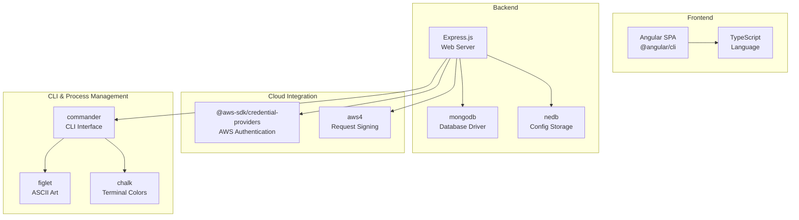
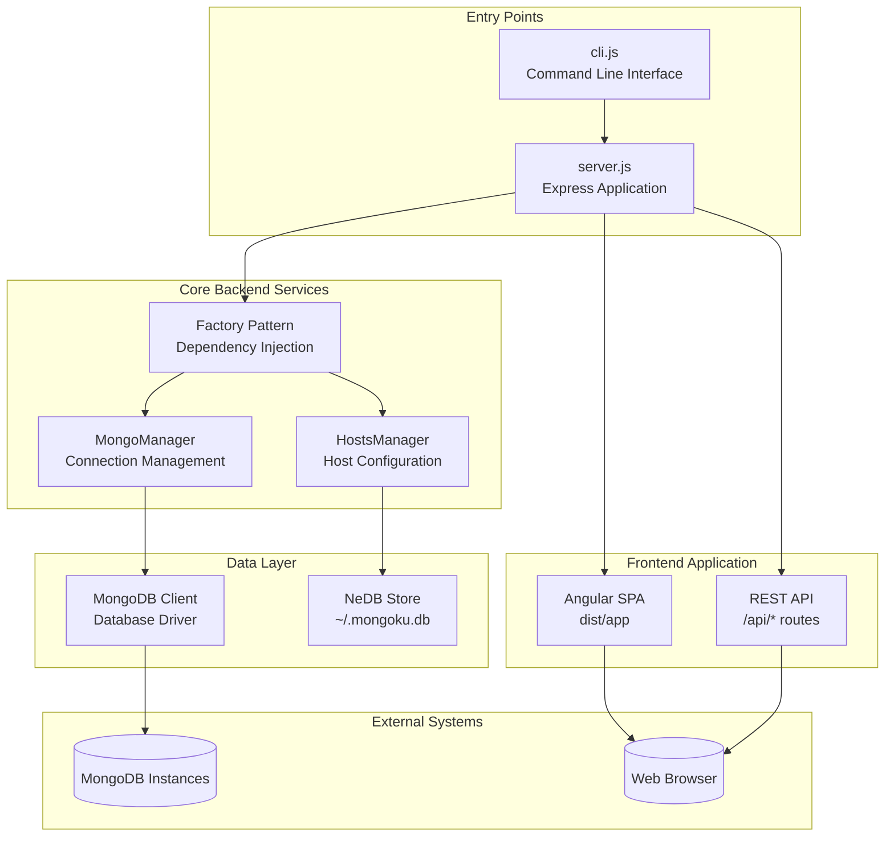
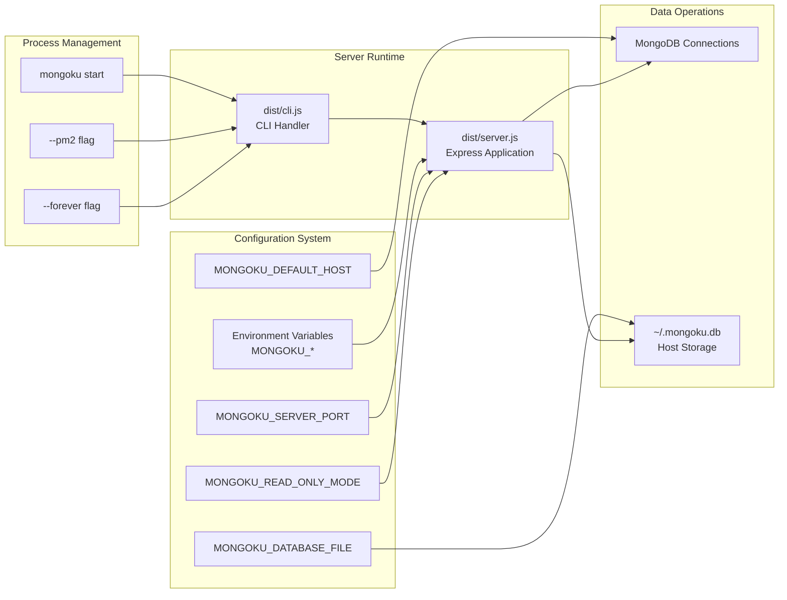

<!-- source: DeepWiki mcp.deepwiki.com · repo huggingface/Mongoku · page 1 Overview · fetched 2026-10-26 -->

# Overview

Relevant source files

The following files were used as context for generating this wiki page:

- [.dockerignore](.dockerignore)
- [README.md](README.md)
- [package.json](package.json)

## Purpose and Scope

This document provides a high-level introduction to Mongoku, explaining its purpose as a web-based MongoDB client, core features, and architectural foundations. It serves as an entry point for understanding the system before diving into specific implementation details.

For detailed installation and setup instructions, see [Getting Started](#2). For in-depth architectural documentation, see [Core Architecture](#3). For deployment-specific information, see [Deployment and Configuration](#6).

## What is Mongoku

Mongoku is a web-based MongoDB client application that enables users to query, explore, and manage MongoDB databases through a browser interface. Built as a full-stack TypeScript application, it provides a scalable solution for MongoDB administration that can handle large datasets efficiently.

The application consists of an Angular single-page application (SPA) frontend served by an Express.js backend, with specialized components for MongoDB connection management and data operations. It can be deployed locally, in containers, or as a hosted service for team collaboration.

Sources: [README.md:1-7](), [package.json:2-15]()

## Key Features and Capabilities

| Feature Category | Capabilities |
|-----------------|-------------|
| **Data Exploration** | Real-time querying, filtering, sorting, and document viewing |
| **Scalability** | Optimized for large datasets (1TB+ clusters) with fast sort/skip/limit operations |
| **Deployment Flexibility** | NPM package, Docker container, manual build, process manager support |
| **Security** | Read-only mode, AWS credential integration |
| **User Experience** | Interactive JSON viewer, theming support, responsive design |

The system supports multiple MongoDB connection types including local instances, remote servers, and AWS-hosted databases. It provides both direct execution and daemon modes using process managers like `PM2` and `Forever`.

Sources: [README.md:3-7](), [README.md:25-32](), [README.md:95-96]()

## Technology Stack

### Core Dependencies

**Core Technologies:**
- **Frontend**: Angular with TypeScript for the SPA interface
- **Backend**: Express.js server with TypeScript compilation
- **Database**: MongoDB driver v5.9.2 for database operations
- **Configuration**: NeDB for local host configuration storage
- **Cloud**: AWS SDK for credential management and request signing

Sources: [package.json:16-31]()

## High-Level System Architecture

### Application Structure

**Architecture Layers:**
- **Entry Layer**: CLI interface and Express server as main entry points
- **Service Layer**: Specialized managers for MongoDB connections and host configuration
- **Data Layer**: MongoDB driver for database operations and NeDB for local configuration
- **Presentation Layer**: Angular SPA for user interface and REST API for data access

Sources: [package.json:33](), [package.json:37-38](), [README.md:76]()

## Core Components Overview

### System Component Mapping

**Key Component Responsibilities:**

| Component | File Location | Purpose |
|-----------|---------------|---------|
| CLI Interface | `dist/cli.js` | Command-line entry point and process management |
| Express Server | `dist/server.js` | Web server and API endpoint hosting |
| Angular App | `dist/app/` | Frontend single-page application |
| Configuration | `~/.mongoku.db` | Persistent host configuration storage |

### Environment Configuration

The system supports several environment variables for runtime configuration:

- `MONGOKU_DEFAULT_HOST`: Default MongoDB connection strings
- `MONGOKU_SERVER_PORT`: Web server port (default: 3100)  
- `MONGOKU_DATABASE_FILE`: Host configuration file location
- `MONGOKU_COUNT_TIMEOUT`: Document count timeout in milliseconds
- `MONGOKU_READ_ONLY_MODE`: Security restriction flag

Sources: [README.md:81-97](), [package.json:37-42]()

## Deployment Architecture

Mongoku supports multiple deployment patterns:

1. **NPM Global Installation**: Direct installation via `npm install -g mongoku`
2. **Docker Container**: Pre-built image at `huggingface/mongoku`
3. **Manual Build**: Custom compilation of TypeScript and Angular components
4. **Process Management**: Integration with PM2 and Forever for daemon operation

The application runs on port 3100 by default and can be configured through environment variables for different deployment scenarios.

Sources: [README.md:15-32](), [README.md:34-55](), [README.md:57-77]()

---

