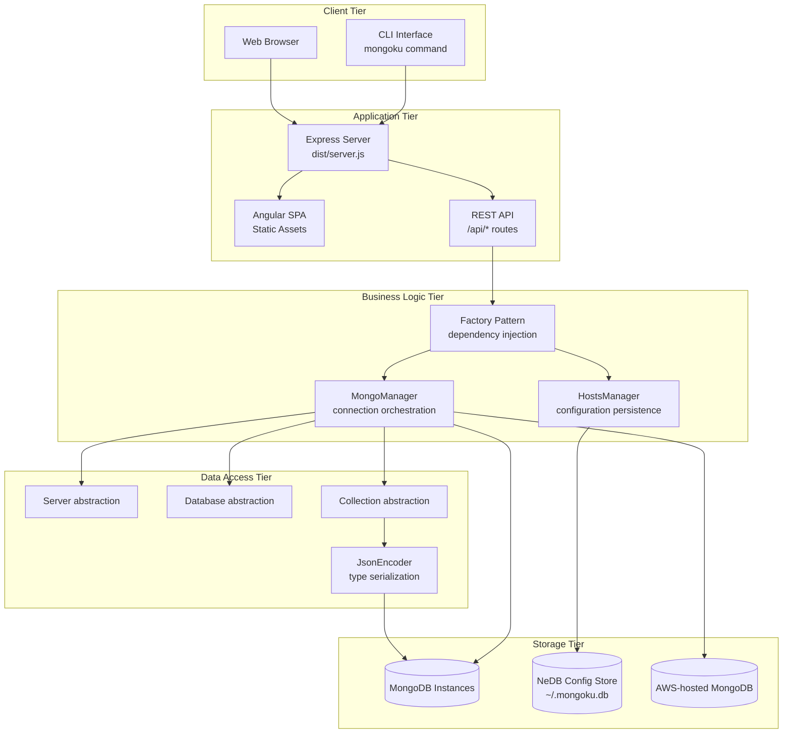
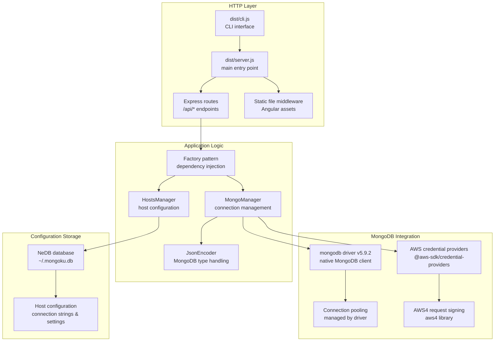
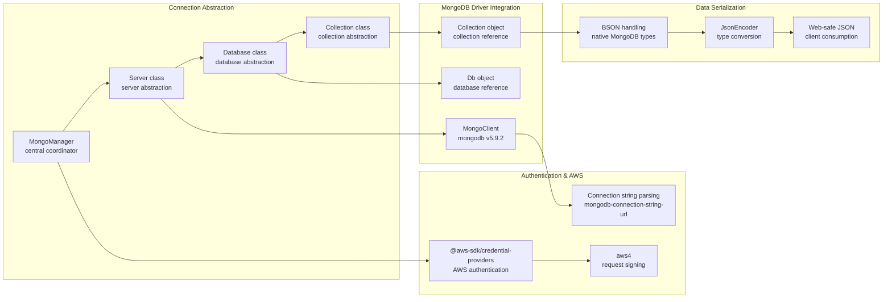
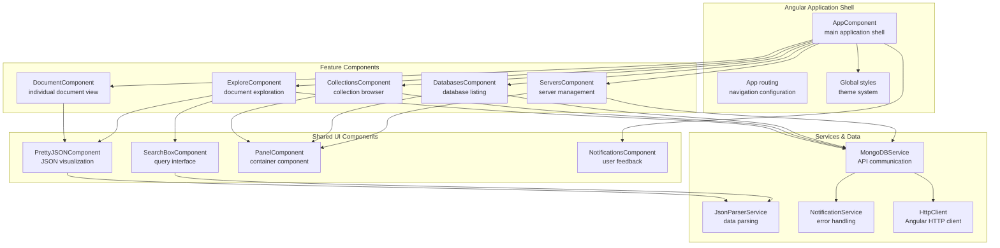
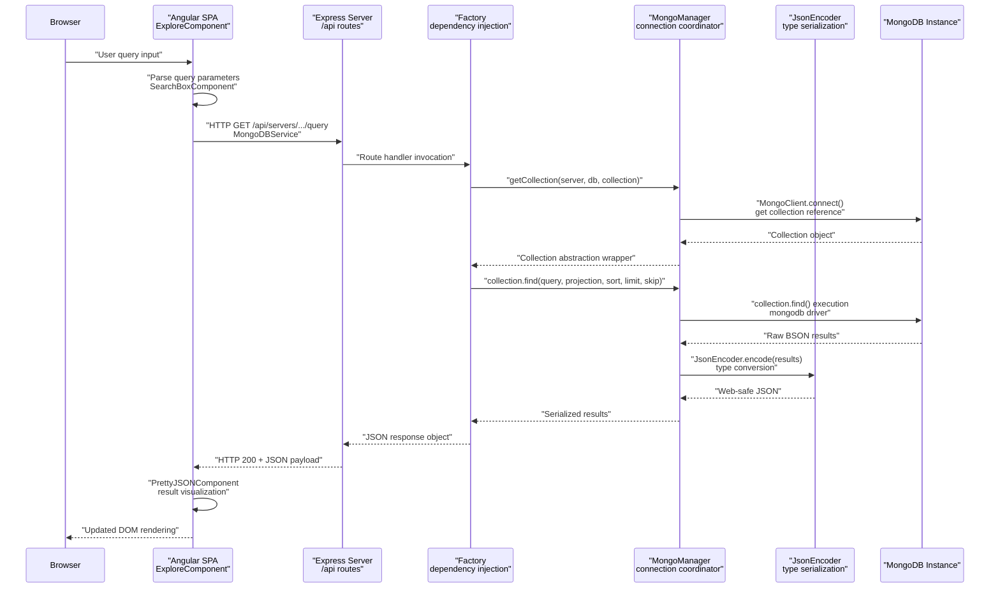
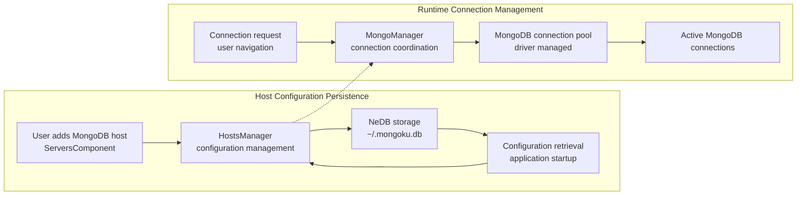
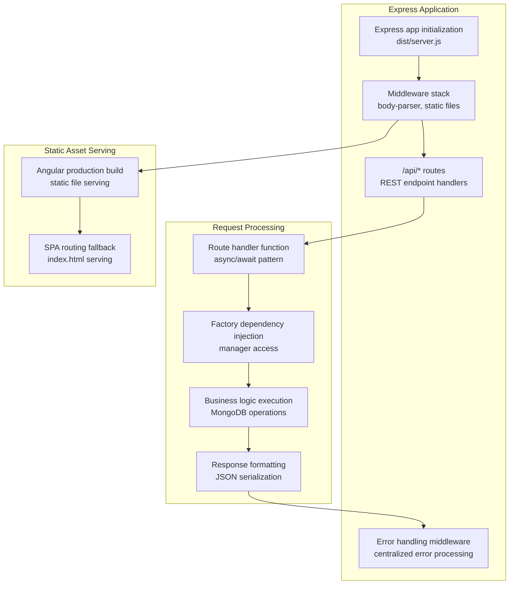

<!-- source: DeepWiki mcp.deepwiki.com · repo huggingface/Mongoku · page 3 Core Architecture · fetched 2026-10-26 -->

# Core Architecture

Relevant source files

The following files were used as context for generating this wiki page:

- [package-lock.json](package-lock.json)
- [package.json](package.json)

This document provides a detailed explanation of Mongoku's internal architecture and how the major systems work together to provide a web-based MongoDB administration interface. It covers the multi-tier system design, component relationships, and data flow patterns that enable users to connect to, explore, and manage MongoDB databases through a browser interface.

For information about installation and deployment methods, see [Deployment and Configuration](#6). For details about the REST API endpoints, see [API Layer](#3.3). For frontend component details, see [Frontend Application](#3.2).

## System Overview

Mongoku implements a classic three-tier web architecture with clear separation between presentation, application logic, and data access layers. The system is built as a Node.js application that serves both a static Angular frontend and dynamic REST API endpoints.

### High-Level System Architecture

Sources: [package.json:33-43](), [package.json:16-26]()

## Backend Architecture

The backend implements a layered architecture using Express.js as the web framework, with specialized managers handling MongoDB connections and host configuration persistence.

### Core Backend Components

Sources: [package.json:38](), [package.json:33](), [package.json:24](), [package.json:25](), [package.json:17-18]()

### MongoDB Connection Management

The system uses a sophisticated connection management strategy that abstracts MongoDB operations through manager classes while supporting various deployment scenarios including AWS-hosted instances.

Sources: [package.json:24](), [package.json:17](), [package.json:18]()

## Frontend Architecture

The frontend is implemented as an Angular Single Page Application (SPA) that communicates with the backend through REST API calls. The application provides a hierarchical navigation experience from servers to databases to collections to individual documents.

### Angular Application Structure

Sources: Based on Angular SPA architecture patterns described in system diagrams

## Data Flow Architecture

The system implements a request-response pattern where frontend components make HTTP requests to Express API endpoints, which coordinate with MongoDB through the manager layer and return processed results.

### Query Processing Pipeline

Sources: Based on Express routing patterns and MongoDB integration described in system architecture

### Configuration Management Flow

Sources: [package.json:25]() (NeDB dependency)

## Key Abstractions

The architecture relies on several key abstractions that provide clean separation of concerns and enable the system to handle various MongoDB deployment scenarios.

### Abstraction Layer Design

| Abstraction | Purpose | Key Responsibilities |
|-------------|---------|---------------------|
| `MongoManager` | Connection orchestration | MongoDB client lifecycle, connection pooling, credential management |
| `HostsManager` | Configuration persistence | Host connection strings, user preferences, NeDB operations |
| `Server` | MongoDB server representation | Server-level operations, database enumeration |
| `Database` | Database abstraction | Collection listing, database statistics |
| `Collection` | Collection operations | CRUD operations, query execution, index management |
| `JsonEncoder` | Type serialization | BSON to JSON conversion, web-safe serialization |

### Express.js Integration Pattern

Sources: [package.json:22]() (Express dependency), [package.json:19]() (body-parser dependency)

The architecture demonstrates a well-structured separation of concerns with clear boundaries between the web layer, business logic, and data access components. The use of factory patterns for dependency injection and abstraction layers for MongoDB operations provides flexibility for different deployment scenarios while maintaining clean, testable code organization.

---

