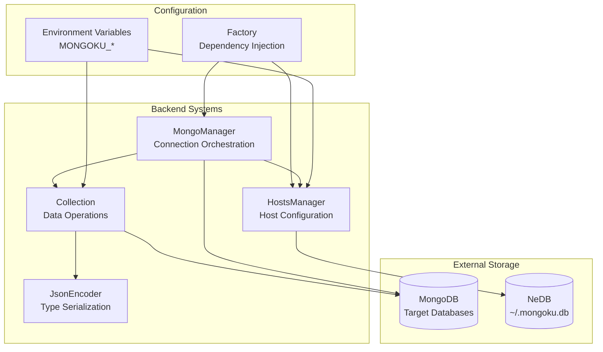
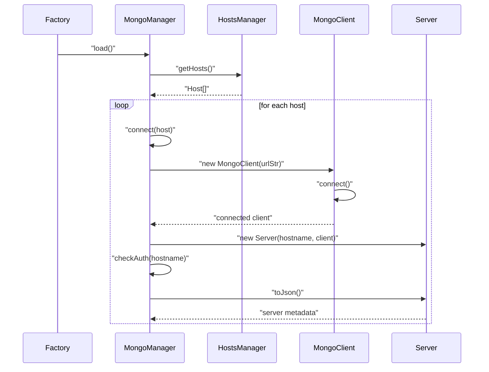
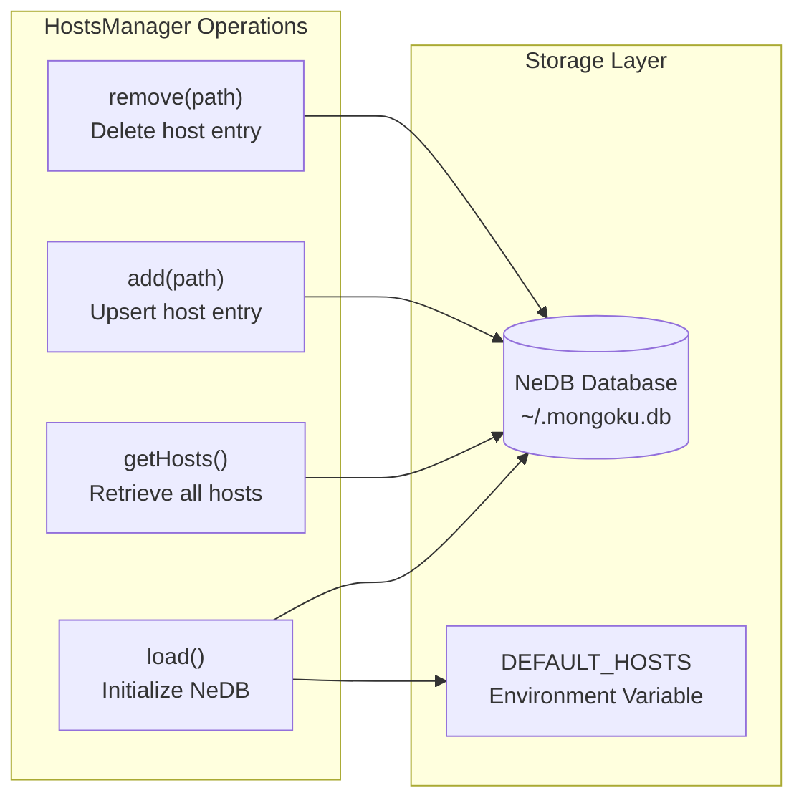
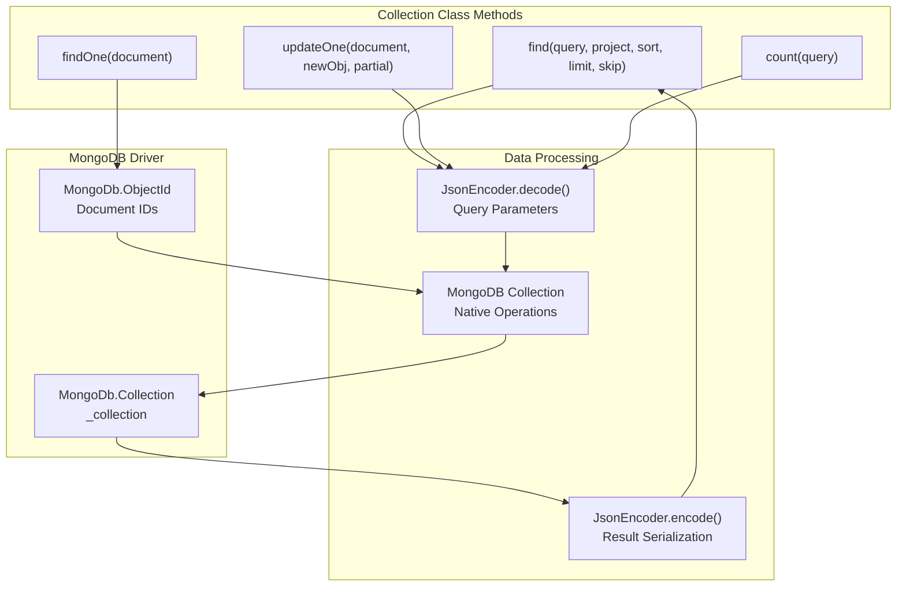
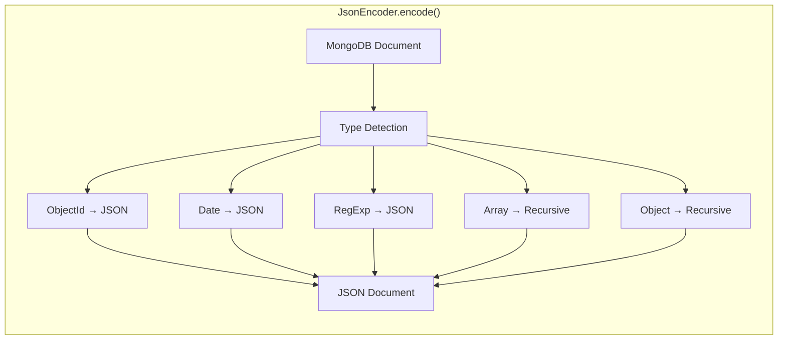
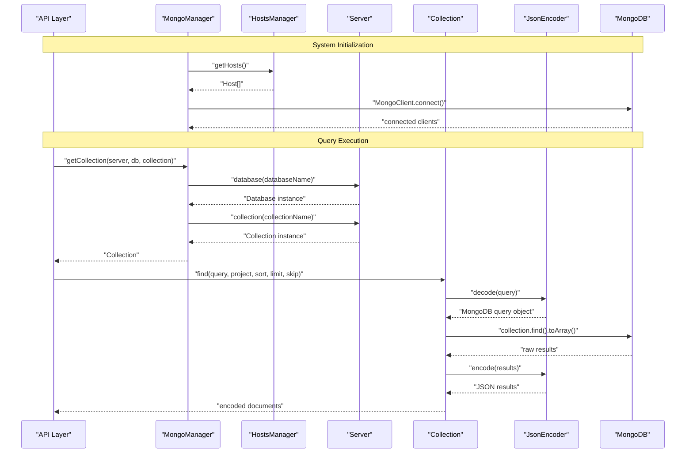

<!-- source: DeepWiki mcp.deepwiki.com · repo huggingface/Mongoku · page 3.1 Backend Systems · fetched 2026-10-26 -->

# Backend Systems

Relevant source files

The following files were used as context for generating this wiki page:

- [Dockerfile](Dockerfile)
- [lib/Collection.ts](lib/Collection.ts)
- [lib/HostsManager.ts](lib/HostsManager.ts)
- [lib/JsonEncoder.ts](lib/JsonEncoder.ts)
- [lib/MongoManager.ts](lib/MongoManager.ts)

This document covers the core backend components that manage MongoDB connections, host configuration, and data operations within Mongoku. These systems form the foundation that enables the web application to interact with MongoDB instances.

For information about the HTTP API endpoints that expose these systems to the frontend, see [API Layer](#3.3). For details about the Angular frontend that consumes these backend services, see [Frontend Application](#3.2).

## Core Backend Architecture

The backend systems are organized into four primary components that work together to provide MongoDB management capabilities:

Sources: [lib/MongoManager.ts:1-133](), [lib/HostsManager.ts:1-92](), [lib/Collection.ts:1-108](), [lib/JsonEncoder.ts:1-61]()

## Connection Management System

The `MongoManager` class serves as the central orchestrator for all MongoDB connections within Mongoku. It maintains a registry of server connections and handles connection lifecycle, authentication, and error states.

### Core Responsibilities

| Function | Method | Description |
|----------|--------|-------------|
| Connection Management | `connect()` | Establishes MongoDB client connections |
| Authentication | `checkAuth()` | Validates credentials and permissions |
| Server Registry | `getServer()` | Retrieves server instances by hostname |
| Data Access | `getCollection()` | Provides collection access through abstraction layers |

### Connection Flow

The `MongoManager` handles both successful connections and error states, storing `MongoError` instances alongside `Server` instances in its `_servers` registry [lib/MongoManager.ts:15-17]().

Sources: [lib/MongoManager.ts:14-133]()

## Host Configuration System

The `HostsManager` class manages the persistent storage of MongoDB host configurations using NeDB as a local database. It provides the configuration foundation that `MongoManager` uses to establish connections.

### Configuration Storage

The system uses several environment variables and default behaviors:

| Variable | Default | Purpose |
|----------|---------|---------|
| `MONGOKU_DEFAULT_HOST` | `localhost:27017` | Initial host configuration |
| `MONGOKU_DATABASE_FILE` | `~/.mongoku.db` | NeDB storage location |

### Host Management Operations

The initialization process [lib/HostsManager.ts:22-45]() checks for an existing database file and populates default hosts on first run using the `DEFAULT_HOSTS` array derived from `MONGOKU_DEFAULT_HOST`.

Sources: [lib/HostsManager.ts:1-92]()

## Data Operations Layer

The `Collection` class provides a high-level abstraction over MongoDB collection operations, handling query execution, document manipulation, and metadata retrieval.

### CRUD Operations

| Method | Parameters | Function |
|--------|------------|----------|
| `findOne()` | `document: string` | Retrieve single document by ObjectId |
| `find()` | `query, project, sort, limit, skip` | Execute queries with pagination |
| `updateOne()` | `document, newObj, partial` | Update or replace documents |
| `removeOne()` | `document: string` | Delete single document |
| `count()` | `query` | Count documents with timeout handling |

### Query Processing Architecture

The `count()` method implements intelligent timeout handling [lib/Collection.ts:68-76](), using `estimatedDocumentCount()` as a fallback when `countDocuments()` exceeds the timeout threshold defined by `MONGOKU_COUNT_TIMEOUT`.

Sources: [lib/Collection.ts:1-108]()

## Data Serialization System

The `JsonEncoder` class handles bidirectional conversion between MongoDB-specific data types and JSON-serializable formats for API communication.

### Type Mapping

| MongoDB Type | JSON Representation | Decode Method |
|--------------|-------------------|---------------|
| `ObjectId` | `{$type: 'ObjectId', $value: string, $date: number}` | `new ObjectId()` |
| `Date` | `{$type: 'Date', $value: string}` | `new Date()` |
| `RegExp` | `{$type: 'RegExp', $value: {$pattern, $flags}}` | `new RegExp()` |

### Encoding Process

The encoding process [lib/JsonEncoder.ts:4-37]() recursively traverses object structures, converting MongoDB types to a structured JSON format that preserves type information for accurate round-trip serialization.

Sources: [lib/JsonEncoder.ts:1-61]()

## System Integration Flow

The backend systems integrate through a coordinated data flow that spans from host configuration to query execution:

This integration ensures that MongoDB-specific types are properly handled throughout the request lifecycle while maintaining clean separation between connection management, data operations, and serialization concerns.

Sources: [lib/MongoManager.ts:122-131](), [lib/Collection.ts:38-48](), [lib/JsonEncoder.ts:4-37]()

---

