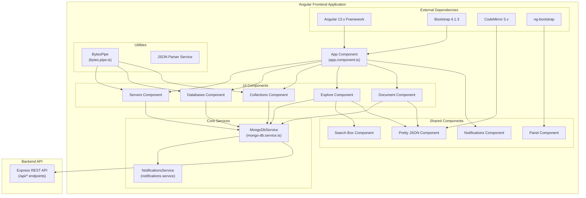
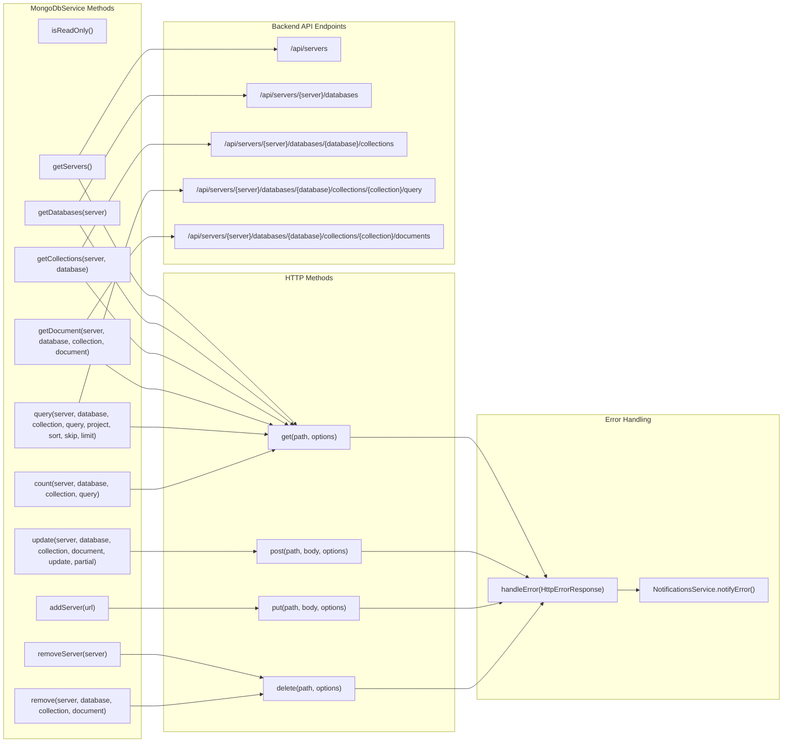
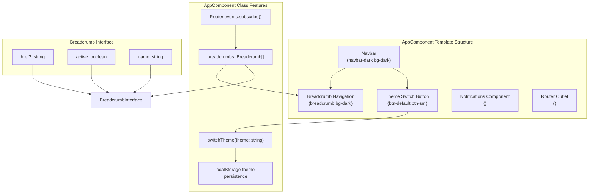
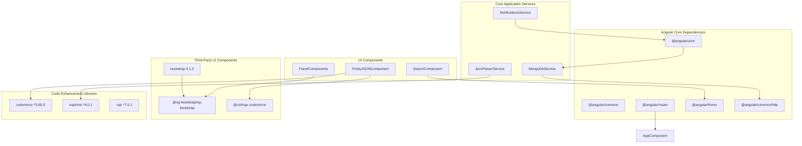

<!-- source: DeepWiki mcp.deepwiki.com · repo huggingface/Mongoku · page 3.2 Frontend Application · fetched 2026-10-26 -->

# Frontend Application

Relevant source files

The following files were used as context for generating this wiki page:

- [app/package-lock.json](app/package-lock.json)
- [app/package.json](app/package.json)
- [app/src/app/app.component.html](app/src/app/app.component.html)
- [app/src/app/app.component.ts](app/src/app/app.component.ts)
- [app/src/app/filters/bytes.pipe.ts](app/src/app/filters/bytes.pipe.ts)
- [app/src/app/services/mongo-db.service.ts](app/src/app/services/mongo-db.service.ts)

## Purpose and Scope

This document covers the Angular frontend application that provides the user interface for Mongoku's web-based MongoDB client. The frontend is a Single Page Application (SPA) that communicates with the backend via REST APIs to enable users to browse databases, explore collections, and view/edit MongoDB documents through an intuitive web interface.

For information about the backend systems that serve the frontend, see [Backend Systems](#3.1). For details about the specific API endpoints used by the frontend, see [API Layer](#3.3). For user-facing features and workflows, see [User Features](#4).

## Architecture Overview

The frontend application is built as an Angular 13 SPA that follows a modular component-based architecture. The application provides a responsive interface for MongoDB database management with real-time navigation, theming support, and comprehensive error handling.

**Sources:** [app/src/app/services/mongo-db.service.ts:1-129](), [app/src/app/app.component.ts:1-94](), [app/package.json:1-56]()

## Core Services

### MongoDbService

The `MongoDbService` is the primary service responsible for all communication between the frontend and backend API. It provides a typed interface for MongoDB operations and handles error management through integration with the notifications system.

The service implements a consistent error handling pattern where all HTTP operations are wrapped with RxJS `catchError` operators that route errors through the `handleError` method, which then displays user-friendly error messages via the `NotificationsService`.

**Sources:** [app/src/app/services/mongo-db.service.ts:14-128]()

### Type Definitions

The service imports and re-exports key type definitions from the backend:

- `ServerJSON`: Represents MongoDB server connection information
- `DatabaseJSON`: Contains database metadata and statistics  
- `CollectionJSON`: Holds collection metadata and document counts

**Sources:** [app/src/app/services/mongo-db.service.ts:6-12]()

## Main Application Shell

### AppComponent Structure

The `AppComponent` serves as the main application shell, providing navigation, breadcrumbs, theming, and layout structure for the entire application.

**Sources:** [app/src/app/app.component.html:1-25](), [app/src/app/app.component.ts:1-94]()

### Dynamic Breadcrumb Generation

The application implements intelligent breadcrumb navigation that automatically updates based on the current route. The breadcrumb system extracts parameters from the router state to build hierarchical navigation links:

| Route Level | Parameter | Breadcrumb Link |
|-------------|-----------|-----------------|
| Server | `params.server` | `/servers/{server}/databases` |
| Database | `params.database` | `/servers/{server}/databases/{database}/collections` |
| Collection | `params.collection` | `/servers/{server}/databases/{database}/collections/{collection}` |
| Document | `params.document` | Non-clickable final breadcrumb |

**Sources:** [app/src/app/app.component.ts:28-76]()

### Theme Management

The application supports light and dark themes with persistent user preference storage:

- Theme state stored in `localStorage` with key `"theme"`
- Theme classes applied to `document.body`: `"theme-light"` for light mode
- Default theme is dark (no additional class applied)
- Theme toggle button dynamically shows opposite theme name

**Sources:** [app/src/app/app.component.ts:20-25](), [app/src/app/app.component.ts:78-92]()

## Component Architecture Pattern

### Angular Framework Integration

The frontend leverages Angular 13's component-based architecture with the following key patterns:

**Sources:** [app/package.json:14-34]()

### Utility Components

#### BytesPipe

The `BytesPipe` provides user-friendly formatting of byte values into appropriate units (B, KB, MB, GB, TB, PB). It uses a simple algorithm that divides by 1024 until the value is less than 1024, then formats to 2 decimal places.

**Sources:** [app/src/app/filters/bytes.pipe.ts:1-26]()

## Technology Stack

### Core Framework Dependencies

| Category | Package | Version | Purpose |
|----------|---------|---------|---------|
| Framework | `@angular/core` | ^13.1.1 | Core Angular framework |
| HTTP Client | `@angular/common` | ^13.1.1 | HTTP client and common utilities |
| Routing | `@angular/router` | ^13.1.1 | Client-side routing |
| Forms | `@angular/forms` | ^13.1.1 | Reactive and template forms |
| Reactive Programming | `rxjs` | ^7.5.1 | Observables and reactive operators |

### UI and Styling Dependencies  

| Category | Package | Version | Purpose |
|----------|---------|---------|---------|
| CSS Framework | `bootstrap` | 4.1.3 | Responsive grid and components |
| Angular Bootstrap | `@ng-bootstrap/ng-bootstrap` | ^11.0.0 | Angular Bootstrap components |
| Code Editor | `codemirror` | ^5.65.0 | Code syntax highlighting |
| CodeMirror Angular | `@ctrl/ngx-codemirror` | ^5.1.1 | Angular CodeMirror wrapper |
| Sass Processing | `node-sass` | ^7.0.1 | Sass to CSS compilation |

### Development and Build Dependencies

| Category | Package | Version | Purpose |
|----------|---------|---------|---------|
| Build Tools | `@angular/cli` | ^13.1.2 | Angular CLI build system |
| Build Angular | `@angular-devkit/build-angular` | ^13.1.2 | Angular build optimizations |
| TypeScript | `typescript` | ^4.5.4 | TypeScript compiler |
| Testing | `jasmine-core` | ^4.0.0 | Unit testing framework |
| Testing | `karma` | ^6.3.10 | Test runner |

**Sources:** [app/package.json:14-54]()

### Build and Development Scripts

The application defines standard Angular CLI commands for development workflow:

- `ng serve`: Development server with hot reload
- `ng build --configuration production`: Production build with optimizations
- `ng test`: Unit test execution
- `ng lint`: Code quality linting
- `ng e2e`: End-to-end testing

**Sources:** [app/package.json:5-12]()

---

