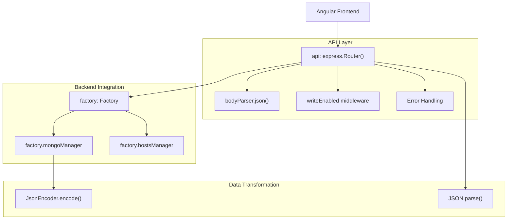
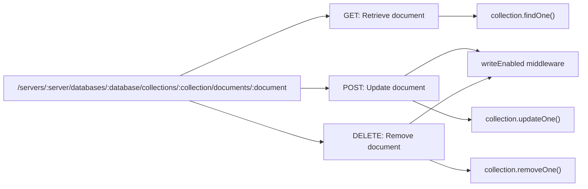
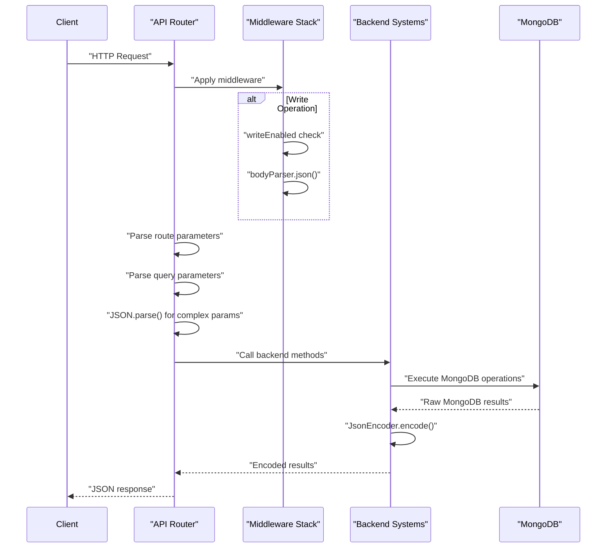
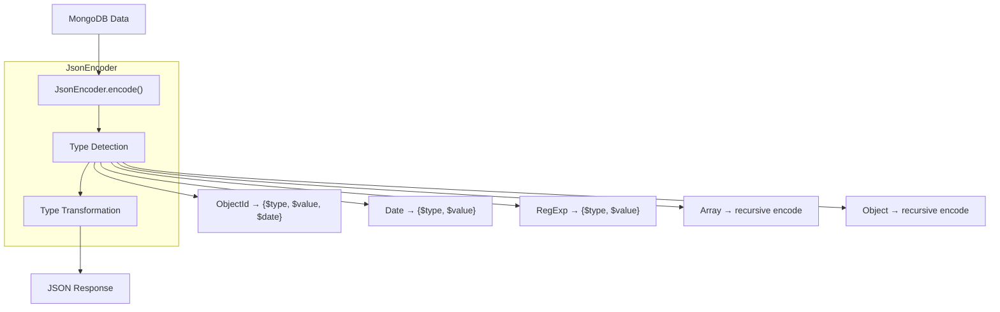

<!-- source: DeepWiki mcp.deepwiki.com · repo huggingface/Mongoku · page 3.3 API Layer · fetched 2026-10-26 -->

# API Layer

<details>
<summary>Relevant source files</summary>

The following files were used as context for generating this wiki page:

- [Dockerfile](Dockerfile)
- [lib/JsonEncoder.ts](lib/JsonEncoder.ts)
- [routes/api.ts](routes/api.ts)

</details>


## Purpose and Scope

The API Layer serves as the bridge between Mongoku's Angular frontend and the backend MongoDB management systems. It provides a RESTful HTTP interface that exposes MongoDB operations through standardized endpoints, handling request parsing, response formatting, and error management. This layer is implemented as an Express.js router that coordinates with the backend systems to perform database operations.

For information about the backend systems that the API Layer interacts with, see [Backend Systems](#3.1). For details about how the frontend consumes these APIs, see [Frontend Application](#3.2).

## API Architecture Overview

The API Layer is structured as a single Express router that handles all API endpoints under the `/api` path prefix. It integrates with the backend through a factory pattern and provides consistent JSON responses across all operations.



Sources: [routes/api.ts:1-8](), [routes/api.ts:4-5]()

## Endpoint Structure

The API follows a hierarchical REST structure that mirrors MongoDB's organizational hierarchy: servers → databases → collections → documents.

```mermaid
graph TD
    API["/api"]
    
    ReadOnly["/readonly"]
    Servers["/servers"]
    ServerParam["/servers/:server"]
    
    Databases["/servers/:server/databases"]
    Collections["/servers/:server/databases/:database/collections"]
    Documents["/servers/:server/databases/:database/collections/:collection/documents/:document"]
    Query["/servers/:server/databases/:database/collections/:collection/query"]
    Count["/servers/:server/databases/:database/collections/:collection/count"]
    
    API --> ReadOnly
    API --> Servers
    API --> ServerParam
    API --> Databases
    API --> Collections
    API --> Documents
    API --> Query
    API --> Count
    
    ReadOnly --> ReadOnlyOp["GET: Check read-only mode"]
    Servers --> ServersGet["GET: List servers"]
    Servers --> ServersPut["PUT: Add server"]
    ServerParam --> ServersDelete["DELETE: Remove server"]
    Databases --> DatabasesGet["GET: List databases"]
    Collections --> CollectionsGet["GET: List collections"]
    Documents --> DocumentsGet["GET: Get document"]
    Documents --> DocumentsPost["POST: Update document"]
    Documents --> DocumentsDelete["DELETE: Remove document"]
    Query --> QueryGet["GET: Query collection"]
    Count --> CountGet["GET: Count documents"]
```



Sources: [routes/api.ts:10-225]()

## Core Endpoint Categories

### System Management Endpoints

| Endpoint | Method | Purpose | Middleware |
|----------|---------|---------|------------|
| `/readonly` | GET | Check if system is in read-only mode | None |
| `/servers` | GET | List all configured MongoDB servers | None |
| `/servers` | PUT | Add a new MongoDB server | `bodyParser.json()` |
| `/servers/:server` | DELETE | Remove a MongoDB server | None |

The system management endpoints handle server configuration and system status. The read-only endpoint specifically checks the `MONGOKU_READ_ONLY_MODE` environment variable.

Sources: [routes/api.ts:10-47]()

### Database Navigation Endpoints

| Endpoint | Method | Purpose |
|----------|---------|---------|
| `/servers/:server/databases` | GET | List databases on a server |
| `/servers/:server/databases/:database/collections` | GET | List collections in a database |

These endpoints provide the hierarchical navigation structure for MongoDB instances, allowing the frontend to build the database tree view.

Sources: [routes/api.ts:49-70]()

### Document Operations Endpoints

The document operations endpoints provide full CRUD functionality for individual MongoDB documents:



Sources: [routes/api.ts:72-141]()

### Query and Aggregation Endpoints

| Endpoint | Method | Purpose | Query Parameters |
|----------|---------|---------|------------------|
| `/servers/:server/databases/:database/collections/:collection/query` | GET | Query collection with filters | `q`, `sort`, `project`, `limit`, `skip` |
| `/servers/:server/databases/:database/collections/:collection/count` | GET | Count documents matching query | `q` |

The query endpoint supports complex MongoDB query operations with full parameter parsing and validation.

Sources: [routes/api.ts:143-225]()

## Request Processing Pipeline

The API Layer implements a sophisticated request processing pipeline that handles parameter validation, JSON parsing, and MongoDB-specific type conversion:



Sources: [routes/api.ts:148-194](), [lib/JsonEncoder.ts:4-37]()

## Data Transformation Layer

The API Layer uses the `JsonEncoder` class to handle MongoDB-specific data types that cannot be directly serialized to JSON:

### Supported Type Transformations

| MongoDB Type | JSON Representation | Encoding Logic |
|-------------|---------------------|----------------|
| `ObjectId` | `{$type: 'ObjectId', $value: string, $date: number}` | Converts to hex string with timestamp |
| `Date` | `{$type: 'Date', $value: string}` | Converts to ISO string |
| `RegExp` | `{$type: 'RegExp', $value: {$pattern: string, $flags: string}}` | Preserves pattern and flags |



Sources: [lib/JsonEncoder.ts:4-37]()

## Error Handling and Response Format

The API Layer implements consistent error handling through Express's built-in error handling mechanism. All endpoints follow a standard response format:

### Success Response Format
```json
{
  "ok": true,
  "data": "endpoint-specific data"
}
```

### Error Handling Pattern
All endpoints use a consistent error handling pattern where errors are passed to the Express error handler using `next(err)`. This ensures consistent error formatting across all API endpoints.

Sources: [routes/api.ts:27-29](), [routes/api.ts:55-57](), [routes/api.ts:93-95]()

## Read-Only Mode Support

The API Layer implements read-only mode through the `writeEnabled` middleware, which is applied to all write operations (POST, PUT, DELETE). This middleware checks the `MONGOKU_READ_ONLY_MODE` environment variable to prevent write operations when the system is configured in read-only mode.

### Write-Protected Endpoints
- `POST /servers/:server/databases/:database/collections/:collection/documents/:document`
- `DELETE /servers/:server/databases/:database/collections/:collection/documents/:document`

Sources: [routes/api.ts:5](), [routes/api.ts:98](), [routes/api.ts:121](), [routes/api.ts:10-15]()

## Query Parameter Processing

The API Layer implements sophisticated query parameter processing for the query endpoint, handling JSON parsing and validation for complex MongoDB queries:

| Parameter | Type | Default | Processing |
|-----------|------|---------|------------|
| `q` | JSON string/object | `{}` | Parsed as MongoDB query |
| `sort` | JSON string/object | `{}` | Parsed as MongoDB sort specification |
| `project` | JSON string/object | `""` | Parsed as MongoDB projection |
| `limit` | Number | `20` | Parsed as integer with validation |
| `skip` | Number | `0` | Parsed as integer with validation |

Sources: [routes/api.ts:148-177](), [routes/api.ts:201-208]()

---

