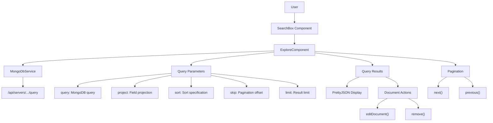
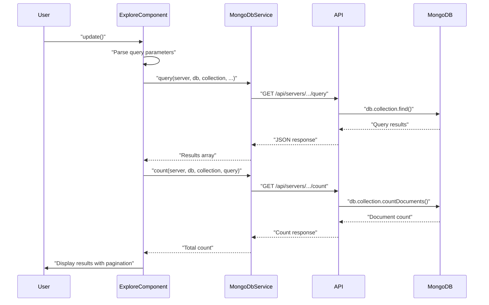
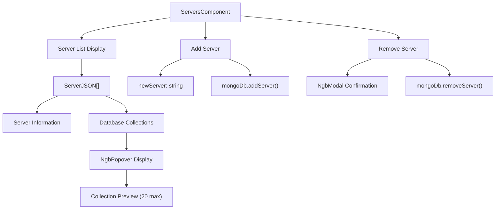

<!-- source: DeepWiki mcp.deepwiki.com · repo huggingface/Mongoku · page 4 User Features · fetched 2026-10-26 -->

# User Features

Relevant source files

The following files were used as context for generating this wiki page:

- [app/src/app/pages/explore/explore.component.ts](app/src/app/pages/explore/explore.component.ts)
- [app/src/app/pages/servers/servers.component.ts](app/src/app/pages/servers/servers.component.ts)

This document provides a comprehensive guide to the main features available to users for interacting with MongoDB data through Mongoku's web interface. It covers the core functionality that end users interact with, including data exploration, server management, and document operations.

For technical details about the underlying systems that power these features, see [Core Architecture](#3). For information about UI components and interface design, see [User Interface](#5).

## Overview

Mongoku provides a rich web-based interface for MongoDB database management and exploration. The main user-facing features are organized around several key workflows:

| Feature Category | Primary Component | Key Capabilities |
|------------------|-------------------|------------------|
| Data Exploration | `ExploreComponent` | Query documents, filter results, pagination |
| Server Management | `ServersComponent` | Add/remove MongoDB connections |
| Document Operations | `ExploreComponent` | View, edit, delete individual documents |
| Database Navigation | Various components | Browse databases and collections |

The application supports both read-only and read-write modes, with the read-only mode controlled by the `readOnly` property throughout the system [app/src/app/pages/explore/explore.component.ts:21]().

## Data Exploration Workflow

The core data exploration feature allows users to query and browse MongoDB collections through a sophisticated interface built around the `ExploreComponent`.

### Query Processing

The exploration workflow begins when users specify search parameters through the interface. The `ExploreComponent` processes these parameters and constructs MongoDB queries:

- **Query Construction**: The component accepts query parameters from the URL and transforms them into MongoDB queries [app/src/app/pages/explore/explore.component.ts:74-76]()
- **JSON Parsing**: Raw query strings are parsed using `JsonParserService` to ensure valid MongoDB query syntax [app/src/app/pages/explore/explore.component.ts:83-89]()
- **Parameter Validation**: The system validates that required parameters like `query` and `sort` are present before executing [app/src/app/pages/explore/explore.component.ts:90]()

### Query Execution

The query execution process involves multiple API calls to retrieve both data and metadata:

The component executes two parallel operations:
1. **Data Retrieval**: Fetches the actual documents matching the query [app/src/app/pages/explore/explore.component.ts:108-115]()
2. **Count Retrieval**: Gets the total count of matching documents for pagination [app/src/app/pages/explore/explore.component.ts:118-126]()

### Pagination System

Mongoku implements a comprehensive pagination system that allows users to navigate through large result sets:

- **Navigation Logic**: The `hasNext` and `hasPrevious` computed properties determine pagination button states [app/src/app/pages/explore/explore.component.ts:173-183]()
- **Page Navigation**: The `next()` and `previous()` methods update the `skip` parameter and trigger new queries [app/src/app/pages/explore/explore.component.ts:177-188]()
- **State Management**: The component tracks current position and total count to provide accurate pagination information [app/src/app/pages/explore/explore.component.ts:28-31]()

Sources: [app/src/app/pages/explore/explore.component.ts:1-191]()

## Document Operations

Mongoku provides comprehensive document manipulation capabilities when not in read-only mode. These operations are implemented directly within the `ExploreComponent`.

### Document Editing

The document editing feature allows users to modify documents in-place:

- **Inline Editing**: Documents can be edited directly in the results view through the `editDocument` method [app/src/app/pages/explore/explore.component.ts:138-160]()
- **ObjectId Protection**: The system prevents changes to document `_id` fields to maintain data integrity [app/src/app/pages/explore/explore.component.ts:142-145]()
- **Partial Updates**: The system supports partial updates when projection is used, updating only the visible fields [app/src/app/pages/explore/explore.component.ts:139]()

### Document Deletion

Document removal is handled through the `remove` method:

- **Safe Deletion**: The system extracts the ObjectId value safely before deletion [app/src/app/pages/explore/explore.component.ts:162-164]()
- **UI Updates**: After successful deletion, the document is removed from the local results array [app/src/app/pages/explore/explore.component.ts:168-170]()
- **Error Handling**: Failed operations are handled gracefully without affecting the UI state

### Document Navigation

Users can navigate to detailed document views:

- **Document Routing**: The `go` method navigates to individual document pages using Angular routing [app/src/app/pages/explore/explore.component.ts:129-136]()
- **URL Structure**: Document URLs follow the pattern `/servers/{server}/databases/{database}/collections/{collection}/documents/{documentId}`

Sources: [app/src/app/pages/explore/explore.component.ts:129-171]()

## Server Management

The server management functionality is implemented through the `ServersComponent`, which provides the primary interface for managing MongoDB server connections.

### Server Connection Management

The server management system provides several key capabilities:

- **Server Listing**: The `refresh()` method loads all configured servers from the backend [app/src/app/pages/servers/servers.component.ts:22-31]()
- **Connection Status**: Each server entry includes connection status and database information
- **Real-time Updates**: The interface automatically refreshes after server addition or removal operations

### Adding New Servers

The server addition process is streamlined through a simple interface:

- **Input Validation**: Users enter connection strings through the `newServer` string property [app/src/app/pages/servers/servers.component.ts:14]()
- **API Integration**: The `addServer()` method calls the backend API to establish new connections [app/src/app/pages/servers/servers.component.ts:45-54]()
- **State Management**: Successful additions reset the input form and refresh the server list

### Server Removal

Server removal includes safety mechanisms to prevent accidental deletions:

- **Modal Confirmation**: The `removeServer()` method requires user confirmation through `NgbModal` [app/src/app/pages/servers/servers.component.ts:56-69]()
- **Clean Removal**: Confirmed deletions call the backend API and refresh the interface
- **Error Handling**: Failed removal attempts are handled gracefully without affecting the UI

### Database and Collection Preview

The servers interface provides quick access to database structure information:

- **Collection Popover**: The `toggle()` method displays collection lists in popup windows [app/src/app/pages/servers/servers.component.ts:33-43]()
- **Collection Limiting**: Large collection lists are truncated to 20 items with a count of remaining items [app/src/app/pages/servers/servers.component.ts:37-41]()
- **Interactive Display**: Users can toggle collection visibility without navigating away from the main servers page

Sources: [app/src/app/pages/servers/servers.component.ts:1-70]()

## Read-Only Mode Support

Mongoku includes comprehensive read-only mode support that restricts destructive operations while preserving data exploration capabilities.

### Mode Detection

The read-only mode is detected and enforced at the component level:

- **Service Integration**: Components query the `MongoDbService.isReadOnly()` method to determine current mode [app/src/app/pages/explore/explore.component.ts:43-45]()
- **State Tracking**: The `readOnly` boolean property controls the availability of edit and delete operations [app/src/app/pages/explore/explore.component.ts:21]()
- **Dynamic Updates**: Mode changes are reflected immediately in the user interface

### Feature Restrictions

When read-only mode is active, the following restrictions apply:

| Operation | Read-Only Behavior | Implementation |
|-----------|-------------------|----------------|
| Document Editing | Disabled | `editDocument()` method checks disabled |
| Document Deletion | Disabled | `remove()` method unavailable |
| Server Addition | Disabled | Add server interface hidden |
| Server Removal | Disabled | Remove server options hidden |
| Data Querying | Enabled | Full query capabilities available |
| Data Viewing | Enabled | All display features functional |

### Security Considerations

The read-only mode provides an additional layer of security for production environments:

- **Backend Enforcement**: Read-only restrictions are enforced at both frontend and backend levels
- **User Communication**: The interface clearly indicates when read-only mode is active
- **Graceful Degradation**: All non-destructive features remain fully functional

Sources: [app/src/app/pages/explore/explore.component.ts:21,43-45]()

---

