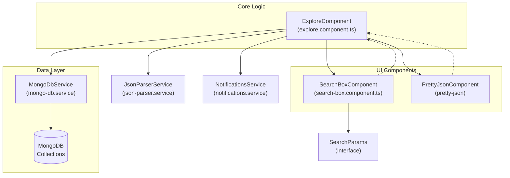
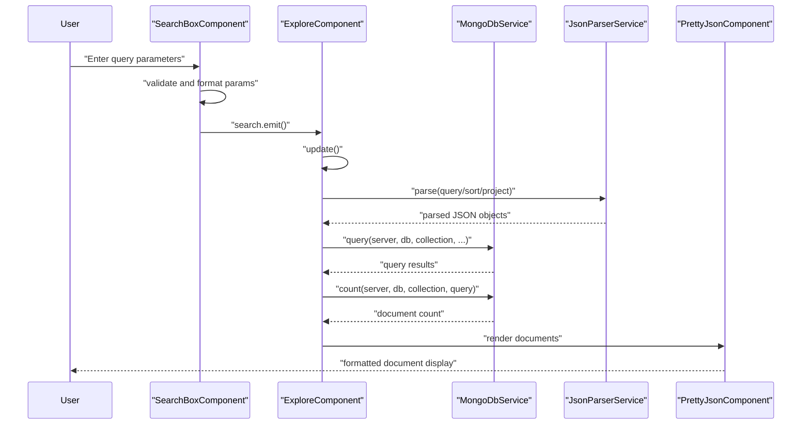
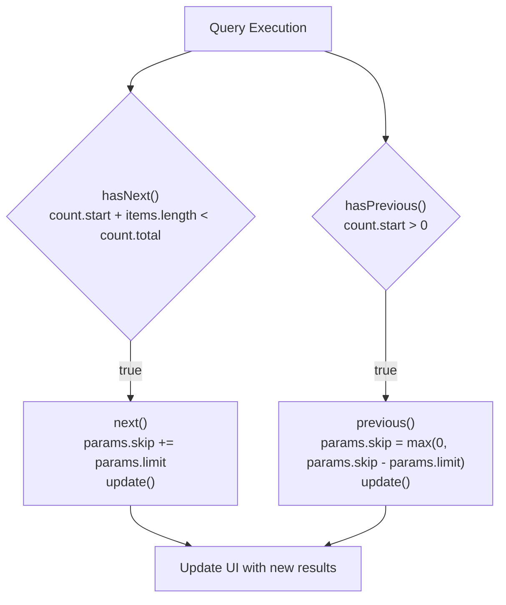

<!-- source: DeepWiki mcp.deepwiki.com · repo huggingface/Mongoku · page 4.1 Data Exploration · fetched 2026-10-26 -->

# Data Exploration

<details>
<summary>Relevant source files</summary>

The following files were used as context for generating this wiki page:

- [app/src/app/components/search-box/search-box.component.html](app/src/app/components/search-box/search-box.component.html)
- [app/src/app/components/search-box/search-box.component.ts](app/src/app/components/search-box/search-box.component.ts)
- [app/src/app/pages/explore/explore.component.html](app/src/app/pages/explore/explore.component.html)
- [app/src/app/pages/explore/explore.component.ts](app/src/app/pages/explore/explore.component.ts)

</details>


This document covers Mongoku's data exploration interface, which provides users with comprehensive tools for querying, viewing, and interacting with MongoDB documents. The exploration system combines a flexible query interface with rich document visualization and basic CRUD operations.

For information about server connection management, see [Server Management](#4.2). For details about the visual components and theming, see [Key Components](#5.1).

## Core Architecture

The data exploration system is built around two primary Angular components that work together to provide a seamless document browsing experience.

### Component Structure



**Sources:** [app/src/app/pages/explore/explore.component.ts:1-191](), [app/src/app/components/search-box/search-box.component.ts:1-84]()

The `ExploreComponent` serves as the main orchestrator, managing query execution, pagination, and document operations. It coordinates with the `SearchBoxComponent` for query input and `PrettyJsonComponent` for document display.

### Key Properties and State Management

| Property | Type | Purpose |
|----------|------|---------|
| `server`, `database`, `collection` | `string` | Current navigation context |
| `readOnly` | `boolean` | Controls edit/delete capabilities |
| `params` | `Partial<SearchParams>` | Current query parameters |
| `loading` | `{content: boolean, count: boolean}` | Loading states for UI |
| `count` | `{total: number, start: number}` | Pagination metadata |
| `items` | `Array` | Current document results |

**Sources:** [app/src/app/pages/explore/explore.component.ts:17-32]()

## Query Interface

The search interface provides MongoDB-native query capabilities through the `SearchBoxComponent`, supporting all standard MongoDB query operators and options.

### SearchParams Interface

```typescript
interface SearchParams {
  query:   string;    // MongoDB query document
  sort:    string;    // Sort specification
  project: string;    // Field projection
  limit:   number;    // Result limit
  skip:    number;    // Pagination offset
}
```

**Sources:** [app/src/app/components/search-box/search-box.component.ts:3-9]()

### Query Parameter Management

The search box provides a dynamic interface where users can toggle query parameters on and off. Default values are maintained for consistency:

| Parameter | Default Value | Purpose |
|-----------|---------------|---------|
| `query` | `"{}"` | MongoDB find query |
| `project` | `"{}"` | Field projection |
| `limit` | `20` | Documents per page |
| `skip` | `0` | Pagination offset |
| `sort` | `""` | Sort specification |

**Sources:** [app/src/app/components/search-box/search-box.component.ts:21-27]()

The interface allows users to add/remove parameters dynamically through the dropdown menu and close buttons, ensuring a clean UI that only shows relevant fields.

## Document Display and Interaction

### Document Rendering Pipeline



**Sources:** [app/src/app/pages/explore/explore.component.ts:80-127](), [app/src/app/components/search-box/search-box.component.ts:70-76]()

### Document Operations

The exploration interface supports several document operations when not in read-only mode:

#### Document Editing
The `editDocument` method handles in-place document updates with validation for ObjectId changes:

```typescript
editDocument(_id, json) {
  const partial = this.params.project && Object.keys(this.jsonParser.parse(this.params.project)).length > 0;
  const newId = json && json._id && json._id.$value;
  const oldId = _id && _id.$value;
  // ObjectId change validation and update logic
}
```

**Sources:** [app/src/app/pages/explore/explore.component.ts:138-160]()

#### Document Removal
Document deletion is handled through the `remove` method, which removes documents by ObjectId and updates the local items array:

**Sources:** [app/src/app/pages/explore/explore.component.ts:162-171]()

#### Navigation to Document Detail
Users can navigate to detailed document views through the `go` method, which constructs the appropriate route:

**Sources:** [app/src/app/pages/explore/explore.component.ts:129-136]()

## Pagination System

The pagination system provides efficient navigation through large result sets using MongoDB's native `skip` and `limit` operations.

### Pagination Logic



**Sources:** [app/src/app/pages/explore/explore.component.ts:173-189]()

The pagination state is displayed in the UI showing current range and total document count:
```html
<span>{{ count.start + 1 | number }} - {{ count.start + items.length | number }} of </span>{{ count.total | number }} Documents
```

**Sources:** [app/src/app/pages/explore/explore.component.html:7]()

## URL State Management

The exploration interface maintains query state in the URL, allowing for bookmarkable queries and browser navigation. The component subscribes to both route parameters and query parameters:

```typescript
combineLatest(
  this.activatedRoute.paramMap,
  this.activatedRoute.queryParamMap
).subscribe(([params, queryParams]) => {
  // Extract server, database, collection from route
  // Extract query parameters from URL
});
```

**Sources:** [app/src/app/pages/explore/explore.component.ts:46-77]()

Query parameters are automatically updated in the URL when the `update` method is called, ensuring the current query state is preserved:

**Sources:** [app/src/app/pages/explore/explore.component.ts:92-97]()

## Error Handling and User Feedback

The exploration system integrates with Mongoku's notification system to provide user feedback for operations:

- **Query Errors**: Invalid JSON in query parameters
- **Update Errors**: ObjectId modification attempts, validation failures
- **Connection Errors**: MongoDB connection issues

**Sources:** [app/src/app/pages/explore/explore.component.ts:143-144](), [app/src/app/pages/explore/explore.component.ts:157]()

The interface also handles loading states to provide visual feedback during query execution, with separate loading indicators for document content and count operations.

**Sources:** [app/src/app/pages/explore/explore.component.ts:23-26](), [app/src/app/pages/explore/explore.component.html:19-23]()

---

