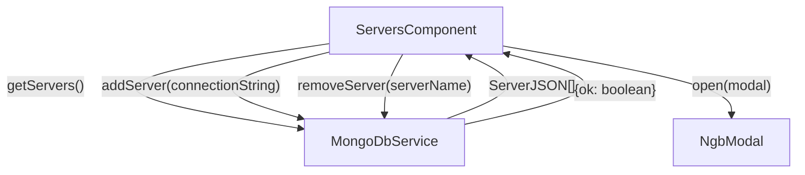
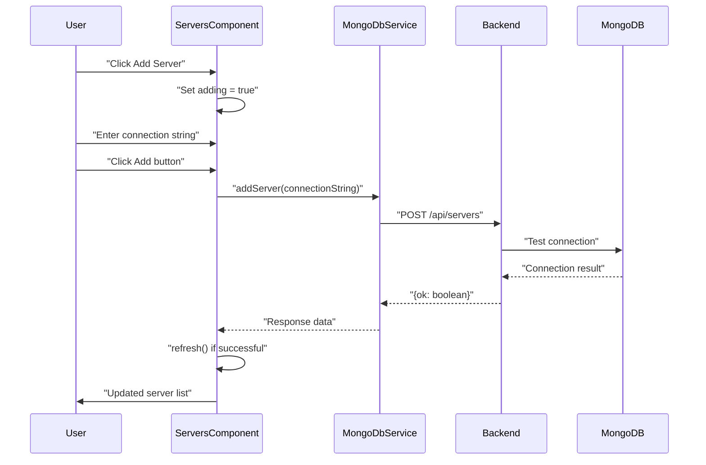
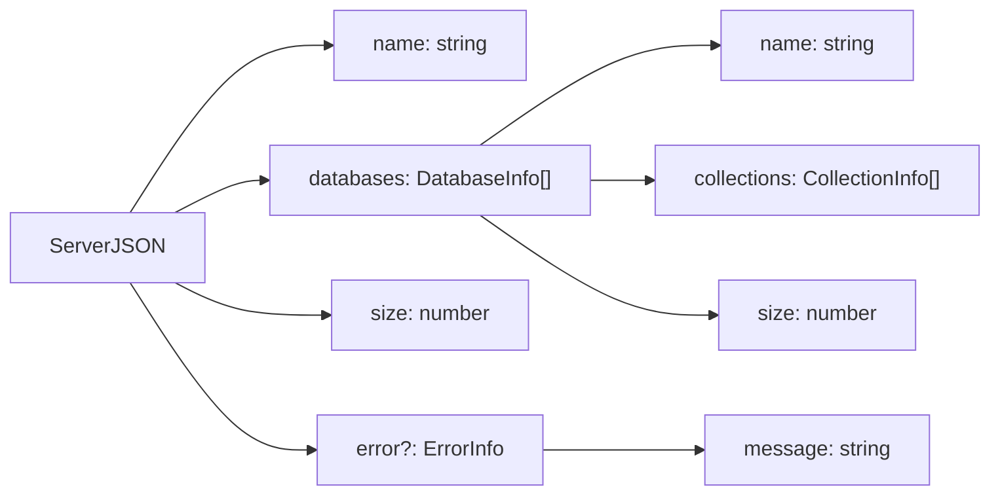
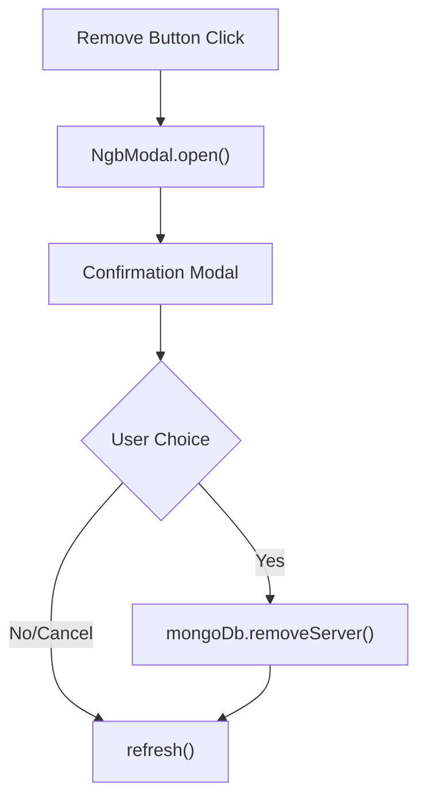

<!-- source: DeepWiki mcp.deepwiki.com · repo huggingface/Mongoku · page 4.2 Server Management · fetched 2026-10-26 -->

# Server Management

Relevant source files

The following files were used as context for generating this wiki page:

- [app/src/app/pages/servers/servers.component.html](app/src/app/pages/servers/servers.component.html)
- [app/src/app/pages/servers/servers.component.ts](app/src/app/pages/servers/servers.component.ts)

This document covers Mongoku's server management functionality, which allows users to add, view, and remove MongoDB server connections. Server management is the primary entry point for connecting to MongoDB instances and serves as the foundation for accessing databases and collections.

For information about browsing databases and collections within servers, see [Database and Collection Browsing](#4.3). For details about the underlying API endpoints that power server management, see [API Layer](#3.3).

## System Overview

The server management system is implemented as an Angular component that provides a user interface for managing MongoDB server connections. The system maintains a persistent list of server configurations and displays real-time information about each server's status, databases, and storage usage.

The core functionality includes:
- Adding new MongoDB servers using connection strings
- Displaying server status and metadata
- Removing servers from the managed list
- Handling connection errors and displaying appropriate feedback

Sources: [app/src/app/pages/servers/servers.component.ts:1-71]()

## Core Components

### ServersComponent

The `ServersComponent` class serves as the main controller for server management operations. It manages the component state and coordinates interactions between the user interface and the backend services.

| Property | Type | Purpose |
|----------|------|---------|
| `servers` | `ServerJSON[]` | Array of server configurations and metadata |
| `loading` | `boolean` | Loading state indicator |
| `adding` | `boolean` | Flag for add server form visibility |
| `newServer` | `string` | Connection string for new server |

**Server Management Operations**

Sources: [app/src/app/pages/servers/servers.component.ts:10-16](), [app/src/app/pages/servers/servers.component.ts:45-69]()

### Key Methods

The component implements several core methods for server lifecycle management:

- `refresh()` - Fetches the current list of servers from the backend
- `addServer()` - Adds a new server using the provided connection string
- `removeServer()` - Removes a server after user confirmation
- `toggle()` - Manages popover display for database information

Sources: [app/src/app/pages/servers/servers.component.ts:22-31](), [app/src/app/pages/servers/servers.component.ts:45-69]()

## Server Management Data Flow

### Server Addition Process

Sources: [app/src/app/pages/servers/servers.component.ts:45-54]()

### Server Information Display

The system displays comprehensive server information including connection status, database count, and total storage size. Error states are handled gracefully with badge indicators and tooltips.

Sources: [app/src/app/pages/servers/servers.component.html:29-47]()

## User Interface Components

### Server List Table

The main interface displays servers in a responsive table format with the following columns:

| Column | Content | Interactive Features |
|--------|---------|---------------------|
| Name | Server identifier with connection status | Clickable link to databases (if healthy) |
| Databases | Count with detailed popover | Hover to show database breakdown |
| Size | Total storage across all databases | Formatted using bytes pipe |
| Actions | Remove button | Confirmation modal |

### Add Server Form

The add server interface provides inline form controls:
- Connection string input with placeholder format `user:password@hostname:port`
- Toggle button to show/hide the form
- Validation to prevent empty submissions
- Loading state management during operations

Sources: [app/src/app/pages/servers/servers.component.html:6-18]()

### Error Handling

Connection errors are displayed using Bootstrap badge components with tooltips showing detailed error messages. Failed servers remain in the list but are marked with error indicators and cannot be navigated.

Sources: [app/src/app/pages/servers/servers.component.html:32-35]()

## Modal Interactions

### Confirmation Dialog

Server removal operations require explicit user confirmation through a modal dialog to prevent accidental data loss. The modal implementation uses NgBootstrap components.

Sources: [app/src/app/pages/servers/servers.component.ts:56-69](), [app/src/app/pages/servers/servers.component.html:89-100]()

### Database Information Popover

Database details are displayed in interactive popovers triggered by hover events. The popover content includes:
- Database name
- Collection count
- Individual database size
- Clipping indicator for large lists (shows first 20 items)

Sources: [app/src/app/pages/servers/servers.component.ts:33-43](), [app/src/app/pages/servers/servers.component.html:69-87]()

---

