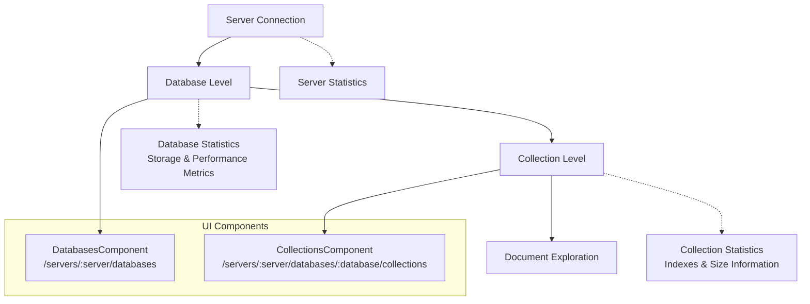
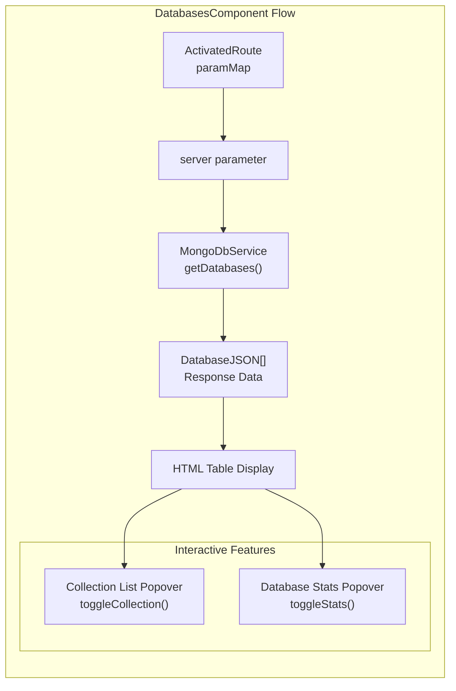
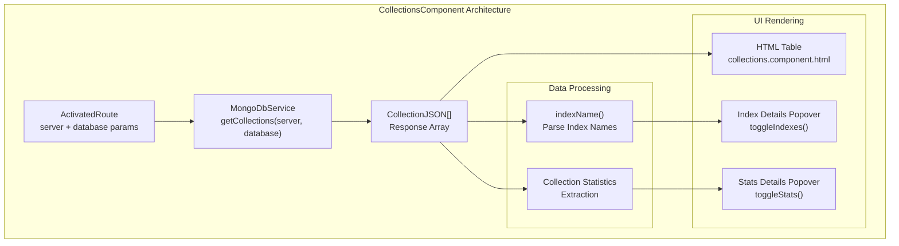
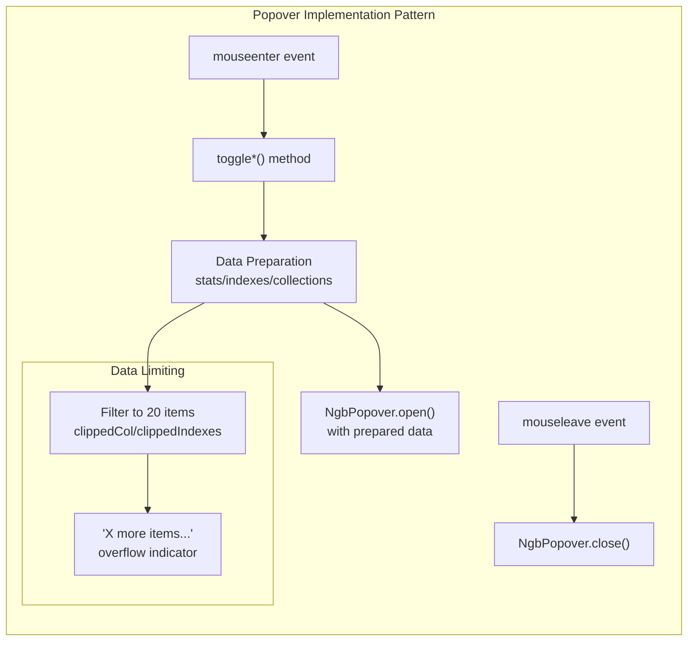
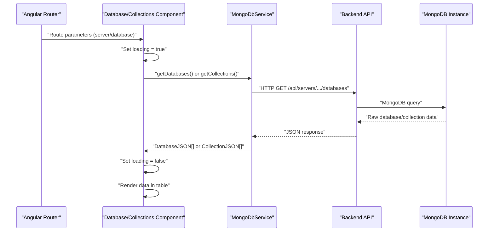

<!-- source: DeepWiki mcp.deepwiki.com · repo huggingface/Mongoku · page 4.3 Database and Collection Browsing · fetched 2026-10-26 -->

# Database and Collection Browsing

Relevant source files

The following files were used as context for generating this wiki page:

- [app/src/app/pages/collections/collections.component.html](app/src/app/pages/collections/collections.component.html)
- [app/src/app/pages/collections/collections.component.ts](app/src/app/pages/collections/collections.component.ts)
- [app/src/app/pages/databases/databases.component.html](app/src/app/pages/databases/databases.component.html)
- [app/src/app/pages/databases/databases.component.ts](app/src/app/pages/databases/databases.component.ts)

This document covers Mongoku's database and collection browsing capabilities, which allow users to navigate the hierarchical structure of MongoDB instances and view metadata about databases and collections. This functionality provides the foundation for exploring MongoDB data structures before diving into document-level operations.

For detailed information about exploring and querying documents within collections, see [Data Exploration](#4.1). For managing server connections, see [Server Management](#4.2).

## Navigation Hierarchy

Mongoku implements a three-level hierarchical navigation system for MongoDB data browsing:

Each level provides progressively more granular information about the MongoDB data structure, with routing handled through Angular's router system using parameterized URLs.

Sources: [app/src/app/pages/databases/databases.component.html:12](), [app/src/app/pages/collections/collections.component.html:13]()

## Database Browsing Interface

The `DatabasesComponent` presents a tabular view of all databases available on a selected server. The interface displays three primary columns of information for each database:

| Column | Data Source | Description |
|--------|-------------|-------------|
| name | `database.name` | Database identifier with navigation link |
| collections | `database.collections.length` | Count of collections with hover details |
| size | `database.size` | Total database size with detailed statistics |

The component implements hover-activated popovers using Angular Bootstrap's `NgbPopover` directive. When users hover over collection counts, they see a detailed breakdown of individual collections with their respective sizes. Similarly, hovering over the size column reveals comprehensive database statistics including average object size, data size, storage size, and index size.

Sources: [app/src/app/pages/databases/databases.component.ts:23-31](), [app/src/app/pages/databases/databases.component.html:4-45]()

## Collection Browsing Interface

The `CollectionsComponent` provides detailed metadata about collections within a specific database. The interface extends the database browsing pattern with additional collection-specific information:

| Column | Data Source | Description |
|--------|-------------|-------------|
| name | `collection.name` | Collection identifier with navigation link |
| documents | `collection.count` | Document count in collection |
| indexes | `collection.nIndexes` | Number of indexes with detailed breakdown |
| size | `collection.size` | Collection size with performance statistics |

The collections interface includes sophisticated index name parsing through the `indexName()` method, which converts MongoDB's internal index naming convention into human-readable JSON objects. This method handles special cases like `_id` field transformations and directional indicators.

Sources: [app/src/app/pages/collections/collections.component.ts:35-44](), [app/src/app/pages/collections/collections.component.html:1-90]()

## Statistics and Metadata Display

Both database and collection browsing interfaces implement rich metadata display through popover components. These popovers provide detailed statistics without cluttering the main interface:

### Database Statistics Popover
- Average object size
- Data size
- Storage size  
- Index size

### Collection Statistics Popover
- Average object size
- Data size
- Storage size
- Total index size

### Index Information Popover
- Individual index names (parsed from MongoDB format)
- Index sizes
- Truncation indicator for large index lists (>20 items)

The popover system implements data limiting to maintain performance with large datasets. Both collection lists and index lists are truncated to 20 items with overflow indicators showing the count of additional items.

Sources: [app/src/app/pages/databases/databases.component.ts:45-51](), [app/src/app/pages/collections/collections.component.ts:58-70]()

## Data Flow and Service Integration

Database and collection browsing relies on the `MongoDbService` for data retrieval, implementing a consistent pattern across both components:

Both components implement identical loading state management and error handling patterns. The loading state is displayed as a centered "Loading..." message while data is being fetched, and empty states show appropriate "No databases..." or "No collections..." messages.

Sources: [app/src/app/pages/databases/databases.component.ts:19-31](), [app/src/app/pages/collections/collections.component.ts:20-33]()

---

