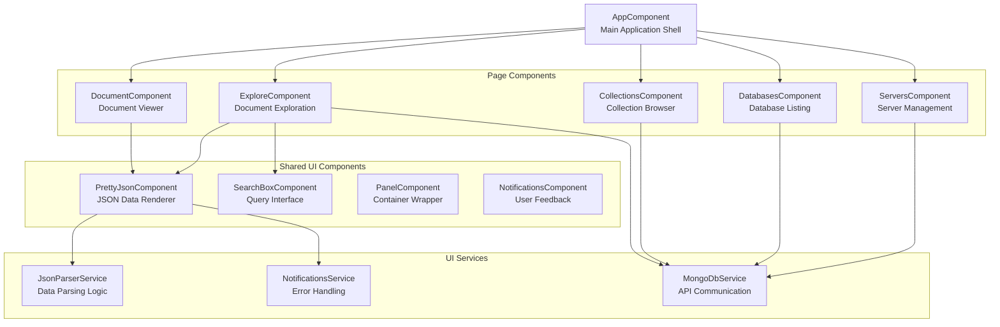
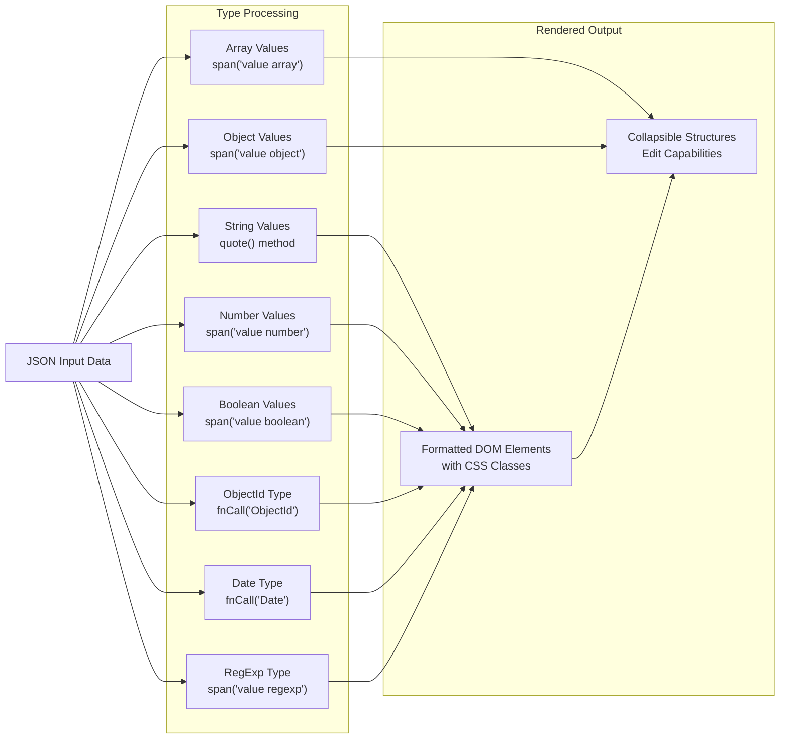
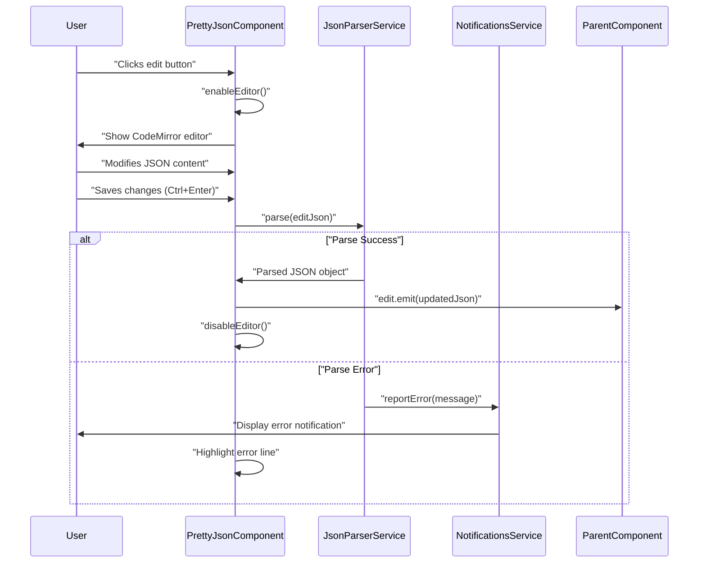

<!-- source: DeepWiki mcp.deepwiki.com · repo huggingface/Mongoku · page 5 User Interface · fetched 2026-10-26 -->

# User Interface

Relevant source files

The following files were used as context for generating this wiki page:

- [app/src/app/components/pretty-json/pretty-json.component.ts](app/src/app/components/pretty-json/pretty-json.component.ts)
- [app/src/app/services/json-parser.service.ts](app/src/app/services/json-parser.service.ts)
- [app/src/app/services/services.module.ts](app/src/app/services/services.module.ts)
- [app/src/sass/themes/dark-default.scss](app/src/sass/themes/dark-default.scss)
- [app/src/sass/themes/light.scss](app/src/sass/themes/light.scss)

This document covers Mongoku's user interface architecture, core UI components, and styling system. It provides an overview of how the Angular frontend application presents MongoDB data to users through interactive components and customizable themes.

For detailed information about specific UI components like PrettyJSON and search functionality, see [Key Components](#5.1). For theming and visual customization options, see [Theming and Styling](#5.2).

## UI Architecture Overview

Mongoku's user interface is built as an Angular Single Page Application (SPA) with a component-based architecture. The UI layer handles data visualization, user interactions, and provides a responsive interface for MongoDB operations.

### Frontend Component Structure

Sources: [app/src/app/components/pretty-json/pretty-json.component.ts:1-383](), [app/src/app/services/json-parser.service.ts:1-141](), [app/src/app/services/services.module.ts:1-18]()

## Core UI Components

### PrettyJsonComponent

The `PrettyJsonComponent` is the primary data visualization component responsible for rendering MongoDB documents in a formatted, interactive JSON view. It provides collapsible tree structures, syntax highlighting, and edit capabilities.

| Property | Type | Description |
|----------|------|-------------|
| `json` | `any` | Input data to be displayed |
| `autoCollapse` | `boolean` | Automatically collapse nested structures |
| `readOnly` | `boolean` | Disable editing functionality |
| `go` | `EventEmitter` | Navigate to referenced documents |
| `edit` | `EventEmitter` | Handle document modifications |
| `remove` | `EventEmitter` | Delete document operations |

The component uses a custom rendering engine that converts JSON objects into DOM elements with appropriate CSS classes for styling and interaction.

### JSON Data Type Handling

Sources: [app/src/app/components/pretty-json/pretty-json.component.ts:225-352]()

### Interactive Features

The `PrettyJsonComponent` provides several interactive capabilities:

- **Collapsible Views**: Arrays and objects can be collapsed/expanded using the `collapse()` method [app/src/app/components/pretty-json/pretty-json.component.ts:365-381]()
- **In-line Editing**: CodeMirror-based editor with syntax validation [app/src/app/components/pretty-json/pretty-json.component.ts:82-119]()
- **Document Navigation**: Clickable ObjectId references for cross-document navigation [app/src/app/components/pretty-json/pretty-json.component.ts:133-136]()
- **Link Detection**: Automatic URL linking for string values [app/src/app/components/pretty-json/pretty-json.component.ts:184-190]()

Sources: [app/src/app/components/pretty-json/pretty-json.component.ts:50-119]()

## Styling and Theme System

Mongoku implements a CSS custom property-based theming system supporting both light and dark color schemes. The theming system uses CSS variables to enable dynamic theme switching.

### Theme Structure

| Theme Variable | Light Theme Value | Dark Theme Value | Usage |
|----------------|-------------------|------------------|-------|
| `--background-color` | `hsl(228, 26%, 98%)` | `hsl(216, 26%, 15%)` | Main background |
| `--text` | `hsl(0, 0%, 12%)` | `hsl(0, 0%, 88%)` | Primary text |
| `--panel-body` | `hsl(232, 23%, 93%)` | `hsl(220, 23%, 21%)` | Panel backgrounds |
| `--code-string` | `#a31515` | `#ce9178` | JSON string values |
| `--code-numbers` | `#09885a` | `#b5cea8` | Numeric values |
| `--code-boolean` | `#0000ff` | `#569cd6` | Boolean/null values |

Sources: [app/src/sass/themes/light.scss:1-35](), [app/src/sass/themes/dark-default.scss:1-35]()

### JSON Syntax Highlighting

The `PrettyJsonComponent` applies semantic CSS classes for syntax highlighting:

- `.value.string` - String literals
- `.value.number` - Numeric values  
- `.value.boolean` - Boolean values
- `.value.null` - Null values
- `.value.regexp` - Regular expressions
- `.call.function` - MongoDB type constructors (ObjectId, Date)

Sources: [app/src/app/components/pretty-json/pretty-json.component.ts:237-260]()

## Data Flow Architecture

The UI components follow a unidirectional data flow pattern where user interactions trigger events that flow up to parent components and services.

### Component Communication Flow

Sources: [app/src/app/components/pretty-json/pretty-json.component.ts:99-119](), [app/src/app/services/json-parser.service.ts:105-139]()

## Error Handling and User Feedback

The UI implements comprehensive error handling through the `NotificationsService`, which provides user feedback for various error conditions:

- JSON parsing errors with line-specific highlighting
- MongoDB connection failures
- Invalid query syntax
- Network communication errors

The `PrettyJsonComponent` integrates with this system by highlighting syntax errors directly in the CodeMirror editor and displaying contextual error messages.

Sources: [app/src/app/components/pretty-json/pretty-json.component.ts:110-118](), [app/src/app/services/json-parser.service.ts:16-18](), [app/src/app/services/services.module.ts:15]()

---

