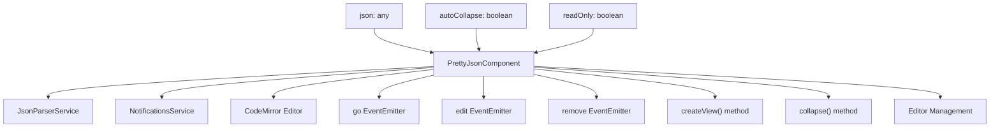
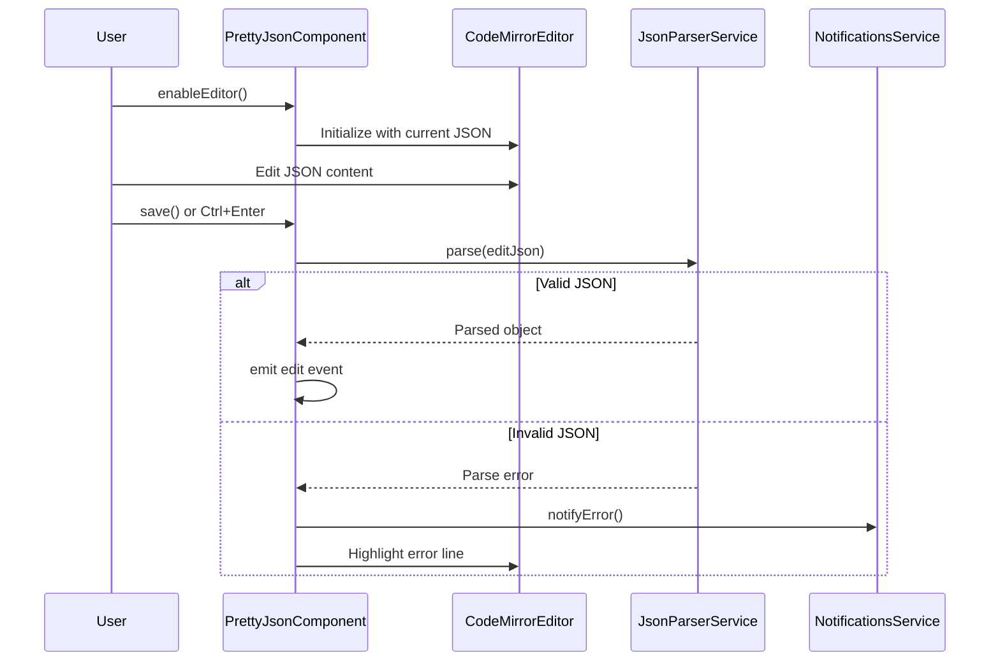
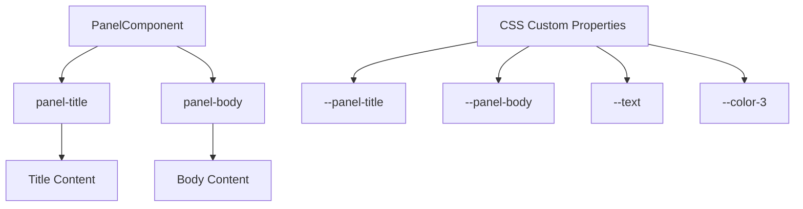
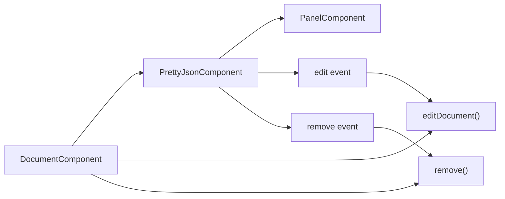

<!-- source: DeepWiki mcp.deepwiki.com · repo huggingface/Mongoku · page 5.1 Key Components · fetched 2026-10-26 -->

# Key Components

<details>
<summary>Relevant source files</summary>

The following files were used as context for generating this wiki page:

- [app/src/app/app.component.scss](app/src/app/app.component.scss)
- [app/src/app/components/panel/panel.component.scss](app/src/app/components/panel/panel.component.scss)
- [app/src/app/components/pretty-json/pretty-json.component.html](app/src/app/components/pretty-json/pretty-json.component.html)
- [app/src/app/components/pretty-json/pretty-json.component.ts](app/src/app/components/pretty-json/pretty-json.component.ts)
- [app/src/app/components/search-box/search-box.component.html](app/src/app/components/search-box/search-box.component.html)
- [app/src/app/components/search-box/search-box.component.ts](app/src/app/components/search-box/search-box.component.ts)
- [app/src/app/pages/document/document.component.html](app/src/app/pages/document/document.component.html)

</details>


This page documents the core user interface components that make up Mongoku's frontend experience. These components handle data visualization, user input, and layout structure within the Angular single-page application.

For information about the overall frontend architecture and routing, see [Frontend Application](#3.2). For details on theming and visual customization, see [Theming and Styling](#5.2).

## Overview

Mongoku's user interface is built around three primary component types that work together to provide a comprehensive MongoDB data exploration experience:

| Component | Purpose | Key Features |
|-----------|---------|--------------|
| `SearchBoxComponent` | Query interface for MongoDB operations | Parameter management, dynamic UI, search execution |
| `PrettyJsonComponent` | JSON data visualization and editing | Syntax highlighting, collapsible view, inline editing |
| `PanelComponent` | Layout container for content sections | Consistent styling, title/body structure |

## SearchBoxComponent Architecture

### Component Structure Diagram

```mermaid
graph TB
    SearchBoxComponent["SearchBoxComponent"]
    SearchParams["SearchParams Interface"]
    DropdownMenu["ngbDropdown Menu"]
    ParamsGroup["params-group"]
    
    SearchBoxComponent --> SearchParams
    SearchBoxComponent --> DropdownMenu
    SearchBoxComponent --> ParamsGroup
    
    SearchParams --> query["query: string"]
    SearchParams --> sort["sort: string"] 
    SearchParams --> project["project: string"]
    SearchParams --> limit["limit: number"]
    SearchParams --> skip["skip: number"]
    
    ParamsGroup --> QueryInput["Query Input"]
    ParamsGroup --> SortInput["Sort Input (conditional)"]
    ParamsGroup --> SkipInput["Skip Input (conditional)"]
    ParamsGroup --> LimitInput["Limit Input (conditional)"]
    ParamsGroup --> ProjectInput["Project Input (conditional)"]
    
    DropdownMenu --> AddSort["Add Sort Option"]
    DropdownMenu --> AddSkip["Add Skip Option"] 
    DropdownMenu --> AddLimit["Add Limit Option"]
    DropdownMenu --> AddProject["Add Project Option"]
```


The `SearchBoxComponent` manages MongoDB query parameters through a structured interface. The component implements the `SearchParams` interface which defines five core parameters for database operations.

**Sources:** [app/src/app/components/search-box/search-box.component.ts:1-84](), [app/src/app/components/search-box/search-box.component.html:1-44]()

### Parameter Management System

The component uses a `defaults` object to manage parameter state and a `show` object to control UI visibility:

```typescript
private defaults = {
  query:   "{}",
  project: "{}",
  limit:   20,
  skip:    0,
  sort:    ""
};
```

The `toggle()` method at [app/src/app/components/search-box/search-box.component.ts:58-64]() controls parameter visibility and resets values to defaults when parameters are hidden. The `canAddParams()` method determines when the add parameter button should be displayed.

**Sources:** [app/src/app/components/search-box/search-box.component.ts:21-33](), [app/src/app/components/search-box/search-box.component.ts:58-68]()

## PrettyJsonComponent Architecture

### Component Data Flow Diagram


The `PrettyJsonComponent` is the most complex UI component, handling JSON visualization with MongoDB-specific type support. It processes input data through the `createView()` method and provides interactive editing capabilities.

**Sources:** [app/src/app/components/pretty-json/pretty-json.component.ts:1-383](), [app/src/app/components/pretty-json/pretty-json.component.html:1-36]()

### JSON Rendering System

The component implements a sophisticated JSON rendering system that handles MongoDB-specific data types:

| Data Type | Rendering Method | Special Handling |
|-----------|------------------|------------------|
| `ObjectId` | `fnCall()` method | Displays as `ObjectId("value")` |
| `Date` | `fnCall()` method | Displays as `Date("value")` |
| `RegExp` | Inline formatting | Displays as `/pattern/flags` |
| Arrays | Collapsible structure | With `[...]` summary |
| Objects | Collapsible structure | With `{...}` summary |

The type detection logic is implemented in the `createView()` method at [app/src/app/components/pretty-json/pretty-json.component.ts:252-260]().

**Sources:** [app/src/app/components/pretty-json/pretty-json.component.ts:225-352](), [app/src/app/components/pretty-json/pretty-json.component.ts:252-260]()

### Editing and Persistence

The component provides inline editing through CodeMirror integration with the following workflow:



The editor configuration is defined in `editorOptions` at [app/src/app/components/pretty-json/pretty-json.component.ts:50-59]() and includes keyboard shortcuts for saving.

**Sources:** [app/src/app/components/pretty-json/pretty-json.component.ts:82-131](), [app/src/app/components/pretty-json/pretty-json.component.ts:50-59]()

## PanelComponent Structure

The `PanelComponent` serves as a consistent layout container with styling support for titles and body content. It implements a simple structure with CSS custom properties for theming:



The panel styling uses CSS custom properties for theme integration and supports optional border removal through the `border=false` attribute.

**Sources:** [app/src/app/components/panel/panel.component.scss:1-37]()

## Component Integration Patterns

### Document Display Integration
The components work together in document display scenarios as shown in the document component template:



The document component at [app/src/app/pages/document/document.component.html:3-9]() demonstrates the integration pattern where `PrettyJsonComponent` is wrapped within the document page logic.

**Sources:** [app/src/app/pages/document/document.component.html:1-12]()

### Explore Page Integration
In the explore interface, `SearchBoxComponent` and `PrettyJsonComponent` work together to provide query and display functionality, with the search component controlling the data that feeds into the JSON display components.

The integration follows a pattern where search parameters from `SearchBoxComponent` are used to fetch data that is then displayed using multiple `PrettyJsonComponent` instances for result sets.

**Sources:** [app/src/app/components/search-box/search-box.component.ts:70-76](), [app/src/app/components/pretty-json/pretty-json.component.ts:36-42]()

---

