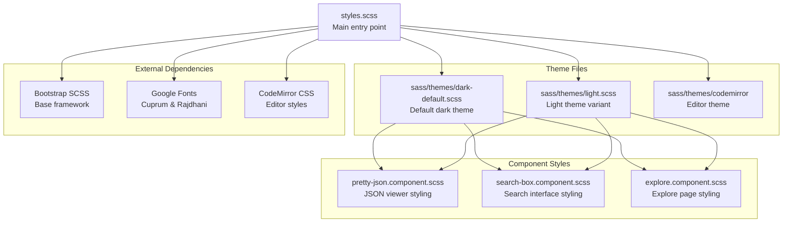
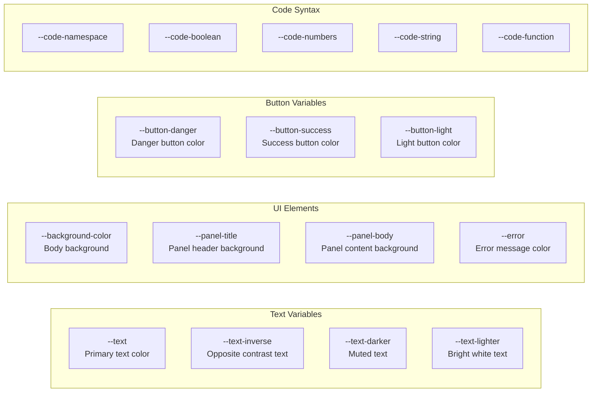
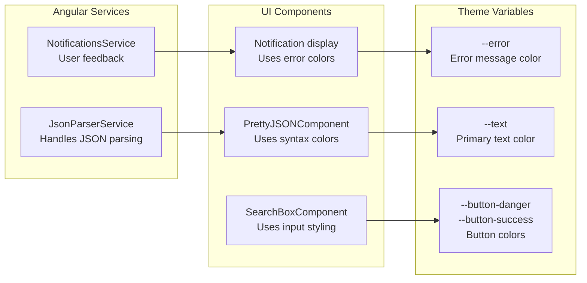

<!-- source: DeepWiki mcp.deepwiki.com · repo huggingface/Mongoku · page 5.2 Theming and Styling · fetched 2026-10-26 -->

# Theming and Styling

Relevant source files

The following files were used as context for generating this wiki page:

- [app/src/app/components/pretty-json/pretty-json.component.scss](app/src/app/components/pretty-json/pretty-json.component.scss)
- [app/src/app/components/search-box/search-box.component.scss](app/src/app/components/search-box/search-box.component.scss)
- [app/src/app/pages/explore/explore.component.scss](app/src/app/pages/explore/explore.component.scss)
- [app/src/app/services/json-parser.service.ts](app/src/app/services/json-parser.service.ts)
- [app/src/app/services/services.module.ts](app/src/app/services/services.module.ts)
- [app/src/sass/themes/dark-default.scss](app/src/sass/themes/dark-default.scss)
- [app/src/sass/themes/light.scss](app/src/sass/themes/light.scss)
- [app/src/styles.scss](app/src/styles.scss)

This document covers Mongoku's visual theming system and styling architecture. It explains how themes are implemented using CSS custom properties, how the color schemes are organized, and how component-specific styling integrates with the global theme system.

For information about specific UI components and their functionality, see [Key Components](#5.1).

## Theme System Architecture

Mongoku implements a flexible theming system based on CSS custom properties (CSS variables) that allows for easy switching between light and dark themes. The system uses SCSS for preprocessing and Bootstrap as the foundation framework.

### Theme File Structure

Sources: [app/src/styles.scss:1-15](), [app/src/sass/themes/dark-default.scss:1-34](), [app/src/sass/themes/light.scss:1-34]()

## CSS Custom Properties System

The theming system relies heavily on CSS custom properties to create a consistent color palette and styling approach across all components.

### Color Palette Structure

Both themes define a structured color palette using a four-tier system:

| Variable | Purpose | Dark Theme Value | Light Theme Value |
|----------|---------|------------------|-------------------|
| `--color-1` | Primary background | `hsl(216, 26%, 15%)` | `hsl(228, 26%, 98%)` |
| `--color-2` | Secondary background | `hsl(220, 23%, 21%)` | `hsl(232, 23%, 93%)` |
| `--color-3` | Border/separator color | `hsl(217, 20%, 25%)` | `hsl(229, 20%, 88%)` |
| `--color-4` | Input/control color | `hsl(220, 20%, 30%)` | `hsl(232, 20%, 83%)` |

### Text and UI Variables

Sources: [app/src/sass/themes/dark-default.scss:1-34](), [app/src/sass/themes/light.scss:1-34]()

## Theme Implementation

### Dark Theme (Default)

The dark theme is defined in `:root` and serves as the default theme for the application. It uses a blue-tinted dark color scheme with high contrast text.

Key characteristics:
- Base color: `hsl(216, 26%, 15%)` - dark blue-gray
- Text color: `hsl(0, 0%, 88%)` - light gray
- Syntax highlighting optimized for dark backgrounds
- VS Code-inspired color palette for code elements

### Light Theme

The light theme uses the `.theme-light` class selector and provides a clean, bright alternative with inverted colors from the dark theme.

Key characteristics:
- Base color: `hsl(228, 26%, 98%)` - very light blue-gray
- Text color: `hsl(0, 0%, 12%)` - dark gray
- Syntax highlighting optimized for light backgrounds
- Traditional light theme color palette

Sources: [app/src/sass/themes/dark-default.scss:1-34](), [app/src/sass/themes/light.scss:1-34]()

## Component-Specific Styling

### PrettyJSON Component Styling

The `PrettyJSONComponent` includes extensive styling for JSON syntax highlighting and interactive features:

```mermaid
graph TD
    PrettyJSONRoot["pretty-json.component.scss"]
    
    subgraph "Visual Elements"
        ObjectInfo["object-info<br/>Document metadata display"]
        EditorLayer["editor<br/>Inline editing overlay"]
        RemoveLayer["remove-layer<br/>Delete confirmation overlay"]
    end
    
    subgraph "Syntax Highlighting"
        NullStyle[".null<br/>var(--code-null)"]
        BooleanStyle[".boolean<br/>var(--code-boolean)"]
        NumberStyle[".number<br/>var(--code-numbers)"]
        StringStyle[".quoted<br/>var(--code-string)"]
        RegexpStyle[".regexp<br/>var(--code-regexp)"]
        FunctionStyle[".function<br/>var(--code-function)"]
    end
    
    subgraph "Interactive Features"
        Collapser[".collapser<br/>Expand/collapse controls"]
        EditorActions[".editor-actions<br/>Save/cancel buttons"]
        HoverActions[":host:hover .actions<br/>Show on hover"]
    end
    
    PrettyJSONRoot --> ObjectInfo
    PrettyJSONRoot --> EditorLayer
    PrettyJSONRoot --> RemoveLayer
    PrettyJSONRoot --> NullStyle
    PrettyJSONRoot --> BooleanStyle
    PrettyJSONRoot --> NumberStyle
    PrettyJSONRoot --> StringStyle
    PrettyJSONRoot --> RegexpStyle
    PrettyJSONRoot --> FunctionStyle
    PrettyJSONRoot --> Collapser
    PrettyJSONRoot --> EditorActions
    PrettyJSONRoot --> HoverActions
```

Sources: [app/src/app/components/pretty-json/pretty-json.component.scss:1-227]()

### Search Box Styling

The search box component implements a complex flexbox layout with multiple input groups and custom styling:

Key styling features:
- `.search-box` - Main container with flexbox layout
- `.params-group` - Contains multiple parameter input groups
- `.input-group` - Individual query parameter sections
- `.label` - Parameter name displays
- `.add-param` and `.confirm-search` - Action buttons

Sources: [app/src/app/components/search-box/search-box.component.scss:1-106]()

## Global Style Overrides

The main `styles.scss` file contains global overrides for Bootstrap and third-party components:

### Bootstrap Overrides

| Component | Customization | CSS Variables Used |
|-----------|---------------|-------------------|
| `.navbar` | Border color | `var(--color-3)` |
| `.bg-dark` | Background color | `var(--color-2)` |
| `.table` | Border colors | `var(--color-3)` |
| `.btn.btn-default` | Theme-aware buttons | `var(--color-1)`, `var(--text)` |
| `.modal-content` | Modal appearance | `var(--color-2)`, `var(--color-3)` |

### Typography

- Primary font: `'Rajdhani', sans-serif` for UI text
- Code font: `'Source Code Pro', monospace` for code elements
- Imported from Google Fonts: Cuprum and Rajdhani

Sources: [app/src/styles.scss:17-156]()

## Theme Integration Points

### Service Integration

The theming system integrates with Angular services, particularly for error handling and notifications:

Sources: [app/src/app/services/json-parser.service.ts:1-141](), [app/src/app/services/services.module.ts:1-18]()

## Customization Guidelines

### Adding New Themes

To add a new theme:

1. Create a new SCSS file in `app/src/sass/themes/`
2. Define all required CSS custom properties
3. Import the theme in `app/src/styles.scss`
4. Use a class-based selector (e.g., `.theme-custom`)

### Extending Component Styles

Component styles should:
- Use CSS custom properties for colors and spacing
- Follow the established naming conventions
- Maintain compatibility with both light and dark themes
- Use the Source Code Pro font for code-related elements

Sources: [app/src/styles.scss:1-156](), [app/src/sass/themes/dark-default.scss:1-34](), [app/src/sass/themes/light.scss:1-34]()

---

