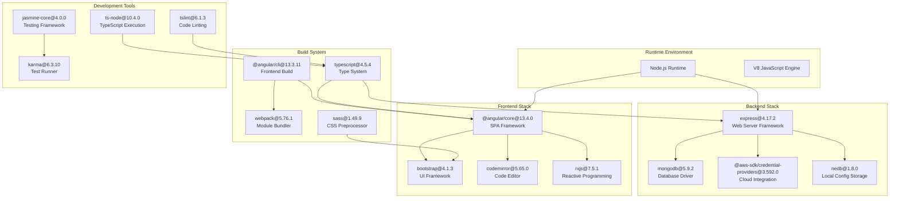
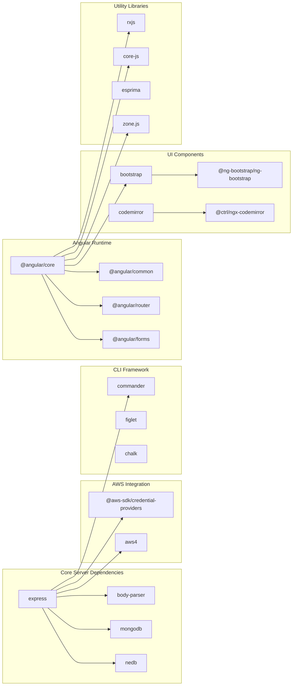
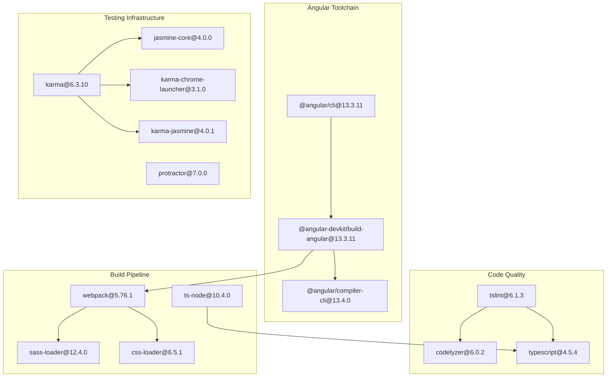

<!-- source: DeepWiki mcp.deepwiki.com · repo huggingface/Mongoku · page 7 Development Reference · fetched 2026-10-26 -->

# Development Reference

Relevant source files

The following files were used as context for generating this wiki page:

- [app/package-lock.json](app/package-lock.json)
- [app/package.json](app/package.json)
- [package-lock.json](package-lock.json)

This document provides technical reference material for developers who want to understand, modify, or contribute to Mongoku. It covers the development technology stack, dependency architecture, build systems, and key code entities that comprise the application.

For deployment and configuration information, see [Deployment and Configuration](#6). For user-facing feature documentation, see [User Features](#4).

## Technology Stack Overview

Mongoku is built as a full-stack web application using a modern JavaScript/TypeScript technology stack with clear separation between frontend and backend concerns.

### Core Technologies Architecture

Sources: [package.json:11-21](), [app/package.json:14-34](), [app/package.json:35-54]()

## Dependency Architecture

The application dependencies are organized into distinct categories based on their function within the development and runtime environments.

### Runtime Dependencies Structure

Sources: [package.json:11-21](), [app/package.json:14-34]()

## Build System Architecture

Mongoku uses a dual-build system approach with separate build processes for the backend Node.js application and the frontend Angular application.

### Build Process Flow

| Component | Build Tool | Input | Output | Configuration |
|-----------|------------|--------|--------|---------------|
| **Backend** | `tsc` (TypeScript Compiler) | `src/**/*.ts` | `dist/**/*.js` | `tsconfig.json` |
| **Frontend** | `@angular/cli` | `app/src/**/*.ts` | `app/dist/**/*.js` | `app/angular.json` |
| **Styles** | `sass-loader` | `app/src/**/*.scss` | CSS bundles | Webpack config |
| **Assets** | `copy-webpack-plugin` | Static files | `app/dist/assets/` | Angular build config |

### Development vs Production Builds

The build system supports different optimization levels:

**Development Mode:**
- Source maps enabled for debugging
- Hot module replacement for frontend
- Unminified code for easier debugging
- Development server with live reload

**Production Mode:**
- Code minification via `terser@5.14.2`
- Tree shaking for dead code elimination
- Asset optimization and compression
- Ahead-of-time (AOT) compilation for Angular

Sources: [app/package.json:35-54](), [package.json:25-30]()

## Key Development Dependencies

### Frontend Development Tools

The Angular application uses a comprehensive set of development tools:

Sources: [app/package.json:35-54]()

### Backend Development Dependencies

The backend uses TypeScript definitions and development utilities:

- `@types/express@4.17.13`: TypeScript definitions for Express.js
- `@types/figlet@1.5.4`: TypeScript definitions for ASCII art library
- `@types/mongodb@4.0.7`: TypeScript definitions for MongoDB driver  
- `@types/nedb@1.8.12`: TypeScript definitions for NeDB

Sources: [package.json:25-30]()

## Development Workflow

### Local Development Setup

1. **Backend Development**: TypeScript files in `/src` are compiled to `/dist` using the TypeScript compiler
2. **Frontend Development**: Angular application in `/app` uses Angular CLI development server with hot reload
3. **Concurrent Development**: Both backend and frontend can be developed simultaneously using separate terminal sessions

### Testing Strategy

| Test Type | Framework | Location | Purpose |
|-----------|-----------|----------|---------|
| **Unit Tests** | Jasmine + Karma | `app/src/**/*.spec.ts` | Component and service testing |
| **E2E Tests** | Protractor | `app/e2e/` | End-to-end user workflows |
| **Backend Tests** | Custom (if any) | `src/**/*.test.ts` | Server logic testing |

### Code Quality Tools

- **TSLint**: Enforces TypeScript coding standards
- **Codelyzer**: Angular-specific linting rules
- **TypeScript**: Static type checking for both frontend and backend

Sources: [app/package.json:5-12](), [app/package.json:40-53]()

## File Structure and Module Organization

### Backend Module Structure

The backend follows a modular architecture with these key areas:

- **Express Server**: Web server and routing logic
- **MongoDB Manager**: Database connection and operations management
- **Host Manager**: Configuration and connection string management  
- **API Layer**: REST endpoint definitions and request handling
- **CLI Interface**: Command-line interface and process management

### Frontend Module Structure  

The Angular application is organized into feature modules:

- **Core Module**: Shared services and singleton providers
- **Shared Module**: Reusable components and directives
- **Feature Modules**: Page-specific components and logic
- **Routing Module**: Navigation and route configuration

Sources: Based on system architecture diagrams and dependency analysis

This development reference provides the foundation for understanding Mongoku's technical architecture. For specific build instructions and environment setup, see [Build and Development Setup](#7.2). For dependency details and system requirements, see [Dependencies and Requirements](#7.1).

---

