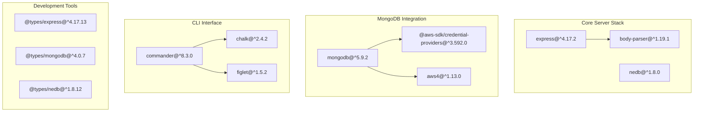
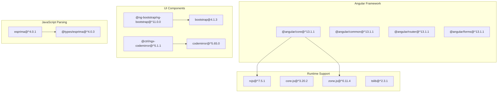
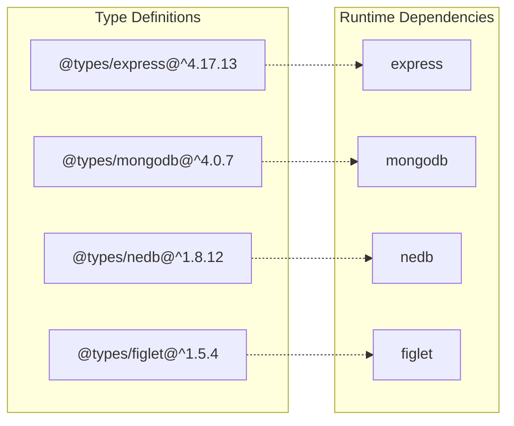

<!-- source: DeepWiki mcp.deepwiki.com · repo huggingface/Mongoku · page 7.1 Dependencies and Requirements · fetched 2026-10-26 -->

# Dependencies and Requirements

Relevant source files

The following files were used as context for generating this wiki page:

- [app/package-lock.json](app/package-lock.json)
- [app/package.json](app/package.json)
- [package-lock.json](package-lock.json)
- [package.json](package.json)

This document provides a comprehensive breakdown of all dependencies, system requirements, and development prerequisites for Mongoku. It covers both the backend Node.js/Express server dependencies and the frontend Angular application dependencies, along with their specific purposes and version constraints.

For information about setting up a development environment and build processes, see [Build and Development Setup](#7.2). For deployment-specific configuration requirements, see [Environment Configuration](#6.2).

## System Requirements

Mongoku requires specific versions of Node.js and npm to function properly across both backend and frontend components.

### Runtime Requirements

| Component | Requirement | Source |
|-----------|-------------|---------|
| Node.js | ≥16.0.0 | Backend AWS SDK constraints |
| Node.js | ^12.20.0 \|\| ^14.15.0 \|\| ≥16.10.0 | Angular CLI constraints |
| npm | ^6.11.0 \|\| ^7.5.6 \|\| ≥8.0.0 | Angular tooling |

The most restrictive requirement comes from the AWS SDK dependencies, which require Node.js ≥16.0.0 for the latest security and compatibility features.

**Sources:** [package-lock.json:194-196](), [app/package-lock.json:76-80]()

## Backend Dependencies Architecture

The backend dependencies are organized into several functional categories that support different aspects of the MongoDB client functionality.

**Sources:** [package.json:16-26](), [package.json:27-32]()

### Core Backend Dependencies

#### Web Server Framework
- **`express@^4.17.2`** - Primary web application framework providing HTTP server functionality and middleware support for the API layer
- **`body-parser@^1.19.1`** - HTTP request body parsing middleware for handling JSON and form data in API endpoints

#### Database Connectivity
- **`mongodb@^5.9.2`** - Official MongoDB Node.js driver providing connection management and query execution capabilities
- **`nedb@^1.8.0`** - Embedded JavaScript database used for local configuration storage in `~/.mongoku.db`

#### AWS Integration
- **`@aws-sdk/credential-providers@^3.592.0`** - AWS SDK credential provider modules supporting various authentication methods for cloud MongoDB instances
- **`aws4@^1.13.0`** - AWS request signing utility for secure API communication with AWS-hosted MongoDB services

#### Command Line Interface
- **`commander@^8.3.0`** - Command-line interface framework powering the `mongoku` CLI commands
- **`figlet@^1.5.2`** - ASCII art text generator for CLI banner display
- **`chalk@^2.4.2`** - Terminal string styling library for colored CLI output

**Sources:** [package.json:16-26]()

## Frontend Dependencies Architecture

The Angular frontend has a comprehensive set of dependencies supporting modern web application development with rich UI components and development tooling.

**Sources:** [app/package.json:14-34]()

### Core Frontend Dependencies

#### Angular Framework Stack
- **`@angular/core@^13.1.1`** - Core Angular framework providing dependency injection, change detection, and component lifecycle management
- **`@angular/common@^13.1.1`** - Common Angular directives, pipes, and services used throughout the application
- **`@angular/router@^13.1.1`** - Client-side routing for navigation between database exploration views
- **`@angular/forms@^13.1.1`** - Form handling and validation for search queries and configuration inputs

#### User Interface Components
- **`bootstrap@4.1.3`** - CSS framework providing responsive grid system and base styling for UI components
- **`@ng-bootstrap/ng-bootstrap@^11.0.0`** - Angular-specific Bootstrap components with TypeScript support
- **`codemirror@^5.65.0`** - Code editor library providing syntax highlighting and editing capabilities for JSON documents
- **`@ctrl/ngx-codemirror@^5.1.1`** - Angular wrapper for CodeMirror integration

#### JavaScript Processing
- **`esprima@^4.0.1`** - JavaScript parser for analyzing and validating MongoDB query syntax
- **`@types/esprima@^4.0.3`** - TypeScript type definitions for esprima parser

#### Runtime Support Libraries
- **`rxjs@^7.5.1`** - Reactive programming library for handling asynchronous operations and HTTP requests
- **`core-js@^3.20.2`** - Polyfill library for modern JavaScript features across different browsers
- **`zone.js@^0.11.4`** - Execution context library required by Angular for change detection
- **`tslib@^2.3.1`** - TypeScript runtime helper library

**Sources:** [app/package.json:14-34]()

## Development Dependencies

### Backend Development Tools

The backend development dependencies provide TypeScript type definitions for all major runtime dependencies, enabling type safety and IntelliSense support in development environments.

**Sources:** [package.json:27-32]()

### Frontend Development Tools

The frontend includes an extensive development toolchain supporting Angular development, testing, and building:

| Category | Dependencies | Purpose |
|----------|--------------|---------|
| Angular CLI | `@angular/cli@^13.1.2`, `@angular-devkit/build-angular@^13.1.2` | Build system and development server |
| TypeScript | `typescript@^4.5.4`, `@angular/compiler-cli@^13.1.1` | TypeScript compilation and Angular template processing |
| Testing | `jasmine-core@^4.0.0`, `karma@^6.3.10`, `protractor@^7.0.0` | Unit and end-to-end testing frameworks |
| Code Quality | `tslint@^6.1.3`, `codelyzer@^6.0.2` | Static code analysis and linting |

**Sources:** [app/package.json:35-54]()

## Dependency Version Constraints

### Critical Version Compatibility

Several dependencies have strict version constraints that affect system compatibility:

1. **Node.js ≥16.0.0** - Required by AWS SDK v3 for modern security features and API compatibility
2. **Angular 13.x** - All Angular packages must use compatible versions within the same major release
3. **TypeScript ^4.5.4** - Maximum version 4.7 supported by Angular 13.x toolchain
4. **MongoDB Driver ^5.9.2** - Provides compatibility with MongoDB 4.4+ server versions

### Package Lock Integrity

Both `package-lock.json` and `app/package-lock.json` files use lockfileVersion 3, ensuring reproducible builds across development and deployment environments. The lock files specify exact dependency trees with integrity hashes for security verification.

**Sources:** [package-lock.json:3-4](), [app/package-lock.json:3-4]()

---

