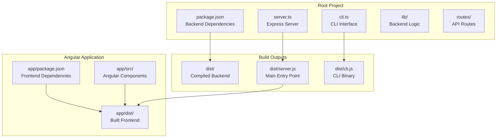
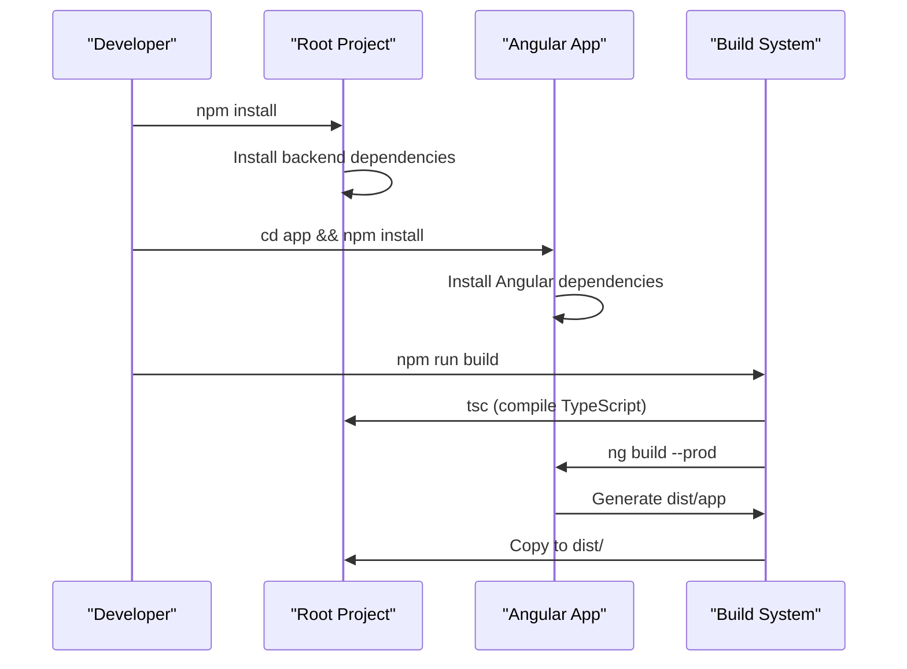
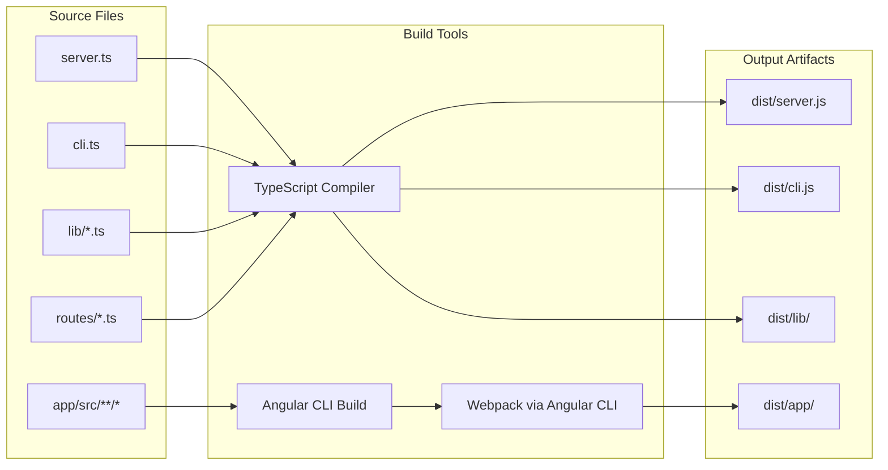
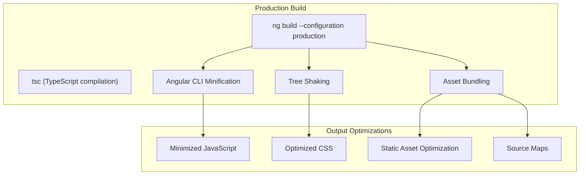

<!-- source: DeepWiki mcp.deepwiki.com · repo huggingface/Mongoku · page 7.2 Build and Development Setup · fetched 2026-10-26 -->

# Build and Development Setup

<details>
<summary>Relevant source files</summary>

The following files were used as context for generating this wiki page:

- [app/package-lock.json](app/package-lock.json)
- [app/package.json](app/package.json)
- [cli.ts](cli.ts)
- [package.json](package.json)
- [server.ts](server.ts)

</details>


This document covers the complete build and development setup for Mongoku, including project structure, dependencies, build processes, and development workflows. It provides technical guidance for developers who want to contribute to the project, modify the codebase, or understand the build pipeline.

For information about deploying Mongoku in production environments, see [Docker Deployment](#6.1) and [Environment Configuration](#6.2). For details about the overall system architecture, see [Core Architecture](#3).

## Project Structure Overview

Mongoku is organized as a monorepo with separate frontend and backend build configurations. The project uses TypeScript for both the backend server and build tooling, while the frontend is built with Angular.



**Sources:** [package.json:1-44](), [app/package.json:1-56](), [server.ts:1-68](), [cli.ts:1-66]()

## Prerequisites and Requirements

### System Requirements

| Component | Requirement | Purpose |
|-----------|-------------|----------|
| Node.js | ^12.20.0 \|\| ^14.15.0 \|\| >=16.10.0 | Runtime environment |
| TypeScript | >=4.4.3 <4.7 | Backend compilation |
| Angular CLI | ^13.1.2 | Frontend build system |
| npm | ^6.11.0 \|\| ^7.5.6 \|\| >=8.0.0 | Package management |

### Core Dependencies

The project maintains two separate dependency trees:

**Backend Dependencies** ([package.json:16-32]()):
- `express`: Web server framework
- `mongodb`: MongoDB driver
- `commander`: CLI argument parsing
- `nedb`: Local configuration storage
- `aws4`: AWS authentication support

**Frontend Dependencies** ([app/package.json:14-34]()):
- `@angular/core`: Angular framework
- `@ctrl/ngx-codemirror`: Code editor component
- `bootstrap`: UI framework
- `rxjs`: Reactive programming library

**Sources:** [package.json:16-32](), [app/package.json:14-34](), [app/package-lock.json:76-80]()

## Development Environment Setup

### Initial Setup Process



### Build Configuration

The build system uses two separate package managers and build tools:

**Backend Build** ([package.json:34-36]()):
```json
"scripts": {
  "debug-server": "npx tsc -w & npx nodemon --inspect=9017 ./dist/server.js"
}
```

**Frontend Build** ([app/package.json:5-12]()):
```json
"scripts": {
  "ng": "ng",
  "start": "ng serve",
  "build": "ng build --configuration production",
  "test": "ng test",
  "lint": "ng lint"
}
```

**Sources:** [package.json:34-36](), [app/package.json:5-12]()

## Build Process Architecture

### Compilation Pipeline



### Build Entry Points

The build system has clearly defined entry points specified in [package.json:33-42]():

- **Main Entry Point**: `./dist/server.js` - Express server
- **CLI Binary**: `./dist/cli.js` - Command-line interface  
- **Published Files**: Only `/dist` directory is included in npm package

**Sources:** [package.json:33-42](), [server.ts:10-61](), [cli.ts:11-65]()

## Development Workflows

### Backend Development

For backend development, the project provides a debug script that combines TypeScript compilation with live reloading:

```bash
npm run debug-server
```

This command ([package.json:35]()):
1. Runs `tsc -w` (TypeScript compiler in watch mode)
2. Runs `nodemon --inspect=9017 ./dist/server.js` (Node.js with debugging)

### Frontend Development

For frontend development, use the Angular CLI development server:

```bash
cd app
npm start  # Equivalent to ng serve
```

### Development Server Configuration

The development setup uses specific port configurations ([server.ts:11]()): 

```typescript
const SERVER_PORT = process.env.MONGOKU_SERVER_PORT || 3100;
```

**Sources:** [package.json:35](), [server.ts:11](), [app/package.json:7]()

## Testing and Debugging

### Debug Configuration

The project includes debugging support through Node.js inspector protocol. The debug script ([package.json:35]()) starts the server with inspector on port 9017:

```bash
npx nodemon --inspect=9017 ./dist/server.js
```

### Testing Framework

Frontend testing uses the Angular testing ecosystem ([app/package.json:35-54]()):

| Tool | Purpose |
|------|---------|
| `jasmine-core` | Testing framework |
| `karma` | Test runner |
| `protractor` | End-to-end testing |
| `karma-chrome-launcher` | Browser testing |

### Available Test Commands

```bash
cd app
npm test     # Unit tests
npm run e2e  # End-to-end tests  
npm run lint # Code linting
```

**Sources:** [package.json:35](), [app/package.json:35-54]()

## Production Build Process

### Build Optimization

The production build process optimizes both frontend and backend code:



### Deployment Artifacts

After building, the project creates a complete deployment package:

- **Backend**: Compiled JavaScript in `dist/` directory
- **Frontend**: Optimized Angular application in `dist/app/`
- **CLI**: Executable binary at `dist/cli.js`

The server serves the Angular application statically ([server.ts:13-38]()) from the `app/` directory relative to the server location.

**Sources:** [app/package.json:8](), [server.ts:13-38](), [package.json:40-42]()

## Process Management Integration

### CLI Process Management

The CLI ([cli.ts:21-65]()) supports multiple process management options:

```typescript
// PM2 process manager
if (pm2) {
    child_process.exec(`pm2 start --name mongoku ${entryPath}`, ...);
}

// Forever process manager  
if (forever) {
    child_process.exec(`forever --uid mongoku start -a ${entryPath}`, ...);
}
```

### Process Manager Commands

| Command | Purpose | Process Manager |
|---------|---------|-----------------|
| `mongoku start` | Direct execution | None |
| `mongoku start --pm2` | Daemon with PM2 | PM2 |
| `mongoku start --forever` | Daemon with Forever | Forever |

**Sources:** [cli.ts:21-65]()