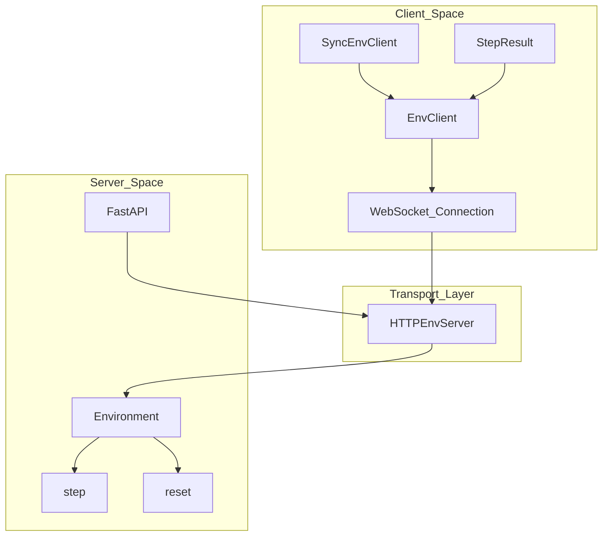
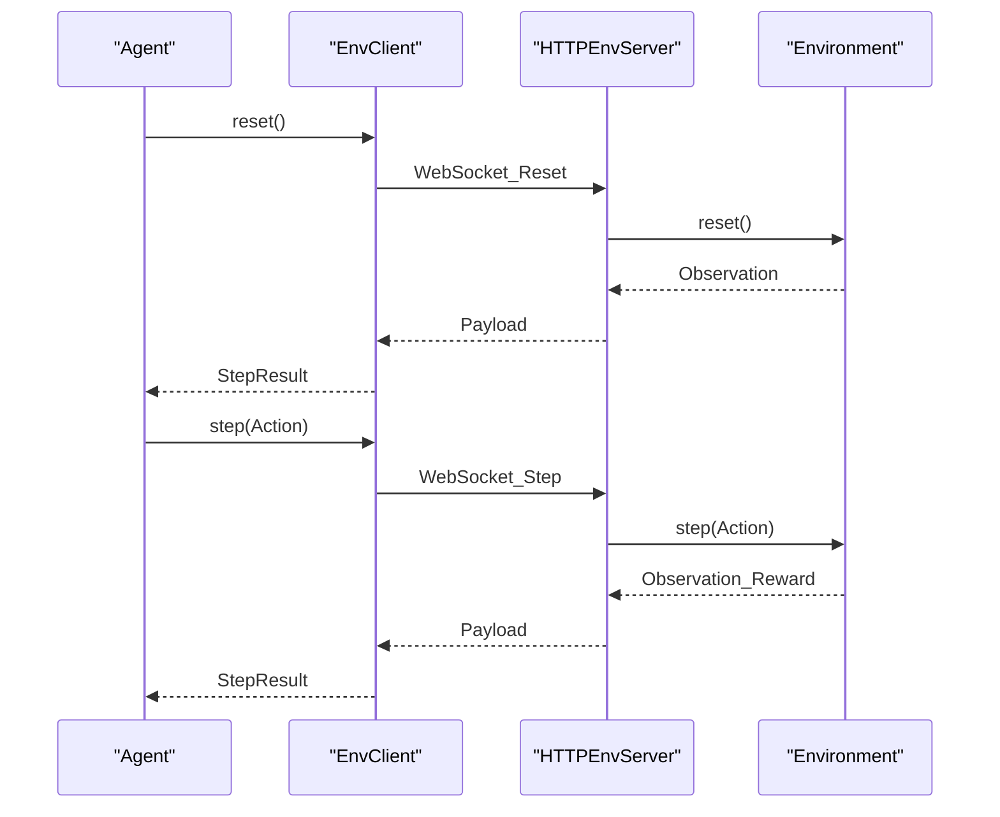

<!-- source: DeepWiki mcp.deepwiki.com · repo huggingface/OpenEnv · page 1 OpenEnv Overview · fetched 2026-10-26 -->

# OpenEnv Overview

Relevant source files

The following files were used as context for generating this wiki page:

- [README.md](README.md)
- [docs/source/_toctree.yml](docs/source/_toctree.yml)
- [docs/source/contributing.md](docs/source/contributing.md)
- [docs/source/environments.md](docs/source/environments.md)
- [docs/source/guides/async-sync.md](docs/source/guides/async-sync.md)
- [docs/source/guides/rewards.md](docs/source/guides/rewards.md)
- [docs/source/guides/simulation-vs-production.md](docs/source/guides/simulation-vs-production.md)
- [docs/source/guides/task-api.md](docs/source/guides/task-api.md)
- [docs/source/index.md](docs/source/index.md)
- [docs/source/tutorials/browsergym-harness.md](docs/source/tutorials/browsergym-harness.md)
- [docs/source/tutorials/harbor-harness.md](docs/source/tutorials/harbor-harness.md)
- [docs/source/tutorials/harnesses.md](docs/source/tutorials/harnesses.md)
- [docs/source/tutorials/index.md](docs/source/tutorials/index.md)
- [docs/source/tutorials/mcp-environment.md](docs/source/tutorials/mcp-environment.md)
- [docs/source/tutorials/openenv-tutorial.md](docs/source/tutorials/openenv-tutorial.md)
- [docs/source/tutorials/rubrics.md](docs/source/tutorials/rubrics.md)
- [examples/mcp_environment.ipynb](examples/mcp_environment.ipynb)
- [src/openenv/core/README.md](src/openenv/core/README.md)
- [tutorial/01-environments.md](tutorial/01-environments.md)

OpenEnv is an end-to-end framework for creating, deploying, and utilizing isolated execution environments for agentic reinforcement learning (RL) [README.md:1-4](). It provides a unified standard for interacting with complex agentic tasks—such as code generation, web browsing, or game playing—via familiar, Gymnasium-style APIs like `reset()`, `step()`, and `state()` [README.md:16-18]().

The purpose of this parent page is to introduce the high-level architecture and subsystems of OpenEnv. For detailed installation and guides, see [Getting Started](#1.1); for architecture specifics, see [Architecture and Design Principles](#1.2).

Sources: [README.md:1-4](), [README.md:16-18]()

## Key Design Principles

OpenEnv is built on several core architectural pillars defined in the project's design documents and guides:

*   **Container-First Isolation**: Every environment is packaged as a container (typically Docker), ensuring that untrusted agent code is executed in a secure, reproducible sandbox [README.md:17-18]().
*   **HTTP-Native Topology**: Environments are exposed as HTTP/WebSocket services, allowing training code to interact with environments across different processes, machines, or cloud providers [README.md:16-18](), [src/openenv/core/README.md:11-12]().
*   **Strong Type Safety**: Uses Pydantic and dataclass models for `Action`, `Observation`, and `State`, enabling robust IDE support and runtime validation [src/openenv/core/README.md:23-23](), [docs/source/tutorials/openenv-tutorial.md:29-30]().
*   **Dual-API Surface**: Supports both a **Simulation Mode** (Gym-style `step()` loop for RL training) and a **Production Mode** (Model Context Protocol / MCP for direct tool-use by agents) [README.md:21-22](), [docs/source/guides/simulation-vs-production.md:3-9]().

Sources: [README.md:16-22](), [src/openenv/core/README.md:11-24](), [docs/source/tutorials/openenv-tutorial.md:29-30](), [docs/source/guides/simulation-vs-production.md:3-9]()

## System Architecture

The OpenEnv architecture follows a client-server pattern where the client (running the RL policy or agent) communicates with an isolated server (the environment runtime) over WebSockets and HTTP routes.

### Logic Flow and Code Entity Mapping

The following diagram illustrates how natural language concepts map to specific code entities within the `openenv.core` package.

OpenEnv Entity Relationship Diagram

Sources: [src/openenv/core/README.md:19-27](), [src/openenv/core/README.md:182-192]()

### Component Interaction

OpenEnv environments are typically structured into models, server logic, and client interfaces.

Component Interaction Diagram

Sources: [README.md:16-18](), [src/openenv/core/README.md:182-197]()

## Core Subsystems

OpenEnv is composed of several subsystems that handle different parts of the agentic lifecycle:

*   **Core Framework**: Foundational building blocks in `openenv.core` including `EnvClient`, `HTTPEnvServer`, and the `ContainerProvider` interface [src/openenv/core/README.md:11-24]().
*   **MCP Integration**: Native support for the Model Context Protocol, allowing environments to expose their capabilities as standardized tools for LLM-based agents [README.md:21-22](), [docs/source/tutorials/mcp-environment.md:1-5]().
*   **Rubric System**: A composable reward computation engine supporting complex, trajectory-based scoring and LLM-as-a-judge patterns [README.md:22-23](), [docs/source/tutorials/rubrics.md:5-16]().
*   **Agentic Harness**: Infrastructure for integrating with evaluation harnesses like Inspect AI and driving rollouts through tool-calling interfaces [README.md:22-23](), [src/openenv/core/README.md:25-28]().
*   **CLI & Deployment**: The `openenv` command-line tool for scaffolding new environments and deploying them directly to Hugging Face Spaces [README.md:92-96]().

Sources: [README.md:21-23](), [src/openenv/core/README.md:11-28](), [docs/source/tutorials/mcp-environment.md:1-5](), [docs/source/tutorials/rubrics.md:5-16]()

## Next Steps

To dive deeper into specific areas of OpenEnv, refer to the following child pages:

*   **[Getting Started](#1.1)** — Installation instructions, environment setup, and dependency structures.
*   **[Architecture and Design Principles](#1.2)** — Detailed breakdown of container providers, client-server topology, RFCs, and simulation vs. production modes.

Sources: [docs/source/_toctree.yml:1-5]()

---

