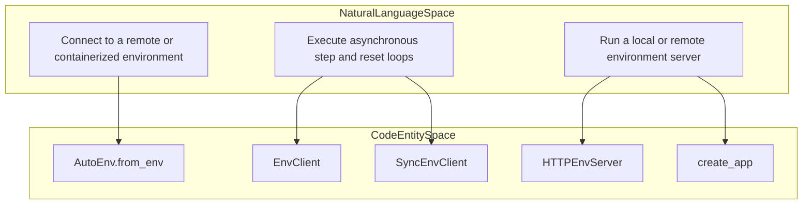
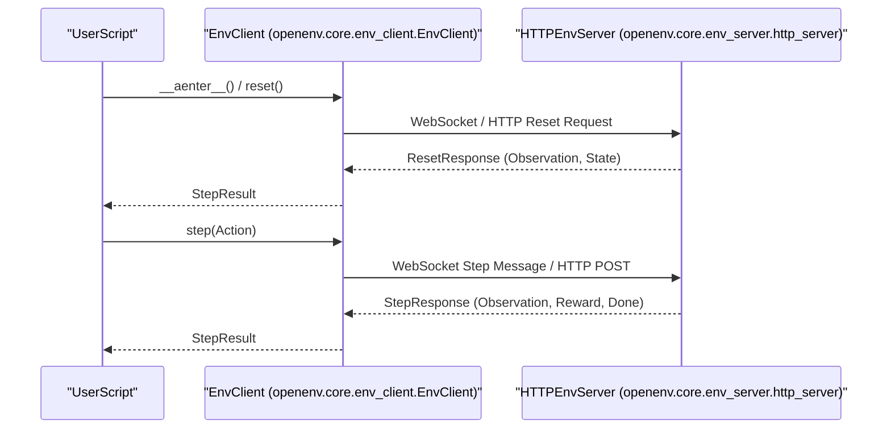

<!-- source: DeepWiki mcp.deepwiki.com · repo huggingface/OpenEnv · page 1.1 Getting Started · fetched 2026-10-26 -->

# Getting Started

<details>
<summary>Relevant source files</summary>

The following files were used as context for generating this wiki page:

- [docs/source/getting-started.md](docs/source/getting-started.md)
- [docs/source/getting_started/contributing-envs.md](docs/source/getting_started/contributing-envs.md)
- [docs/source/guides/runtime-providers.md](docs/source/guides/runtime-providers.md)
- [docs/source/reference/core.md](docs/source/reference/core.md)
- [envs/carla_env/uv.lock](envs/carla_env/uv.lock)
- [envs/grid_world_env/uv.lock](envs/grid_world_env/uv.lock)
- [envs/reasoning_gym_env/uv.lock](envs/reasoning_gym_env/uv.lock)
- [examples/openenv_building_environments.ipynb](examples/openenv_building_environments.ipynb)
- [examples/openenv_introduction_quickstart.ipynb](examples/openenv_introduction_quickstart.ipynb)
- [examples/openenv_using_environments.ipynb](examples/openenv_using_environments.ipynb)
- [pyproject.toml](pyproject.toml)
- [scripts/validation/reproduce.py](scripts/validation/reproduce.py)
- [scripts/validation/verify_artifacts.py](scripts/validation/verify_artifacts.py)
- [tests/test_core/conftest.py](tests/test_core/conftest.py)
- [tests/test_core/test_env_client_capacity.py](tests/test_core/test_env_client_capacity.py)
- [tests/test_core/test_env_client_headers.py](tests/test_core/test_env_client_headers.py)
- [tests/test_validation/integration/test_served_probe.py](tests/test_validation/integration/test_served_probe.py)
- [tests/test_validation/test_reproduction.py](tests/test_validation/test_reproduction.py)
- [tests/validation_runtime/pyproject.toml](tests/validation_runtime/pyproject.toml)
- [tests/validation_runtime/toolchain.json](tests/validation_runtime/toolchain.json)
- [tests/validation_runtime/uv.lock](tests/validation_runtime/uv.lock)

</details>


## Purpose and Scope

This page covers the installation of OpenEnv, core and optional dependency structures defined in `pyproject.toml`, the quickstart guide for interacting with environments via `AutoEnv` and `EnvClient`, environment server connection modes, the `openenv.yaml` configuration manifest, and the runtime data flow between clients, providers, and environment servers.

Sources: [pyproject.toml:1-76](), [docs/source/getting-started.md:1-165]()

---

## Installation and Dependency Structure

OpenEnv separates core framework functionality from heavy environment-specific dependencies or optional cloud providers. The core runtime requires minimal libraries like `fastapi`, `pydantic`, `uvicorn`, and `websockets` [pyproject.toml:17-38]().

### Core Installation

```bash
pip install openenv
```
[docs/source/getting-started.md:7-9]()

### Optional Dependency Groups

Optional integrations are defined as extras in `pyproject.toml` and can be installed via `pip install openenv[<extra>]` [pyproject.toml:40-73](), [docs/source/getting-started.md:18-26]():

| Extra | Pulls in | Reference / Purpose |
| :--- | :--- | :--- |
| `inspect` | `inspect-ai>=0.3.0` | Inspect AI evaluation harness integration [pyproject.toml:60-62]() |
| `harbor` | `harbor[...]` (Python 3.12+) | Black-box agent harness platform and sandbox backends [pyproject.toml:63-73]() |
| `daytona` | `daytona>=0.136.0`, `pyyaml` | Daytona cloud sandboxes [pyproject.toml:43-46]() |
| `aca` | `azure-containerapps-sandbox`, `azure-identity` | Azure Container Apps Sandboxes [pyproject.toml:47-52]() |
| `modal` | `modal>=1.4.0`, `pyyaml` | Modal sandboxes [pyproject.toml:53-56]() |
| `novita` | `novita-sandbox>=2.1.1` | Novita AI sandboxes [pyproject.toml:57-59]() |

Sources: [pyproject.toml:13-73](), [docs/source/getting-started.md:16-26]()

---

## Quickstart: Loading and Interacting with Environments

The `AutoEnv` class provides auto-discovery to load environment clients from Hugging Face Spaces or local Docker images without manual package imports [docs/source/getting-started.md:29-59]().

### Using `AutoEnv` with Remote Spaces

```python
from openenv import AutoEnv

env = AutoEnv.from_env(
    "openenv/echo_env",
    base_url="https://openenv-echo-env.hf.space",
)

with env.sync() as client:
    result = client.reset()
    print(result.observation.metadata["message"])

    message = client.call_tool("echo_message", message="Hello, OpenEnv!")
    print(message)
```
[docs/source/getting-started.md:33-47]()

### Asynchronous Client Operations

OpenEnv clients are asynchronous by default (`EnvClient`). For production loops or async frameworks, use `await client.step(...)` [docs/source/getting-started.md:61-86]().

```python
import asyncio
from echo_env import CallToolAction, EchoEnv

async def main():
    async with EchoEnv(base_url="https://openenv-echo-env.hf.space") as client:
        await client.reset()
        result = await client.step(
            CallToolAction(
                tool_name="echo_message",
                arguments={"message": "Hello, World!"},
            )
        )
        print(result.reward)

asyncio.run(main())
```
[docs/source/getting-started.md:67-86]()

Sources: [docs/source/getting-started.md:27-102](), [src/openenv/core/env_client.py:64-77]()

---

## Environment Manifest (`openenv.yaml`)

Every deployable OpenEnv environment contains an `openenv.yaml` manifest. It acts as the central contract parsed by the `openenv` CLI and container runtime providers during discovery, build, validation, and deployment operations.

Key configuration aspects typically declared in `openenv.yaml` include:
- Application entry point (`app`) pointing to the FastAPI ASGI instance [docs/source/getting-started.md:144-148]()
- Environment class identifiers and schema metadata [docs/source/getting-started.md:29-59]()
- Static and runtime validation policy references [docs/source/getting-started.md:52-56]()

Sources: [docs/source/getting-started.md:27-59](), [docs/source/getting-started.md:144-156]()

---

## Data Flow and Code Entities

OpenEnv separates the client application process from the isolated container or server where execution takes place. 

### Diagram 1: Natural Language to Code Entity Mapping (Client & Server Initialization)

**Title: NaturalLanguageToCodeMapping**

Sources: [docs/source/getting-started.md:27-102](), [docs/source/core.md:97-164]()

### Diagram 2: Interaction Sequence and Data Flow

**Title: ClientServerInteractionSequence**

Sources: [docs/source/core.md:135-168](), [src/openenv/core/env_client.py:64-101]()

---

