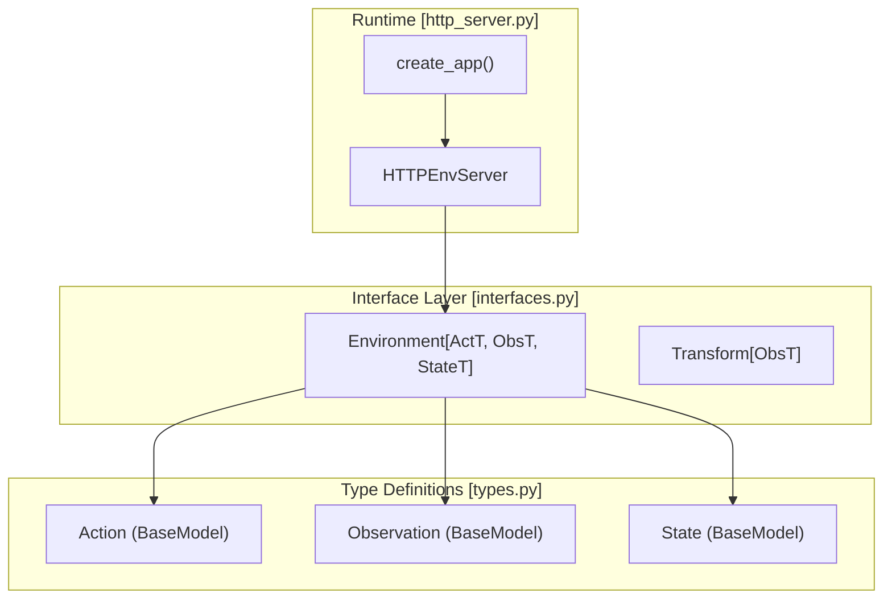
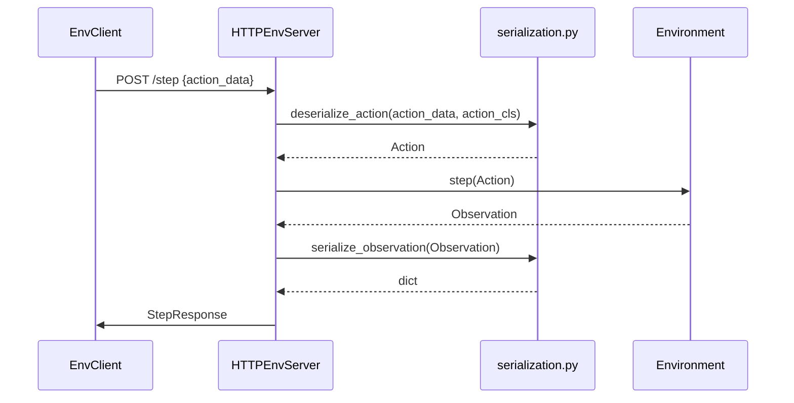

<!-- source: DeepWiki mcp.deepwiki.com · repo huggingface/OpenEnv · page 2 Core Framework · fetched 2026-10-26 -->

# Core Framework

Relevant source files

The following files were used as context for generating this wiki page:

- [README.md](README.md)
- [docs/source/contributing.md](docs/source/contributing.md)
- [docs/source/index.md](docs/source/index.md)
- [docs/source/tutorials/openenv-tutorial.md](docs/source/tutorials/openenv-tutorial.md)
- [examples/echo_mcp_demo.py](examples/echo_mcp_demo.py)
- [src/openenv/core/README.md](src/openenv/core/README.md)
- [src/openenv/core/__init__.py](src/openenv/core/__init__.py)
- [src/openenv/core/client_types.py](src/openenv/core/client_types.py)
- [src/openenv/core/env_server/__init__.py](src/openenv/core/env_server/__init__.py)
- [src/openenv/core/env_server/exceptions.py](src/openenv/core/env_server/exceptions.py)
- [src/openenv/core/env_server/http_server.py](src/openenv/core/env_server/http_server.py)
- [src/openenv/core/env_server/interfaces.py](src/openenv/core/env_server/interfaces.py)
- [src/openenv/core/env_server/mcp_types.py](src/openenv/core/env_server/mcp_types.py)
- [src/openenv/core/env_server/types.py](src/openenv/core/env_server/types.py)
- [tests/core/test_types_and_enums.py](tests/core/test_types_and_enums.py)
- [tutorial/01-environments.md](tutorial/01-environments.md)

The `src/openenv/core` package provides the central abstractions, communication protocols, and runtime primitives that enable interoperability between diverse agentic environments and the models that interact with them. It establishes a unified Gymnasium-style interface while simultaneously supporting the [MCP (Model Context Protocol) Integration](#2.3) for production tool-use.

For a detailed breakdown of each subsystem, follow the links to the child pages below.

---

## Central Abstractions

The framework is built around three primary primitives defined in `src/openenv/core/env_server/types.py` and `interfaces.py`: `Action`, `Observation`, and `State`. These classes leverage Pydantic for strict schema validation, runtime assignment checks, and serialization [src/openenv/core/env_server/types.py:50-191]().

The base `Environment` class coordinates state transitions via `reset()` and `step()` methods, while `Transform` allows observation augmentation following functional patterns [src/openenv/core/env_server/interfaces.py:201-223]().

### Core Entity Mapping
The following diagram bridges conceptual framework components to their concrete implementation classes in the codebase.

**Framework Component Architecture**

Sources: [src/openenv/core/env_server/interfaces.py:106-223](), [src/openenv/core/env_server/types.py:50-191](), [src/openenv/core/env_server/http_server.py:140-184]()

---

## Communication Protocols

OpenEnv supports dual communication pathways: a REST/WebSocket API for simulation and the Model Context Protocol (MCP) for tool discovery and execution.

### Gym-Style Simulation
In simulation mode, the framework follows a standard `reset()` and `step()` lifecycle [src/openenv/core/env_server/interfaces.py:100-198](). 
- **Reset**: Initializes the environment episode and returns the initial observation [src/openenv/core/env_server/types.py:90-123]().
- **Step**: Processes an `Action` payload and returns a `StepResponse` containing the resulting `Observation`, `reward`, and `done` flag [src/openenv/core/env_server/types.py:125-168]().

### MCP Integration
OpenEnv natively supports MCP, allowing environments to expose actions as discoverable tools over standard JSON-RPC 2.0 transport layers.

For details, see [MCP (Model Context Protocol) Integration](#2.3).

### Serialization Flow
The framework uses specialized serialization utilities to map incoming JSON payloads to Pydantic models and serialize observations back to transport formats [src/openenv/core/env_server/serialization.py:30-134]().

**Data Transformation Pipeline**

Sources: [src/openenv/core/env_server/serialization.py:30-169](), [src/openenv/core/env_server/types.py:125-168](), [src/openenv/core/env_server/interfaces.py:100-223]()

---

## Major Subsystems

### Environment Server
- **Child Page:** [Environment Server](#2.1)
- **Summary:** The server-side infrastructure handles HTTP and WebSocket connections, session management, and environment lifecycle. It relies on FastAPI for route registration and provides the `create_app` factory for instantiating environment applications [src/openenv/core/env_server/http_server.py:140-184]().

### Environment Client
- **Child Page:** [Environment Client](#2.2)
- **Summary:** Provides high-level Python client wrappers (`EnvClient`, `SyncEnvClient`, `GenericEnvClient`) managing WebSocket lifecycles, connection handshakes, and factory methods such as `from_docker_image()` [src/openenv/core/__init__.py:27-56]().

### MCP (Model Context Protocol) Integration
- **Child Page:** [MCP (Model Context Protocol) Integration](#2.3)
- **Summary:** Covers the dual API surface supporting Gym simulation mode alongside MCP production mode, including `MCPToolClient`, `MCPEnvironment`, JSON-RPC 2.0 transport, and `RESERVED_TOOL_NAMES` [src/openenv/core/env_server/__init__.py:17-39]().

### Rubric System (Reward Computation)
- **Child Page:** [Rubric System (Reward Computation)](#2.4)
- **Summary:** Implements reward computation abstractions via the `Rubric` base class, composable containers (`WeightedSum`, `Gate`, `Sequential`), and `LLMJudge` integrations [src/openenv/core/env_server/interfaces.py:201-223]().

### Container Providers and Runtime
- **Child Page:** [Container Providers and Runtime](#2.5)
- **Summary:** Abstracts container execution engines via the pluggable `ContainerProvider` interface (`LocalDockerProvider`, `DaytonaProvider`, `ModalProvider`, etc.), managing health monitoring and readiness probes.

### AutoEnv, Discovery, and Catalog
- **Child Page:** [AutoEnv, Discovery, and Catalog](#2.6)
- **Summary:** Covers dynamic environment discovery via `EnvironmentDiscovery`, `openenv.yaml` manifest parsing, catalog contracts (RFC 011), and the `OPENENV_TRUST_REMOTE_CODE` security flag.

### Agentic Harness and Data Collection
- **Child Page:** [Agentic Harness and Data Collection](#2.7)
- **Summary:** Details runtime harness primitives (`ResourceSession`, `MCPHarnessAdapter`, bridge/events modules) and the `collect.py` rollout serialization pipeline.

### LLM Client and Evaluation Harnesses
- **Child Page:** [LLM Client and Evaluation Harnesses](#2.8)
- **Summary:** Defines the `LLMClient` abstraction (`OpenAIClient`, `AnthropicClient`), tool-schema transformations, and integration with `EvalHarness` and `InspectAIHarness`.

### Harbor (Black-Box Agent Harness Platform)
- **Child Page:** [Harbor (Black-Box Agent Harness Platform)](#2.9)
- **Summary:** Overviews running coding-agent harnesses (Claude Code, OpenCode) on Harbor tasks inside isolated sandboxes while capturing traces and model interactions.

Sources: [src/openenv/core/__init__.py:27-56](), [src/openenv/core/env_server/http_server.py:140-184](), [src/openenv/core/env_server/interfaces.py:201-223]()

---

