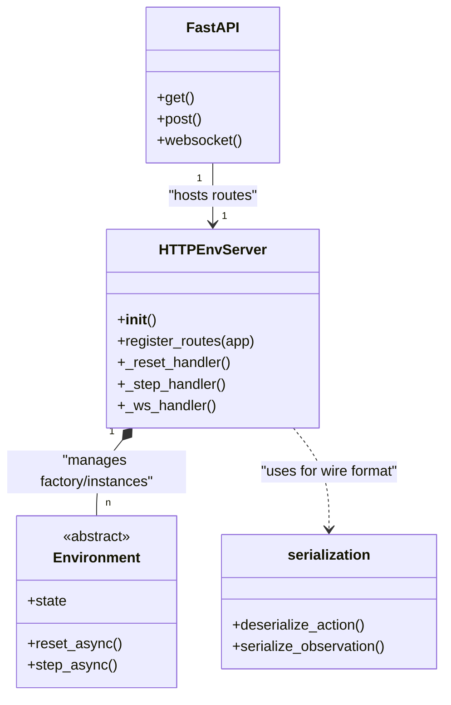
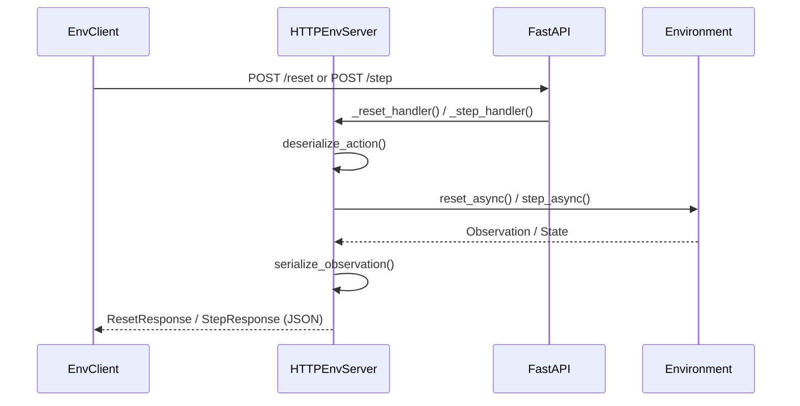

<!-- source: DeepWiki mcp.deepwiki.com · repo huggingface/OpenEnv · page 2.1 Environment Server · fetched 2026-10-26 -->

# Environment Server

Relevant source files

The following files were used as context for generating this wiki page:

- [.claude/hooks/check-line-endings.sh](.claude/hooks/check-line-endings.sh)
- [.gitattributes](.gitattributes)
- [AGENTS.md](AGENTS.md)
- [envs/echo_env/openenv.yaml](envs/echo_env/openenv.yaml)
- [envs/openspiel_env/openenv.yaml](envs/openspiel_env/openenv.yaml)
- [examples/echo_mcp_demo.py](examples/echo_mcp_demo.py)
- [src/openenv/cli/commands/serve.py](src/openenv/cli/commands/serve.py)
- [src/openenv/core/__init__.py](src/openenv/core/__init__.py)
- [src/openenv/core/client_types.py](src/openenv/core/client_types.py)
- [src/openenv/core/env_server/__init__.py](src/openenv/core/env_server/__init__.py)
- [src/openenv/core/env_server/exceptions.py](src/openenv/core/env_server/exceptions.py)
- [src/openenv/core/env_server/http_server.py](src/openenv/core/env_server/http_server.py)
- [src/openenv/core/env_server/interfaces.py](src/openenv/core/env_server/interfaces.py)
- [src/openenv/core/env_server/mcp_types.py](src/openenv/core/env_server/mcp_types.py)
- [src/openenv/core/env_server/route_config.py](src/openenv/core/env_server/route_config.py)
- [src/openenv/core/env_server/serialization.py](src/openenv/core/env_server/serialization.py)
- [src/openenv/core/env_server/types.py](src/openenv/core/env_server/types.py)
- [tests/core/test_mcp/test_mcp_types.py](tests/core/test_mcp/test_mcp_types.py)
- [tests/core/test_route_config.py](tests/core/test_route_config.py)
- [tests/core/test_types_and_enums.py](tests/core/test_types_and_enums.py)
- [tests/core/test_web_interface_mcp.py](tests/core/test_web_interface_mcp.py)

This page provides a deep technical dive into the server-side infrastructure of OpenEnv, covering `HTTPEnvServer`, FastAPI route registration, WebSocket session management, concurrency configuration, serialization, declarative route configuration via `route_config`, the `create_app` factory, and simulation versus production server modes.

---

### Core Architecture: `HTTPEnvServer` and `create_app`

The `HTTPEnvServer` class is the central orchestrator responsible for exposing OpenEnv [`Environment`]([src/openenv/core/env_server/interfaces.py:223]()) instances over network protocols. It wraps an environment factory callable and handles the lifecycle of environment instances, translating incoming HTTP requests and WebSocket messages into method calls on the underlying environment.

**Server Entity Mapping to Code Entities**

Sources: [src/openenv/core/env_server/http_server.py:140-218](), [src/openenv/core/env_server/interfaces.py:223-225](), [src/openenv/core/env_server/serialization.py:43-185]()

---

### FastAPI Route Registration & Declarative `route_config`

The server exposes both stateless REST endpoints and stateful WebSocket channels. To reduce boilerplate in route setup, OpenEnv utilizes declarative configuration objects defined in `route_config.py` [src/openenv/core/env_server/route_config.py:1-8]() alongside direct FastAPI route bindings in `HTTPEnvServer`.

#### Request Processing Flow

**Environment Server Request Data Flow**

Sources: [src/openenv/core/env_server/http_server.py:343-415](), [src/openenv/core/env_server/serialization.py:43-185]()

---

### WebSocket Session Management and Concurrency Configuration

OpenEnv supports both single-session and multi-session concurrency configurations governed by `ConcurrencyConfig` [src/openenv/core/env_server/types.py:265-279]() and enforced by custom exceptions [src/openenv/core/env_server/exceptions.py:14-40]().

*   **Concurrency Limits**: `max_concurrent_envs` restricts the number of active WebSocket sessions.
*   **Safety Checks**: If `max_concurrent_envs > 1`, the server checks whether the environment is explicitly marked with `SUPPORTS_CONCURRENT_SESSIONS = True`. If not, a [`ConcurrencyConfigurationError`]([src/openenv/core/env_server/exceptions.py:14-40]()) is raised at startup.
*   **Session Isolation**: Each WebSocket session spins up a dedicated environment instance via the factory callable and uses a thread pool executor to prevent blocking operations from starving the main event loop [src/openenv/core/env_server/http_server.py:173-216]().

Sources: [src/openenv/core/env_server/http_server.py:173-216](), [src/openenv/core/env_server/exceptions.py:14-65]()

---

### Serialization and Deserialization Pipeline

Data passing between clients and servers is strictly validated and converted using Pydantic models. 

*   **Action Deserialization**: [`deserialize_action`]([src/openenv/core/env_server/serialization.py:43-72]()) and [`deserialize_action_with_preprocessing`]([src/openenv/core/env_server/serialization.py:74-145]()) convert incoming JSON dictionaries into strongly typed [`Action`]([src/openenv/core/env_server/types.py:50-66]()) subclasses, automatically handling MCP protocol payloads (`list_tools`, `call_tool`) through discriminator mapping.
*   **Observation Serialization**: [`serialize_observation`]([src/openenv/core/env_server/serialization.py:147-185]()) formats an [`Observation`]([src/openenv/core/env_server/types.py:68-88]()) instance into the exact wire structure expected by [`EnvClient`]([src/openenv/core/__init__.py:28]()), cleanly separating fields like `observation`, `reward`, `done`, and `metadata`.

Sources: [src/openenv/core/env_server/serialization.py:1-185](), [src/openenv/core/env_server/types.py:50-88]()

---

### Simulation vs. Production Server Modes

OpenEnv servers can be initialized in different operating modes represented by the [`ServerMode`]([src/openenv/core/env_server/types.py:18-23]()) enum:

| Server Mode | Target Use Case | Behavior & Restrictions |
| :--- | :--- | :--- |
| `ServerMode.SIMULATION` | Training, offline rollouts, RL benchmarks | Full environment access, diagnostic tool visibility, resets enabled. |
| `ServerMode.PRODUCTION` | Deployment, evaluation harnesses, agents | Restricts simulation-only tools, restricts state inspection, enforces safety constraints. |

Sources: [src/openenv/core/env_server/types.py:18-23](), [src/openenv/core/env_server/mcp_environment.py:169-174]()

---

