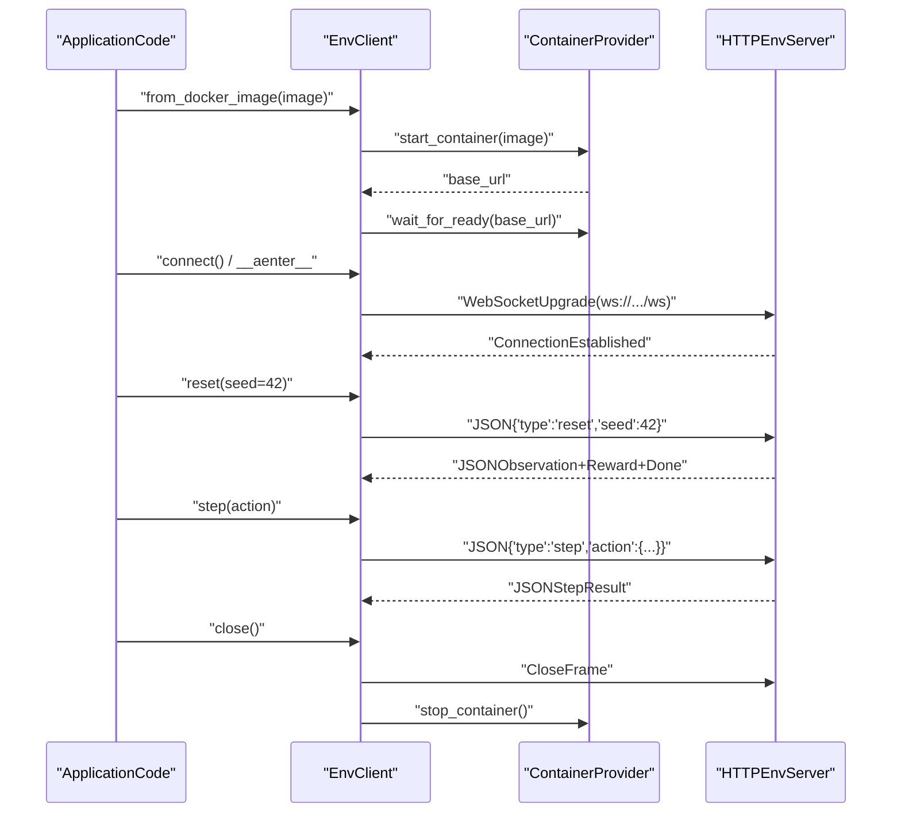
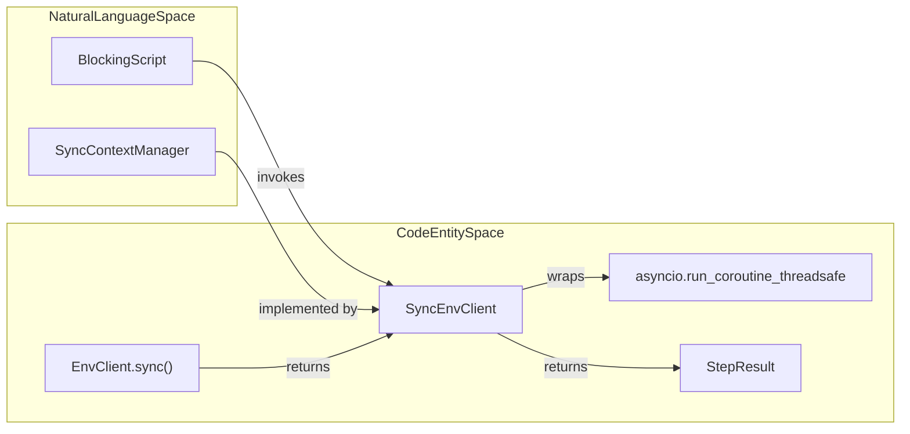

<!-- source: DeepWiki mcp.deepwiki.com · repo huggingface/OpenEnv · page 2.2 Environment Client · fetched 2026-10-26 -->

# Environment Client

Relevant source files

The following files were used as context for generating this wiki page:

- [docs/source/environments/sophistry_bench_sprint.md](docs/source/environments/sophistry_bench_sprint.md)
- [envs/chess_env/client.py](envs/chess_env/client.py)
- [envs/sophistry_bench_sprint_env/README.md](envs/sophistry_bench_sprint_env/README.md)
- [envs/sophistry_bench_sprint_env/__init__.py](envs/sophistry_bench_sprint_env/__init__.py)
- [envs/sophistry_bench_sprint_env/client.py](envs/sophistry_bench_sprint_env/client.py)
- [envs/sophistry_bench_sprint_env/models.py](envs/sophistry_bench_sprint_env/models.py)
- [envs/sophistry_bench_sprint_env/openenv.yaml](envs/sophistry_bench_sprint_env/openenv.yaml)
- [envs/sophistry_bench_sprint_env/pyproject.toml](envs/sophistry_bench_sprint_env/pyproject.toml)
- [envs/sophistry_bench_sprint_env/server/__init__.py](envs/sophistry_bench_sprint_env/server/__init__.py)
- [envs/sumo_rl_env/client.py](envs/sumo_rl_env/client.py)
- [examples/sophistry_bench_sprint_grpo.py](examples/sophistry_bench_sprint_grpo.py)
- [src/openenv/auto/auto_env.py](src/openenv/auto/auto_env.py)
- [src/openenv/core/env_client.py](src/openenv/core/env_client.py)
- [src/openenv/core/utils.py](src/openenv/core/utils.py)
- [tests/envs/test_auto_env.py](tests/envs/test_auto_env.py)
- [tests/envs/test_client_step_result_contract.py](tests/envs/test_client_step_result_contract.py)
- [tests/test_core/test_client_provider_cleanup.py](tests/test_core/test_client_provider_cleanup.py)
- [tests/test_core/test_client_provider_cleanup_docker.py](tests/test_core/test_client_provider_cleanup_docker.py)
- [tests/test_core/test_generic_client.py](tests/test_core/test_generic_client.py)

This page covers the core client abstractions in OpenEnv (`EnvClient`, `SyncEnvClient`, `GenericEnvClient`), the WebSocket communication lifecycle, factory methods (`from_docker_image`, `from_env`, `from_hub`), the `StepResult` data container, and the `.sync()` wrapper.

## Core Client Architecture

The OpenEnv client subsystem is designed around a persistent WebSocket connection that eliminates the overhead of HTTP request-response cycles during multi-step episodes. 

### Client Hierarchy and Roles

| Class | Role | Implementation Detail |
| :--- | :--- | :--- |
| `EnvClient` | Abstract Base | Manages WebSocket connections, message timeouts, session creation, and protocol serialization. |
| `GenericEnvClient` | Concrete Implementation | General-purpose client handling arbitrary dictionary-based or model-based actions and observations. |
| `SyncEnvClient` | Synchronous Wrapper | Provides a blocking interface for standard synchronous training loops and scripts using an internal background event loop. |
| `AutoEnv` | Factory Class | Automatically discovers, installs, and instantiates the correct client class for a given environment key or Hugging Face Hub repository. |

Sources: `[src/openenv/core/env_client.py:41-65]`, `[src/openenv/auto/auto_env.py:118-152]`, `[src/openenv/core/sync_client.py:20-50]`

---

## Communication Lifecycle

When an environment client initializes via factory methods like `from_docker_image` or `from_hub`, it yields a `_BootstrapResult` handle that defers container startup and connection until awaited or invoked via `.sync()` [src/openenv/core/env_client.py:107-181](). Once connected, interactions follow a persistent WebSocket session lifecycle.

### WebSocket Interaction Flow

Sources: `[src/openenv/core/env_client.py:148-224]`, `[src/openenv/core/containers/runtime/providers.py:44-98]`

---

## Factory Methods and Discovery

Environments can be instantiated through multiple factory patterns depending on the deployment topology.

### `from_env` and `AutoEnv`
The `AutoEnv.from_env(name)` method parses the target environment name or Hugging Face Hub repository identifier, checks local installations, downloads dependencies if necessary (using `uv pip` or standard pip), and dynamically loads the target `EnvClient` subclass [src/openenv/auto/auto_env.py:118-179]().

### `from_docker_image` and `_BootstrapResult`
Factory methods like `from_docker_image` return a `_BootstrapResult` handle. This lazy evaluation container supports both asynchronous usage (`await handle`) and synchronous usage (`handle.sync()`), preventing container leaks and managing cleanup if initialization fails [src/openenv/core/env_client.py:107-181]().

Sources: `[src/openenv/auto/auto_env.py:118-179]`, `[src/openenv/core/env_client.py:107-181]`

---

## Data Structures: StepResult

Every environment interaction through `reset()` or `step()` returns a `StepResult` instance containing standard reinforcement learning rollout components [src/openenv/core/client_types.py:10-27]().

| Attribute | Type | Description |
| :--- | :--- | :--- |
| `observation` | `ObsT` | The environment-specific observation payload (e.g., text, bounding boxes, DOM nodes). |
| `reward` | `Optional[float]` | Scalar reward computed by the server-side rubric. |
| `done` | `bool` | Terminal flag indicating episode termination. |
| `metadata` | `Optional[Dict[str, Any]]` | Additional diagnostic information or debugging components. |

Sources: `[src/openenv/core/client_types.py:10-27]`

---

## Implementation Details: Sync vs Async and Lifecycle Management

The base `EnvClient` is fully asynchronous using `websockets.asyncio.client`. To bridge this into synchronous training pipelines, the `.sync()` method wraps calls using `SyncEnvClient` [src/openenv/core/env_client.py:10-31]().

### Natural Language Space to Code Entity Space Mapping

Sources: `[src/openenv/core/env_client.py:10-31]`, `[src/openenv/core/sync_client.py:20-50]`

### WebSocket Configuration
* **Payload Limits**: WebSocket message size limits default to 100MB to support large payloads such as screenshots and HTML DOM trees [src/openenv/core/env_client.py:108-108]().
* **Proxy Bypassing**: Automatically detects `localhost` or `127.0.0.1` addresses and updates environment proxy variables to prevent local container traffic interception [src/openenv/core/env_client.py:180-193]().

Sources: `[src/openenv/core/env_client.py:100-200]`, `[src/openenv/core/env_server/serialization.py:30-65]`

---

