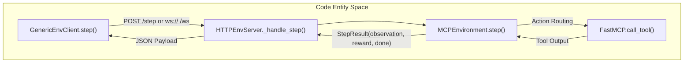
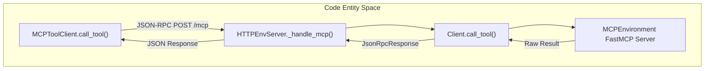

<!-- source: DeepWiki mcp.deepwiki.com · repo huggingface/OpenEnv · page 2.3 MCP (Model Context Protocol) Integration · fetched 2026-10-26 -->

# MCP (Model Context Protocol) Integration

<details>
<summary>Relevant source files</summary>

The following files were used as context for generating this wiki page:

- [envs/chess_env/server/rubrics.py](envs/chess_env/server/rubrics.py)
- [envs/echo_env/server/echo_environment.py](envs/echo_env/server/echo_environment.py)
- [envs/finqa_env/server/finqa_environment.py](envs/finqa_env/server/finqa_environment.py)
- [envs/finqa_env/server/tools.py](envs/finqa_env/server/tools.py)
- [examples/modal_echo_env.py](examples/modal_echo_env.py)
- [src/openenv/core/env_server/mcp_environment.py](src/openenv/core/env_server/mcp_environment.py)
- [src/openenv/core/mcp_client.py](src/openenv/core/mcp_client.py)
- [src/openenv/core/rubrics/__init__.py](src/openenv/core/rubrics/__init__.py)
- [src/openenv/core/rubrics/llm_judge.py](src/openenv/core/rubrics/llm_judge.py)
- [tests/core/test_mcp/test_mcp_client.py](tests/core/test_mcp/test_mcp_client.py)
- [tests/core/test_mcp/test_mcp_integration.py](tests/core/test_mcp/test_mcp_integration.py)
- [tests/core/test_mode_selection.py](tests/core/test_mode_selection.py)
- [tests/core/test_production_mode_mcp.py](tests/core/test_production_mode_mcp.py)
- [tests/core/test_production_mode_routes.py](tests/core/test_production_mode_routes.py)
- [tests/core/test_rubrics/test_llm_judge.py](tests/core/test_rubrics/test_llm_judge.py)
- [tests/core/test_simulation_mode_preserves_api.py](tests/core/test_simulation_mode_preserves_api.py)
- [tests/envs/test_chess_rubric_migration.py](tests/envs/test_chess_rubric_migration.py)
- [tests/envs/test_finqa_environment.py](tests/envs/test_finqa_environment.py)

</details>


OpenEnv integrates the Model Context Protocol (MCP) to standardize how agents interact with tools across different simulation and production environments. This page details the dual API surface supporting both Gym-style reinforcement learning (RL) training and production inference serving, along with the underlying client and server architectures, JSON-RPC 2.0 transport, session management, and reserved tool restrictions.

---

## Dual API Surface: Simulation vs. Production

OpenEnv environments support two distinct operational modes determined by the client and server configuration (`mode="simulation"` vs. `mode="production"`). These modes control whether the environment exposes trajectory-based RL primitives or direct tool-serving RPC endpoints.

| Feature | Simulation Mode (`simulation`) | Production Mode (`production`) |
| :--- | :--- | :--- |
| **Primary Use Case** | RL training, policy evaluation, trajectory logging | Live inference, agentic tool execution, production deployment |
| **Active Endpoints** | `/ws`, `/reset`, `/step`, `/state` | `/mcp`, `/ws`, `/health`, `/schema`, `/metadata` |
| **Tool Execution** | Wrapped via `step(CallToolAction(...))` | Direct JSON-RPC 2.0 calls via `/mcp` or WebSocket |
| **Feedback Signals** | Rewards (`reward`), completion (`done`), step counters | Raw tool execution output only |
| **Session Model** | Episode-oriented resets | Persistent tool session state |

Sources: `[src/openenv/core/mcp_client.py:16-31]`, `[tests/core/test_production_mode_routes.py:100-130]()`

### Data Flow: Simulation Mode
In simulation mode, the orchestrator drives the environment through explicit episode boundaries using `reset()` and `step()`. Tool invocations are encapsulated within `CallToolAction` structures and return `StepResult` objects containing rewards and done flags.


*Sources: `[src/openenv/core/mcp_client.py:28-30]`, `[src/openenv/core/env_server/mcp_environment.py:133-145]()`*

### Data Flow: Production Mode
In production mode, simulation control routes (`/reset`, `/step`, `/state`) are disabled to prevent state manipulation and causality violations. Clients interact directly with the underlying MCP server through JSON-RPC 2.0 messages over `/mcp` or WebSocket connections.


*Sources: `[src/openenv/core/mcp_client.py:30-31]`, `[tests/core/test_production_mode_routes.py:140-176]()`*

---

## Core MCP Classes and Implementation

### `MCPEnvironment`
`MCPEnvironment` serves as the base class for environments exposing tools via FastMCP `[src/openenv/core/env_server/mcp_environment.py:133-138]()`. It bridges FastMCP server definitions with OpenEnv's execution lifecycle.

- **Tool Registration & Validation**: During initialization `__init__`, the environment validates all registered tool names against `RESERVED_TOOL_NAMES` `[src/openenv/core/env_server/mcp_environment.py:186-188]()`.
- **Action Handling**: It automatically maps incoming `ListToolsAction` and `CallToolAction` requests to the underlying FastMCP server instance `[src/openenv/core/env_server/mcp_environment.py:141-145]()`.
- **Mode-Aware Tools**: Supports registering tools visible exclusively in specific modes via `@self.tool(mode="production")` or `@self.tool(mode="simulation")` `[src/openenv/core/env_server/mcp_environment.py:28-36]()`.

### `MCPToolClient`
`MCPToolClient` inherits from `MCPClientBase` and provides asynchronous and synchronous tool discovery and invocation interfaces `[src/openenv/core/mcp_client.py:77-105]()`.

- **Mode Enforcement**: Enforces `mode="production"` upon initialization, raising a `ValueError` if simulation mode is requested directly on an MCP client `[src/openenv/core/mcp_client.py:146-157]()`.
- **Tool Discovery**: `list_tools()` queries the server and caches tool schemas in `self._tools_cache` `[src/openenv/core/mcp_client.py:104-105]()`.
- **Tool Invocation**: `call_tool(tool_name, **kwargs)` dispatches tool execution requests and handles response parsing `[src/openenv/core/mcp_client.py:42-45]()`.

Sources: `[src/openenv/core/env_server/mcp_environment.py:133-198]`, `[src/openenv/core/mcp_client.py:77-175]()`

---

## JSON-RPC 2.0 Transport and Tool Discovery

Communication across production endpoints adheres strictly to the JSON-RPC 2.0 specification. 

- **Transport Endpoints**: Requests are sent via HTTP POST to `/mcp` or over WebSocket connections `[src/openenv/core/env_client.py:1-50]`.
- **Payload Structure**: JSON-RPC requests contain `jsonrpc: "2.0"`, a unique request `id`, a `method` string (e.g., `tools/list` or `tools/call`), and a `params` dictionary `[tests/core/test_mcp/test_mcp_client.py:72-100]()`.
- **Error Handling**: Standard JSON-RPC error codes are returned upon failure, categorizing errors into transport faults, tool execution exceptions, and missing tools (`ToolErrorType.TOOL_NOT_FOUND`) `[src/openenv/core/env_server/mcp_types.py:33-50]`, `[tests/core/test_mcp/test_mcp_client.py:182-201]()`.

### Tool Discovery Schema
Tools are serialized into OpenEnv's internal `Tool` model, which normalizes input schemas across different FastMCP server versions:

```python
class Tool(BaseModel):
    name: str
    description: str
    input_schema: Dict[str, Any]
```
Sources: `[src/openenv/core/env_server/mcp_types.py:183-200]`, `[src/openenv/core/mcp_client.py:76-82]()`

---

## Session Management and Reserved Tool Names

### Session Management
In production mode, clients manage persistent execution sessions to maintain context across stateful tool calls:
1. **Initialization**: The client establishes a connection and acquires a session handle `[src/openenv/core/mcp_client.py:170-172]()`.
2. **Locking & Concurrency**: Session synchronization locks (`_production_session_lock`, `_production_connect_lock`) prevent race conditions during concurrent asynchronous tool calls `[src/openenv/core/mcp_client.py:171-173]()`.

### `RESERVED_TOOL_NAMES`
To prevent namespace collisions between agent-accessible tools and the OpenEnv execution and control plane, `MCPEnvironment` explicitly prohibits registering tools under reserved control names `[src/openenv/core/env_server/mcp_environment.py:186-187]()`.

The reserved tool names are:
- `reset`
- `step`
- `state`
- `close`

Attempting to register a tool matching any of these strings raises a `ValueError` during environment instantiation.

Sources: `[src/openenv/core/env_server/mcp_types.py:16-17]`, `[src/openenv/core/env_server/mcp_environment.py:186-188]`

---

