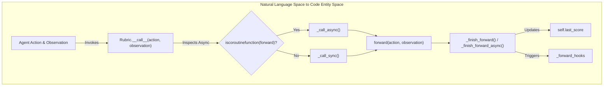
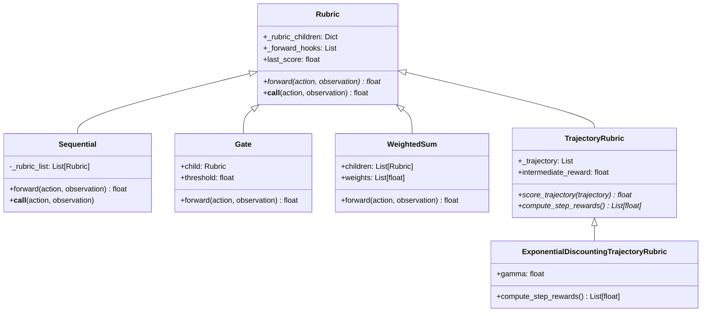

<!-- source: DeepWiki mcp.deepwiki.com · repo huggingface/OpenEnv · page 2.4 Rubric System (Reward Computation) · fetched 2026-10-26 -->

# Rubric System (Reward Computation)

Relevant source files

The following files were used as context for generating this wiki page:

- [.claude/agents/alignment-reviewer.md](.claude/agents/alignment-reviewer.md)
- [.claude/agents/build-validator.md](.claude/agents/build-validator.md)
- [.claude/agents/env-validator.md](.claude/agents/env-validator.md)
- [.claude/agents/openenv-architect.md](.claude/agents/openenv-architect.md)
- [.claude/docs/INVARIANTS.md](.claude/docs/INVARIANTS.md)
- [.claude/docs/PATTERNS.md](.claude/docs/PATTERNS.md)
- [.claude/docs/PRINCIPLES.md](.claude/docs/PRINCIPLES.md)
- [.claude/hooks/check-debug.sh](.claude/hooks/check-debug.sh)
- [rfcs/004-rubrics.md](rfcs/004-rubrics.md)
- [src/openenv/core/rubrics/base.py](src/openenv/core/rubrics/base.py)
- [src/openenv/core/rubrics/containers.py](src/openenv/core/rubrics/containers.py)
- [src/openenv/core/rubrics/trajectory.py](src/openenv/core/rubrics/trajectory.py)
- [tests/core/test_rubrics/test_async_base_rubric.py](tests/core/test_rubrics/test_async_base_rubric.py)
- [tests/core/test_rubrics/test_pre_hook_bugs.py](tests/core/test_rubrics/test_pre_hook_bugs.py)

The Rubric system is OpenEnv's first-class abstraction for computing rewards. Modeled after PyTorch's `nn.Module`, it provides a composable, hierarchical framework for multi-criteria reward evaluation [rfcs/004-rubrics.md:1-5](). Rubrics allow environment authors to break down complex reward logic into small, reusable components that support introspection, serialization, hooks, and asynchronous evaluation [rfcs/004-rubrics.md:10-30]().

---

## 1. The Rubric Base Class

The foundation of the reward system is the abstract base class `Rubric` defined in `src/openenv/core/rubrics/base.py` [src/openenv/core/rubrics/base.py:17-36](). Subclasses must implement the `forward(self, action, observation) -> float` method [src/openenv/core/rubrics/base.py:159-170]().

### Key Mechanisms
*   **Auto-Registration**: When a `Rubric` instance is assigned as an attribute on another rubric via `__setattr__`, it is automatically registered into `_rubric_children`, enabling recursive inspection [src/openenv/core/rubrics/base.py:50-55]().
*   **Synchronous and Asynchronous Execution**: The `__call__` method inspects whether `forward()` or any registered hook is a coroutine function (`inspect.iscoroutinefunction`), seamlessly branching into sync or async execution paths [src/openenv/core/rubrics/base.py:56-81]().
*   **Observability Hooks**: Supports pre-forward hooks (`_forward_pre_hooks`) and post-forward hooks (`_forward_hooks`) to capture execution telemetry without mutating reward values [src/openenv/core/rubrics/base.py:39-40](), [rfcs/004-rubrics.md:162-164]().
*   **Score Tracking**: The `last_score` attribute records the most recent return value of `__call__`, enabling training harnesses to log component scores [src/openenv/core/rubrics/base.py:41-48]().

*Sources:* [src/openenv/core/rubrics/base.py:17-182](), [rfcs/004-rubrics.md:35-50]()

---

## 2. Composable Containers

Similar to PyTorch's container modules, OpenEnv provides composable container rubrics in `src/openenv/core/rubrics/containers.py` to aggregate reward signals [rfcs/004-rubrics.md:119-122]().

### Container Types and Semantics
*   **`Sequential`**: Evaluates child rubrics in order. If any child returns a score of `0.0`, execution halts immediately (fail-fast) and returns `0.0`. This models hierarchical gating (e.g., verifying syntax before running execution or tests) [src/openenv/core/rubrics/containers.py:27-43](), [rfcs/004-rubrics.md:123]().
*   **`Gate`**: Wraps a single rubric and applies a threshold filter. If the child score meets or exceeds the threshold, it passes through; otherwise, it returns `0.0` [rfcs/004-rubrics.md:125]().
*   **`WeightedSum`**: Combines multiple rubrics via a weighted linear combination, utilizing parallel evaluation where applicable [rfcs/004-rubrics.md:127]().

*Sources:* [src/openenv/core/rubrics/base.py:17-55](), [src/openenv/core/rubrics/containers.py:27-43](), [src/openenv/core/rubrics/trajectory.py:22-190]()

*Sources:* [src/openenv/core/rubrics/base.py:1-182](), [src/openenv/core/rubrics/containers.py:1-172](), [rfcs/004-rubrics.md:119-160]()

---

## 3. Trajectory Rubrics

For delayed reward environments where outcomes are known only at episode termination (e.g., board games, multi-step planning), OpenEnv provides `TrajectoryRubric` in `src/openenv/core/rubrics/trajectory.py` [src/openenv/core/rubrics/trajectory.py:1-14]().

### Mechanics and Credit Assignment
*   **Accumulation**: Non-terminal steps return an `intermediate_reward` (default `0.0`), while storing `(action, observation)` pairs in CPU memory [src/openenv/core/rubrics/trajectory.py:62-91]().
*   **Termination Scoring**: When `observation.done` is true, `score_trajectory()` evaluates the entire episode history [src/openenv/core/rubrics/trajectory.py:87-105]().
*   **`ExponentialDiscountingTrajectoryRubric`**: Subclass that applies temporal discounting ($r_t = \gamma^{T-1-t} \cdot R_{\text{final}}$) across the episode trajectory once completed [src/openenv/core/rubrics/trajectory.py:138-190]().

*Sources:* [src/openenv/core/rubrics/trajectory.py:1-211]()

---

## 4. Environment Step Lifecycle Integration

Rubrics execute exclusively on the **environment server** during the `step()` cycle [rfcs/004-rubrics.md:50-64](). The environment base class requires a `rubric` attribute initialized in its constructor [rfcs/004-rubrics.md:55-75]().

*Sources:* [rfcs/004-rubrics.md:50-75](), [.claude/docs/PATTERNS.md:112-130]()

*Sources:* [rfcs/004-rubrics.md:50-75](), [.claude/docs/PATTERNS.md:112-130]()

---

